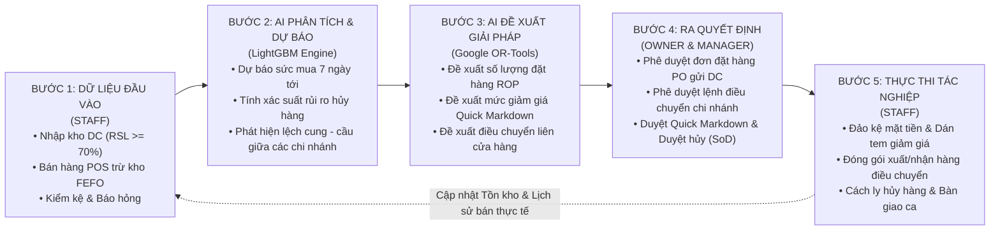

# ĐẶC TẢ CHI TIẾT USER STORIES & NGHIỆP VỤ CHUỖI CUNG ỨNG THEO 3 ACTOR (26 NHÓM NGHIỆP VỤ)

**Đề tài:** Hệ thống Quản lý Chuỗi Cung ứng Thực phẩm Thông minh Ứng dụng AI (SmartSupply AI / Supply Chain Spoilage Predictor)  
**Đơn vị:** Khoa Công nghệ Thông tin - Trường Đại học Lạc Hồng (LHU)  
**Giảng viên hướng dẫn:** ThS. Lê Minh Nhật  
**Nhóm sinh viên thực hiện:** Đỗ Tấn Du (123001364) & Đoàn Minh Quân (123000946)  
**Cơ sở dữ liệu:** Microsoft SQL Server LocalDB `(localdb)\mssqllocaldb` (`retail_spoilage_db` – 15 bảng chuẩn 3NF)  
**Tài liệu tham chiếu:** [Biên bản góp ý đồ án](file:///c:/thuyet%20minh/Docs/bienban_gopy_doan_thayhuongdan.md) & [Phân tích nghiệp vụ 3 Actor](file:///c:/thuyet%20minh/Docs/SmartSupply_AI_Phan_tich_nghiep_vu_3_Actor.md)

---

## I. TỔNG QUAN BÀI TOÁN THỰC TẾ, QUY MÔ CHUỖI & CẤU TRÚC 3 ACTOR

### 1.1 Giải quyết bài toán thực tế từ 1 cửa hàng đơn lẻ đến chuỗi 3–30 chi nhánh
Hệ thống được thiết kế linh hoạt thông qua định danh `store_id` liên kết bảng `store_profile`, đáp ứng trọn vẹn cả 2 mô hình vận hành ngoài doanh nghiệp bán lẻ thực phẩm (FMCG / Fresh Food):
1. **Chế độ Cửa hàng Đơn lẻ (Single-Store Mode - 1 chi nhánh):**
   * Quản lý trọn vẹn vòng đời lô hàng từ khi nhập tại cổng Kho tổng (DC Biên Hòa) với kiểm định độ tươi `RSL >= 70%`, xuất bán lẻ tại quầy POS theo nguyên tắc **FEFO (First Expired, First Out - hết hạn trước xuất trước)**, cảnh báo hạn dùng 3 vùng màu (Xanh / Vàng / Đỏ), giảm giá xả hàng **Quick Markdown** (15%–50%), đảo kệ mặt tiền và tiêu hủy gắn liền Sổ hao hụt tài chính.
   * Khi vận hành 1 cửa hàng, mô hình AI (**LightGBM** + **Google OR-Tools**) tập trung tối ưu lượng đặt hàng bổ sung (**ROP**) từ Kho tổng DC và đề xuất mức giảm giá xả hàng tại chỗ.
2. **Chế độ Chuỗi Cửa hàng (Multi-Store Chain Mode - từ 3 đến 30 chi nhánh; MVP triển khai 3 chi nhánh tại TP. Biên Hòa):**
   * Gồm: **Chi nhánh 1 (`RETAIL-STORE-01` - LHU Mart Bửu Long)**, **Chi nhánh 2 (`RETAIL-STORE-02` - LHU Mart Tam Hiệp)**, **Chi nhánh 3 (`RETAIL-STORE-03` - LHU Mart Trảng Dài)**.
   * Trong thực tế bán lẻ chuỗi, cùng một mặt hàng (ví dụ: Sữa tươi thanh trùng hoặc Bánh mì tươi) có thể bị **tồn đọng cận date tại Chi nhánh A** (do mưa lớn hoặc khu vực vắng khách), nhưng lại **cháy hàng tại Chi nhánh B** cách đó vài km.
   * Thay vì để Chi nhánh A phải đại hạ giá 50% hoặc tiêu hủy mất trắng 100% vốn trong khi Chi nhánh B phải đặt nhập lô mới từ DC, thuật toán tối ưu **Google OR-Tools** kết hợp dự báo 7 ngày của **LightGBM** sẽ phát hiện chênh lệch cung – cầu và đề xuất **Lệnh điều chuyển nội bộ liên cửa hàng (`stock_transfers`)** từ Chi nhánh A sang Chi nhánh B nếu giá trị cứu vãn lớn hơn chi phí vận chuyển nội bộ.

### 1.2 Tinh gọn và chuẩn hóa 3 Actor chính trong hệ thống
Tiếp thu góp ý của ThS. Lê Minh Nhật, hệ thống chuẩn hóa các vai trò tác nghiệp thành **03 Actor chính** (gộp Thu ngân và Nhân viên kho/quầy kệ thành một vai trò **STAFF** đa nhiệm đúng với thực tế vận hành cửa hàng tiện lợi quy mô vừa và nhỏ):

| Mã Actor | Tên Vai Trò | Mã Role trong CSDL (`roles.code`) | Phạm vi Dữ liệu (`Data Scope`) | Số Nhóm Nghiệp vụ | Trách nhiệm Cốt lõi trong Chuỗi Cung ứng |
| :---: | :--- | :---: | :--- | :---: | :--- |
| **Actor 1** | **OWNER** *(Chủ chuỗi / Admin)* | `ADMIN` / `OWNER` | Toàn chuỗi (`ALL STORES`: Chi nhánh 1..N) | **10 nhóm** (`US-OWN-01` $\rightarrow$ `10`) | Quản trị nhân sự & phân quyền RBAC, quản lý danh mục chi nhánh & sản phẩm gốc, giám sát tồn kho/tài chính toàn chuỗi, xem dự báo AI vĩ mô, phê duyệt đơn nhập DC lớn & phê duyệt điều chuyển liên chi nhánh. |
| **Actor 2** | **MANAGER** *(Quản lý cửa hàng)* | `MANAGER` | Chi nhánh được giao (`store_id` cố định) | **9 nhóm** (`US-MGR-01` $\rightarrow$ `09`) | Điều hành trực tiếp 1 chi nhánh: theo dõi KPI cửa hàng, kiểm soát lô hàng cận date, kích hoạt Quick Markdown, duyệt tiêu hủy hàng hỏng (SoD), lập/duyệt đơn nhập hàng và đề xuất điều chuyển hàng dư sang chi nhánh khác. |
| **Actor 3** | **STAFF** *(Nhân viên cửa hàng)* | `STAFF` *(tương thích `CASHIER`, `WAREHOUSE_STAFF`)* | Tác nghiệp tại quầy & kho của chi nhánh (`store_id`) | **7 nhóm** (`US-STF-01` $\rightarrow$ `07`) | Trực tiếp thu thập dữ liệu đầu vào: bán hàng POS trừ kho FEFO, kiểm nhận xe tải DC (`RSL >= 70%`), đảo kệ mặt tiền 5 bước, lập phiếu báo hỏng/cận date và đóng gói/giao nhận hàng điều chuyển giữa các chi nhánh. |

---

## II. ĐẶC TẢ USER STORIES CHI TIẾT CHO ACTOR 1: OWNER (CHỦ CHUỖI / ADMIN) — 10 NHÓM NGHIỆP VỤ

### 1. Nhóm nghiệp vụ OWNER 01: Quản lý tài khoản và phân quyền (`US-OWN-01`)
* **User Story (Ai – Làm gì – Để làm gì):**
  > **Là một** Chủ chuỗi cửa hàng (`OWNER`), **tôi muốn** tạo mới tài khoản nhân sự, gán vai trò (`MANAGER`, `STAFF`), phân công chi nhánh làm việc (`store_id`) và khóa/mở khóa tài khoản hoặc cấp lại mật khẩu, **để** kiểm soát chặt chẽ quyền truy cập hệ thống và đảm bảo mỗi nhân sự chỉ thao tác đúng chức trách tại cửa hàng được giao.
* **Luồng thao tác nghiệp vụ thực tế:**
  1. `OWNER` truy cập màn hình **Quản trị Nhân sự & Phân quyền RBAC**.
  2. Tạo tài khoản mới với thông tin: Họ tên, Username, Email, Số điện thoại, Vai trò (`MANAGER` hoặc `STAFF`), và Chi nhánh trực thuộc (`RETAIL-STORE-01`, `02`, hoặc `03`).
  3. Khi nhân viên nghỉ việc hoặc nghi ngờ lộ mật khẩu, `OWNER` thực hiện khóa tài khoản (`status = 'LOCKED'`) hoặc Reset mật khẩu có ghi nhận lý do.
* **Tiêu chí nghiệm thu (Acceptance Criteria):**
  * **AC1:** Hệ thống chặn tuyệt đối thao tác tự khóa hoặc tự hạ quyền của chính tài khoản `OWNER` đang đăng nhập (`Self-Protection Rule`).
  * **AC2:** Mật khẩu lưu trong bảng `users.password_hash` bắt buộc băm bằng `bcrypt` (Salt rounds $\ge 10$); tài khoản nhập sai mật khẩu 5 lần liên tiếp tự động khóa tạm thời 15 phút (`locked_until`).
  * **AC3:** Mọi thay đổi tạo/sửa/khóa/reset mật khẩu đều sinh bản ghi bất biến trong `system_audit_logs`.
* **Ánh xạ CSDL & API:** Bảng `users`, `roles`, `store_profile`, `system_audit_logs` | API: `GET/POST/PUT /api/users`, `PATCH /api/users/:id/status`, `POST /api/users/:id/reset-password`.

---

### 2. Nhóm nghiệp vụ OWNER 02: Quản lý chuỗi cửa hàng (`US-OWN-02`)
* **User Story:**
  > **Là một** Chủ chuỗi cửa hàng (`OWNER`), **tôi muốn** thêm mới, cập nhật thông tin cấu hình của các chi nhánh thuộc chuỗi (mã chi nhánh, địa chỉ, Cửa hàng trưởng phụ trách, Kho tổng DC cấp hàng, ngưỡng `RSL` tối thiểu và khung giờ hoạt động), **để** mở rộng quy mô chuỗi từ 1 lên 3–30 cửa hàng và chuẩn hóa tiêu chuẩn vận hành trên toàn hệ thống.
* **Luồng thao tác nghiệp vụ thực tế:**
  1. `OWNER` xem danh sách toàn bộ chi nhánh trong chuỗi (`RETAIL-STORE-01` Bửu Long, `RETAIL-STORE-02` Tam Hiệp, `RETAIL-STORE-03` Trảng Dài).
  2. `OWNER` thêm chi nhánh mới hoặc chỉnh sửa thông số vận hành: Cửa hàng trưởng (`manager_id`), thời gian giao hàng từ DC (`default_lead_time_days = 1`), ngưỡng độ tươi nhận hàng (`min_inbound_rsl_percent = 70%`), ngưỡng cảnh báo Vàng (`standard_warning_days = 7`) và Đỏ (`critical_days = 3`).
* **Tiêu chí nghiệm thu (Acceptance Criteria):**
  * **AC1:** Mã cửa hàng (`store_code`) là duy nhất (`UNIQUE`); mỗi cửa hàng liên kết khóa ngoại hợp lệ tới `users(id)` (`manager_id`) và `suppliers(id)` (`default_dc_supplier_id`).
  * **AC2:** Khi chuyển trạng thái cửa hàng sang `CLOSED` hoặc `MAINTENANCE`, hệ thống chặn phát sinh đơn bán lẻ POS mới tại chi nhánh đó.
* **Ánh xạ CSDL & API:** Bảng `store_profile`, `users`, `suppliers` | API: `GET /api/store/profile`, `PUT /api/store/profile`.

---

### 3. Nhóm nghiệp vụ OWNER 03: Quản lý danh mục sản phẩm, ngành hàng & nhà cung cấp (`US-OWN-03`)
* **User Story:**
  > **Là một** Chủ chuỗi cửa hàng (`OWNER`), **tôi muốn** quản lý tập trung danh mục Ngành hàng (`categories`), Nhà cung cấp/Kho tổng (`suppliers`) và Danh mục Sản phẩm chuẩn (`products`) gồm mã SKU, Barcode, giá vốn nhập, giá bán niêm yết và hạn sử dụng chuẩn, **để** đồng bộ dữ liệu hàng hóa và giá bán thống nhất trên toàn bộ các cửa hàng trong chuỗi.
* **Luồng thao tác nghiệp vụ thực tế:**
  1. `OWNER` thiết lập nhóm ngành hàng bảo quản lạnh/mát/khô (`categories`: Sữa tươi, Bánh mì tươi, Thịt cá mát, Rau củ quả) kèm ngưỡng cảnh báo cận date mặc định (`default_warning_days`) và dải nhiệt độ bảo quản.
  2. `OWNER` thêm mới hoặc cập nhật sản phẩm (`products`) và liên kết với Kho tổng cung ứng (`default_supplier_id`).
* **Tiêu chí nghiệm thu (Acceptance Criteria):**
  * **AC1 (Rule 9 - Chống trùng lặp sản phẩm):** Hệ thống tự động chuẩn hóa chuỗi tiếng Việt và chặn thêm mới nếu trùng mã `sku`/`barcode` hoặc tên sản phẩm tương đồng ngữ nghĩa $\ge 85\%$.
  * **AC2:** Giá bán niêm yết (`selling_price`) phải lớn hơn hoặc bằng giá vốn nhập chuẩn (`import_price > 0`).
* **Ánh xạ CSDL & API:** Bảng `categories`, `suppliers`, `products` | API: `GET/POST/PUT /api/catalog/products`, `GET/POST /api/catalog/categories`, `GET/POST /api/suppliers`.

---

### 4. Nhóm nghiệp vụ OWNER 04: Giám sát kho và đơn hàng toàn chuỗi (`US-OWN-04`)
* **User Story:**
  > **Là một** Chủ chuỗi cửa hàng (`OWNER`), **tôi muốn** theo dõi bức tranh tồn kho thực tế theo từng lô hàng (`batches`), lịch sử phiếu nhập kho (`goods_receipts`), hóa đơn xuất bán (`sales_history`) và đơn đặt hàng (`purchase_orders`) của toàn bộ các chi nhánh, **để** nắm bắt tức thời nơi nào đang thừa hàng hoặc đứt hàng mà không phải chờ báo cáo thủ công cuối tháng.
* **Luồng thao tác nghiệp vụ thực tế:**
  1. `OWNER` chọn bộ lọc chi nhánh (`Tất cả chi nhánh` hoặc từng cửa hàng `RETAIL-STORE-01`, `02`, `03`).
  2. Quan sát tổng tồn kho khả dụng, tổng giá trị vốn tồn kho đang nằm tại từng cửa hàng và trạng thái các đơn PO đang gửi về Kho tổng DC.
* **Tiêu chí nghiệm thu (Acceptance Criteria):**
  * **AC1:** Hiển thị chính xác số lượng tồn hiện tại (`current_quantity`), ngày hết hạn (`expiry_date`), số ngày còn lại (`days_remaining`) và chi nhánh sở hữu (`store_id`) của mọi lô hàng.
  * **AC2:** Hỗ trợ truy vết ngược từ bất kỳ lô hàng nào về phiếu nhập kho gốc (`goods_receipts`) và đơn đặt hàng (`purchase_orders`).
* **Ánh xạ CSDL & API:** Bảng `batches`, `goods_receipts`, `purchase_orders`, `sales_history`, View `vw_Batches_ShelfLife_Alerts` | API: `GET /api/batches`, `GET /api/sales/history`, `GET /api/forecast/purchase-orders`.

---

### 5. Nhóm nghiệp vụ OWNER 05: Dự báo nhu cầu tiêu thụ bằng AI toàn chuỗi (`US-OWN-05`)
* **User Story:**
  > **Là một** Chủ chuỗi cửa hàng (`OWNER`), **tôi muốn** xem kết quả dự báo sức mua 7 ngày tới (`predicted_demand_7d`) từ mô hình học máy **LightGBM** cho từng sản phẩm tại từng chi nhánh kèm các yếu tố thời tiết, thứ trong tuần và ngày lễ, **để** chủ động kế hoạch chuẩn bị nguồn hàng tại Kho tổng DC và phân bổ hàng hóa hợp lý cho toàn chuỗi.
* **Luồng thao tác nghiệp vụ thực tế:**
  1. `OWNER` mở phân hệ **Dự báo Nhu cầu AI & Tối ưu Đặt hàng**.
  2. Hệ thống hiển thị biểu đồ và bảng dự báo nhu cầu tiêu thụ 7 ngày tới của từng SKU theo từng cửa hàng, so sánh giữa **Tồn kho hiện tại (`current_stock`)** và **Sức mua dự báo 7 ngày (`predicted_demand_7d`)**.
* **Tiêu chí nghiệm thu (Acceptance Criteria):**
  * **AC1:** Kết quả dự báo được tính toán từ mô hình **LightGBM** tích hợp biến ngoại cảnh (Thời tiết `weather_factor`, Ngày lễ `holiday_factor`, Lịch sử bán 14 ngày) và lưu vết vào bảng `ai_forecasts`.
  * **AC2:** Hiển thị rõ độ tin cậy của mô hình và phân loại trạng thái cung-cầu của từng cửa hàng (`THIẾU HÀNG - CẦN NHẬP`, `CÂN BẰNG`, hoặc `DƯ THỪA - NGUY CƠ HỦY`).
* **Ánh xạ CSDL & API:** Bảng `ai_forecasts`, `sales_history`, `batches`, `products` | API: `GET /api/forecast/rop`, `GET /api/ai/forecasts`.

---

### 6. Nhóm nghiệp vụ OWNER 06: Quản lý rủi ro lãng phí toàn chuỗi (`US-OWN-06`)
* **User Story:**
  > **Là một** Chủ chuỗi cửa hàng (`OWNER`), **tôi muốn** giám sát danh sách các lô hàng đang nằm trong **Vùng Vàng (Cảnh báo)**, **Vùng Đỏ (Nguy kịch)** hoặc có xác suất rủi ro hủy cao (`spoilage_risk_prob` từ AI) trên toàn chuỗi, **để** chỉ đạo kịp thời các giải pháp xả hàng hoặc điều chuyển trước khi thực phẩm hết hạn gây thiệt hại vốn.
* **Luồng thao tác nghiệp vụ thực tế:**
  1. `OWNER` xem bảng cảnh báo **Expiry Watchdog & AI Spoilage Risk** toàn chuỗi.
  2. Hệ thống tính toán lượng hàng tồn dư dự kiến không kịp bán trước ngày hết hạn:
     $$\text{Overstock\_At\_Risk} = \max\left(0,\ \text{CurrentStock} - \text{PredictedDemand}_{\text{days\_left}}\right)$$
  3. Cảnh báo đỏ các lô có `DOS > DUE` (Số ngày bán hết tồn kho lớn hơn số ngày hạn dùng còn lại).
* **Tiêu chí nghiệm thu (Acceptance Criteria):**
  * **AC1:** Phân loại chính xác 3 vùng màu theo chuẩn SSOT: **Vùng Xanh** (`DaysLeft > WarningDays`), **Vùng Vàng** (`3 < DaysLeft <= WarningDays`), **Vùng Đỏ** (`0 < DaysLeft <= 3`), và khóa cứng **Hết hạn** (`DaysLeft <= 0`).
  * **AC2:** Tính chính xác **Tổng Giá Trị Vốn Đang Rủi Ro (`At-Risk Capital Value`)** theo từng chi nhánh để `OWNER` so sánh mức độ tuân thủ FEFO giữa các Cửa hàng trưởng.
* **Ánh xạ CSDL & API:** Bảng `batches`, `ai_forecasts`, `spoilage_records`, View `vw_Batches_ShelfLife_Alerts` | API: `GET /api/batches/alerts`, `GET /api/dashboard/summary`.

---

### 7. Nhóm nghiệp vụ OWNER 07: Quản lý và phê duyệt đề xuất nhập hàng (`US-OWN-07`)
* **User Story:**
  > **Là một** Chủ chuỗi cửa hàng (`OWNER`), **tôi muốn** xem xét và phê duyệt (hoặc điều chỉnh, từ chối) các đơn đề xuất đặt hàng bổ sung (`purchase_orders`) do thuật toán **Google OR-Tools / ROP** tính toán và được Quản lý cửa hàng gửi lên, **để** kiểm soát ngân sách nhập hàng toàn chuỗi và ngăn chặn việc đặt hàng dư thừa gây tồn đọng.
* **Luồng thao tác nghiệp vụ thực tế:**
  1. Hệ thống AI/ROP đề xuất lượng đặt hàng tối ưu `optimal_order_qty` cho các mặt hàng chạm ngưỡng `ROP` tại từng cửa hàng.
  2. `OWNER` kiểm tra cảnh báo `DOS > DUE` trên đơn PO; nếu hợp lệ thì nhấn **Phê duyệt & Phát hành đơn tới DC (`APPROVED` $\rightarrow$ `SUBMITTED`)**.
* **Tiêu chí nghiệm thu (Acceptance Criteria):**
  * **AC1:** Tuân thủ nguyên tắc bất kiêm nhiệm (**SoD**): Người phê duyệt đơn (`approved_by`) được lưu tách biệt với người lập đề xuất (`created_by`).
  * **AC2:** Hệ thống hiển thị cảnh báo chặn nếu đơn đặt hàng chứa SKU đang có lô cận date tồn đọng vượt ngưỡng an toàn tại chính cửa hàng đó.
* **Ánh xạ CSDL & API:** Bảng `purchase_orders`, `purchase_order_items`, `ai_forecasts`, `system_audit_logs` | API: `POST /api/forecast/purchase-orders`, `PATCH /api/forecast/purchase-orders/:id/status`.

---

### 8. Nhóm nghiệp vụ OWNER 08: Quản lý điều phối hàng hóa liên chi nhánh (`US-OWN-08`)
* **User Story:**
  > **Là một** Chủ chuỗi cửa hàng (`OWNER`), **tôi muốn** xem các phương án điều chuyển hàng cận date/tồn dư từ chi nhánh bán chậm sang chi nhánh bán mạnh do thuật toán **Google OR-Tools** đề xuất và thực hiện phê duyệt lệnh điều chuyển (`stock_transfers`), **để** cân bằng tồn kho toàn chuỗi, cứu vãn doanh thu và giảm tối đa lượng thực phẩm phải tiêu hủy.
* **Luồng thao tác nghiệp vụ thực tế:**
  1. Mô hình **LightGBM** phát hiện Chi nhánh A (`from_store_id`) đang dư thừa lô hàng sắp hết hạn trong khi Chi nhánh B (`to_store_id`) có sức mua cao và sắp thiếu hàng.
  2. Bộ giải **Google OR-Tools** tính toán số lượng điều chuyển tối ưu (`transfer_qty`) sao cho:
     $$\text{Giá trị thu hồi ước tính} > \text{Chi phí vận chuyển nội bộ (`transfer_cost`)}$$
  3. `OWNER` xem xét phiếu điều chuyển trạng thái `PROPOSED` / `PENDING` và bấm **Phê duyệt Điều chuyển (`APPROVED`)** để giao nhiệm vụ cho 2 cửa hàng thực hiện xuất – nhận.
* **Tiêu chí nghiệm thu (Acceptance Criteria):**
  * **AC1:** Ràng buộc CSDL `CK_StockTransfers_DifferentStores` đảm bảo cửa hàng xuất (`from_store_id`) khác cửa hàng nhận (`to_store_id`) và số lượng điều chuyển không vượt quá tồn khả dụng của lô nguồn (`source_batch_id`).
  * **AC2:** Khi `OWNER` phê duyệt hoặc từ chối lệnh điều chuyển, hệ thống ghi nhận `approved_by`, `approved_at` và lưu vết vào `system_audit_logs`.
* **Ánh xạ CSDL & API:** Bảng `stock_transfers`, `ai_forecasts`, `batches`, `store_profile` | API: `GET/POST /api/stock-transfers`, `PATCH /api/stock-transfers/:id/approve`.

---

### 9. Nhóm nghiệp vụ OWNER 09: Báo cáo và phân tích hiệu quả toàn chuỗi (`US-OWN-09`)
* **User Story:**
  > **Là một** Chủ chuỗi cửa hàng (`OWNER`), **tôi muốn** xem bảng điều hành Dashboard tổng hợp 6 chỉ số KPI tài chính (Tổng doanh thu, Giá trị tồn kho, Tổn thất hủy hàng `CostLoss`, Giá trị vốn thu hồi nhờ xả hàng/điều chuyển, Tỷ lệ lãng phí `Spoilage Rate %` và Độ chính xác dự báo AI) của toàn chuỗi và so sánh giữa các chi nhánh, **để** đánh giá hiệu quả kinh doanh và hiệu quả chống lãng phí của hệ thống AI.
* **Luồng thao tác nghiệp vụ thực tế:**
  1. `OWNER` truy cập **Dashboard Điều hành Chuỗi** và **Sổ Hao hụt Tài chính (`spoilage_records`)**.
  2. Xem biểu đồ xu hướng doanh thu vs. tổn thất hủy hàng theo thời gian, tỷ lệ `Spoilage Rate %` theo ngành hàng và bảng xếp hạng hiệu quả vận hành giữa 3 chi nhánh.
* **Tiêu chí nghiệm thu (Acceptance Criteria):**
  * **AC1:** Công thức tính tỷ lệ hao hụt chuẩn xác:
    $$\text{Spoilage Rate (\%)} = \frac{\sum \text{CostLoss}}{\sum \text{ImportValue}} \times 100\%$$
  * **AC2:** Hỗ trợ xuất báo cáo tài chính & kiểm kê ra định dạng CSV/In ấn chuẩn mực phục vụ họp hội đồng quản trị.
* **Ánh xạ CSDL & API:** Bảng `sales_history`, `spoilage_records`, `batches`, `stock_transfers`, `ai_forecasts` | API: `GET /api/dashboard/summary`, `GET /api/spoilage/analytics`.

---

### 10. Nhóm nghiệp vụ OWNER 10: Cấu hình và giám sát kiểm toán hệ thống (`US-OWN-10`)
* **User Story:**
  > **Là một** Chủ chuỗi cửa hàng (`OWNER`), **tôi muốn** tra cứu **Nhật ký Kiểm toán Bất biến (`system_audit_logs`)** và lịch sử **Biên bản Bàn giao Ca (`Shift Handover`)** trên toàn hệ thống theo người dùng, loại hành động, thời gian và địa chỉ IP, **để** phát hiện kịp thời mọi hành vi gian lận, sửa giá trái phép hoặc chênh lệch quỹ tiền mặt tại các cửa hàng.
* **Luồng thao tác nghiệp vụ thực tế:**
  1. `OWNER` mở màn hình **Nhật ký Kiểm toán Hệ thống (`AuditLogView`)**.
  2. Lọc theo loại sự kiện (`CHECKOUT_FEFO`, `MARKDOWN_APPLY`, `DISPOSAL_APPROVE`, `STOCK_TRANSFER`, `USER_ROLE_CHANGE`, `SHIFT_HANDOVER`) và xem chi tiết JSON `old_values` $\rightarrow$ `new_values`.
* **Tiêu chí nghiệm thu (Acceptance Criteria):**
  * **AC1 (Rule 11 - Immutable Audit Log):** Bảng `system_audit_logs` chỉ cho phép ghi thêm (`INSERT`), tuyệt đối không có API xóa (`DELETE`) hoặc sửa (`UPDATE`) lịch sử kiểm toán.
  * **AC2:** Chỉ Actor `OWNER` (`ADMIN`) mới có quyền truy cập toàn bộ nhật ký kiểm toán hệ thống; các vai trò thấp hơn bị chặn bằng `roleMiddleware` (HTTP `403 Forbidden`).
* **Ánh xạ CSDL & API:** Bảng `system_audit_logs`, `users` | API: `GET /api/audit-logs`.

---

## III. ĐẶC TẢ USER STORIES CHI TIẾT CHO ACTOR 2: MANAGER (QUẢN LÝ CỬA HÀNG) — 9 NHÓM NGHIỆP VỤ

### 11. Nhóm nghiệp vụ MANAGER 01: Xem Dashboard điều hành cửa hàng (`US-MGR-01`)
* **User Story:**
  > **Là một** Quản lý cửa hàng (`MANAGER`), **tôi muốn** theo dõi Dashboard thời gian thực của riêng chi nhánh mình phụ trách (doanh thu trong ngày, số lô chạm Vùng Vàng/Đỏ, các nhiệm vụ khẩn cấp trên **Action Board ca trực** và tình trạng bàn giao ca), **để** điều phối nhân viên xử lý ngay các điểm nóng vận hành đầu mỗi ca làm việc.
* **Luồng thao tác nghiệp vụ thực tế:**
  1. Ngay sau khi đăng nhập, `MANAGER` được đưa thẳng vào **Dashboard Cửa hàng** của chi nhánh mình (`store_id`).
  2. Xem bảng **Action Board Ca Trực** liệt kê các lô hàng cần kích hoạt giảm giá ngay, các lô chưa đảo kệ mặt tiền và các phiếu tiêu hủy đang chờ duyệt.
* **Tiêu chí nghiệm thu (Acceptance Criteria):**
  * **AC1:** Dữ liệu KPI và biểu đồ phản ánh đúng phạm vi chi nhánh của `MANAGER` theo thời gian thực.
  * **AC2:** Từ mỗi dòng cảnh báo trên Action Board, `MANAGER` có thể bấm nút thao tác nhanh (1-Click Action) để mở ngay Modal xử lý tương ứng.
* **Ánh xạ CSDL & API:** Bảng `batches`, `sales_history`, `spoilage_records`, `store_profile` | API: `GET /api/dashboard/summary`.

---

### 12. Nhóm nghiệp vụ MANAGER 02: Quản lý tồn kho và vòng đời hạn sử dụng (`US-MGR-02`)
* **User Story:**
  > **Là một** Quản lý cửa hàng (`MANAGER`), **tôi muốn** kiểm soát chi tiết từng lô hàng nhập – xuất – tồn tại kho cửa hàng (`batches`), theo dõi chỉ số hạn dùng còn lại (`DaysLeft` và `RSL %`) và giám sát việc thực hiện đảo kệ FEFO của nhân viên, **để** đảm bảo không có lô hàng nào bị bỏ quên trong kho đến khi quá hạn.
* **Luồng thao tác nghiệp vụ thực tế:**
  1. `MANAGER` mở màn hình **Giám sát Hạn dùng FEFO (`FefoMonitorView`)** và **Tiếp nhận Kho (`DcIntakeView`)**.
  2. Lọc các lô hàng theo ngành hàng, trạng thái hạn dùng (`SAFE`, `WARNING`, `CRITICAL`, `EXPIRED`) và trạng thái đảo kệ (`is_shelf_rotated`).
* **Tiêu chí nghiệm thu (Acceptance Criteria):**
  * **AC1:** Các lô hàng luôn được sắp xếp ưu tiên theo thứ tự hạn sử dụng gần nhất lên đầu (`expiry_date ASC` - **Rule 2**).
  * **AC2:** Các lô có `DaysLeft <= 0` tự động chuyển trạng thái `EXPIRED` và khóa cứng không cho xuất bán POS (**Rule 5**).
* **Ánh xạ CSDL & API:** Bảng `batches`, `products`, `goods_receipts`, View `vw_Batches_ShelfLife_Alerts` | API: `GET /api/batches`, `GET /api/batches/alerts`.

---

### 13. Nhóm nghiệp vụ MANAGER 03: Quản lý đơn hàng và giao dịch tại cửa hàng (`US-MGR-03`)
* **User Story:**
  > **Là một** Quản lý cửa hàng (`MANAGER`), **tôi muốn** theo dõi toàn bộ các đơn hàng bán lẻ POS phát sinh trong ca, đối soát hóa đơn bẻ lô FEFO và kiểm tra biên bản chốt ca của nhân viên, **để** đảm bảo tính minh bạch tài chính giữa doanh thu ghi nhận trên máy và tiền mặt thực tế trong két.
* **Luồng thao tác nghiệp vụ thực tế:**
  1. `MANAGER` tra cứu danh sách hóa đơn bán hàng (`sales_history`) theo mã giao dịch `transaction_code` hoặc theo ca làm việc.
  2. Cuối ca, `MANAGER` kiểm tra **Biên bản Bàn giao Ca 4 Bước (`ShiftHandoverView`)**, thẩm định giải trình nếu có chênh lệch quỹ tiền mặt và ký duyệt khóa ca điện tử.
* **Tiêu chí nghiệm thu (Acceptance Criteria):**
  * **AC1:** Hiển thị chi tiết từng dòng hóa đơn đã trừ vào mã lô (`batch_code`) nào, đơn giá gốc, mức chiết khấu Quick Markdown và thành tiền.
  * **AC2:** Nếu chênh lệch tiền mặt két $\ne 0\text{ đ}$, hệ thống bắt buộc có ghi chú giải trình và chữ ký xác nhận của `MANAGER` trước khi chốt ca.
* **Ánh xạ CSDL & API:** Bảng `sales_history`, `batches`, `system_audit_logs` | API: `GET /api/sales/history`, `POST /api/shift-handover`.

---

### 14. Nhóm nghiệp vụ MANAGER 04: Quản lý thông tin sản phẩm tại cửa hàng (`US-MGR-04`)
* **User Story:**
  > **Là một** Quản lý cửa hàng (`MANAGER`), **tôi muốn** tra cứu, cập nhật định mức tồn kho an toàn (`min_stock_level`, `max_stock_level`) và ngưỡng cảnh báo cận date riêng (`custom_warning_days`) của sản phẩm trong phạm vi được phân quyền, **để** tinh chỉnh cảnh báo phù hợp với tốc độ tiêu thụ đặc thù tại địa bàn cửa hàng mình.
* **Luồng thao tác nghiệp vụ thực tế:**
  1. `MANAGER` mở màn hình **Danh mục Sản phẩm FMCG (`ProductCatalogView`)**.
  2. Xem chi tiết thông số SKU, in tem nhãn mã vạch sản phẩm và điều chỉnh ngưỡng tồn kho tối thiểu/tối đa hoặc số ngày cảnh báo sớm cho các mặt hàng nhạy cảm nhiệt độ.
* **Tiêu chí nghiệm thu (Acceptance Criteria):**
  * **AC1:** Mọi thay đổi định mức tồn kho hoặc ngưỡng cảnh báo của sản phẩm đều được kiểm tra hợp lệ (`min_stock_level < max_stock_level`, `custom_warning_days > 3`) và ghi vết vào `system_audit_logs`.
* **Ánh xạ CSDL & API:** Bảng `products`, `categories`, `suppliers` | API: `GET/PUT /api/catalog/products/:id`.

---

### 15. Nhóm nghiệp vụ MANAGER 05: Xem dự báo sức mua AI của cửa hàng (`US-MGR-05`)
* **User Story:**
  > **Là một** Quản lý cửa hàng (`MANAGER`), **tôi muốn** xem dự báo nhu cầu tiêu thụ 7 ngày tới (`predicted_demand_7d`) và điểm đặt hàng lại (`ROP`) của từng sản phẩm tại cửa hàng mình dưới tác động của thời tiết (Nắng nóng/Mưa bão) và ngày lễ, **để** biết chính xác mặt hàng nào sắp cháy hàng và mặt hàng nào đang bán chậm.
* **Luồng thao tác nghiệp vụ thực tế:**
  1. `MANAGER` mở màn hình **Dự báo Nhu cầu AI & Đặt hàng ROP (`ForecastOrdersView`)**.
  2. Xem bảng phân tích tốc độ bán bình quân 14 ngày ($d_{base}$), tốc độ bán điều chỉnh ngoại cảnh ($d_{adjusted}$), dự báo 7 ngày của mô hình **LightGBM** và số ngày bán hết tồn kho (`DOS - Days of Supply`).
* **Tiêu chí nghiệm thu (Acceptance Criteria):**
  * **AC1:** Tự động cập nhật dự báo khi ngữ cảnh thời tiết (`weather`) hoặc cờ ngày lễ (`isHoliday`) thay đổi.
  * **AC2:** Hiển thị trực quan chỉ số `DOS` so với hạn sử dụng còn lại `DUE` để cảnh báo sớm nguy cơ tồn đọng.
* **Ánh xạ CSDL & API:** Bảng `ai_forecasts`, `sales_history`, `batches`, `products` | API: `GET /api/forecast/rop`.

---

### 16. Nhóm nghiệp vụ MANAGER 06: Xử lý cảnh báo lãng phí (Quick Markdown & Duyệt tiêu hủy SoD) (`US-MGR-06`)
* **User Story:**
  > **Là một** Quản lý cửa hàng (`MANAGER`), **tôi muốn** kích hoạt giảm giá xả hàng tức thì (**Quick Markdown**: 15%, 30%, 40%, 50%) cho các lô chạm Vùng Vàng/Đỏ và phê duyệt các đề xuất tiêu hủy hàng hỏng/hết hạn do nhân viên lập, **để** kích cầu bán nhanh hàng cận date nhằm thu hồi vốn gốc và hạch toán chính xác tổn thất vào Sổ hao hụt tài chính.
* **Luồng thao tác nghiệp vụ thực tế:**
  1. **Xử lý hàng cận date (Còn hạn dùng):** `MANAGER` mở `QuickMarkdownModal`, chọn mức giảm giá (Vùng Vàng: 15%–30%; Vùng Đỏ: 40%–50%), áp dụng tức thì xuống quầy POS và in tem Sticker giảm giá cho nhân viên dán lên sản phẩm.
  2. **Xử lý hàng hỏng/quá date (Không thể bán):** `MANAGER` kiểm tra các phiếu đề xuất hủy (`PENDING`) do `STAFF` lập tại `SpoilageLogView`, xác minh hiện vật và bấm **Phê duyệt Tiêu hủy (`APPROVED`)**.
* **Tiêu chí nghiệm thu (Acceptance Criteria):**
  * **AC1 (Rule 10 - Quick Markdown):** Ngay khi `MANAGER` duyệt giảm giá, đơn giá của lô đó tại màn hình bán hàng POS tự động giảm tương ứng mà không ảnh hưởng tới các lô hàng hạn xa khác của cùng sản phẩm.
  * **AC2 (Rule 6 & SoD - Bất kiêm nhiệm tiêu hủy):** Khi `MANAGER` phê duyệt hủy, hệ thống kiểm tra `approved_by != performed_by`, tự động trừ tồn kho lô hàng về `0`, đổi trạng thái lô sang `DISPOSED` và chốt cứng `cost_loss = quantity_disposed * import_price`.
* **Ánh xạ CSDL & API:** Bảng `batches`, `spoilage_records`, `system_audit_logs` | API: `PATCH /api/batches/:id/discount`, `POST /api/spoilage/dispose`, `PATCH /api/spoilage/:id/approve`.

---

### 17. Nhóm nghiệp vụ MANAGER 07: Quản lý và lập yêu cầu nhập hàng từ DC (`US-MGR-07`)
* **User Story:**
  > **Là một** Quản lý cửa hàng (`MANAGER`), **tôi muốn** kiểm tra số lượng đặt hàng tối ưu do AI (**LightGBM + OR-Tools**) đề xuất và tạo/duyệt đơn đặt hàng bổ sung (`purchase_orders`) gửi về Trung tâm Phân phối Kho tổng DC Biên Hòa, **để** kịp thời bổ sung hàng hóa trước khi chạm mức tồn kho an toàn (`Safety Stock`).
* **Luồng thao tác nghiệp vụ thực tế:**
  1. Tại màn hình `ForecastOrdersView`, `MANAGER` chọn các mặt hàng có khuyến nghị `CẦN ĐẶT HÀNG NGAY` (khi tồn kho khả dụng $\le ROP$).
  2. Kiểm tra số lượng đề xuất (`suggested_qty`), điều chỉnh số lượng đặt thực tế (`ordered_qty`) nếu cần và phát hành đơn PO gửi Kho tổng DC.
* **Tiêu chí nghiệm thu (Acceptance Criteria):**
  * **AC1:** Tự động sinh mã đơn đặt hàng chuẩn `PO-YYYYMMDD-XXXX` gắn với `store_id` của cửa hàng và `supplier_id` của Kho tổng DC.
  * **AC2:** Lưu đầy đủ cả 2 cột `suggested_qty` (số lượng AI đề xuất) và `ordered_qty` (số lượng Quản lý chốt đặt) trong bảng `purchase_order_items` để phục vụ đánh giá hiệu quả tuân thủ AI.
* **Ánh xạ CSDL & API:** Bảng `purchase_orders`, `purchase_order_items`, `ai_forecasts` | API: `POST /api/forecast/purchase-orders`.

---

### 18. Nhóm nghiệp vụ MANAGER 08: Điều phối hàng hóa giữa các cửa hàng (`US-MGR-08`)
* **User Story:**
  > **Là một** Quản lý cửa hàng (`MANAGER`), **tôi muốn** tạo đề xuất chuyển bớt các lô hàng cận date đang tồn dư tại cửa hàng mình sang chi nhánh khác có sức mua mạnh hơn (theo gợi ý của **Google OR-Tools**) hoặc xác nhận đồng ý tiếp nhận lô hàng điều chuyển từ chi nhánh bạn, **để** giải phóng tồn kho ứ đọng và giảm tỷ lệ hủy hàng tại cửa hàng mình.
* **Luồng thao tác nghiệp vụ thực tế:**
  1. Khi hệ thống AI cảnh báo một lô hàng tại cửa hàng có nguy cơ không bán hết trước ngày hết hạn (`overstock_qty > 0`) và gợi ý chi nhánh nhận tối ưu (`to_store_id`), `MANAGER` cửa hàng xuất bấm **Tạo Lệnh Điều Chuyển (`stock_transfers`)**.
  2. `MANAGER` cửa hàng nhận (hoặc `OWNER`) xem thông tin lô hàng (hạn dùng còn lại, số lượng, giá vốn) và xác nhận phê duyệt tiếp nhận.
* **Tiêu chí nghiệm thu (Acceptance Criteria):**
  * **AC1:** Chỉ cho phép điều chuyển các lô hàng còn hạn sử dụng an toàn (`DaysLeft >= 2`) và số lượng điều chuyển $\le \text{current\_quantity}$.
  * **AC2:** Theo dõi rõ ràng vòng đời phiếu điều chuyển qua các trạng thái: `PROPOSED` $\rightarrow$ `APPROVED` $\rightarrow$ `IN_TRANSIT` $\rightarrow$ `COMPLETED`.
* **Ánh xạ CSDL & API:** Bảng `stock_transfers`, `batches`, `store_profile`, `ai_forecasts` | API: `GET/POST /api/stock-transfers`, `PATCH /api/stock-transfers/:id/status`.

---

### 19. Nhóm nghiệp vụ MANAGER 09: Xem báo cáo hoạt động cửa hàng (`US-MGR-09`)
* **User Story:**
  > **Là một** Quản lý cửa hàng (`MANAGER`), **tôi muốn** xem báo cáo tổng kết doanh thu, cơ cấu hàng tồn kho theo 3 vùng hạn dùng, chi phí tổn thất tiêu hủy (`Spoilage CostLoss`) và doanh thu cứu vãn được nhờ Quick Markdown tại cửa hàng mình, **để** rút kinh nghiệm điều hành ca và báo cáo kết quả KPI với Chủ chuỗi (`OWNER`).
* **Luồng thao tác nghiệp vụ thực tế:**
  1. `MANAGER` xem biểu đồ phân tích doanh thu 7 ngày, tỷ lệ hao hụt `Spoilage Rate %` theo từng nhóm ngành hàng (Sữa, Bánh mì, Thịt cá, Rau củ) và danh sách biên bản tiêu hủy đã ký duyệt.
  2. In **Biên bản Tiêu hủy & Hạch toán Sổ Hao hụt (`PrintSpoilageReceiptModal`)** có đầy đủ chữ ký số của Người lập và Người duyệt để lưu hồ sơ kế toán cửa hàng.
* **Tiêu chí nghiệm thu (Acceptance Criteria):**
  * **AC1:** Số liệu báo cáo khớp 100% với tổng phát sinh trong bảng `sales_history` và `spoilage_records` của cửa hàng.
* **Ánh xạ CSDL & API:** Bảng `sales_history`, `spoilage_records`, `batches` | API: `GET /api/dashboard/summary`, `GET /api/spoilage`.

---

## IV. ĐẶC TẢ USER STORIES CHI TIẾT CHO ACTOR 3: STAFF (NHÂN VIÊN CỬA HÀNG) — 7 NHÓM NGHIỆP VỤ

*(Lưu ý thực tế: Actor **STAFF** gộp chung nhiệm vụ Thu ngân POS và Nhân viên Kho/Quầy kệ tại cửa hàng tiện lợi, giúp một nhân viên trong ca trực có thể thực hiện liền mạch từ nhận hàng, trưng bày kệ đến bán hàng thu ngân).*

### 20. Nhóm nghiệp vụ STAFF 01: Tra cứu sản phẩm và bảng giá khuyến mãi (`US-STF-01`)
* **User Story:**
  > **Là một** Nhân viên cửa hàng (`STAFF`), **tôi muốn** tra cứu nhanh danh sách sản phẩm, nhóm ngành hàng, vị trí bảo quản, giá bán niêm yết và mức giảm giá Quick Markdown đang áp dụng bằng tên, mã SKU hoặc quét mã vạch Barcode, **để** tư vấn chính xác cho khách mua hàng tại quầy và kiểm tra giá niêm yết trên kệ.
* **Luồng thao tác nghiệp vụ thực tế:**
  1. `STAFF` nhập từ khóa hoặc dùng máy quét Barcode (`BarcodeScannerModal`) tại màn hình **Danh mục Sản phẩm** hoặc **Quầy POS**.
  2. Xem thông tin sản phẩm, đơn vị tính, giá gốc, phần trăm giảm giá xả hàng (nếu có) và tổng tồn kho khả dụng.
* **Tiêu chí nghiệm thu (Acceptance Criteria):**
  * **AC1:** Tốc độ tìm kiếm tức thời ($< 100\text{ ms}$) nhờ chỉ mục `IX_Products_Sku`; `STAFF` chỉ có quyền xem (`Read-Only`), không được phép sửa giá gốc hay xóa sản phẩm.
* **Ánh xạ CSDL & API:** Bảng `products`, `categories`, `batches` | API: `GET /api/catalog/products`.

---

### 21. Nhóm nghiệp vụ STAFF 02: Bán hàng tại quầy POS theo nguyên tắc FEFO (`US-STF-02`)
* **User Story:**
  > **Là một** Nhân viên cửa hàng (`STAFF`), **tôi muốn** quét mã sản phẩm tạo hóa đơn bán lẻ tại quầy POS để hệ thống tự động chọn lô có hạn sử dụng gần nhất xuất trước (**FEFO**), tự động bẻ đơn qua nhiều lô nếu lô đầu không đủ số lượng và tự động áp dụng giá giảm Quick Markdown, **để** thanh toán nhanh chóng cho khách hàng đồng thời cập nhật chính xác dữ liệu tiêu thụ thực tế phục vụ AI dự báo.
* **Luồng thao tác nghiệp vụ thực tế:**
  1. `STAFF` quét mã Barcode hoặc chọn sản phẩm đưa vào giỏ hàng tại `PosCheckoutView`, chọn số lượng khách mua.
  2. Kiểm tra cờ ngữ cảnh bán hàng (Thời tiết: Nắng/Mưa/Nóng; Ngày lễ/Ngày thường), chọn phương thức thanh toán (Tiền mặt / Chuyển khoản QR) và bấm **Thanh toán & Xuất hóa đơn K80**.
* **Tiêu chí nghiệm thu (Acceptance Criteria):**
  * **AC1 (Rule 2 - FEFO & Split Order):** Hệ thống tự động truy vấn các lô `current_quantity > 0 AND expiry_date > CAST(GETDATE() AS DATE)` sắp xếp theo `expiry_date ASC`; nếu khách mua 5 hộp mà lô cận date nhất chỉ còn 3 hộp, hệ thống tự động trừ 3 hộp ở Lô 1 (với giá giảm của Lô 1) và 2 hộp ở Lô 2 (với giá của Lô 2).
  * **AC2 (Rule 3 - Chống tồn kho âm):** Toàn bộ giao dịch trừ kho và ghi `sales_history` nằm trong một SQL Transaction có khóa `WITH (UPDLOCK, ROWLOCK)`, đảm bảo `current_quantity >= 0` tuyệt đối.
* **Ánh xạ CSDL & API:** Bảng `batches`, `sales_history`, `products`, `system_audit_logs` | API: `POST /api/sales/checkout`.

---

### 22. Nhóm nghiệp vụ STAFF 03: Tiếp nhận hàng nhập kho từ Kho tổng DC (`US-STF-03`)
* **User Story:**
  > **Là một** Nhân viên cửa hàng (`STAFF`), **tôi muốn** kiểm đếm các kiện hàng từ xe tải Kho tổng DC giao đến, nhập Ngày sản xuất (`MFG`) và Hạn sử dụng (`EXP`) vào hệ thống để kiểm định tự động tiêu chuẩn độ tươi `RSL >= 70%` và in tem mã vạch lô hàng dán lên kiện, **để** ngăn chặn hàng cận date từ DC đẩy xuống cửa hàng và kích hoạt theo dõi hạn dùng ngay từ cổng nhập.
* **Luồng thao tác nghiệp vụ thực tế:**
  1. Khi xe tải DC Biên Hòa giao hàng theo đơn `purchase_orders`, `STAFF` mở màn hình **Tiếp nhận Hàng DC (`DcIntakeView`)**.
  2. Chọn sản phẩm, nhập số lượng thực nhận, Ngày sản xuất (`manufacture_date`) và Ngày hết hạn (`expiry_date`) in trên bao bì.
  3. Hệ thống tính tức thời chỉ số phần trăm hạn dùng còn lại:
     $$RSL_{\text{inbound}} = \frac{\text{ExpiryDate} - \text{ImportDate}}{\text{ExpiryDate} - \text{ManufactureDate}} \times 100\%$$
  4. Nếu đạt chuẩn, `STAFF` bấm **Xác nhận Nhập kho** và **In Tem Nhãn Lô (`PrintBatchLabelModal`)**.
* **Tiêu chí nghiệm thu (Acceptance Criteria):**
  * **AC1 (Rule 7 - Chốt chặn RSL $\ge 70\%$):** Nếu $RSL_{\text{inbound}} < 70\%$, giao diện chuyển sang cảnh báo Đỏ và khóa nút lưu, đồng thời Backend trả về lỗi `400 Bad Request` từ chối nhận lô hàng.
  * **AC2:** Tự động sinh phiếu nhập `goods_receipts` và mã lô chuẩn `LOT-DC-[SKU]-[YYYYMMDD]` với `current_quantity = initial_quantity`.
* **Ánh xạ CSDL & API:** Bảng `goods_receipts`, `batches`, `purchase_orders`, `system_audit_logs` | API: `POST /api/batches/receive-inbound`.

---

### 23. Nhóm nghiệp vụ STAFF 04: Xuất kho nghiệp vụ & Bàn giao ca trực (`US-STF-04`)
* **User Story:**
  > **Là một** Nhân viên cửa hàng (`STAFF`), **tôi muốn** thực hiện xuất kho theo các nghiệp vụ được phân quyền (xuất bán lẻ POS, xuất cách ly hàng hỏng/hết hạn khỏi quầy kệ và chốt sổ bàn giao ca cuối ngày), **để** mọi biến động giảm tồn kho đều có chứng từ đối soát minh bạch giữa các ca làm việc.
* **Luồng thao tác nghiệp vụ thực tế:**
  1. Trong ca trực, mọi thao tác xuất hàng cho khách đều được ghi nhận tự động qua POS hoặc qua phiếu xuất điều chuyển/xuất hủy.
  2. Khi kết thúc ca làm việc (Ca Sáng / Ca Chiều / Ca Đêm), `STAFF` mở màn hình **Bàn giao Ca trực (`ShiftHandoverView`)**, thực hiện kiểm đếm tiền mặt trong két, kiểm đếm số lô cận date trên kệ và lập biên bản bàn giao cho nhân viên ca kế tiếp.
* **Tiêu chí nghiệm thu (Acceptance Criteria):**
  * **AC1:** Hệ thống tự động tổng hợp doanh thu tiền mặt trong ca từ `sales_history` để đối chiếu với số tiền thực đếm của `STAFF`.
  * **AC2:** Biên bản bàn giao ca sau khi hoàn tất 4 bước được lưu vết bất biến vào `system_audit_logs`.
* **Ánh xạ CSDL & API:** Bảng `batches`, `sales_history`, `spoilage_records`, `system_audit_logs` | API: `POST /api/shift-handover`.

---

### 24. Nhóm nghiệp vụ STAFF 05: Kiểm tra tồn kho, thông tin lô hàng & hạn sử dụng (`US-STF-05`)
* **User Story:**
  > **Là một** Nhân viên cửa hàng (`STAFF`), **tôi muốn** xem danh sách tồn kho chi tiết theo từng mã lô (`batch_code`), số lượng còn lại trên kệ và số ngày hạn sử dụng đếm ngược (`DaysLeft`), **để** biết chính xác lô nào cần ưu tiên trưng bày ra phía ngoài mặt tiền kệ cho khách lấy trước.
* **Luồng thao tác nghiệp vụ thực tế:**
  1. `STAFF` mở màn hình **Giám sát Hạn dùng FEFO (`FefoMonitorView`)** trong ca trực.
  2. Quan sát các thẻ màu trạng thái của từng lô hàng (`Xanh - An toàn`, `Vàng - Cảnh báo cận date`, `Đỏ - Nguy kịch 1-3 ngày`, `Tím/Xám - Đã hết hạn khóa bán`) để kiểm tra khớp với hàng thực tế trên quầy kệ.
* **Tiêu chí nghiệm thu (Acceptance Criteria):**
  * **AC1:** Hiển thị rõ ràng đồng hồ đếm ngược số ngày còn lại (`DaysLeft`) và tỷ lệ `% RSL` của từng lô hàng.
* **Ánh xạ CSDL & API:** Bảng `batches`, `products`, View `vw_Batches_ShelfLife_Alerts` | API: `GET /api/batches`.

---

### 25. Nhóm nghiệp vụ STAFF 06: Xử lý cảnh báo tại quầy kệ (Đảo kệ SOP 5 bước & Báo cáo hàng hỏng) (`US-STF-06`)
* **User Story:**
  > **Là một** Nhân viên cửa hàng (`STAFF`), **tôi muốn** thực hiện quy trình **SOP 5 bước đảo lô cận date ra mặt tiền kệ trưng bày**, dán tem nhãn giảm giá lên bao bì và lập phiếu đề xuất tiêu hủy (`PENDING`) khi phát hiện hàng bị móp méo, biến chất hoặc hết hạn để báo cáo Quản lý duyệt, **để** duy trì kỷ luật trưng bày FEFO và cách ly kịp thời thực phẩm không an toàn khỏi tay người tiêu dùng.
* **Luồng thao tác nghiệp vụ thực tế:**
  1. **Thực hiện Đảo kệ FEFO & Dán tem giảm giá:** Khi thấy lô hàng có cờ yêu cầu đảo kệ hoặc vừa được `MANAGER` bật Quick Markdown, `STAFF` rút lô hạn xa vào trong, xếp lô hạn gần ra hàng đầu mặt kệ, dán tem Sticker giảm giá và bấm nút **Xác nhận Đã Đảo Kệ (`is_shelf_rotated = 1`)** trên ứng dụng.
  2. **Báo cáo hàng hỏng / quá date:** Khi kiểm kệ phát hiện hộp sữa bị phồng rộp hoặc lô bánh đã quá hạn (`DaysLeft <= 0`), `STAFF` rút hàng về khay cách ly, mở `DisposalFormModal` lập **Đề xuất Tiêu hủy (`status = 'PENDING'`)** gửi `MANAGER` phê duyệt.
* **Tiêu chí nghiệm thu (Acceptance Criteria):**
  * **AC1 (Rule 10 - Xác nhận đảo kệ điện tử):** Khi `STAFF` bấm xác nhận đảo kệ, hệ thống cập nhật `is_shelf_rotated = 1`, `shelf_rotated_at = SYSDATETIME()` và ghi nhận người thực hiện vào `system_audit_logs`.
  * **AC2 (SoD - Bất kiêm nhiệm tiêu hủy):** `STAFF` chỉ được quyền tạo đề xuất tiêu hủy (`POST /api/spoilage/proposals`), tuyệt đối không được quyền tự phê duyệt tiêu hủy (`PATCH /api/spoilage/:id/approve` trả về `403 Forbidden`).
* **Ánh xạ CSDL & API:** Bảng `batches`, `spoilage_records`, `system_audit_logs` | API: `PATCH /api/batches/:id/rotate`, `POST /api/spoilage/proposals`.

---

### 26. Nhóm nghiệp vụ STAFF 07: Thực hiện giao nhận điều chuyển hàng hóa liên cửa hàng (`US-STF-07`)
* **User Story:**
  > **Là một** Nhân viên cửa hàng (`STAFF`), **tôi muốn** xem các phiếu điều chuyển liên cửa hàng đã được cấp trên phê duyệt (`APPROVED`) để chuẩn bị đóng gói xuất hàng đi (tại cửa hàng xuất) hoặc kiểm đếm xác nhận nhận hàng vào kho (tại cửa hàng nhận), **để** hoàn tất việc luân chuyển lô hàng cận date giữa các chi nhánh một cách nhanh chóng và khớp đúng số lượng thực tế.
* **Luồng thao tác nghiệp vụ thực tế:**
  1. **Tại Cửa hàng Xuất (`from_store_id`):** Khi phiếu điều chuyển chuyển sang trạng thái `APPROVED`, `STAFF` lấy đúng mã lô (`source_batch_id`) và số lượng (`transfer_qty`), đóng thùng bảo quản lạnh và bấm **Xác nhận Xuất Hàng Đi (`IN_TRANSIT`)**.
  2. **Tại Cửa hàng Nhận (`to_store_id`):** Khi hàng chuyển đến nơi, `STAFF` cửa hàng nhận kiểm tra tình trạng bao bì, hạn sử dụng và bấm **Xác nhận Đã Nhận Hàng Điều Chuyển (`COMPLETED`)**.
* **Tiêu chí nghiệm thu (Acceptance Criteria):**
  * **AC1 (SQL Transaction Toàn vẹn Điều chuyển):** Khi `STAFF` xác nhận hoàn tất điều chuyển, hệ thống thực thi trong một SQL Transaction duy nhất: trừ `current_quantity` ở lô nguồn tại Cửa hàng Xuất và tạo/cộng `current_quantity` vào lô tương ứng tại Cửa hàng Nhận (giữ nguyên `manufacture_date` và `expiry_date` gốc của lô hàng).
  * **AC2:** Không cho phép xác nhận xuất hoặc nhận nếu phiếu điều chuyển chưa được `OWNER`/`MANAGER` phê duyệt (`status != 'APPROVED'`).
* **Ánh xạ CSDL & API:** Bảng `stock_transfers`, `batches`, `system_audit_logs` | API: `PATCH /api/stock-transfers/:id/ship`, `PATCH /api/stock-transfers/:id/receive`.

---

## V. QUY TRÌNH NGHIỆP VỤ CỐT LÕI 5 BƯỚC (END-TO-END SUPPLY CHAIN LOOP)

Toàn bộ 26 nhóm nghiệp vụ của 3 Actor không hoạt động rời rạc mà vận hành thành một **Vòng lặp Chuỗi cung ứng Thông minh 5 Bước** lấy dữ liệu thực tế và AI làm trung tâm:

---

## VI. MA TRẬN TỔNG HỢP PHÂN QUYỀN 3 ACTOR & KIỂM SOÁT BACKEND (RBAC & SoD)

| STT | Mã User Story | Tên Nhóm Nghiệp vụ | Actor Thực hiện | Kiểm soát Phân quyền tại Backend (`roleMiddleware`) | Bảng CSDL SQL Server 3NF Tác động |
| :-: | :---: | :--- | :---: | :--- | :--- |
| 1 | `US-OWN-01` | Quản lý tài khoản và phân quyền | **OWNER** | Chỉ `OWNER` (`ADMIN`) | `users`, `roles`, `system_audit_logs` |
| 2 | `US-OWN-02` | Quản lý chuỗi cửa hàng (3–30 chi nhánh) | **OWNER** | Chỉ `OWNER` (`ADMIN`) | `store_profile`, `users`, `suppliers` |
| 3 | `US-OWN-03` | Quản lý danh mục sản phẩm, nhóm hàng, NCC | **OWNER** | `OWNER` toàn quyền | `categories`, `suppliers`, `products` |
| 4 | `US-OWN-04` | Giám sát kho và đơn hàng toàn chuỗi | **OWNER** | `OWNER` xem toàn chuỗi (`ALL STORES`) | `batches`, `goods_receipts`, `purchase_orders` |
| 5 | `US-OWN-05` | Dự báo nhu cầu tiêu thụ bằng AI toàn chuỗi | **OWNER** | `OWNER` chạy & xem dự báo toàn chuỗi | `ai_forecasts`, `sales_history`, `products` |
| 6 | `US-OWN-06` | Quản lý rủi ro lãng phí toàn chuỗi | **OWNER** | `OWNER` giám sát cảnh báo toàn chuỗi | `batches`, `ai_forecasts`, `spoilage_records` |
| 7 | `US-OWN-07` | Quản lý và phê duyệt đề xuất nhập hàng | **OWNER** | `OWNER` phê duyệt PO cấp chuỗi | `purchase_orders`, `purchase_order_items` |
| 8 | `US-OWN-08` | Quản lý điều phối hàng hóa liên chi nhánh | **OWNER** | `OWNER` phê duyệt điều chuyển liên cửa hàng | `stock_transfers`, `batches`, `store_profile` |
| 9 | `US-OWN-09` | Báo cáo và phân tích hiệu quả toàn chuỗi | **OWNER** | `OWNER` xem báo cáo tổng hợp đa chi nhánh | `sales_history`, `spoilage_records`, `stock_transfers` |
| 10 | `US-OWN-10` | Cấu hình và giám sát kiểm toán hệ thống | **OWNER** | Chỉ `OWNER` (`ADMIN`) xem Audit Logs | `system_audit_logs`, `store_profile` |
| 11 | `US-MGR-01` | Xem Dashboard điều hành cửa hàng | **MANAGER** | Giới hạn theo `store_id` của Manager | `batches`, `sales_history`, `spoilage_records` |
| 12 | `US-MGR-02` | Quản lý tồn kho và hạn sử dụng cửa hàng | **MANAGER** | `MANAGER` quản lý các lô thuộc `store_id` | `batches`, `goods_receipts`, `products` |
| 13 | `US-MGR-03` | Quản lý đơn hàng và đối soát ca cửa hàng | **MANAGER** | `MANAGER` đối soát hóa đơn & ký chốt ca | `sales_history`, `system_audit_logs` |
| 14 | `US-MGR-04` | Quản lý thông tin sản phẩm tại cửa hàng | **MANAGER** | `MANAGER` cập nhật định mức tồn/cảnh báo | `products`, `categories` |
| 15 | `US-MGR-05` | Xem dự báo sức mua AI tại cửa hàng | **MANAGER** | `MANAGER` xem dự báo LightGBM của cửa hàng | `ai_forecasts`, `sales_history` |
| 16 | `US-MGR-06` | Xử lý cảnh báo lãng phí (Markdown & Duyệt hủy)| **MANAGER** | Chỉ `MANAGER`/`OWNER` được duyệt Markdown & Hủy | `batches`, `spoilage_records`, `system_audit_logs` |
| 17 | `US-MGR-07` | Quản lý và lập yêu cầu nhập hàng từ DC | **MANAGER** | `MANAGER` lập/duyệt đơn PO của chi nhánh | `purchase_orders`, `purchase_order_items` |
| 18 | `US-MGR-08` | Điều phối hàng hóa giữa các cửa hàng | **MANAGER** | `MANAGER` đề xuất chuyển đi / nhận hàng | `stock_transfers`, `batches`, `ai_forecasts` |
| 19 | `US-MGR-09` | Xem báo cáo hoạt động cửa hàng | **MANAGER** | `MANAGER` xem báo cáo tài chính chi nhánh | `sales_history`, `spoilage_records` |
| 20 | `US-STF-01` | Xem và tra cứu thông tin sản phẩm | **STAFF** | `STAFF` chỉ đọc (`Read-Only`), chặn sửa/xóa | `products`, `categories`, `batches` |
| 21 | `US-STF-02` | Bán hàng tại quầy POS theo FEFO | **STAFF** | `STAFF` tạo hóa đơn, tự động trừ kho FEFO | `batches`, `sales_history`, `system_audit_logs` |
| 22 | `US-STF-03` | Tiếp nhận hàng nhập kho từ DC (`RSL >= 70%`) | **STAFF** | `STAFF` nhập lô mới, chặn nếu `RSL < 70%` | `goods_receipts`, `batches`, `system_audit_logs` |
| 23 | `US-STF-04` | Xuất kho nghiệp vụ & Bàn giao ca trực | **STAFF** | `STAFF` xuất kho theo phiếu & kê khai chốt ca | `batches`, `sales_history`, `system_audit_logs` |
| 24 | `US-STF-05` | Kiểm tra tồn kho, mã lô và hạn sử dụng | **STAFF** | `STAFF` tra cứu danh sách lô & đếm ngược HSD | `batches`, `products` |
| 25 | `US-STF-06` | Xử lý cảnh báo (Đảo kệ 5 bước & Báo hỏng) | **STAFF** | `STAFF` xác nhận đảo kệ & lập đề xuất hủy (`SoD`)| `batches`, `spoilage_records`, `system_audit_logs` |
| 26 | `US-STF-07` | Thực hiện giao nhận điều chuyển liên cửa hàng | **STAFF** | `STAFF` xác nhận xuất đi / nhận hàng theo phiếu | `stock_transfers`, `batches`, `system_audit_logs` |

