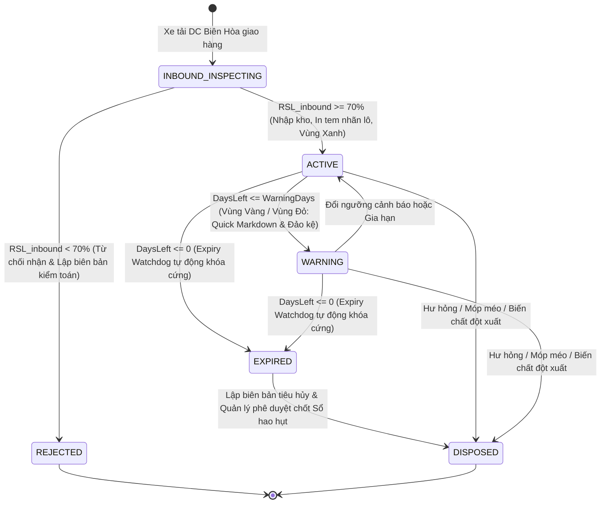
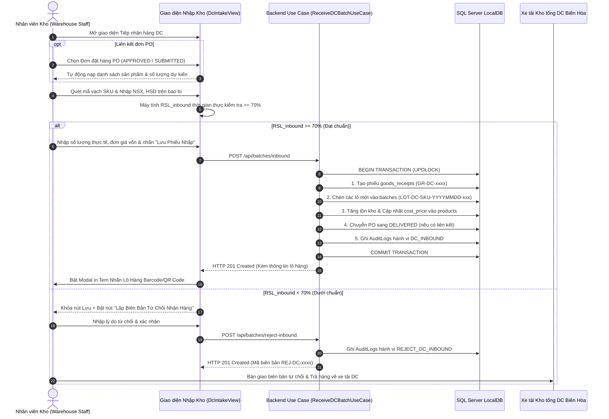
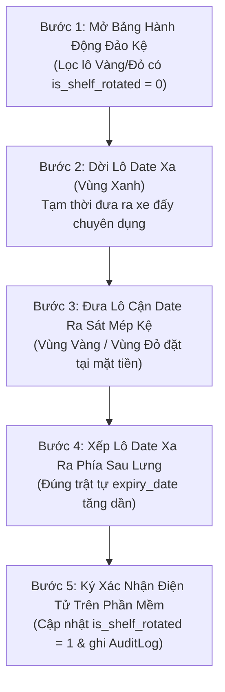
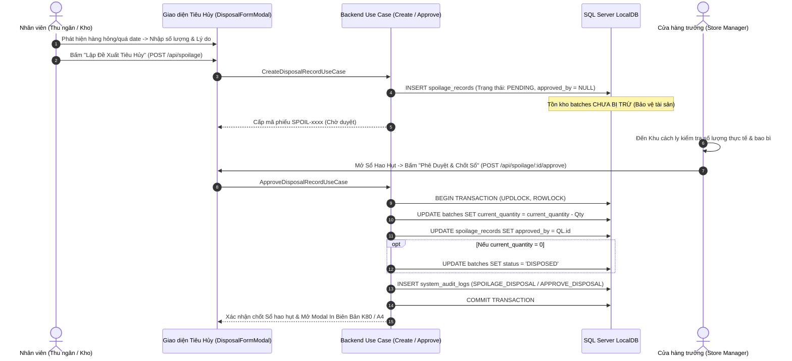
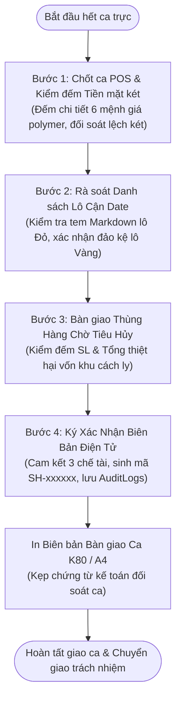
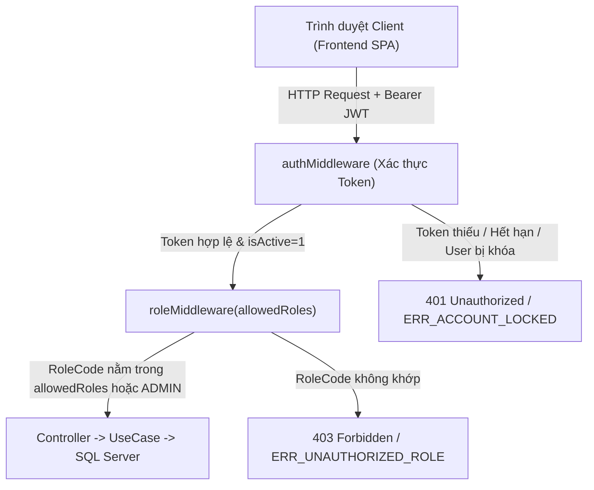

# ĐẶC TẢ WEBSITE QUẢN LÝ CHUỖI CUNG ỨNG BÁN LẺ CHỐNG LÃNG PHÍ

## Theo Clean Architecture và sử dụng SQL Server (Supply Chain Spoilage Predictor)

# 1. Mục tiêu hệ thống

Xây dựng nền tảng website quản lý Chuỗi Cửa hàng Bán lẻ Tinh gọn (Chuỗi 3 Chi nhánh LHU Mart: Store A Bửu Long `RETAIL-STORE-01`, Store B Tân Phong `RETAIL-STORE-02`, Store C Trảng Dài `RETAIL-STORE-03`) của ngành FMCG và thực phẩm tiện lợi, thuộc đề tài 'Nền tảng Quản trị Chuỗi cung ứng Chống lãng phí (Supply Chain Spoilage Predictor)'. Hệ thống cho phép quản lý toàn diện việc tiếp nhận hàng theo đợt từ Kho tổng (DC Biên Hòa), kiểm định date nghiêm ngặt (RSL >= 70%), quản lý danh mục sản phẩm FMCG (chống trùng >= 85%), kiểm soát hạn sử dụng từng lô (Shelf-Life), cảnh báo 3 cấp màu (Xanh / Vàng / Đỏ), bán lẻ tại quầy POS theo nguyên tắc FEFO tuyệt đối (Bán hàng = Xuất kho trực tiếp tự động bẻ lô), giảm giá xả hàng Quick Markdown (15%, 30%, 40%, 50%), quy trình SOP 5 bước đảo kệ mặt tiền, tiêu hủy hàng quá date gắn liền Sổ hao hụt tài chính bất biến, bàn giao ca trực điện tử 4 bước, và Động cơ AI 3 bước chuẩn GVHD (Mô hình LightGBM dự báo nhu cầu 7 ngày + Bộ giải Tối ưu có Ràng buộc Google OR-Tools MILP cân bằng tồn kho và điều chuyển nội bộ giữa 3 chi nhánh trước khi đặt thêm từ DC).

Hệ thống sử dụng Microsoft SQL Server LocalDB (`retail_spoilage_db` – 15 bảng chuẩn 3NF, 36 Foreign Keys named, sysdiagrams) làm cơ sở dữ liệu chính và tuân thủ Kiến trúc Clean Architecture 4 tầng.

Mô hình chuỗi liên kết tập trung: Cửa hàng liên kết trực tiếp với Kho tổng DC Biên Hòa và hỗ trợ điều phối hàng tồn cận date giữa 3 chi nhánh (`dbo.stock_transfers`) nhằm tối ưu hóa vòng đời thực phẩm, giải quyết triệt để tình trạng 'Cửa hàng A dư thừa sắp hủy – Cửa hàng B thiếu hụt đứt hàng' trước khi phát sinh đơn đặt hàng bổ sung mới từ DC.

# 2. Phạm vi hệ thống

Hệ thống quản lý các nhóm dữ liệu chính:

1. Thông tin cửa hàng bán lẻ duy nhất
2. Kho tổng cung ứng liên kết (DC Biên Hòa)
3. Danh mục ngành hàng FMCG và thực phẩm
4. Sản phẩm hàng hóa bán lẻ
5. Lô hàng và vòng đời hạn sử dụng (Shelf-Life)
6. Người dùng và phân quyền (Admin, Cửa hàng trưởng, Thu ngân, Nhân viên kho)
7. Phiếu tiếp nhận hàng từ Kho tổng DC (Goods Receipts)
8. Đơn bán lẻ tại quầy POS (Bán hàng = Xuất kho FEFO)
9. Giám sát hạn dùng và cảnh báo 3 cấp màu (Xanh / Vàng / Đỏ)
10. Kích hoạt giảm giá xả hàng Quick Markdown
11. Nhật ký xác nhận đảo lô hàng mặt tiền kệ trưng bày
12. Biên bản tiêu hủy hàng hỏng & Sổ hao hụt tài chính
13. Dự báo nhu cầu bán hàng & Điểm đặt hàng bổ sung (ROP Forecast)
14. Đơn đặt hàng bổ sung gửi về Kho tổng DC (Purchase Orders)
15. Lịch trực và bàn giao ca làm việc
16. Dashboard thống kê điều hành thời gian thực
17. Nhật ký thao tác hệ thống (Audit Log)

# 3. Đặc điểm quan trọng của hệ thống

## 3.1 Mô hình Chuỗi Cửa hàng Bán lẻ Tinh gọn & Điều phối Cứu Hàng Cận Date (Rule 1)

Theo định hướng nâng cấp của GVHD (ThS. Lê Minh Nhật), hệ thống áp dụng mô hình Chuỗi Cửa hàng Bán lẻ Tinh gọn (MVP gồm 3 Chi nhánh: Store A Bửu Long `RETAIL-STORE-01`, Store B Tân Phong `RETAIL-STORE-02`, Store C Trảng Dài `RETAIL-STORE-03`) liên kết trực tiếp với Trung tâm Phân phối DC Biên Hòa:

- Mỗi chi nhánh vận hành độc lập tại quầy thu ngân POS theo chuẩn FEFO tuyệt đối và tự quản lý kho quầy kệ.
- Toàn chuỗi dùng chung Danh mục Sản phẩm FMCG chuẩn và liên kết chung nguồn nhập hàng từ Kho tổng DC Biên Hòa.
- Hỗ trợ phân hệ Điều phối Tồn kho Liên Cửa hàng (Inter-Store Stock Transfer – bảng `dbo.stock_transfers`) nhằm giải bài toán Cung – Cầu nội bộ.
- Quy trình điều chuyển 5 bước khép kín (`PROPOSED` -> `APPROVED` -> `IN_TRANSIT` -> `RECEIVED` -> `CANCELLED`) kiểm soát bằng khóa ngoại `store_id` và bảo vệ bằng phân quyền SoD giữa OWNER, MANAGER và STAFF.
- Loại bỏ các thủ tục hoàn trả nhà cung cấp (RTV) phức tạp ngoài phạm vi cửa hàng tiện lợi.

Ví dụ:

Tên cửa hàng: Cửa hàng Bán lẻ Tiện lợi LHU Mart
Mã cửa hàng: RETAIL-STORE-01
Vị trí: Số 10 Huỳnh Văn Nghệ, P. Bửu Long, TP. Biên Hòa, Đồng Nai
Kho tổng liên kết: Trung tâm Phân phối DC Biên Hòa (Mã: DC-BIENHOA)
Thời gian giao hàng chuẩn (Lead Time): 1 ngày
Sức chứa quầy kệ: 1,500 SKU / 5,000 đơn vị sản phẩm
Ngành hàng chính: Sữa, Bánh tươi, Nước giải khát, Thực phẩm mát, Đồ khô FMCG
Trạng thái: Đang hoạt động

## 3.2 Sử dụng SQL Server

Cơ sở dữ liệu dùng Microsoft SQL Server LocalDB với tên retail\_spoilage\_db.

Các yêu cầu khi thiết kế database:

- Dùng bảng quan hệ rõ ràng, đạt chuẩn chuẩn hóa 3NF
- Có khóa chính (IDENTITY hoặc UNIQUEIDENTIFIER), khóa ngoại toàn vẹn
- Có ràng buộc CHECK chống tồn kho âm (current\_quantity >= 0)
- Có trạng thái cho các nghiệp vụ quan trọng (ACTIVE, WARNING, EXPIRED, DISPOSED)
- Có CreatedAt, UpdatedAt cho các bảng chính
- Có AuditLog để lưu lịch sử thao tác bất biến
- Có transaction khi xuất bán lẻ POS FEFO, nhập kho DC, tiêu hủy hàng hỏng
- Có index cho các bảng lô hàng, sản phẩm, lịch sử bán hàng, nhật ký kiểm toán

# 4. Nhóm người dùng trong hệ thống

Hệ thống áp dụng mô hình phân quyền dựa trên vai trò (RBAC) với 4 nhóm người dùng chuẩn (chi tiết hóa từ 3 Actor cốt lõi: `OWNER` → `ADMIN`, `MANAGER` → `STORE_MANAGER`, và `STAFF` tách biệt trách nhiệm thành `CASHIER` & `WAREHOUSE_STAFF`), đảm bảo tính tách biệt trách nhiệm (Separation of Duties - SoD), quyền tối thiểu (Least Privilege) và lưu vết kiểm toán bất biến (Rule 11).

| Nhóm Actor gốc | Vai trò hệ thống (`RoleCode`) | Tên hiển thị | Thiết bị sử dụng chính | Màn hình mặc định sau đăng nhập |
| :--- | :--- | :--- | :--- | :--- |
| **OWNER / ADMIN** | `ADMIN` | Quản trị viên hệ thống | Desktop / Laptop quản trị | Dashboard Tổng điều hành (`/dashboard`) |
| **MANAGER** | `STORE_MANAGER` | Cửa hàng trưởng | Desktop / Tablet quản lý | Dashboard Tổng điều hành (`/dashboard`) |
| **STAFF (Cửa ra)** | `CASHIER` | Nhân viên thu ngân POS | Máy POS cảm ứng + Đầu đọc Barcode | Quầy Bán lẻ POS (`/pos-checkout`) |
| **STAFF (Cửa vào & Kệ)** | `WAREHOUSE_STAFF` | Nhân viên kho & quầy kệ | Tablet / Máy kiểm kho cầm tay | Tiếp nhận hàng DC (`/dc-intake`) |

## 4.0 Quy chuẩn Trang Đăng nhập riêng (`/login`) & Bảo mật tài khoản chung

Mọi nhóm người dùng trước khi truy cập vào hệ thống đều bắt buộc đi qua **Trang Đăng nhập riêng biệt (`/login`)** với các cơ chế bảo mật:

- **Xác thực danh tính (Authentication):** Đăng nhập bằng `Username` và `Password` (mật khẩu băm `bcrypt`), cấp phát `JWT Access Token` có chữ ký số và kiểm tra trạng thái phiên qua endpoint `/api/auth/me`.
- **Điều hướng thông minh theo vai trò (Role-based Redirect):** Sau khi xác thực thành công tại `/login`, hệ thống tự động chuyển hướng người dùng đến đúng phân hệ nghiệp vụ trọng tâm của vai trò đó và chỉ hiển thị các menu được cấp quyền trên Sidebar.
- **Chính sách chống dò mật khẩu (Brute-Force Lockout Policy):** Nhập sai mật khẩu liên tiếp 5 lần sẽ tự động khóa cứng tài khoản nhân viên (`is_active = 0`) hoặc tạm khóa 15 phút đối với `ADMIN`, đồng thời ghi cảnh báo an ninh vào `AuditLogs`.
- **Quản lý thông tin bảo mật cá nhân:** Tất cả người dùng đã đăng nhập đều có quyền xem thông tin định danh ca trực hiện tại, tự đổi mật khẩu cá nhân (`POST /api/auth/change-password`) và đăng xuất an toàn khỏi thiết bị.

## 4.1 Admin (Quản trị viên hệ thống) — RoleCode: `ADMIN`

Admin có quyền cao nhất về mặt kỹ thuật, bảo mật tài khoản và tham số hệ thống.

Chức năng chính:

- Quản lý tài khoản nhân viên: Cấp mới, chỉnh sửa hồ sơ/vai trò, đặt lại mật khẩu và khóa/mở khóa tài khoản khẩn cấp
- Quản lý danh mục ngành hàng và danh mục sản phẩm FMCG
- Cấu hình thông tin cửa hàng duy nhất và tham số kết nối Kho tổng DC Biên Hòa
- Cấu hình ngưỡng cảnh báo cận date mặc định (Vàng/Đỏ) và tỷ lệ nhận hàng tối thiểu (Min RSL >= 70%)
- Cấu hình hệ số ngoại cảnh thời tiết (W_factor) và ngày lễ (H_factor) cho thuật toán ROP
- Xem Dashboard tổng điều hành và giám sát toàn bộ Nhật ký kiểm toán bất biến (System Audit Logs)
- Quyền can thiệp tối cao (Override) để hỗ trợ xử lý sự cố vận hành khẩn cấp
- Sao lưu, phục hồi và bảo trì cơ sở dữ liệu Microsoft SQL Server
- Ranh giới bảo vệ (SoD): Không được phép xóa hoặc chỉnh sửa Nhật ký kiểm toán bất biến (`AuditLogs`) và không thể tự khóa tài khoản của chính mình

## 4.2 Cửa hàng trưởng (Store Manager) — RoleCode: `STORE_MANAGER`

Cửa hàng trưởng chịu trách nhiệm điều hành toàn diện doanh số, bảo toàn dòng tiền vốn và kiểm soát hao hụt tại cửa hàng.

Chức năng chính:

- Quản lý danh mục ngành hàng và dữ liệu sản phẩm tại cửa hàng
- Giám sát tình trạng hạn sử dụng các lô hàng qua Dashboard 6 chỉ số KPI tài chính thời gian thực
- Phê duyệt kích hoạt giảm giá xả hàng Quick Markdown (15%, 30%, 40%, 50%) theo Rule 4 & 10
- Trực tiếp kiểm tra hàng tại khu cách ly, phê duyệt biên bản tiêu hủy hàng hỏng/quá hạn và chốt Sổ hao hụt tài chính (Rule 6)
- Xem dự báo nhu cầu ROP, điều chỉnh số lượng và phê duyệt đơn đặt hàng bổ sung gửi về Kho tổng DC (Rule 8)
- Quản lý phân công ca trực, đối soát tiền két thực tế và ký duyệt Biên bản bàn giao ca điện tử 4 bước
- Bán lẻ POS hoặc tiếp nhận hàng DC dự phòng khi thiếu nhân sự hoặc giờ cao điểm
- Xem báo cáo tài chính, doanh thu, tỷ lệ lãng phí Spoilage Rate % và tra cứu Audit Log cấp cửa hàng
- Ranh giới bảo vệ (SoD): Không có quyền tạo mới/khóa tài khoản người dùng, không được xóa lịch sử giao dịch bán hàng hoặc xóa vết kiểm toán

## 4.3 Nhân viên thu ngân (Cashier) — RoleCode: `CASHIER`

Nhân viên thu ngân trực tiếp thực hiện bán lẻ tại quầy POS, là mắt xích kiểm soát cửa ra của hàng hóa đến tay khách hàng.

Chức năng chính:

- Quét mã vạch Barcode / SKU sản phẩm tại quầy bán lẻ POS
- Hệ thống tự động bẻ lô trừ kho theo nguyên tắc FEFO (thu ngân không tự ý chọn lô thủ công)
- Tự động áp dụng giá xả hàng ưu đãi nếu lô hàng đang có chính sách Quick Markdown đã duyệt
- Hàng rào khóa cứng: Tự động chặn xuất bán và cảnh báo nếu quét trúng sản phẩm đã quá hạn (DaysLeft <= 0 - Rule 5)
- Lựa chọn ngữ cảnh bán hàng: Thời tiết và Cờ ngày lễ phục vụ dữ liệu huấn luyện ROP
- Tra cứu tồn kho khả dụng và xem danh sách cảnh báo lô hàng 3 cấp màu để hỗ trợ tư vấn cho khách mua hàng
- Lập đề xuất tiêu hủy nhanh cho sản phẩm bị móp méo, vỡ hỏng phát sinh tại quầy (trạng thái chờ Quản lý duyệt)
- Thực hiện chốt ca thu ngân, kiểm đếm tiền mặt két và ký bàn giao ca trực điện tử
- Ranh giới bảo vệ (SoD): Không được tự chọn lô xuất bán thủ công, không có quyền nhập kho DC, không tự ý kích hoạt giảm giá Quick Markdown, không xác nhận đảo kệ và không tự duyệt tiêu hủy

## 4.4 Nhân viên kho & quầy kệ (Warehouse Staff) — RoleCode: `WAREHOUSE_STAFF`

Nhân viên kho phụ trách tiếp nhận hàng từ xe tải DC, quản lý sắp xếp quầy kệ và theo dõi hạn sử dụng thực tế.

Chức năng chính:

- Người gác cổng chất lượng đầu vào (Rule 7): Kiểm tra date xe tải DC, tính RSL; từ chối nhận nếu RSL < 70%
- Nhập phiếu tiếp nhận hàng từ Kho tổng DC (tạo lô hàng mới và cập nhật giá vốn chuẩn vào CSDL)
- Xem Action Board ca trực: Lọc nhanh danh sách lô hàng Vùng Vàng và Vùng Đỏ cần xử lý khẩn cấp
- Thực hiện Quy trình SOP 5 bước đảo lô hàng cận date ra mặt tiền quầy kệ theo chuẩn FEFO (Rule 10)
- Xác nhận điện tử đã hoàn tất đảo kệ lên hệ thống để lưu vết kiểm toán (Rule 11)
- In và dán tem nhãn giảm giá xả hàng Quick Markdown lên bao bì theo phê duyệt của Quản lý
- Thu gom hàng hỏng, rách bao bì, hết hạn vào khu cách ly và lập đề xuất tiêu hủy (trạng thái chờ Quản lý duyệt)
- Xem cảnh báo điểm đặt hàng ROP để chủ động chuẩn bị vị trí lưu kho và quầy kệ
- Thực hiện kiểm đếm hàng tồn/hàng chờ hủy và ký xác nhận Biên bản bàn giao ca trực điện tử
- Ranh giới bảo vệ (SoD): Không có quyền bán lẻ POS, không tự ý sửa giá/duyệt Quick Markdown, không có quyền tạo/duyệt đơn đặt hàng PO gửi DC và không tự duyệt tiêu hủy

# 5. Quản lý thông tin cửa hàng bán lẻ duy nhất

Do chỉ có một cửa hàng bán lẻ, hệ thống cần một bảng cấu hình cố định StoreProfile để lưu thông tin cửa hàng.

Thông tin cần quản lý:

- Mã cửa hàng: RETAIL-STORE-01
- Tên cửa hàng: Cửa hàng Bán lẻ Tiện lợi LHU Mart
- Địa chỉ: Số 10 Huỳnh Văn Nghệ, P. Bửu Long, TP. Biên Hòa, Đồng Nai
- Số điện thoại liên hệ
- Cửa hàng trưởng phụ trách
- Kho tổng DC mặc định: Kho Phân Phối DC Biên Hòa
- Thời gian giao hàng tiêu chuẩn (Lead Time): 1 ngày (từ 1 đến 14 ngày)
- Tỷ lệ hạn sử dụng tối thiểu khi nhận hàng từ DC (Min RSL): 70% (từ 50% đến 95%)
- Ngưỡng cảnh báo cận date mặc định (Vùng Vàng): 7 ngày (từ 3 đến 30 ngày)
- Ngưỡng cảnh báo nguy kịch (Vùng Đỏ): 3 ngày (từ 1 đến 5 ngày)
- Giờ mở cửa / Giờ đóng cửa: 06:00 - 22:00 (chuẩn 2 ca trực)
- Sức chứa quầy kệ tiêu chuẩn: 1,500 SKU / 5,000 đơn vị sản phẩm
- Trạng thái hoạt động cửa hàng

Trạng thái cửa hàng:

OPEN - Đang mở cửa bán hàng (Quầy POS xuất bán bình thường)
CLOSED - Đang đóng cửa ca đêm (Tự động khóa thanh toán POS)
INVENTORY - Tạm ngưng để kiểm kê kho (Khóa chức năng thanh toán POS)
SUSPENDED - Tạm ngừng hoạt động (Khóa chức năng thanh toán POS)

Điều kiện và ranh giới phân quyền (SoD):

- Cửa hàng chỉ cho phép quầy POS xuất bán khi ở trạng thái OPEN. Khi ở trạng thái CLOSED, INVENTORY hoặc SUSPENDED thì quầy POS bị KHÓA CỨNG chức năng thanh toán.
- Mọi phiếu nhập hàng, xuất kho FEFO, biên bản tiêu hủy và sổ hao hụt đều tự động gán với cửa hàng duy nhất này (Rule 1).
- Nguyên tắc phân quyền tách biệt trách nhiệm (Separation of Duties - SoD): Chỉ Quản trị viên hệ thống (ADMIN) mới có quyền thay đổi các ngưỡng kỹ thuật cốt lõi (Min RSL, Ngưỡng cảnh báo 3 màu, Lead Time DC, Sức chứa quầy kệ, Bổ nhiệm Cửa hàng trưởng); Cửa hàng trưởng (STORE_MANAGER) chỉ được phép chuyển đổi Trạng thái hoạt động (status) và khung giờ ca trực. Mọi thao tác thay đổi cấu hình đều ghi nhận vết bất biến vào AuditLogs (Rule 11).

> [!NOTE]
> **Định hướng Kiến trúc SaaS B2B:** Theo tài liệu *SmartSupply AI — Định hướng dự án & Triển khai hệ thống*, mô hình MVP chốt việc thiết kế tập trung phục vụ một cửa hàng bán lẻ độc lập hoặc doanh nghiệp một chi nhánh liên kết kho tổng DC Biên Hòa, loại trừ hoàn toàn việc điều chuyển ngang hoặc luân chuyển nội bộ phức tạp để tối ưu hiệu năng và tinh gọn quy trình nghiệp vụ.

# 6. Quản lý danh mục ngành hàng FMCG & Sản phẩm

Phân loại hàng hóa theo đặc thù thời hạn sử dụng và điều kiện bảo quản thực tế của chuỗi bán lẻ tinh gọn.

## 6.1 Danh mục 7 ngành hàng FMCG chuẩn mực:

1. **Sữa & Chế phẩm từ sữa (DAIRY):** HSD: 14 – 180 ngày, Ngưỡng cảnh báo: 7 ngày, Điều kiện bảo quản: Vùng mát (2 – 4°C).
2. **Bánh mì & Đồ ăn nhanh (BAKERY):** HSD: 3 – 7 ngày, Ngưỡng cảnh báo: 2 ngày, Điều kiện bảo quản: Nhiệt độ phòng (25°C).
3. **Nước giải khát (BEVERAGE):** HSD: 30 – 365 ngày, Ngưỡng cảnh báo: 15 ngày, Điều kiện bảo quản: Nhiệt độ phòng (25°C).
4. **Thực phẩm khô đóng gói (DRY_FOOD):** HSD: 180 – 720 ngày, Ngưỡng cảnh báo: 30 ngày, Điều kiện bảo quản: Khô ráo thoáng mát.
5. **Thực phẩm chế biến sẵn (PROCESSED_MEAT):** HSD: 15 – 90 ngày, Ngưỡng cảnh báo: 5 ngày, Điều kiện bảo quản: Đông lạnh (-18°C).
6. **Thịt tươi & Thủy hải sản mát (MEAT_POULTRY):** HSD: 3 – 15 ngày, Ngưỡng cảnh báo: 5 ngày, Điều kiện bảo quản: Đông lạnh (-18°C).
7. **Rau củ & Trái cây sạch (FRESH_PRODUCE):** HSD: 3 – 14 ngày, Ngưỡng cảnh báo: 3 ngày, Điều kiện bảo quản: Mát (8 – 12°C).

## 6.2 Thông tin sản phẩm hàng hóa (Bảng Products):

- Mã SKU sản phẩm (duy nhất, dùng quét Barcode tại POS)
- Tên sản phẩm thương mại
- Tên chuẩn hóa (NormalizedName: loại bỏ dấu tiếng Việt, viết thường, loại bỏ ký tự đặc biệt phục vụ so khớp và tìm kiếm)
- Danh mục ngành hàng (CategoryId)
- Nhà cung ứng mặc định (SupplierId: Kho tổng DC Biên Hòa)
- Đơn vị tính chuẩn hóa (Hộp, Chai, Gói, Hũ, Khay, Lon, Túi, Bịch, Kg, Lốc, Thùng, Vỉ)
- Giá vốn nhập chuẩn (CostPrice >= 0)
- Giá bán lẻ niêm yết (SellingPrice > 0, SellingPrice >= CostPrice)
- Vòng đời hạn sử dụng tiêu chuẩn (StandardShelfLifeDays > 0)
- Ngưỡng tồn kho an toàn tối thiểu (MinStockLevel >= 0, dùng tính toán điểm đặt hàng ROP)
- Ngưỡng tồn kho tối đa trên kệ (MaxStockLevel >= MinStockLevel)
- Ngưỡng ngày cảnh báo cận date tùy biến (CustomWarningDays: nếu để trống sẽ kế thừa DefaultWarningDays của Ngành hàng)
- Hình ảnh sản phẩm (ImageUrl)
- Trạng thái kinh doanh (IsActive: 1 = Đang kinh doanh, 0 = Ngừng kinh doanh)

## 6.3 Thuật toán chống trùng lặp sản phẩm (Rule 9 - Product Deduplication):

- Khi thêm mới hoặc cập nhật thông tin sản phẩm, hệ thống tự động chuẩn hóa chuỗi tên sản phẩm (loại bỏ dấu thanh tiếng Việt, chuyển chữ thường, xóa ký tự đặc biệt và khoảng trắng thừa).
- Kiểm tra chặn trùng tuyệt đối mã SKU (case-insensitive) trên toàn hệ thống.
- Tính toán độ tương đồng tên sản phẩm bằng kết hợp thuật toán Sørensen–Dice Bigram và khoảng cách chỉnh sửa Levenshtein: nếu độ tương đồng đạt **>= 85%** so với bất kỳ sản phẩm nào đã lưu hành, hệ thống từ chối tạo mới / cập nhật (HTTP 400/409) và hiển thị cảnh báo chi tiết để tránh phân tán dữ liệu các lô hàng.

## 6.4 Quy tắc bảo vệ toàn vẹn dữ liệu & Phân quyền SoD:

- **Bảo vệ toàn vẹn khóa ngoại (FK Integrity):** Tuyệt đối không cho phép xóa danh mục ngành hàng (`Categories`) nếu đang có sản phẩm thuộc ngành hàng đó.
- **Bảo vệ toàn vẹn lô hàng (Batch Integrity):** Tuyệt đối không cho phép xóa hoặc chuyển sang trạng thái ngừng kinh doanh (`IsActive = 0`) đối với sản phẩm nếu sản phẩm đó đang còn ít nhất một lô hàng khả dụng trong kho (`current_quantity > 0` và trạng thái `ACTIVE` hoặc `WARNING`). Bắt buộc phải xả bán hết hoặc thanh lý/tiêu hủy toàn bộ tồn kho trước khi ngừng kinh doanh.
- **Ranh giới Phân quyền (SoD):** Chỉ Quản trị viên (`ADMIN`) và Cửa hàng trưởng (`STORE_MANAGER`) mới có quyền Thêm mới, Sửa thông tin, Cập nhật giá bán, Điều chỉnh ngưỡng tồn kho và Quản lý danh mục ngành hàng. Thu ngân (`CASHIER`) và Nhân viên kho (`WAREHOUSE_STAFF`) chỉ có quyền tra cứu (Read-only) để phục vụ xuất bán POS và tiếp nhận hàng DC. Mọi thao tác đều được ghi vết bất biến vào `system_audit_logs` (Rule 11), bám sát nguyên tắc phân định trách nhiệm 3 Actor (OWNER/ADMIN, MANAGER, STAFF) trong tài liệu định hướng *SmartSupply AI — Phân tích nghiệp vụ 3 Actor*.

# 7. Quản lý lô hàng & Vòng đời hạn sử dụng (Shelf-Life Management)

Quản lý chi tiết theo từng lô hàng (Batch-Level Inventory Tracking) là hạt nhân then chốt của toàn bộ hệ thống bán lẻ chống lãng phí LHU Mart. Khác với mô hình bán lẻ thông thường chỉ quản lý tổng tồn kho theo sản phẩm, hệ thống bắt buộc phân rã tồn kho theo từng đợt hàng nhập thực tế nhằm phục vụ thuật toán xuất kho FEFO (Rule 2), cảnh báo 3 cấp màu (Rule 4), tự động khóa cứng hàng hết hạn (Rule 5) và dự báo nguy cơ lãng phí (AI 2 Spoilage Risk - tham chiếu tài liệu *SmartSupply AI — Định hướng & Đặc tả triển khai*).

## 7.1 Cấu trúc Dữ liệu Hồ sơ Lô hàng (Product Batch Profile)

Mỗi sản phẩm FMCG có thể có nhiều lô hàng khác nhau lưu hành song song trên quầy kệ và trong kho. Bảng `batches` lưu giữ thông tin chi tiết của từng lô:

- **Mã lô hàng (`batch_code`):** Mã định danh duy nhất toàn hệ thống, tự động sinh theo quy chuẩn khi tiếp nhận hàng.
- **Sản phẩm liên kết (`product_id`):** Khóa ngoại liên kết danh mục sản phẩm FMCG (`products`).
- **Phiếu tiếp nhận nguồn (`receipt_id`):** Khóa ngoại liên kết biên bản nhận hàng DC (`goods_receipts`) để bảo đảm khả năng truy vết nguồn gốc 100%.
- **Ngày nhập kho (`import_date`):** Ngày xe tải DC Biên Hòa giao hàng và cửa hàng xác nhận nhập kho.
- **Ngày sản xuất (`manufacture_date`):** Ngày sản xuất (NSX) in trên bao bì thùng hàng do nhà sản xuất công bố.
- **Ngày hết hạn sử dụng (`expiry_date`):** Hạn sử dụng (HSD / Best Before / Use By) in trên bao bì.
- **Số lượng nhập ban đầu (`initial_quantity`):** Tổng sản lượng thực tế nhận vào kho.
- **Số lượng tồn hiện tại (`current_quantity`):** Lượng hàng còn lại khả dụng trên quầy kệ (Ràng buộc CHECK: `0 <= current_quantity <= initial_quantity`).
- **Đơn giá vốn nhập thực tế (`import_price`):** Giá nhập theo hợp đồng cung ứng của đợt hàng (VNĐ).
- **Tỷ lệ giảm giá xả hàng (`discount_percent`):** Mức chiết khấu Quick Markdown đang áp dụng (0%, 15%, 30%, 40%, 50%).
- **Cờ đảo kệ mặt tiền (`is_shelf_rotated`):** Cờ boolean xác nhận nhân viên đã thực hiện SOP 5 bước đảo lô ra mặt tiền trưng bày (0 = Chưa đảo, 1 = Đã đảo).
- **Dấu vết đảo kệ (`shelf_rotated_at`, `shelf_rotated_by`):** Thời điểm và định danh nhân viên thực hiện ký xác nhận đảo kệ.
- **Trạng thái vòng đời (`status`):** `ACTIVE`, `WARNING`, `EXPIRED`, `DISPOSED`.
- **Thời điểm tạo (`created_at`):** Dấu vết thời gian tạo bản ghi trong hệ thống.

## 7.2 Quy chuẩn Định dạng Mã Lô Hàng & Mã Vạch (Batch Coding & Labeling Standards)

Để phục vụ quản lý thực địa, kiểm kê và quét mã tại quầy kệ, hệ thống quy chuẩn hóa cấu trúc mã lô:
$$\text{BatchCode} = \text{LOT-DC-[SKU]-[YYYYMMDD]}$$
- `LOT-DC`: Tiền tố cố định chỉ định nguồn nhập từ Trung tâm Phân phối Kho tổng DC Biên Hòa.
- `[SKU]`: Mã định danh sản phẩm FMCG chuẩn (ví dụ: `MILK-TH-01`, `BREAD-SGP-01`).
- `[YYYYMMDD]`: Ngày tiếp nhận hàng vào kho (ví dụ: `20261029`).

Mỗi mã lô tương ứng với một mã vạch chuẩn **Code 128** và **QR Code** được in trên tem nhãn dán khay/thùng hàng, cho phép nhân viên sử dụng máy quét mã vạch cầm tay hoặc camera smartphone quét truy xuất tức thì toàn bộ thông số vòng đời của lô hàng.

## 7.3 Sơ đồ Chuyển đổi Trạng thái Vòng đời Lô Hàng (Batch Lifecycle State Machine)

Vòng đời của từng lô hàng trải qua 5 trạng thái vận hành chặt chẽ:



- **`ACTIVE` (Đang lưu hành bình thường):** Lô hàng mới nhập, thuộc Vùng Xanh ($DaysLeft > WarningDays$), bán nguyên giá niêm yết theo nguyên tắc FEFO.
- **`WARNING` (Cảnh báo cận date):** Lô hàng rơi vào Vùng Vàng hoặc Vùng Đỏ, hoặc đang áp dụng giảm giá Quick Markdown, cần đảo kệ mặt tiền.
- **`EXPIRED` (Khóa cứng quá hạn):** Lô hàng có $DaysLeft \le 0$, tự động bị Expiry Watchdog khóa cứng, cấm xuất bán POS tuyệt đối (Rule 5), chuyển vào khu cách ly.
- **`DISPOSED` (Đã tiêu hủy):** Lô hàng đã hoàn tất thủ tục tiêu hủy, hạch toán thiệt hại vốn vào Sổ hao hụt tài chính bất biến (`spoilage_records`).

## 7.4 Bộ Công thức Toán học Đo lường Vòng đời & Dự báo Nguy cơ Lãng phí (Shelf-Life & Spoilage Risk Metrics)

Hệ thống tự động tính toán các chỉ số toán học chuẩn xác theo thời gian thực:

1. **Số ngày sử dụng còn lại ($DaysLeft$):**
   $$DaysLeft = DATEDIFF(day, CAST(GETDATE() \text{ AS DATE}), ExpiryDate)$$
2. **Tổng vòng đời chuẩn của lô hàng ($TotalLife$):**
   $$TotalLife = DATEDIFF(day, ManufactureDate, ExpiryDate)$$
3. **Tỷ lệ hạn sử dụng còn lại (% RSL – Remaining Shelf-Life):**
   $$RSL (\%) = \left(\frac{DaysLeft}{TotalLife}\right) \times 100\%$$
4. **Tiêu chuẩn kiểm định đợt hàng tiếp nhận từ DC Biên Hòa (Rule 7):**
   $$RSL_{inbound} = \left(\frac{DATEDIFF(day, ImportDate, ExpiryDate)}{TotalLife}\right) \times 100\% \ge 70\%$$
   *(Nếu $RSL_{inbound} < 70\%$, hệ thống khóa lưu và yêu cầu lập Biên bản Từ chối Nhận hàng)*.
5. **Dự báo nguy cơ lãng phí (AI 2 - Spoilage Risk Metric từ tài liệu SmartSupply AI):**
   Hệ thống so sánh số lượng tồn kho hiện tại với mức tiêu thụ dự kiến dựa trên tốc độ bán bình quân 14 ngày gần nhất ($v_{14d}$):
   $$EstimatedSales = v_{14d} \times DaysLeft$$
   $$AtRiskStock = \max(0, CurrentQuantity - EstimatedSales)$$
   $$AtRiskCost = AtRiskStock \times ImportPrice$$
   *(Nếu $AtRiskStock > 0$, hệ thống phát cảnh báo nguy cơ ứ đọng date và kích hoạt đề xuất Quick Markdown / Đảo kệ ngay trên Action Board ca trực)*.
6. **Đơn giá bán lẻ hiệu dụng sau chiết khấu Quick Markdown:**
   $$Price_{effective} = SellingPrice \times \left(1 - \frac{DiscountPercent}{100}\right)$$

## 7.5 Động cơ Cảnh báo 3 Cấp Màu Động (Dynamic 3-Zone Alert Engine - Rule 4 & Rule 5)

Ngưỡng ngày cảnh báo được hệ thống xác định linh hoạt theo thứ tự ưu tiên kế thừa phân tầng:
$$WarningDays = COALESCE(Products.CustomWarningDays, Categories.DefaultWarningDays, StoreProfile.DefaultWarningDays, 7)$$

Hệ thống tự động phân loại rủi ro của toàn bộ các lô hàng trong kho vào 4 phân vùng màu sắc:

| Phân vùng | Điều kiện số ngày còn lại ($DaysLeft$) | Trạng thái hiển thị | Hành động quy chuẩn theo SOP |
| :--- | :--- | :---: | :--- |
| **Vùng Xanh (An toàn)** | $DaysLeft > WarningDays$ | `GREEN` (An toàn) | Bán nguyên giá niêm yết. Trưng bày ở các hàng kệ phía sau theo thứ tự FEFO. |
| **Vùng Vàng (Cảnh báo)** | $3 < DaysLeft \le WarningDays$ | `YELLOW` (Cảnh báo) | Bật cảnh báo ca trực. Kích hoạt Quick Markdown 15% - 30%. Thực hiện SOP 5 bước đảo lô ra mặt tiền kệ. |
| **Vùng Đỏ (Nguy kịch)** | $0 < DaysLeft \le 3$ | `RED` (Nguy kịch) | Đảo kệ mặt tiền ngang tầm mắt. Kích hoạt Quick Markdown kịch sàn 40% - 50% gom xả gấp trong ngày. |
| **Khóa Cứng (Hết hạn)** | $DaysLeft \le 0$ | `EXPIRED` (Khóa) | Khóa quét mã vạch tại quầy POS 100% (Rule 5). Cách ly hàng hóa và lập Biên bản tiêu hủy vào Sổ hao hụt. |

## 7.6 Quy tắc Bảo vệ Toàn vẹn Dữ liệu & Kiểm soát Đồng thời (Rule 3 SSOT)

- **Ràng buộc toàn vẹn thời gian:** Bắt buộc $ExpiryDate > ManufactureDate$ và $ImportDate \le ExpiryDate$.
- **Chống tồn kho âm tuyệt đối (Rule 3):** Ràng buộc `CHECK (current_quantity >= 0 AND current_quantity <= initial_quantity)` ngăn chặn triệt để tình trạng âm kho.
- **Kiểm soát tranh chấp đồng thời (Concurrency Control):** Mọi giao dịch xuất bán POS hoặc điều chỉnh trừ kho đều thực thi trong SQL Transaction với khóa dòng `WITH (UPDLOCK, ROWLOCK)` trên bản ghi lô hàng, loại trừ hoàn toàn nguy cơ tranh chấp tồn kho khi nhiều quầy POS thanh toán đồng thời.
- **Cơ chế Expiry Watchdog:** Trước mỗi giao dịch xuất bán, kiểm kê hoặc truy vấn danh sách lô hàng, hệ thống tự động quét và cập nhật trạng thái `EXPIRED` cho tất cả các lô có $DaysLeft \le 0$.
- **Tính bất biến của lịch sử (Immutability):** Nghiêm cấm xóa vật lý (Hard Delete) bất kỳ lô hàng nào đã phát sinh giao dịch bán lẻ (`sales_history`) hoặc biên bản tiêu hủy (`spoilage_records`).

## 7.7 Ma trận Phân định Trách nhiệm (SoD Matrix 4 Actor) cho Nghiệp vụ Lô hàng

Tham chiếu từ tài liệu phân tích nghiệp vụ 3 Actor (*SmartSupply AI — Phân tích nghiệp vụ 3 Actor*), thẩm quyền của từng vị trí đối với nghiệp vụ quản lý lô hàng được phân định nghiêm ngặt:

| Nghiệp vụ Quản lý Lô hàng | ADMIN | STORE_MANAGER | WAREHOUSE_STAFF | CASHIER |
| :--- | :---: | :---: | :---: | :---: |
| Tiếp nhận lô hàng DC ($RSL \ge 70\%$) | Cho phép | Cho phép | **Tác nghiệp chính** | Từ chối (Chặn) |
| Từ chối nhận hàng DC ($RSL < 70\%$) & lập biên bản | Cho phép | Cho phép | **Tác nghiệp chính** | Từ chối (Chặn) |
| In tem nhãn Barcode lô hàng dán kệ | Cho phép | Cho phép | **Tác nghiệp chính** | Chỉ xem |
| Giám sát 3 vùng màu & Vốn rủi ro lãng phí | Toàn quyền | Toàn quyền | Xem ca trực | Xem phục vụ bán |
| Kích hoạt Quick Markdown (15%, 30%, 40%, 50%) | **Phê duyệt** | **Phê duyệt** | Chỉ xem (Chặn) | Chỉ xem (Chặn) |
| Thực hiện SOP 5 bước đảo kệ mặt tiền | Giám sát | Giám sát | **Thực hiện chính** | Chỉ xem |
| In tem Sticker xả hàng giảm giá | Cho phép | Cho phép | Cho phép | Cho phép |
| Đề xuất tiêu hủy lô hàng quá hạn / hư hỏng | Đề xuất | Đề xuất | **Đề xuất chính** | Đề xuất (Hàng hư quầy) |
| Phê duyệt chốt Sổ hao hụt tài chính | **Chốt sổ** | **Chốt sổ** | Từ chối (Chặn) | Từ chối (Chặn) |

## 7.8 Tiêu chuẩn Tem Nhãn Mã Vạch & Tem Sticker Xả Hàng Giảm Giá

Hệ thống hỗ trợ in ấn 2 loại tem nhãn vật lý chuẩn hóa phục vụ vận hành cửa hàng:
1. **Tem Nhãn Lô Hàng Tiếp Nhận (Inbound Shelf Label):** Kích thước nhiệt 75x50mm hoặc 100x60mm dán trên khay/thùng hàng tại kho: Tên cửa hàng ("LHU Mart"), Tên sản phẩm FMCG, Mã SKU, Mã lô (`batch_code`), Mã vạch Barcode Code 128 / QR Code, Ngày sản xuất, Hạn sử dụng, Tỷ lệ RSL %, Quy cách đóng gói.
2. **Tem Sticker Xả Hàng Quick Markdown (Promotional Clearance Sticker):** Kích thước tem tròn 35mm hoặc tem dạ quang màu vàng/đỏ dán trực tiếp lên bao bì sản phẩm cận date: Mức giảm giá ("GIẢM 30%", "GIẢM 50%"), Giá gốc niêm yết (gạch ngang), Giá khuyến mãi xả hàng mới, Lưu ý hạn dùng.

# 8. Chức năng bán lẻ POS theo nguyên tắc FEFO (First Expired, First Out)

Bán lẻ tại quầy POS là điểm chạm nghiệp vụ trực tiếp với người tiêu dùng và là điểm khởi đầu cho toàn bộ luồng dữ liệu của hệ thống. Tại Cửa hàng Bán lẻ LHU Mart, hệ thống áp dụng nguyên tắc cốt lõi: **Bán hàng tại quầy POS = Xuất kho trực tiếp**. Mỗi giao dịch thanh toán thành công lập tức khấu trừ tồn kho khả dụng theo lô và ghi nhận lịch sử bất biến.

## 8.1 Nguyên tắc FEFO Tuyệt đối trong Bán lẻ POS (Rule 2 SSOT)

- **Xuất kho tự động theo hạn sử dụng:** Hệ thống tự động truy vấn toàn bộ các lô hàng còn tồn khả dụng (`current_quantity > 0`, `status IN ('ACTIVE', 'WARNING')` và $DaysLeft > 0$) của sản phẩm được quét, sau đó sắp xếp theo thứ tự ưu tiên: `expiry_date ASC, id ASC`. Lô có hạn sử dụng gần nhất bắt buộc phải được xuất trước.
- **Cấm can thiệp chọn lô thủ công:** Thu ngân (`CASHIER`) tuyệt đối không có quyền can thiệp chọn mã lô trên giao diện POS. Điều này ngăn chặn tình trạng ưu ái giữ date mới cho người quen, đảm bảo tính công bằng và tuân thủ nghiêm ngặt chuẩn mực vận hành chống lãng phí (tham chiếu phân định trách nhiệm trong *SmartSupply AI — Phân tích nghiệp vụ 3 Actor*).
- **Tự động áp dụng giá xả hàng Quick Markdown:** Nếu lô hàng cận date đang được hưởng chính sách chiết khấu xả hàng (`discount_percent > 0`), hệ thống tự động áp dụng đơn giá khuyến mãi ưu đãi cho đúng số lượng lấy từ lô đó, khuyến khích khách hàng tiêu thụ các sản phẩm cận date.

## 8.2 Thuật toán Phân bổ Lô FEFO & Bẻ nhỏ Đơn hàng Tự động (Split Order Algorithm)

Khi khách hàng mua số lượng lớn hơn lượng hàng tồn của lô cận date nhất, hệ thống tự động kích hoạt thuật toán bẻ đơn hàng (*Split Order Scenario*) qua nhiều lô kế tiếp nhau theo chuẩn FEFO trong cùng một giao dịch nguyên tử:

```typescript
function allocateFefo(productId, requestedQuantity, sellingPrice, availableBatches):
    // 1. Sắp xếp các lô khả dụng theo chuẩn FEFO
    sort(availableBatches, by: (expiry_date ASC, id ASC))
    
    remainingToAllocate = requestedQuantity
    allocations = []
    
    // 2. Vòng lặp bóc tách từng lô
    for each batch in availableBatches:
        if remainingToAllocate <= 0: break
        
        qtyFromBatch = min(batch.current_quantity, remainingToAllocate)
        unitPrice = calculateEffectivePrice(sellingPrice, batch.discount_percent)
        lineTotal = qtyFromBatch * unitPrice
        
        allocations.append({
            batchId: batch.id,
            batchCode: batch.batchCode,
            expiryDate: batch.expiryDate,
            daysLeft: batch.daysLeft,
            quantityAllocated: qtyFromBatch,
            discountPercent: batch.discount_percent,
            unitPrice: unitPrice,
            lineTotal: lineTotal
        })
        
        remainingToAllocate -= qtyFromBatch
        
    // 3. Kiểm tra điều kiện tồn kho an toàn
    if remainingToAllocate > 0:
        throw InsufficientStockError("Tổng tồn kho khả dụng còn hạn không đủ đáp ứng số lượng yêu cầu!")
        
    isSplitOrder = (allocations.length > 1)
    return { allocations, isSplitOrder, totalAmount }
```

### Kịch bản minh họa Bẻ nhỏ Đơn hàng thực tế:
- **Khách mua:** 5 hộp *Sữa Tươi Tiệt Trùng Vinamilk 100ml* (Đơn giá niêm yết: 10,000 đ/hộp).
- **Hiện trạng tồn kho theo chuẩn FEFO:**
  * Lô 1 (`LOT-DC-MILK-001`): $ExpiryDate$ còn 2 ngày (Vùng Đỏ), tồn 3 hộp, đang giảm giá 30% $\rightarrow$ Đơn giá sau giảm: 7,000 đ.
  * Lô 2 (`LOT-DC-MILK-002`): $ExpiryDate$ còn 45 ngày (Vùng Xanh), tồn 10 hộp, nguyên giá 0% $\rightarrow$ Đơn giá: 10,000 đ.
- **Hệ thống tự động bẻ thành 2 dòng phân bổ trong 1 hóa đơn:**
  * Dòng 1: Trừ 3 hộp từ Lô `LOT-DC-MILK-001` $\times$ 7,000 đ = 21,000 đ (Lô 1 tồn về 0).
  * Dòng 2: Trừ 2 hộp từ Lô `LOT-DC-MILK-002` $\times$ 10,000 đ = 20,000 đ (Lô 2 còn lại 8 hộp).
  * **Tổng tiền hóa đơn:** 41,000 đ (Khách hàng tiết kiệm được 9,000 đ nhờ chính sách xả hàng).
  * Ghi nhận 2 bản ghi độc lập vào `sales_history` đích danh theo từng `batch_id` để hạch toán kế toán và lưu vết kiểm toán chính xác 100%.

## 8.3 Quy trình 7 Bước Bán lẻ Chuẩn hóa tại Quầy POS

1. **Bước 1 — Kiểm tra trạng thái hoạt động cửa hàng (Store Profile Guard):** Hệ thống kiểm tra `StoreProfile.status == 'OPEN'`. Nếu cửa hàng ở trạng thái `CLOSED` (đóng cửa đêm), `INVENTORY` (tạm dừng kiểm kê) hoặc `SUSPENDED` (tạm ngừng), nút thanh toán bị khóa cứng và hiển thị cảnh báo từ chối thanh toán.
2. **Bước 2 — Quét Barcode SKU / Thêm sản phẩm vào giỏ hàng:** Thu ngân sử dụng đầu đọc Barcode USB hoặc camera thiết bị quét mã vạch sản phẩm. Hệ thống kiểm tra tính khả dụng (`is_active = 1`) và thêm sản phẩm vào giỏ hàng.
3. **Bước 3 — Hiển thị FEFO Preview thời gian thực:** Trên từng dòng sản phẩm của giỏ hàng, hệ thống trực quan hóa chi tiết các lô hàng sẽ bị xuất kho, số ngày còn lại ($DaysLeft$), mức chiết khấu Quick Markdown và giá tiền dự kiến để thu ngân và khách hàng cùng đối soát.
4. **Bước 4 — Thu thập Ngữ cảnh Bán hàng (AI Context Inputs):** Thu ngân chọn cờ Thời tiết (`SUNNY`, `RAINY`, `NORMAL`) và Ngày lễ (`is_holiday = 0 / 1`). Đây là nguồn dữ liệu bắt buộc phục vụ huấn luyện mô hình dự báo nhu cầu tiêu thụ AI 1 (Demand Forecasting).
5. **Bước 5 — Mở Transaction SQL Server & Khóa dòng Concurrency (Rule 3):** Khi thu ngân bấm "Thanh toán & Xuất kho FEFO", Backend mở SQL Transaction nguyên khối có khóa dòng `WITH (UPDLOCK, ROWLOCK)` trên từng bản ghi lô hàng liên quan.
6. **Bước 6 — Khấu trừ Tồn kho & Kiểm tra Ràng buộc Âm kho:** Trừ `current_quantity` tương ứng với từng dòng lô đã bẻ. Nếu có bất kỳ vi phạm nào ($current\_quantity < 0$ hoặc bị quầy POS khác tranh chấp), hệ thống lập tức ROLLBACK Transaction và thông báo lỗi.
7. **Bước 7 — Lưu Lịch sử Bán lẻ, Xuất Hóa đơn & Ghi AuditLog (Rule 11):** Chèn các bản ghi vào `sales_history`, tạo mã hóa đơn `TXN-POS-[YYYYMMDD]-[RANDOM]`, ghi nhật ký kiểm toán `POS_CHECKOUT_FEFO` và xuất biên lai in nhiệt K80 chi tiết cho khách hàng.

## 8.4 Dữ liệu Ngữ cảnh Bán hàng phục vụ AI Dự báo Sức mua (AI 1 - Demand Forecasting)

Mỗi giao dịch bán lẻ tại quầy POS không chỉ là hành động thương mại đơn thuần mà còn là **trạm thu thập dữ liệu huấn luyện cho trí tuệ nhân tạo** (tham chiếu tài liệu *SmartSupply AI — Định hướng dự án & Triển khai hệ thống*):

- **Yếu tố Thời tiết (`weather`):** Nắng nóng (`SUNNY`) làm tăng vọt sức mua nước giải khát, kem, sữa chua; Mưa gió ngập lụt (`RAINY`) làm giảm lượng khách trực tiếp nhưng tăng nhu cầu tích trữ thực phẩm khô, mì gói, bánh mì.
- **Yếu tố Ngày lễ / Cuối tuần (`is_holiday`):** Ngày nghỉ lễ và cuối tuần có sức mua tăng từ 30% - 70% so với ngày thường trong tuần.
- **Yếu tố Thứ trong tuần (`day_of_week`):** Lưu trữ từ `MONDAY` đến `SUNDAY` để bắt trọn chu kỳ mua sắm định kỳ theo tuần.
- **Yếu tố Giảm giá xả hàng (`discount_percent`):** Ghi nhận độ nhạy cảm của khách hàng đối với các mức giảm giá Quick Markdown 15%, 30%, 40%, 50%.

## 8.5 Bảy Điều kiện Biên Bắt buộc Khi Xuất Bán POS (Validation Boundaries)

Giao dịch xuất bán lẻ tại quầy POS chỉ được phép hoàn tất khi thỏa mãn đồng thời 7 điều kiện biên:
1. `StoreProfile.status == 'OPEN'` (Cửa hàng đang trong ca mở cửa phục vụ).
2. `products.is_active == 1` (Sản phẩm đang lưu hành hợp lệ, không bị ngừng kinh doanh).
3. `quantity_sold > 0` (Số lượng mua là số nguyên dương).
4. `DaysLeft > 0` và `status IN ('ACTIVE', 'WARNING')` (Lô hàng xuất bán bắt buộc chưa quá hạn; Expiry Watchdog tự động khóa các lô quá hạn trước khi phân bổ).
5. $\sum \text{current\_quantity} \ge \text{quantity\_sold}$ (Tổng tồn kho khả dụng còn hạn của sản phẩm đủ đáp ứng nhu cầu).
6. Tuyệt đối không cho phép tồn kho âm ($current\_quantity \ge 0$ được bảo vệ bằng CHECK constraint và logic Domain).
7. Giao dịch thực thi an toàn trong SQL Server Transaction có khóa dòng `WITH (UPDLOCK, ROWLOCK)`.

## 8.6 Ma trận Phân định Trách nhiệm (SoD Matrix 4 Actor) tại Quầy POS

| Nghiệp vụ Bán lẻ POS | CASHIER | WAREHOUSE_STAFF | STORE_MANAGER | ADMIN |
| :--- | :---: | :---: | :---: | :---: |
| Quét Barcode SKU & Thêm giỏ hàng POS | **Tác nghiệp chính** | Cho phép | Cho phép | Cho phép |
| Can thiệp chọn lô xuất kho thủ công | **TUYỆT ĐỐI CẤM** | **TUYỆT ĐỐI CẤM** | **TUYỆT ĐỐI CẤM** | **TUYỆT ĐỐI CẤM** |
| Chọn cờ ngữ cảnh Thời tiết & Ngày lễ | **Thực hiện** | Thực hiện | Thực hiện | Thực hiện |
| Thu tiền mặt, tính tiền thối, thanh toán POS | **Tác nghiệp chính** | Cho phép | Cho phép | Cho phép |
| In lại hóa đơn lịch sử bán lẻ (`reprint`) | Cho phép | Cho phép | Cho phép | Cho phép |
| Hủy hóa đơn đã thanh toán hoàn tất | Chặn | Chặn | **Cần duyệt lý do** | **Toàn quyền** |
| Xem lịch sử bán lẻ & Doanh số trong ca | Xem ca trực | Xem phục vụ kho | Xem toàn cửa hàng | Toàn quyền |

## 8.7 Quy chuẩn Biên lai Hóa đơn In nhiệt K80/K57 (Thermal Receipt Standards)

Hệ thống hỗ trợ xuất biên lai in nhiệt tiêu chuẩn K80 (80mm) và K57 (57mm), gồm 4 phần:
1. **Phần Đầu (Header):** Tên thương hiệu ("Cửa hàng Bán lẻ Tiện lợi LHU Mart"), Mã cửa hàng (`RETAIL-STORE-01`), Địa chỉ (Số 10 Huỳnh Văn Nghệ, Biên Hòa), Số điện thoại hotline, Mã hóa đơn (`TXN-POS-[YYYYMMDD]-[XXXX]`), Thời gian in (giờ:phút:giây ngày/tháng/năm), Tên thu ngân phụ trách ca.
2. **Ngữ cảnh Giao dịch:** Thời tiết (`Nắng ráo / Mưa / Ôn hòa`), Cờ sự kiện (`Ngày thường / Ngày lễ tết`).
3. **Bảng Phân bổ FEFO Chi tiết:** Tên sản phẩm, Số lượng tổng; Danh sách chi tiết từng lô đã bẻ (Mã lô `batch_code`, HSD, Số lượng trừ, Đơn giá gốc, % Giảm giá Quick Markdown, Thành tiền dòng).
4. **Phần Đuôi (Footer):** Tổng tiền thanh toán (VNĐ), Tiền khách đưa, Tiền thừa trả khách, Lời cảm ơn ("LHU Mart chân thành cảm ơn Quý khách! Chung tay chống lãng phí thực phẩm"), Mã vạch Barcode hóa đơn dùng tra cứu đối soát khi khách đổi trả.

# 9. Quy trình kiểm soát hạn dùng, cảnh báo 3 cấp màu & Tiêu hủy (Shelf-Life Control & Spoilage Management)

Cơ chế kiểm soát vòng đời hạn sử dụng (Shelf-life) và quản lý rủi ro lãng phí là trái tim điều hành của nền tảng Bán lẻ Chống lãng phí LHU Mart. Toàn bộ quy trình được thiết kế theo 8 chuẩn mực kỹ thuật khép kín, tự động hóa từ khâu phân loại màu sắc, kích hoạt giảm giá, đảo kệ mặt tiền, đến khóa cứng hết hạn và hạch toán Sổ hao hụt tài chính bất biến.

## 9.1 Động cơ cảnh báo 3 cấp màu động (Dynamic 3-Zone Alert Engine - Rule 4 SSOT)

Hệ thống liên tục phân loại mức độ rủi ro cận date của từng lô hàng theo thời gian thực dựa trên số ngày còn lại đến hạn sử dụng ($DaysLeft$):
$$\text{DaysLeft} = \text{DATEDIFF}(\text{DAY}, \text{CAST}(\text{GETDATE()} \text{ AS DATE}), \text{expiry\_date})$$

So sánh $DaysLeft$ với ngưỡng cảnh báo của từng ngành hàng ($WarningDays \in [7, 30]$ ngày cấu hình tại bảng `categories` hoặc đè riêng theo `products.warning_threshold_days`):

1. **VÙNG XANH (An toàn - SAFE / GREEN ZONE):**
   * **Điều kiện:** $DaysLeft > WarningDays$.
   * **Đặc trưng:** Lô hàng còn rất xa hạn dùng, chất lượng cảm quan và dinh dưỡng đạt mức tối ưu.
   * **Chính sách bán lẻ:** Lưu kho và bán lẻ bình thường theo giá niêm yết 100% tại quầy POS.
   * **Sắp xếp quầy kệ:** Xếp ở các tầng kệ bên trong hoặc phía sau các lô cận date (chuẩn FEFO vật lý).

2. **VÙNG VÀNG (Cảnh báo cận date - WARNING / YELLOW ZONE):**
   * **Điều kiện:** $3 < DaysLeft \le WarningDays$.
   * **Đặc trưng:** Hàng hóa bắt đầu bước vào giai đoạn tốc độ suy giảm chất lượng tăng dần. Có nguy cơ không tiêu thụ hết trước hạn nếu giữ nguyên tốc độ bán thông thường.
   * **Chính sách can thiệp:** Kích hoạt giảm giá xả hàng nhẹ (Quick Markdown 15% – 30%), mở cờ cảnh báo trên màn hình điều hành.
   * **SOP Đảo kệ:** Bắt buộc nhân viên kho/thu ngân thực hiện SOP 5 bước đảo lô ra mặt tiền trưng bày để tiếp cận khách hàng trước tiên.

3. **VÙNG ĐỎ (Nguy kịch - CRITICAL / RED ZONE):**
   * **Điều kiện:** $0 < DaysLeft \le 3\text{ ngày}$.
   * **Đặc trưng:** Hàng hóa cận date nghiêm trọng, chỉ còn tối đa 72 giờ trước khi hết hạn sử dụng.
   * **Chính sách can thiệp:** Kích hoạt giảm giá kịch sàn (Quick Markdown 40% – 50%), gom hàng về "Kệ xả hàng chống lãng phí trong ngày" đặt tại lối ra vào chính của quầy thu ngân.
   * **Cảnh báo khẩn cấp:** Đưa ngay vào Tab 1 Action Board ca trực để nhân viên xử lý trong 30 phút đầu ca.

---

## 9.2 Cơ chế Expiry Watchdog & Khóa cứng hàng hết hạn (Rule 5 SSOT)

Hệ thống bảo vệ an toàn vệ sinh thực phẩm (ATTP) tuyệt đối cho người tiêu dùng thông qua cơ chế giám sát tự động **Expiry Watchdog**:

1. **Điều kiện kích hoạt:**
   $$\text{DaysLeft} \le 0 \quad (\text{tương đương } \text{expiry\_date} \le \text{CAST}(\text{GETDATE()} \text{ AS DATE}))$$
2. **Cơ chế quét tự động 2 lớp:**
   * **Lớp 1 (Cron Job nền):** Tự động kích hoạt lúc 00:00:00 mỗi ngày, quét toàn bộ lô hàng có $current\_quantity > 0$ và $DaysLeft \le 0$ để chuyển `status = 'EXPIRED'`.
   * **Lớp 2 (Just-In-Time Guard):** Trước mỗi giao dịch bán lẻ POS hoặc truy vấn tồn kho khả dụng, View `vw_Batches_ShelfLife_Alerts` và Use Case `ProcessFefoSaleUseCase` tự động lọc bỏ các lô $DaysLeft \le 0$, không cho phép xuất bán.
3. **Chế tài hệ thống:**
   * **Khóa cứng POS:** API `/api/sales` lập tức từ chối và ném lỗi HTTP 400 `ERR_BATCH_EXPIRED` nếu mã lô truyền vào đã hết hạn.
   * **Rút hàng khỏi kệ:** Phần mềm hiển thị cảnh báo đỏ yêu cầu nhân viên ca trực rút 100% sản phẩm thuộc lô này khỏi quầy kệ trưng bày vật lý, niêm phong và chuyển vào **Khu cách ly chờ tiêu hủy (Quarantine Bin)**.
   * **Nghiêm cấm bán giảm giá:** Tuyệt đối không cho phép áp dụng bất kỳ mức giảm giá Quick Markdown nào đối với lô đã hết hạn.

---

## 9.3 Tích hợp Mô hình AI 2 – Spoilage Risk (Dự báo Nguy cơ Lãng phí)

Kế thừa kiến trúc từ đề án SmartSupply AI, hệ thống không chỉ dựa vào số ngày cố định mà còn ứng dụng mô hình toán học dự báo nguy cơ lãng phí (**AI 2 Spoilage Risk**) để hỗ trợ Cửa hàng trưởng ra quyết định sớm:

1. **Công thức Ước tính Sản lượng Tiêu thụ Khả dĩ trước hạn ($ExpectedSales$):**
   $$ExpectedSales = \hat{d}_{adjusted} \times DaysLeft$$
   *(Trong đó $\hat{d}_{adjusted}$ là tốc độ bán trung bình ngày của sản phẩm đã điều chỉnh theo hệ số thời tiết $W_{factor}$ và ngày lễ $H_{factor}$ từ AI 1 Demand Forecasting).*

2. **Công thức Tồn dư Nguy cơ Lãng phí ($ExcessStock$):**
   $$ExcessStock = \max(0, current\_quantity - ExpectedSales)$$

3. **Chỉ số Rủi ro Hao hụt Lô hàng ($SpoilageRiskPercent$):**
   $$SpoilageRiskPercent = \min\left(100, \frac{ExcessStock}{current\_quantity} \times 100\%\right)$$

4. **Ma trận Khuyến nghị Thông minh từ AI 2:**
   * **Nếu $SpoilageRiskPercent = 0\%$:** Tồn kho sẽ được tiêu thụ hết tự nhiên trước date $\rightarrow$ Bán nguyên giá, duy trì FEFO.
   * **Nếu $0\% < SpoilageRiskPercent \le 30\%$:** Khuyến nghị kích hoạt Quick Markdown 15% và đảo kệ mặt tiền.
   * **Nếu $30\% < SpoilageRiskPercent \le 60\%$:** Khuyến nghị tăng mức Markdown lên 30%–40%, đồng thời giảm sản lượng đề xuất trong đơn PO gửi DC.
   * **Nếu $SpoilageRiskPercent > 60\%$:** Nguy cơ hủy hàng cực cao $\rightarrow$ Báo động đỏ trên Dashboard, kích hoạt Quick Markdown kịch sàn 50% gom xả khẩn cấp.

---

## 9.4 Chính sách Giảm giá Xả hàng Quick Markdown & Quy trình SOP 5 bước Đảo kệ (Rule 10 SSOT)

Để hạn chế tối đa việc phải tiêu hủy hàng hóa gây thiệt hại tài chính và lãng phí thực phẩm, hệ thống cung cấp công cụ xả hàng chủ động:

### 9.4.1 Ma trận 4 mức chiết khấu Quick Markdown
* **15%:** Dành cho hàng Vùng Vàng mới chạm ngưỡng cảnh báo, hạn dùng còn từ 5–7 ngày.
* **30%:** Dành cho hàng Vùng Vàng sát hạn, tốc độ bán thực tế chậm hơn kỳ vọng.
* **40%:** Dành cho hàng Vùng Đỏ (còn 2–3 ngày), cần giải phóng nhanh dòng vốn.
* **50%:** Dành cho hàng Vùng Đỏ cận date kịch sàn (còn 1 ngày), giá bán bằng hoặc tiệm cận giá vốn để thu hồi tiền mặt.
* **0%:** Khôi phục giá niêm yết ban đầu khi lô hàng được điều phối hoặc có sự kiện đặc biệt.

*Cơ chế đồng bộ thời gian thực:* Khi Cửa hàng trưởng bấm áp dụng mức giảm giá, `discount_percent` của lô hàng được cập nhật tức thì trong CSDL và có hiệu lực ngay lập tức tại quầy thu ngân POS mà không cần nhân viên gõ tay.

### 9.4.2 Quy trình SOP 5 bước Đảo kệ mặt tiền (Shelf Rotation SOP)
Tuân thủ tiêu chuẩn vận hành bán lẻ FMCG chuyên nghiệp:
* **Bước 1 (Tra cứu phần mềm):** Nhân viên kho mở Tab 2 trên Action Board hoặc Fefo Monitor, lọc các lô có cờ `is_shelf_rotated = 0`.
* **Bước 2 (Dỡ lô date xa):** Đến đúng vị trí quầy kệ vật lý, dời tạm thời các lô Vùng Xanh (date xa) ra ngoài hoặc sang bên cạnh.
* **Bước 3 (Đưa lô cận date ra sát mép ngoài):** Lấy toàn bộ sản phẩm của lô Vùng Vàng / Vùng Đỏ xếp ra vị trí mặt tiền kệ (ngang tầm mắt hoặc tầm với thuận tiện nhất của khách hàng).
* **Bước 4 (Xếp lô date xa phía sau):** Xếp các sản phẩm date xa trở lại phía sau lưng lô cận date, đảm bảo khách hàng tự nhiên lấy lô cận date trước.
* **Bước 5 (Xác nhận điện tử):** Nhân viên quét mã barcode hoặc bấm nút "Xác nhận đã đảo kệ" trên phần mềm. Hệ thống cập nhật `is_shelf_rotated = 1`, lưu vết ID nhân viên và thời gian hoàn thành vào `system_audit_logs`.

---

## 9.5 Quy trình 4 bước Tiêu hủy Hàng hỏng & Sổ Hao hụt Tài chính Bất biến (Rule 6 SSOT)

Khi hàng hóa bị quá hạn ($DaysLeft \le 0$) hoặc hư hỏng cơ học (móp méo, vỡ hộp, biến chất), quy trình tiêu hủy bắt buộc phải thực thi nghiêm ngặt để đảm bảo an toàn thực phẩm và tính minh bạch tài chính.

### 9.5.1 Quy trình nghiệp vụ 4 bước
1. **Bước 1 (Thu gom & Cách ly):** Nhân viên phát hiện hàng hỏng/hết hạn trên kệ hoặc kho, lập tức rút khỏi lưu hành và gom vào Thùng cách ly (Quarantine Bin).
2. **Bước 2 (Lập phiếu đề xuất PENDING):** Nhân viên mở giao diện `SpoilageDisposalView`, chọn lô hàng, nhập số lượng thực tế cần hủy, chọn lý do và bấm "Lập Đề Xuất Tiêu Hủy". Phiếu được lưu ở trạng thái chờ duyệt (`approved_by = NULL`).
3. **Bước 3 (Thẩm định & Phê duyệt APPROVED):** Cửa hàng trưởng trực tiếp kiểm đếm số lượng và tình trạng hàng tại khu cách ly. Nếu khớp, Cửa hàng trưởng bấm "Phê Duyệt Tiêu Hủy" trên phần mềm (yêu cầu quyền `STORE_MANAGER` hoặc `ADMIN`).
4. **Bước 4 (Trừ kho & Chốt Sổ hao hụt):** Hệ thống mở SQL Transaction, trừ số lượng tồn kho `current_quantity` của lô hàng, tự động hạch toán giá trị tổn thất vốn $CostLoss$, và lưu vết vĩnh viễn vào Sổ hao hụt tài chính.

### 9.5.2 Ràng buộc Bất biến Tài chính (Cost Loss Immutability)
* Giá trị thiệt hại vốn thực tế được tính toán tự động bằng tích số lượng hủy và giá vốn nhập khẩu của lô:
  $$\text{CostLoss} = \text{quantity\_disposed} \times \text{import\_price}$$
* Dữ liệu trong bảng `spoilage_records` là **bất biến (Append-Only / Immutable)**: nghiêm cấm mọi thao tác sửa hoặc xóa (`UPDATE`, `DELETE`) bản ghi đã duyệt.
* Sổ hao hụt đóng vai trò là chứng từ kế toán hợp pháp phục vụ quyết toán thuế Thu nhập Doanh nghiệp (chi phí hao hụt hợp lý theo Thông tư 96/2015/TT-BTC) và trình nộp cơ quan Thanh tra An toàn Thực phẩm.

---

## 9.6 Ma trận Phân quyền & Tách biệt Trách nhiệm (SoD 4 Actor - Mục 16 SSOT)

Nhằm triệt tiêu nguy cơ gian lận nội bộ (nhân viên tự ý tẩu tán hàng hóa rồi báo tiêu hủy ảo), hệ thống áp dụng nguyên tắc **Tách biệt Trách nhiệm (Separation of Duties - SoD)**:

| Hành vi Nghiệp vụ | Thu ngân (CASHIER) | Nhân viên kho (WAREHOUSE) | Cửa hàng trưởng (STORE_MANAGER) | Quản trị viên (ADMIN) |
| :--- | :---: | :---: | :---: | :---: |
| Xem cảnh báo 3 cấp màu & Quá hạn | Có | Có | Có | Có |
| Kích hoạt giảm giá Quick Markdown | Không | Không | **Có** | **Có** |
| Xác nhận SOP 5 bước Đảo kệ | Có | **Có** | Có | Có |
| Lập phiếu đề xuất tiêu hủy (`PENDING`) | **Có** | **Có** | Có | Có |
| Phê duyệt tiêu hủy (`APPROVED`) & Chốt Sổ | **KHÓA (403)** | **KHÓA (403)** | **Có** | **Có** |
| Xem Sổ hao hụt tài chính & Thống kê | Chỉ xem ca trực | Chỉ xem ca trực | **Toàn bộ** | **Toàn bộ** |

---

## 9.7 7 Điều kiện Biên & Ràng buộc Toàn vẹn Giao dịch Tiêu hủy

Mọi thao tác tiêu hủy đều được kiểm tra nghiêm ngặt ở cả tầng Domain và Database:

1. **Khóa dòng dữ liệu (Concurrency Guard):** Sử dụng `WITH (UPDLOCK, ROWLOCK)` trong SQL Transaction khi kiểm tra và trừ kho lô hàng để chống xung đột với quầy POS hoặc ca trực khác.
2. **Kiểm tra số lượng hủy hợp lệ:** Số lượng tiêu hủy phải là số nguyên dương ($quantity\_disposed > 0$).
3. **Chống âm kho lô hàng:** Số lượng tiêu hủy không được vượt quá tồn kho khả dụng hiện tại ($quantity\_disposed \le current\_quantity$).
4. **Chuẩn hóa lý do tiêu hủy:** Chỉ chấp nhận 3 nhóm lý do chuẩn:
   * `EXPIRED`: Hết hạn sử dụng theo date in trên bao bì.
   * `DAMAGED`: Hư hỏng vật lý (móp méo, thủng gói, rách tem trong vận chuyển hoặc trưng bày).
   * `SPOILED`: Biến chất, chua hỏng, lên men do đứt chuỗi cung ứng lạnh (Cold-Chain Defect).
5. **Cập nhật trạng thái lô hàng:**
   * Nếu $current\_quantity - quantity\_disposed = 0$: Hệ thống tự động chuyển `status = 'DISPOSED'`.
   * Nếu $current\_quantity - quantity\_disposed > 0$: Lô hàng giữ trạng thái cũ nhưng số lượng bị giảm tương ứng.
6. **Bảo vệ khóa ngoại và dữ liệu lịch sử:** Không cho phép xóa lô hàng nếu đã có bản ghi tiêu hủy tham chiếu (`FK_spoilage_batch`).
7. **Ghi nhật ký kiểm toán bất biến:** Tự động ghi bản ghi vào `system_audit_logs` với `action_type = 'SPOILAGE_DISPOSAL'` hoặc `'APPROVE_SPOILAGE'`, lưu đầy đủ mã biên bản, số lượng, giá trị vốn tổn thất, ID người lập và ID người duyệt.

---

## 9.8 Quy chuẩn Mẫu Biên bản Tiêu hủy Điện tử (K80 & A4)

Biên bản tiêu hủy sau khi được phê duyệt có thể in nhiệt khổ K80 tại quầy hoặc xuất định dạng A4 lưu trữ kế toán với các trường thông tin quy chuẩn:

```
============================================================
              CỬA HÀNG BÁN LẺ TIỆN LỢI LHU MART
      Địa chỉ: Số 10 Huỳnh Văn Nghệ, P. Bửu Long, TP. Biên Hòa
           BIÊN BẢN TIÊU HỦY HÀNG HÓA & HAO HỤT TÀI CHÍNH
                  (Chống lãng phí thực phẩm)
------------------------------------------------------------
Mã biên bản:   SPOIL-20261029-4897
Thời gian lập: 29/10/2026 15:30:00
Trạng thái:    ĐÃ PHÊ DUYỆT (APPROVED)
------------------------------------------------------------
Mã lô hàng:    LOT-DC-8934567890101-20261029-1
Sản phẩm:      Sữa tươi thanh trùng tiệt trùng TH True Milk 1L
Ngành hàng:    Sữa & Chế phẩm từ sữa (DAIRY)
Ngày sản xuất: 01/10/2026          Hạn sử dụng: 29/10/2026
------------------------------------------------------------
Số lượng hủy:  10 Hộp
Đơn vị tính:   Hộp
Đơn giá vốn:   25.000 đ
Lý do tiêu hủy: EXPIRED (Hết hạn sử dụng)
Ghi chú:       Hàng quá date cách ly từ ca trực sáng
------------------------------------------------------------
TỔNG VỐN TỔN THẤT (CostLoss):   250.000 đ
(Bằng chữ: Hai trăm năm mươi ngàn đồng chẵn)
------------------------------------------------------------
Người đề xuất:               Người phê duyệt:
Đoàn Minh Quân (Staff)       Đỗ Tấn Du (Store Manager)
(Đã ký điện tử)              (Đã ký điện tử)

   [ Mã QR Tra cứu Biên bản: LHU-MART-SPOIL-20261029-4897 ]
============================================================
```

# 10. Điều kiện kiểm tra khi bán hàng & Xuất kho

Hệ thống phải kiểm tra các điều kiện sau trước khi thực thi xuất bán:

- Sản phẩm có đang ở trạng thái kinh doanh không (is\_active = 1).
- Cửa hàng có đang mở cửa không (Status = 'OPEN').
- Số lượng mua phải là số nguyên dương (> 0).
- Tổng tồn kho khả dụng còn hạn của sản phẩm phải >= số lượng khách mua.
- Lô hàng xuất bán phải có DaysLeft > 0 (không được xuất lô đã hết hạn).
- Tuyệt đối không cho phép current\_quantity của bất kỳ lô nào nhỏ hơn 0.
- Nếu phát sinh tranh chấp tồn kho giữa 2 quầy POS đồng thời, cơ chế khóa UPDLOCK
 sẽ buộc giao dịch đến sau chờ và báo lỗi nếu số lượng không còn đủ.

# 11. Dashboard hệ thống

## 11.1 Dashboard tổng quan cho Cửa hàng trưởng

Các chỉ số KPI tài chính điều hành cần có:

- Tổng giá trị vốn hàng tồn kho hiện tại (VNĐ)
- Tổng giá trị vốn cận date có rủi ro mất mát (Vùng Vàng + Vùng Đỏ)
- Tỷ lệ hao hụt lãng phí (Spoilage Rate % = Giá trị hủy / Doanh thu)
- Doanh số bán hàng hôm nay (VNĐ)
- Số lượng lô hàng cần đảo kệ trong ca trực hôm nay
- Số lượng lô hàng đã hết hạn đang chờ phê duyệt tiêu hủy
- Tỷ lệ tuân thủ bán hàng FEFO của nhân viên

## 11.2 Biểu đồ nên có

- Biểu đồ phân bổ hạn sử dụng theo 3 màu (Xanh / Vàng / Đỏ / Hết hạn)
- Biểu đồ doanh thu bán lẻ theo ngày trong tuần
- Biểu đồ so sánh giá trị bán lẻ và giá trị hàng hủy theo tháng
- Biểu đồ top sản phẩm có tốc độ bán nhanh nhất
- Biểu đồ top sản phẩm phát sinh hao hụt nhiều nhất

## 11.3 Action Board khẩn cấp cho ca trực

Nhân viên ca trực cần thấy nhanh các hành động cần làm ngay:

- Danh sách các lô hàng Vùng Đỏ (còn <= 3 ngày) cần dán tem giảm giá ngay
- Danh sách các lô hàng cận date cần đảo ra mặt tiền kệ trưng bày
- Danh sách các lô hàng đã hết hạn hôm nay cần gom vào thùng chờ hủy
- Cảnh báo các mặt hàng có tồn kho chạm điểm đặt hàng ROP

# 12. Quản lý tiếp nhận hàng từ Kho tổng DC (DC Inbound & Date Inspection - Rule 7)

Cửa hàng bán lẻ tiện lợi LHU Mart (`RETAIL-STORE-01`) vận hành theo mô hình chuỗi cung ứng tinh gọn, chỉ tiếp nhận hàng bổ sung từ một nguồn duy nhất là **Trung tâm Phân phối Kho tổng DC Biên Hòa** (`DC-BIENHOA`). Quy trình tiếp nhận hàng đóng vai trò là "chốt chặn chất lượng" đầu vào, kiểm soát nghiêm ngặt độ tươi mới và ngăn chặn rủi ro cận date ngay từ cửa kho.

---

## 12.1 Tiêu chuẩn nhận date nghiêm ngặt (Inbound Freshness Rule >= 70% - Rule 7 SSOT)

Hạn sử dụng còn lại khi xe tải DC giao đến cửa hàng bán lẻ phải đạt tối thiểu **70%** tổng vòng đời sản phẩm:

$$RSL_{inbound} (\%) = \frac{\text{ExpiryDate} - \text{ImportDate}}{\text{ExpiryDate} - \text{ManufactureDate}} \times 100\% \ge 70.0\%$$

*Trong đó:*
- $\text{ManufactureDate}$ ($NSX$): Ngày sản xuất in trên bao bì hoặc vỏ thùng.
- $\text{ExpiryDate}$ ($HSD$): Hạn sử dụng in trên bao bì. Bắt buộc $\text{ExpiryDate} > \text{ManufactureDate}$.
- $\text{ImportDate}$: Thời điểm xe tải DC giao hàng và nhân viên quét nhận tại kho cửa hàng.
- $RSL_{min}$: Ngưỡng tỷ lệ tươi mới tiếp nhận tối thiểu, được cấu hình linh hoạt trong bảng `store_profile` qua trường `min_inbound_rsl_percent` (mặc định là **70.0%**).

### Ma trận Phản ứng Hệ thống theo Ngưỡng Tươi Mới Đầu Vào

| Khoảng $RSL_{inbound}$ | Trạng thái Kiểm định | Hành vi Hệ thống (System Reaction) | Thẩm quyền Xử lý |
| :---: | :---: | :--- | :--- |
| **$RSL \ge 70\%$** | **ĐẠT CHUẨN (PASS)** | - Hiển thị huy hiệu Xanh lá **"ĐẠT CHUẨN TIẾP NHẬN (>= 70%)"**.<br>- Cho phép nhập số lượng thực nhận và đơn giá vốn.<br>- Mở khóa nút **"Lưu Phiếu Nhập Kho"**. | `WAREHOUSE_STAFF`<br>`STORE_MANAGER` |
| **$RSL < 70\%$** | **VI PHẠM (REJECT)** | - **KHÓA CỨNG** nút **"Lưu Phiếu Nhập Kho"** (Disabled).<br>- Hiển thị cảnh báo Đỏ: *"Vi phạm Rule 7: Hàng không đạt chuẩn độ tươi mới tối thiểu 70%"*.<br>- Tự động kích hoạt nút **"Lập Biên Bản Từ Chối Nhận Hàng DC"**.<br>- Bắt buộc xe tải DC nhận lại toàn bộ kiện hàng vi phạm. | `WAREHOUSE_STAFF`<br>`STORE_MANAGER` |

---

## 12.2 Quy trình tiếp nhận hàng chuẩn hóa 6 bước (Inbound SOP) & Liên kết Đơn đặt hàng PO

Quy trình nhập kho từ xe tải DC Biên Hòa được chuẩn hóa qua 6 bước khép kín nhằm đảm bảo tính toàn vẹn dữ liệu và đối soát đơn hàng:



### Chi tiết 6 bước vận hành Inbound SOP:
1. **Bước 1 - Tiếp nhận xe tải DC & Chọn Đơn PO liên kết:**
   Nhân viên kho mở màn hình *Tiếp nhận hàng DC*, đối chiếu biển số xe và biên bản giao nhận của tài xế DC Biên Hòa. Chọn Đơn đặt hàng PO tương ứng đang ở trạng thái `APPROVED` hoặc `SUBMITTED`. Hệ thống tự động điền danh mục mặt hàng đã đặt để đối chiếu sai lệch (shortfall/overage).
2. **Bước 2 - Kiểm tra cảm quan & Quét mã vạch (Barcode Scanning):**
   Kiểm tra tính nguyên vẹn của bao bì, dấu niêm phong, nhiệt độ bảo quản thùng lạnh. Sử dụng máy quét hoặc camera quét mã vạch SKU để tự động định danh sản phẩm trong danh mục.
3. **Bước 3 - Nhập Ngày sản xuất ($NSX$) và Hạn sử dụng ($HSD$):**
   Nhân viên nhập chính xác thông tin in nổi trên nhãn sản phẩm:
   - Ràng buộc biên: Bắt buộc $\text{ExpiryDate} > \text{ManufactureDate}$ và $\text{ImportDate} \le \text{ExpiryDate}$.
4. **Bước 4 - Kiểm định độ tươi mới $RSL_{inbound}$ tự động:**
   Động cơ Shelf-Life tính toán tức thời chỉ số $RSL_{inbound}$. Nếu $RSL \ge 70\%$, cho phép chuyển sang Bước 5. Nếu $RSL < 70\%$, chuyển sang Quy trình từ chối tại Mục 12.3.
5. **Bước 5 - Nhập số lượng thực nhận và Đơn giá vốn:**
   Nhân viên đếm thực tế số lượng kiện/thùng nhập kho ($QuantityReceived > 0$) và xác nhận đơn giá vốn thực tế ($ImportPrice$).
6. **Bước 6 - Xác nhận Lưu kho & Kích hoạt chuỗi xử lý bất biến:**
   Khi bấm *"Lưu Phiếu Nhập"*, Backend khởi tạo một Transaction SQL Server nguyên tử:
   - Tạo phiếu nhập `goods_receipts` với mã chứng từ `GR-DC-[Timestamp]`.
   - Tự động sinh mã lô hàng chuẩn: `LOT-DC-[SKU]-[YYYYMMDD]-[STT]-[Suffix]`.
   - Chèn bản ghi vào bảng `batches` với `current_quantity = initial_quantity`, trạng thái ban đầu là `ACTIVE` (hoặc `WARNING`/`CRITICAL` tùy số ngày còn lại).
   - Cập nhật giá vốn mới nhất `cost_price = ImportPrice` vào bảng `products`.
   - Nếu có `purchaseOrderId`: Cập nhật trạng thái đơn PO sang `DELIVERED`.
   - Ghi nhật ký kiểm toán bất biến `DC_INBOUND` vào bảng `system_audit_logs`.
   - Mở cửa sổ in tem nhãn lô hàng dán lên thùng hàng trước khi đưa vào kệ lưu kho.

---

## 12.3 Quy trình Xử lý Từ chối Nhận hàng & Lập Biên bản REJECT_DC_INBOUND (Rule 7 & Rule 11)

Khi hàng hóa do xe tải DC giao có chỉ số $RSL_{inbound} < 70\%$, hệ thống áp dụng cơ chế bảo vệ nghiêm ngặt:

1. **Khóa cứng tính năng lưu kho:** Nút *"Lưu Phiếu Nhập Kho"* bị vô hiệu hóa hoàn toàn; API Backend `ReceiveDCBatchUseCase` ném lỗi từ chối và chặn ghi vào bảng `batches`.
2. **Kích hoạt quy trình Lập Biên Bản Từ Chối Điện Tử:**
   Nhân viên kho bấm nút *"Lập Biên Bản Từ Chối Nhận Hàng DC"*, hệ thống mở form biên bản ghi nhận:
   - Mã biên bản tự sinh: `REJ-DC-[Mã 6 số ngẫu nhiên/thời gian]`.
   - Thông tin sản phẩm: Mã SKU, Tên sản phẩm, Ngành hàng.
   - Thông tin lô giao: Mã lô in trên bao bì của nhà sản xuất, Số lượng từ chối.
   - Chỉ số date vi phạm: Ngày sản xuất ($NSX$), Hạn sử dụng ($HSD$), Ngày giao hàng, $RSL_{inbound}$ thực tế kèm cảnh báo vi phạm chuẩn $\ge 70\%$.
   - Lý do từ chối: Ghi chú chi tiết (ví dụ: *"Hàng cận date chỉ còn 55% HSD, không đủ điều kiện bán lẻ an toàn theo Rule 7"*).
   - Nhân viên lập biên bản: Tự động ghi nhận danh tính nhân viên kho đang đăng nhập.
3. **Ghi nhật ký kiểm toán bất biến (`REJECT_DC_INBOUND`):**
   Hệ thống gọi endpoint `POST /api/batches/reject-inbound` và ghi bản ghi vào `system_audit_logs`:
   ```sql
   INSERT INTO system_audit_logs (user_id, action_type, entity_name, entity_id, description, ip_address)
   VALUES (
     @staffId, 
     'REJECT_DC_INBOUND', 
     'GOODS_RECEIPTS', 
     @rejectionCode, 
     N'[BIÊN BẢN TỪ CHỐI NHẬN HÀNG DC - RULE 7] Mã BB: ' + @rejectionCode + ' | Sản phẩm: ' + @prodName + ... ,
     @clientIp
   );
   ```
4. **Bàn giao hoàn trả:** Nhân viên in biên bản hoặc xuất file PDF, ký xác nhận cùng tài xế xe tải DC Biên Hòa để hoàn trả hàng về kho tổng.

---

## 12.4 Quy chuẩn In Tem Nhãn Lô Hàng Barcode / QR Code & Lưu kho

Toàn bộ các lô hàng tiếp nhận đạt chuẩn phải được in tem nhãn định danh dán trực tiếp lên pallet hoặc thùng carton trước khi chuyển vào kho hoặc kệ trưng bày:

### Tiêu chuẩn Kỹ thuật Tem Lô Hàng:
- **Kích thước tem tiêu chuẩn:** `100mm x 75mm` hoặc `80mm x 50mm` (in trên máy in nhiệt chuyên dụng).
- **Mã vạch tích hợp:** Barcode Code 128 hoặc QR Code 2D chứa chuỗi dữ liệu quét nhanh:
  `BATCH:[batchCode]|SKU:[productSku]|EXP:[YYYY-MM-DD]|QTY:[initialQuantity]`
- **Bố cục hiển thị trực quan trên tem:**
  1. **Tiêu đề:** `LHU MART - TEM ĐỊNH DANH LÔ HÀNG TIẾP NHẬN DC`
  2. **Tên sản phẩm & SKU:** In đậm, cỡ chữ lớn, kèm đơn vị tính.
  3. **Mã lô hàng hệ thống:** `LOT-DC-[SKU]-[YYYYMMDD]-[STT]-[Suffix]`.
  4. **Thông tin Hạn dùng:**
     - Ngày sản xuất: `DD/MM/YYYY`
     - Ngày nhập kho: `DD/MM/YYYY`
     - **HẠN SỬ DỤNG (EXPIRY DATE):** In đậm nổi bật, font chữ lớn gấp đôi.
     - Tỷ lệ tươi mới lúc nhận: `$RSL_{inbound}\%$` (kèm biểu tượng Vùng Xanh).
  5. **Mã Barcode / QR Code:** Đặt ở vị trí trung tâm phía dưới, dễ quét bằng máy đọc cầm tay.

---

## 12.5 Ma trận Phân quyền & Tách biệt Trách nhiệm (SoD Matrix 4 Actor - Rule 7)

Nghiệp vụ tiếp nhận hàng hóa từ Kho tổng DC tuân thủ ma trận phân quyền phân định trách nhiệm rõ ràng giữa các vai trò trong cửa hàng:

| Thao tác / Quyền hạn | Quản Trị Viên (`ADMIN`) | Cửa Hàng Trưởng (`STORE_MANAGER`) | Nhân Viên Kho (`WAREHOUSE_STAFF`) | Nhân Viên Thu Ngân (`CASHIER`) |
| :--- | :---: | :---: | :---: | :---: |
| **Cấu hình ngưỡng $RSL_{min}$ cửa hàng** | **Toàn quyền** | Chỉ xem | Chỉ xem | Không có quyền |
| **Duyệt Đơn đặt hàng PO trước khi gửi DC** | Toàn quyền | **Toàn quyền** | Không có quyền | Không có quyền |
| **Mở màn hình Tiếp nhận hàng DC (`DcIntakeView`)** | Cho phép | Cho phép | **Toàn quyền (Mặc định)** | **BỊ KHÓA (Ẩn)** |
| **Quét date & Máy tính $RSL_{inbound}$** | Cho phép | Cho phép | **Toàn quyền** | Không có quyền |
| **Xác nhận Lưu Phiếu Nhập & Sinh Lô** | Cho phép | Cho phép | **Toàn quyền** | **BỊ CHẶN (HTTP 403)** |
| **Lập Biên bản Từ chối Nhận hàng DC** | Cho phép | Cho phép | **Toàn quyền** | Không có quyền |
| **In Tem Nhãn Lô Hàng Barcode/QR** | Cho phép | Cho phép | **Toàn quyền** | Không có quyền |
| **Xem Sổ Kiểm toán Nhập kho & Từ chối** | **Toàn quyền** | **Toàn quyền** | Xem lịch sử ca | Không có quyền |

> [!IMPORTANT]
> **Nguyên tắc Tách biệt Trách nhiệm (SoD):** Nhân viên thu ngân (`CASHIER`) tuyệt đối không được phép thao tác trên giao diện Tiếp nhận hàng DC hoặc gọi API tiếp nhận hàng. Bán hàng tại quầy POS và Tiếp nhận hàng tại kho phải được phân định độc lập nhằm ngăn ngừa thất thoát và gian lận số liệu tồn kho.


# 13. Quản lý xả hàng giảm giá (Quick Markdown) & Đảo kệ theo FEFO (Rule 10 SSOT)

Nghiệp vụ Xả hàng Giảm giá (Quick Markdown) và Quy trình Đảo kệ Mặt tiền theo chuẩn FEFO đóng vai trò là "chiến tuyến phòng ngự cuối cùng" trong chuỗi cung ứng bán lẻ chống lãng phí tại Cửa hàng Tiện lợi LHU Mart (`RETAIL-STORE-01`). Thay vì thụ động chờ lô hàng trượt sang trạng thái hết hạn (`EXPIRED`) dẫn đến tổn thất $100\%$ giá vốn và phát sinh chi phí tiêu hủy, hệ thống chủ động trao công cụ điều hành giá linh hoạt theo thời gian thực (Dynamic Real-time Markdown) cho Cửa hàng trưởng kết hợp cùng kỷ luật trưng bày quầy kệ nghiêm ngặt của nhân viên kho.

---

## 13.1 Ý nghĩa chiến lược & Cơ chế kích hoạt giảm giá xả hàng Quick Markdown

### 13.1.1 Phân tích so sánh 3 kịch bản tài chính của lô hàng
Hệ thống thiết lập cơ chế so sánh tài chính định lượng nhằm khuyến khích hành vi xả hàng sớm thay vì để trôi date:

| Kịch bản Quản trị | Vùng Cảnh báo | Doanh thu Thu hồi ($Rev$) | Tổn thất Tài chính ($CostLoss$) | Tác động Dòng tiền & Sổ sách |
| :--- | :---: | :---: | :---: | :--- |
| **Kịch bản 1: Bán nguyên giá** | Vùng Xanh ($DaysLeft > WarningDays$) | $100\%$ Doanh thu niêm yết | $0$ VNĐ | Biên lợi nhuận gộp đạt chuẩn định mức ($25\% - 35\%$). |
| **Kịch bản 2: Quick Markdown xả hàng (Rule 10)** | Vùng Vàng / Đỏ ($0 < DaysLeft \le WarningDays$) | $50\% - 85\%$ Doanh thu niêm yết | $0$ VNĐ (Giảm một phần biên lãi, vẫn thu hồi đủ hoặc tiệm cận giá vốn) | Thu hồi ngay lập tức $70\% - 100\%$ vốn lưu động, giải phóng quầy kệ, triệt tiêu nguy cơ rác thải thực phẩm. |
| **Kịch bản 3: Tiêu hủy quá date (Hao hụt)** | Hết hạn ($DaysLeft \le 0$) | $0$ VNĐ | Mất trắng $100\%$ giá trị vốn ($ImportPrice \times Quantity$) | Chôn vốn, xói mòn lợi nhuận ròng, phát sinh chi phí đóng gói, lưu hủy và thủ tục biên bản. |

### 13.1.2 Danh mục 4 mức chiết khấu chuẩn hóa và ngưỡng kích hoạt
Nhằm ngăn chặn sự tùy tiện trong giảm giá và đảm bảo tính nhất quán trên toàn hệ thống POS, phần mềm cố định **4 mức chiết khấu chuẩn** (kèm tùy chọn $0\%$ để khôi phục nguyên giá):

| Mức Giảm Giá | Vùng Màu Áp Dụng | Điều Kiện Ngưỡng Hạn Dùng | Mục Tiêu Chiến Lược & Hành Vi Khách Hàng |
| :---: | :---: | :---: | :--- |
| **15%** | **VÙNG VÀNG** (Cảnh báo nhẹ) | $3 < DaysLeft \le WarningDays$ | Giảm nhẹ tạo lực đẩy tiêu thụ ban đầu đối với khách mua sắm hàng ngày có kế hoạch sử dụng ngay trong tuần. |
| **30%** | **VÙNG VÀNG** (Cận kề Vùng Đỏ) | $3 < DaysLeft \le 5$ ngày | Mức chiết khấu hấp dẫn kích thích người tiêu dùng săn deal tiết kiệm, tăng tốc độ giải phóng tồn kho. |
| **40%** | **VÙNG ĐỎ** (Nguy kịch) | $1 < DaysLeft \le 3$ ngày | Cắt giảm sâu toàn bộ biên lợi nhuận để bảo toàn dòng tiền gốc; thu hút phân khúc khách hàng nhạy cảm về giá. |
| **50%** | **VÙNG ĐỎ** (Kịch sàn trong ngày) | $DaysLeft = 1$ ngày (hoặc ca cuối cùng) | Bán hòa vốn hoặc chấp nhận lỗ tối thiểu $5\% - 10\%$ để thu hồi vốn tức thì, tuyệt đối không để rớt sang ngày hôm sau. |
| **0%** | **VÙNG XANH** (Hủy giảm giá) | Khôi phục nguyên giá niêm yết | Áp dụng khi quản lý ấn nhầm hoặc lô hàng được điều chuyển vị trí trưng bày đặc biệt. |

### 13.1.3 Bộ công thức toán học tính toán giá bán lẻ hiệu dụng
Đơn giá bán lẻ hiệu dụng sau chiết khấu ($Price_{effective}$) và số tiền chiết khấu trên từng đơn vị sản phẩm ($DiscountAmount$) được tính toán tự động:

$$Price_{effective} = \text{ROUND}\left(Price_{retail} \times \left(1 - \frac{DiscountPercent}{100}\right), 0\right)$$

$$DiscountAmount = Price_{retail} - Price_{effective} = \text{ROUND}\left(Price_{retail} \times \frac{DiscountPercent}{100}, 0\right)$$

*Ràng buộc kỹ thuật biên:*
- $DiscountPercent \in \{0, 15, 30, 40, 50\}$. Mọi giá trị khác đều bị Domain Service [`MarkdownPricingPolicy.js`](file:///c:/thuyet%20minh/Backend/src/domain/services/MarkdownPricingPolicy.js) chặn đứng và ném mã lỗi HTTP `400 ERR_INVALID_MARKDOWN`.
- $Price_{effective}$ luôn được làm tròn đến hàng đơn vị đồng và bắt buộc $Price_{effective} > 0$.
- Tuyệt đối cấm áp dụng Quick Markdown đối với các lô hàng đã hết hạn ($DaysLeft \le 0$) hoặc đã bị tiêu hủy (`status = 'EXPIRED'` hoặc `'DISPOSED'`). Hệ thống ném lỗi HTTP `400 ERR_BATCH_EXPIRED`.

---

## 13.2 Quy trình SOP đảo kệ mặt tiền 5 bước (Shelf Rotation SOP)

### 13.2.1 Nguyên lý trưng bày FEFO tại quầy kệ vật lý
Tại cửa hàng bán lẻ, người mua hàng có xu hướng tự nhiên rút những món hàng ở hàng đầu tiên sát mép ngoài của kệ trưng bày. Nếu nhân viên chỉ đơn thuần xếp hàng mới nhập lên phía trước, các lô hàng cũ sẽ bị đẩy sâu vào bên trong góc kệ khuất tầm nhìn, dẫn đến tình trạng hàng hết hạn ngay trên kệ dù khách hàng vẫn có nhu cầu mua.

Do đó, **Quy tắc Nghiệp vụ Rule 10** bắt buộc: Tất cả các lô hàng rơi vào **Vùng Vàng** hoặc **Vùng Đỏ** phải được đảo ra vị trí mặt tiền (tiền cảnh) trưng bày của kệ, kèm dán tem Sticker giảm giá nổi bật.



### 13.2.2 Chi tiết 5 bước chuẩn hóa vận hành (Shelf Rotation SOP)

| Thứ tự Bước | Tên Bước Thao Tác | Hành Động Cụ Thể Của Nhân Viên Kho / Quầy Kệ | Tiêu Chuẩn Nghiệm Thu Kỹ Thuật |
| :---: | :--- | :--- | :--- |
| **Bước 1** | **Tra cứu danh sách lô cần đảo kệ** | Nhân viên mở phân hệ Giám sát Hạn dùng (FEFO Monitor) hoặc Tab 2 trên Action Board, lọc danh sách các lô có cảnh báo Vàng hoặc Đỏ đang có cờ `is_shelf_rotated = 0`. | Phần mềm hiển thị chính xác Mã lô, Tên SP, Vị trí kệ, Số lượng tồn và Số ngày còn lại ($DaysLeft$). |
| **Bước 2** | **Dời tạm lô hàng date xa** | Đến đúng kệ hàng thực tế, nhấc toàn bộ các sản phẩm thuộc lô date xa (Vùng Xanh) tạm thời đặt vào khay chứa hoặc xe đẩy chuyên dụng. | Không làm dập nát, móp méo bao bì sản phẩm trong quá trình di chuyển. |
| **Bước 3** | **Đưa lô cận date ra mặt tiền** | Kéo toàn bộ sản phẩm của lô cận date (Vùng Vàng/Vùng Đỏ) xếp dàn đều ra hàng đầu tiên sát mép ngoài cùng của quầy kệ, ngay tầm với mắt nhìn của khách hàng. | Sản phẩm quay mặt logo chính diện ra ngoài; gắn kèm Tem Sticker Giảm Giá xả hàng. |
| **Bước 4** | **Xếp lô date xa ra phía sau** | Xếp các sản phẩm date xa (Vùng Xanh) từ khay chứa trở lại kệ, đặt phía sau lưng của các lô cận date vừa đảo. | Đảm bảo tính ngăn nắp, thẳng hàng, đúng sơ đồ phân bổ diện tích kệ (Planogram). |
| **Bước 5** | **Xác nhận điện tử trên phần mềm** | Mở Modal SOP Đảo Kệ trên ứng dụng, tích chọn hoàn tất 5 bước kiểm tra và bấm nút **"Xác nhận Hoàn tất Đảo Kệ"**. | Gửi `PATCH /api/batches/:id/rotate`, cập nhật `is_shelf_rotated = 1`, lưu `shelf_rotated_at = GETDATE()`, `shelf_rotated_by = CurrentUser` và ghi nhật ký kiểm toán. |

---

## 13.3 Quy chuẩn Kỹ thuật Tem Sticker Xả Hàng & In Tem Nhiệt

Mọi lô hàng sau khi được Cửa hàng trưởng phê duyệt mức chiết khấu Quick Markdown đều bắt buộc phải dán **Tem Sticker Giảm Giá** lên mặt trước của từng bao bì sản phẩm trước khi khách hàng chọn mua:

1. **Quy cách vật lý tem nhãn:**
   - Sử dụng tem tròn đường kính $35\text{ mm}$ màu vàng chanh dạ quang hoặc tem chữ nhật viền đỏ nổi bật.
   - Chất liệu decal cảm nhiệt bám dính tốt trên bề mặt lạnh (đối với nhóm thực phẩm mát và sữa $2 - 4^\circ\text{C}$), không để lại keo bẩn khi bóc.
2. **Thông tin hiển thị bắt buộc trên tem:**
   - Dòng tiêu đề: `LHU MART - XẢ HÀNG CẬN DATE`
   - Huy hiệu giảm giá nổi bật font lớn: `-15%`, `-30%`, `-40%`, hoặc `-50%`.
   - Giá gốc niêm yết: In font gạch ngang (ví dụ: `~~45.000 đ~~`).
   - Giá mới thực thanh toán: In đậm font lớn màu tương phản (ví dụ: `22.500 đ`).
   - Mã lô chuẩn hệ thống (`LOT-DC-xxxx`) và Hạn sử dụng (`HSD: DD/MM/YYYY`).
   - Mã vạch phụ 1D Code 128 hoặc QR Code hỗ trợ đầu đọc tại quầy quét nhanh mã lô giảm giá.
3. **Cơ chế in tem nhiệt tích hợp:**
   - Phần mềm cung cấp cửa sổ bật ra [`PrintDiscountStickerModal.jsx`](file:///c:/thuyet%20minh/Frontend/src/components/PrintDiscountStickerModal.jsx) cho phép nhân viên chọn số lượng tem in tương ứng với số lượng tồn khả dụng của lô hàng và xuất lệnh in trực tiếp ra máy in tem nhãn nhiệt.

---

## 13.4 Đồng bộ Thời gian thực tại Quầy POS & Bẻ Lô Chuẩn FEFO

Cơ chế kết nối giữa Phân hệ Điều hành Giá (Markdown Engine) và Quầy Thu Ngân Bán Lẻ (POS Checkout Engine) được thiết kế theo thời gian thực (Zero Latency Synchronization):

1. **Hiệu lực tức thì:** Ngay khi Cửa hàng trưởng nhấn phê duyệt mức chiết khấu trên phần mềm, giá khuyến mãi $Price_{effective}$ lập tức được lưu vào trường `discount_percent` của bảng `batches` trong Microsoft SQL Server. Thu ngân tại quầy POS không cần tải lại trang hay khởi động lại thiết bị.
2. **Xuất bán chuẩn FEFO & Bẻ lô tự động (Rule 2):**
   - Khi quét mã vạch SKU sản phẩm, Động cơ POS truy vấn các lô có `expiry_date ASC`. Lô cận date nhất đang có chiết khấu Quick Markdown sẽ được ưu tiên bóc tách xuất kho trước.
   - Đơn giá trên dòng giỏ hàng POS tự động áp dụng giá $Price_{effective}$ kèm nhãn thông báo (Badge) `-30%` hoặc `-50%` màu vàng/đỏ.
   - Trường hợp khách mua số lượng lớn vượt quá số tồn của lô xả hàng, động cơ FEFO tự động bẻ đơn qua lô tiếp theo; lô cận date tính giá giảm, lô sau tính nguyên giá một cách minh bạch.
3. **Hóa đơn bán lẻ (POS Receipt):**
   - Hóa đơn in ra hiển thị rõ đơn giá niêm yết, tỷ lệ giảm giá, đơn giá sau giảm và dòng tổng kết: *"Quý khách đã tiết kiệm được: XX.XXX VNĐ nhờ chương trình Chống Lãng Phí LHU Mart"*.

---

## 13.5 Ma trận Phân quyền & Tách biệt Trách nhiệm (SoD Matrix 4 Actor)

Nghiệp vụ điều chỉnh giá bán và đảo kệ được kiểm soát chặt chẽ bằng ma trận phân quyền RBAC nhằm ngăn chặn tình trạng thất thoát doanh thu hoặc trục lợi chính sách giảm giá:

| Quyền Hạn / Tác Vụ Nghiệp Vụ | Quản Trị Viên (`ADMIN`) | Cửa Hàng Trưởng (`STORE_MANAGER`) | Nhân Viên Thu Ngân (`CASHIER`) | Nhân Viên Kho & Kệ (`WAREHOUSE_STAFF`) |
| :--- | :---: | :---: | :---: | :---: |
| **Kích hoạt Quick Markdown (15%, 30%, 40%, 50%)** | Toàn quyền (Phê duyệt & Can thiệp) | **Thẩm quyền chính** (Trực tiếp phê duyệt giá) | ❌ Cấm tuyệt đối (`403 Forbidden`) | ❌ Cấm tuyệt đối (`403 Forbidden`) |
| **Hủy chiết khấu xả hàng (Đưa về 0%)** | Toàn quyền | **Thẩm quyền chính** | ❌ Cấm tuyệt đối | ❌ Cấm tuyệt đối |
| **Thực hiện & Xác nhận SOP Đảo kệ 5 bước** | Kiểm tra & Giám sát | Phê duyệt & Đôn đốc ca trực | ❌ Không phụ trách quầy kệ | **Thẩm quyền chính** (Trực tiếp thực hiện) |
| **In Tem Sticker Giảm Giá xả hàng** | Hỗ trợ in ấn | Cho phép in tem | ❌ Không được cấp quyền | **Thẩm quyền chính** (In dán lên kệ) |
| **Thu ngân bán lẻ ghi nhận giá xả hàng** | Kiểm tra doanh thu | Giám sát báo cáo ca | **Thực thi tự động qua POS** | ❌ Không phụ trách quầy thu ngân |
| **Truy vết Nhật ký Kiểm toán (Audit Logs)** | Xem toàn diện hệ thống | Xem trong phạm vi cửa hàng | ❌ Không được xem | ❌ Không được xem |

---

## 13.6 Nhật ký Kiểm toán Bất biến (Rule 11) & Hạch toán Tài chính

Mọi biến động liên quan đến việc thay đổi giá bán và đảo kệ đều được ghi nhận vĩnh viễn vào bảng `system_audit_logs` trong CSDL Microsoft SQL Server, không thể sửa đổi hoặc xóa bỏ:

1. **Nhật ký Đổi giá Quick Markdown (`QUICK_MARKDOWN`):**
   - Cấu trúc bản ghi:
     ```json
     {
       "action": "QUICK_MARKDOWN",
       "entityName": "BATCHES",
       "entityId": "LOT-DC-MILK-20261028-01-V",
       "userId": 2,
       "userName": "Trần Thị Cửa Hàng Trưởng",
       "description": "Kích hoạt Quick Markdown giảm 30% cho Lô LOT-DC-MILK-20261028-01-V (HSD còn 4 ngày). Đơn giá điều chỉnh: 38.000 đ -> 26.600 đ.",
       "createdAt": "2026-10-29T16:45:00.000Z"
     }
     ```
2. **Nhật ký Xác nhận Đảo kệ Mặt tiền (`ROTATE_SHELF_FEFO`):**
   - Cấu trúc bản ghi:
     ```json
     {
       "action": "ROTATE_SHELF_FEFO",
       "entityName": "BATCHES",
       "entityId": "LOT-DC-MILK-20261028-01-V",
       "userId": 4,
       "userName": "Lê Văn Kho",
       "description": "Xác nhận hoàn tất SOP 5 bước đảo Lô LOT-DC-MILK-20261028-01-V ra sát mép mặt tiền kệ trưng bày.",
       "createdAt": "2026-10-29T16:50:12.000Z"
     }
     ```
3. **Ý nghĩa hạch toán tài chính:** Dữ liệu kiểm toán Quick Markdown là căn cứ pháp lý và kế toán đối soát báo cáo chênh lệch doanh thu khuyến mãi tại Cửa hàng LHU Mart, đồng thời chứng minh hiệu quả của giải pháp chống lãng phí trong việc bảo toàn tối đa dòng tiền vốn của cửa hàng.

---

# 14. Quản lý tiêu hủy & Sổ hao hụt tài chính (Spoilage Loss Ledger – Rule 6 SSOT)

Sổ hao hụt tài chính (Spoilage Loss Ledger) là công cụ pháp lý và hạch toán kế toán cốt lõi của nền tảng Bán lẻ Chống Lãng phí LHU Mart (`RETAIL-STORE-01`). Mọi số lượng hàng hóa rút khỏi lưu thông tại quầy kệ do hư hỏng, quá date hoặc biến chất bắt buộc phải lập biên bản tiêu hủy, đối chiếu tồn kho vật lý tại khu cách ly và ghi nhận bất biến vào Sổ hao hụt theo giá vốn gốc. Quy trình này đảm bảo tính minh bạch tài chính tuyệt đối, phục vụ thanh tra An toàn Thực phẩm (ATTP) và quyết toán thuế Thu nhập Doanh nghiệp (TNDN) theo đúng **Quy tắc Nghiệp vụ Rule 6**.

---

## 14.1 Nguyên tắc Kế toán Tài chính & Bộ Công thức Đo lường Thiệt hại Vốn (CostLoss)

### 14.1.1 Nguyên tắc định giá theo giá vốn nhập kho
Theo chuẩn mực kế toán hàng tồn kho (VAS 02 / IFRS 2), tổn thất hàng hư hỏng rút khỏi lưu thông được ghi nhận theo **Đơn giá vốn nhập kho ($ImportPrice$)**, tuyệt đối **không sử dụng giá bán lẻ niêm yết ($SellingPrice$)**. Việc ghi nhận đúng giá vốn giúp loại trừ doanh thu giả định và biên lợi nhuận chưa thực hiện, phản ánh chính xác dòng vốn lưu động thực tế bị chôn vùi hoặc mất trắng của cửa hàng bán lẻ.

### 14.1.2 Bộ công thức toán học đo lường thiệt hại và tỷ lệ hao hụt

1. **Công thức tính thiệt hại vốn của từng biên bản tiêu hủy ($CostLoss$):**
   $$CostLoss_r = QuantityDisposed_r 	imes ImportPrice_r$$
   *Trong đó:*
   - $QuantityDisposed_r$: Số lượng sản phẩm thực tế bị tiêu hủy trong biên bản $r$ ($QuantityDisposed \in \mathbb{N}^+$).
   - $ImportPrice_r$: Đơn giá vốn thực tế của lô hàng đó được kế thừa bất biến từ bảng `batches` khi xe tải DC Biên Hòa giao đến cửa hàng.

2. **Tổng thiệt hại vốn tích lũy trong kỳ kế toán ($T$):**
   $$TotalCostLoss = \sum_{r \in Records_T} CostLoss_r = \sum_{r \in Records_T} (QuantityDisposed_r 	imes ImportPrice_r)$$

3. **Tỷ lệ hao hụt lãng phí toàn diện ($SpoilageRate\%$):**
   $$SpoilageRate (\%) = rac{TotalCostLoss}{TotalRevenue + TotalCostLoss} 	imes 100\%$$
   *Trong đó:*
   - $TotalRevenue$: Tổng doanh thu thực tế thu được tại quầy POS trong kỳ kế toán ($TotalRevenue = \sum SalesTotal$).
   - *Ngưỡng kiểm soát mục tiêu:* Duy trì $SpoilageRate < 1.5\%$. Nếu tỷ lệ vượt ngưỡng báo động $2.5\%$, hệ thống kích hoạt cảnh báo đỏ trên Dashboard và yêu cầu Cửa hàng trưởng rà soát lại quy trình bảo quản, kích hoạt sớm Quick Markdown hoặc giảm sản lượng đặt hàng ROP gửi DC Biên Hòa.

---

## 14.2 Danh mục 3 Lý do Tiêu hủy Chuẩn hóa & Quy chuẩn Phân loại

Nhằm phục vụ phân tích nguyên nhân gốc rễ (Root Cause Analysis - RCA) và hạch toán chứng từ thuế, hệ thống cố định danh mục 3 lý do tiêu hủy chuẩn hóa:

| Mã Lý Do (`Reason`) | Tên Hiển Thị | Tiêu Chuẩn Nhận Diện Nghiệp Vụ | Biện Pháp Khắc Phục & Ngăn Ngừa |
| :---: | :--- | :--- | :--- |
| **`EXPIRED`** | **Hàng Hết Hạn Sử Dụng** | Lô hàng có $DaysLeft \le 0$ trên quầy kệ; hệ thống tự động kích hoạt Expiry Watchdog khóa cứng xuất bán POS (Rule 5). | Tăng tốc độ đảo kệ mặt tiền (Rule 10), kích hoạt Quick Markdown sâu ($40\% - 50\%$) từ Vùng Đỏ, hiệu chỉnh giảm hệ số ngoại cảnh trong dự báo ROP. |
| **`DAMAGED`** | **Hư Hỏng Bao Bì Vật Lý** | Sản phẩm bị móp méo vỏ hộp, rách seal, nứt vỡ bao bì trong quá trình bốc xếp dỡ từ xe tải DC hoặc do khách hàng làm rơi vỡ tại quầy kệ. | Huấn luyện lại thao tác xếp dỡ của nhân viên kho; lập biên bản từ chối nhận hàng DC nếu phát hiện rách vỡ ngay tại cửa kho xe tải. |
| **`SPOILED`** | **Biến Chất / Hư Hỏng Sinh Học** | Sản phẩm bị chua, lên men sớm, nổi bọt hoặc đóng váng dù còn hạn sử dụng in trên bao bì (thường gặp ở nhóm Sữa tươi, Sữa chua, Bánh tươi). | Kiểm tra nhiệt độ tủ mát bảo quản ($2 - 4^\circ	ext{C}$); kiểm tra nhiệt độ thùng xe tải lạnh DC Biên Hòa lúc giao nhận. |

---

## 14.3 Quy trình Phê duyệt 2 Bước & Tách biệt Trách nhiệm (Two-Phase Approval SOP & SoD)

Nhằm ngăn chặn triệt để hành vi tiêu cực, thất thoát nội bộ hoặc tự ý vứt bỏ hàng hóa trên quầy kệ, hệ thống áp dụng cơ chế phê duyệt 2 pha khép kín với ma trận tách biệt trách nhiệm (Separation of Duties - SoD):



### Chi tiết 2 Pha Xử lý:

1. **Pha 1 – Lập Đề xuất Tiêu hủy (Pending Draft Phase):**
   * Người thực hiện: `CASHIER`, `WAREHOUSE_STAFF` (hoặc `STORE_MANAGER`, `ADMIN`).
   * Nhân viên kiểm đếm số lượng hàng hỏng thực tế, mang vào **Khu vực Cách ly Tiêu hủy** của cửa hàng, mở [`DisposalFormModal.jsx`](file:///c:/thuyet%20minh/Frontend/src/components/DisposalFormModal.jsx) chọn đúng lô hàng, nhập số lượng đề xuất hủy ($QuantityDisposed \le CurrentQuantity$) và chọn lý do chuẩn hóa.
   * Bản ghi được chèn vào bảng `spoilage_records` với trường `approved_by = NULL` (Trạng thái `PENDING`).
   * **Ràng buộc an toàn:** Tồn kho trong bảng `batches` **tuyệt đối chưa bị khấu trừ** ở pha này để tránh trường hợp nhân viên tự ý xóa sổ hàng hóa mà không có sự kiểm tra thực tế của quản lý.

2. **Pha 2 – Kiểm tra Thực tế & Phê duyệt Chốt Sổ (Approval & Ledger Closing Phase):**
   * Người thực hiện: Chỉ `STORE_MANAGER` hoặc `ADMIN` có thẩm quyền phê duyệt.
   * Cửa hàng trưởng trực tiếp đối chiếu hàng thực tế trong thùng cách ly với thông tin đề xuất trên phần mềm.
   * Khi quản lý bấm **"Phê duyệt & Chốt sổ"**, hệ thống mở **SQL Server Transaction** thực thi:
     * Cập nhật `approved_by = ManagerId` và `approved_at = GETDATE()`.
     * Khấu trừ trực tiếp số lượng tồn: `current_quantity = current_quantity - quantity_disposed`.
     * Nếu tồn kho chạm mức $0$, cập nhật trạng thái lô thành `DISPOSED` (kết thúc vòng đời).
     * Ghi nhận dòng kiểm toán bất biến `APPROVE_DISPOSAL` vào bảng `system_audit_logs`.
   * *Ngoại lệ xử lý nhanh:* Nếu người trực tiếp lập phiếu là `STORE_MANAGER` hoặc `ADMIN`, hệ thống tự động gán `approved_by` ngay khi tạo và kích hoạt trừ kho trong cùng một giao dịch nguyên tử.

---

## 14.4 Quy chuẩn Vòng đời Lô Hàng: Chuyển Trạng thái DISPOSED (Rule 6 & Rule 5)

Trạng thái `DISPOSED` là trạng thái cuối cùng (Terminal State) trong máy trạng thái vòng đời của một lô hàng FMCG:

1. **Ràng buộc kiểm tra tồn kho:**
   $$	ext{QuantityDisposed} \le 	ext{CurrentQuantity}$$
   Hệ thống ném mã lỗi HTTP `400 ERR_DISPOSAL_EXCEEDS_STOCK` nếu nhân viên nhập số lượng tiêu hủy lớn hơn lượng tồn kho thực tế của lô.
2. **Kích hoạt trạng thái DISPOSED:**
   * Khi $	ext{QuantityDisposed} = 	ext{CurrentQuantity}$ (tiêu hủy toàn bộ lượng tồn còn lại), hệ thống cập nhật:
     ```sql
     UPDATE batches
     SET current_quantity = 0,
         status = 'DISPOSED'
     WHERE id = @BatchId;
     ```
   * Lô hàng ở trạng thái `DISPOSED` vĩnh viễn bị loại khỏi mọi truy vấn xuất bán POS, không xuất hiện trong gợi ý FEFO, không cho phép kích hoạt Quick Markdown và chỉ xuất hiện trong báo cáo lịch sử và Sổ hao hụt tài chính.

---

## 14.5 Quy chuẩn Chứng từ Biên bản Tiêu hủy Điện tử & In Phiếu K80 / A4

Mọi nghiệp vụ tiêu hủy sau khi được phê duyệt đều phải sinh chứng từ kế toán điện tử đầy đủ tính pháp lý:

1. **Cấu trúc Mã Biên bản Tiêu hủy chuẩn hệ thống:**
   $$	ext{RecordCode} = 	ext{SPOIL}-	ext{[YYYYMMDD]}-	ext{[Mã 4 số ngẫu nhiên]}$$
   *Ví dụ:* `SPOIL-20261105-5367`. Mã biên bản là khóa định danh duy nhất (UNIQUE) trên toàn hệ thống.
2. **Nội dung hiển thị trên Biên bản Tiêu hủy:**
   - Tiêu đề: `CỬA HÀNG BÁN LẺ TIỆN LỢI LHU MART - BIÊN BẢN TIÊU HỦY HÀNG HỎNG & HAO HỤT`
   - Mã biên bản, Thời gian thực hiện, Tên sản phẩm, Mã vạch SKU, Đơn vị tính.
   - Mã lô chuẩn hệ thống (`LOT-DC-xxxx`), Ngày sản xuất, Hạn sử dụng.
   - Số lượng tiêu hủy thực tế, Đơn giá vốn nhập kho ($ImportPrice$).
   - **Tổng thiệt hại vốn tổn thất ($CostLoss = Quantity 	imes ImportPrice$).**
   - Lý do tiêu hủy (`EXPIRED` / `DAMAGED` / `SPOILED`) kèm ghi chú mô tả chi tiết hiện trạng bao bì.
   - Định danh và chữ ký điện tử của **Người lập đề xuất** và **Cửa hàng trưởng ký duyệt**.
3. **Mẫu in biên bản chuyên biệt:**
   - Hỗ trợ xem trước và in tức thì qua [`PrintSpoilageReceiptModal.jsx`](file:///c:/thuyet%20minh/Frontend/src/components/PrintSpoilageReceiptModal.jsx) trên máy in nhiệt K80 hoặc máy in văn phòng A4 kẹp hồ sơ kế toán quyết toán thuế.

---

## 14.6 Ma trận Phân quyền SoD & Nhật ký Kiểm toán Bất biến (Rule 11)

### 14.6.1 Ma trận phân quyền 4 vai trò (RBAC / SoD Matrix)

| Tác Vụ Nghiệp Vụ Tiêu Hủy | Quản Trị Viên (`ADMIN`) | Cửa Hàng Trưởng (`STORE_MANAGER`) | Nhân Viên Thu Ngân (`CASHIER`) | Nhân Viên Kho & Kệ (`WAREHOUSE_STAFF`) |
| :--- | :---: | :---: | :---: | :---: |
| **Lập đề xuất tiêu hủy hàng hỏng (Tạo phiếu PENDING)** | Toàn quyền (Duyệt ngay) | Toàn quyền (Duyệt ngay) | **Được phép** (Chờ quản lý duyệt) | **Được phép** (Chờ quản lý duyệt) |
| **Trực tiếp kiểm tra hàng cách ly & Phê duyệt chốt sổ** | Toàn quyền phê duyệt | **Thẩm quyền chính** | ❌ Cấm tuyệt đối (`403 Forbidden`) | ❌ Cấm tuyệt đối (`403 Forbidden`) |
| **Từ chối / Hủy bỏ phiếu đề xuất không hợp lệ** | Toàn quyền hủy | **Thẩm quyền chính** | ❌ Cấm tuyệt đối | ❌ Cấm tuyệt đối |
| **Xem Sổ hao hụt tài chính & Thiệt hại vốn ($CostLoss$)** | Toàn quyền xem | Toàn quyền xem | ❌ Bị che dữ liệu tài chính | ❌ Bị che dữ liệu tài chính |
| **In Biên bản Tiêu hủy K80 / A4** | Được phép | Được phép | In phiếu do mình lập | In phiếu do mình lập |

### 14.6.2 Nhật ký kiểm toán bất biến (Rule 11 SSOT)
Bảng `system_audit_logs` lưu giữ 2 mốc vết giao dịch không thể tẩy xóa:
1. `SPOILAGE_DISPOSAL`: Ghi nhận khi phiếu được lập, lưu rõ người đề xuất, số lượng, lô hàng và lý do.
2. `APPROVE_DISPOSAL`: Ghi nhận khi Cửa hàng trưởng ký duyệt, lưu rõ người duyệt, tổng giá trị vốn tổn thất ($CostLoss$) và số lượng thực trừ kho.

---

# 15. Quản lý lịch trực và bàn giao ca làm việc (Shift Handover & Staff Scheduling SOP)

Quy trình bàn giao ca trực điện tử khép kín (Shift Handover SOP) là mắt xích vận hành quan trọng bảo vệ tính liên tục của chuỗi cung ứng chống lãng phí tại Cửa hàng Bán lẻ LHU Mart (`RETAIL-STORE-01`). Mọi số liệu doanh thu tiền két quầy POS, trạng thái các lô hàng cận date (Vùng Đỏ, Vùng Vàng) trên quầy kệ, tiến độ đảo kệ mặt tiền FEFO và số lượng hàng hỏng cách ly chờ tiêu hủy bắt buộc phải được kiểm đếm, đối chiếu thực tế và ký biên bản điện tử bàn giao giữa hai ca làm việc. Quy trình này gắn liền với 3 chế tài trách nhiệm nghiêm ngặt nhằm triệt tiêu tối đa rủi ro sót hàng quá hạn và thất thoát tài sản.

---

## 15.1 Mô hình Ca Trực Chuẩn & Cơ Cấu Phân Công Ca (Store Shift Scheduling Model)

### 15.1.1 Khung giờ vận hành 2 ca tiêu chuẩn
Cửa hàng LHU Mart mở cửa phục vụ từ 06:00 đến 22:00 hàng ngày, được phân chia thành 2 ca làm việc tiêu chuẩn kéo dài 8 tiếng:

| Ca Trực (`ShiftType`) | Khung Giờ Làm Việc | Trọng Tâm Nghiệp Vụ Vận Hành |
| :--- | :---: | :--- |
| **Ca Sáng (`MORNING`)** | **06:00 – 14:00** | Mở cửa quầy bán lẻ POS; tiếp nhận đợt xe tải DC Biên Hòa giao hàng sáng sớm (kiểm soát RSL $\ge 70\%$); rà soát quầy kệ mát; kiểm kê hạn dùng đầu ngày. |
| **Ca Chiều (`AFTERNOON`)** | **14:00 – 22:00** | Phục vụ khung giờ cao điểm mua sắm tan tầm; kích hoạt Quick Markdown sâu ($40\% - 50\%$) cho các lô Vùng Đỏ; hoàn tất đảo kệ mặt tiền; kiểm đếm tiền két và chốt ca đóng cửa. |

Hệ thống tự động nhận diện ca trực thời gian thực dựa trên đồng hồ máy chủ:
$$	ext{ShiftType} = egin{cases} 	ext{MORNING} & 	ext{khi } 6 \le 	ext{CurrentHour} < 14 \ 	ext{AFTERNOON} & 	ext{khi } 14 \le 	ext{CurrentHour} < 22 	ext{ (hoặc ngoài giờ)} \end{cases}$$

### 15.1.2 Định biên nhân sự tối thiểu mỗi ca trực
Nhằm đảm bảo tuân thủ nguyên tắc Tách biệt Trách nhiệm (Separation of Duties - SoD), mỗi ca trực bắt buộc phải có mặt tối thiểu 3 nhân sự thuộc các vai trò nghiệp vụ:
1. **01 Cửa hàng trưởng / Quản lý ca trực (`STORE_MANAGER` hoặc `ADMIN`):** Giám sát chung, giải quyết sự cố, thẩm quyền phê duyệt nhận hàng DC, duyệt tiêu hủy và ký chốt Sổ hao hụt tài chính.
2. **01 Nhân viên Thu ngân chính (`CASHIER`):** Trực quầy bán lẻ POS, áp dụng chính sách giảm giá Quick Markdown, kiểm đếm tiền mặt két thu ngân khi hết ca.
3. **01 Nhân viên Kho & Quầy kệ (`WAREHOUSE_STAFF`):** Tiếp nhận bốc dỡ xe tải DC, rà soát hạn dùng, thực hiện SOP 5 bước đảo lô cận date ra sát mép mặt tiền kệ và chuyển hàng hư hỏng vào khu cách ly.

---

## 15.2 Quy trình 4 Bước Bàn giao Ca Trực Điện tử (Electronic Shift Handover SOP)



### Bước 1 – Chốt ca POS & Kiểm đếm Tiền mặt Két thu ngân:
1. Hệ thống tự động truy vấn tổng doanh số bán lẻ thời gian thực phát sinh trong ca trực qua API `GET /api/shift-handover/summary`:
   $$ExpectedPosCash = \sum_{t \in ShiftSales} TotalAmount_t$$
2. Thu ngân ca trước thực hiện kiểm đếm tiền mặt vật lý trong két thu ngân theo bảng kê 6 mệnh giá tiền polymer VND lưu hành:
   - $500.000	ext{ đ}, 200.000	ext{ đ}, 100.000	ext{ đ}, 50.000	ext{ đ}, 20.000	ext{ đ}, 10.000	ext{ đ}$ kèm mục tiền lẻ/tiền xu khác ($OtherCash$).
3. Công thức tính tổng tiền mặt đếm thực tế ($ActualCash$):
   $$ActualCash = \sum_{i=1}^{6} (Denomination_i 	imes Count_i) + OtherCash$$
4. Công thức đối soát chênh lệch doanh số tiền két tự động:
   $$\Delta Cash = ActualCash - ExpectedPosCash$$
5. Phân loại 3 kịch bản đối soát:
   - $\Delta Cash = 0$: **Khớp chuẩn 100% (Balanced)** – Hệ thống hiển thị huy hiệu xanh an toàn.
   - $\Delta Cash > 0$: **Dư tiền két (Cash Surplus)** – Thu ngân ghi chú lý do (khách không lấy tiền lẻ thừa, tip...).
   - $\Delta Cash < 0$: **Thiếu hụt tiền két (Cash Deficit)** – Hệ thống kích hoạt cảnh báo đỏ; yêu cầu Thu ngân giải trình và bồi hoàn theo quy chế tài chính.

### Bước 2 – Rà soát Danh sách Lô Cận Date trên Quầy kệ (Vùng Đỏ & Vùng Vàng):
1. Hệ thống tự động lọc toàn bộ các lô thuộc Vùng Đỏ ($0 < DaysLeft \le 3$) và Vùng Vàng ($3 < DaysLeft \le WarningDays$).
2. Nhân viên giao ca và nhận ca cùng di chuyển ra quầy kệ thực tế kiểm tra:
   - Các lô Vùng Vàng đã hoàn tất SOP 5 bước đảo ra sát mép mặt tiền kệ (`is_shelf_rotated = true`) trước các lô date xa hay chưa.
   - Các lô Vùng Đỏ đã được dán tem chiết khấu Quick Markdown ($40\% - 50\%$) và gom về đầu kệ hoặc quầy xả hàng trong ngày hay chưa.
3. Nhân viên tick xác nhận từng lô trên giao diện [`ShiftHandoverView.jsx`](file:///c:/thuyet%20minh/Frontend/src/components/ShiftHandoverView.jsx) để chuyển giao trách nhiệm theo dõi.

### Bước 3 – Bàn giao Thùng hàng Chờ Tiêu hủy tại Khu vực Cách ly:
1. Hệ thống tự động tổng hợp danh sách các phiếu đề xuất tiêu hủy `PENDING` (chưa duyệt) phát sinh trong ca trực.
2. Kiểm đếm thực tế số lượng sản phẩm ($QuantityDisposed$) và đối chiếu tổng thiệt hại vốn ($\sum CostLoss$) tại thùng cách ly.
3. Cam kết toàn bộ hàng hóa hư hỏng, rách bao bì, quá date đã được rút khỏi kệ trưng bày, tuyệt đối không để lẫn lộn với hàng đang bán.

### Bước 4 – Ký Biên bản Bàn giao Điện tử & Lưu vết Kiểm toán Bất biến:
1. Người bàn giao (`handoverPerson`) và Người tiếp nhận (`receiverPerson`) cùng ký xác nhận điện tử trên phần mềm.
2. Hệ thống hiển thị rõ ràng thông báo cam kết tuân thủ 3 Chế tài kỷ luật (Mục 15.3).
3. Thu ngân bấm nút **"Ký Xác Nhận Bàn Giao Ca"** (`POST /api/shift-handover`), hệ thống cấp mã định danh phiên bàn giao bất biến `SH-[YYYYMMDD]-[Mã số ngẫu nhiên]` và lưu vết vĩnh viễn vào `system_audit_logs` (`action_type = 'SHIFT_HANDOVER'`).

---

## 15.3 Khung 3 Chế tài Trách nhiệm & Ràng buộc Kỷ luật (Disciplinary & Compliance Framework)

Nhằm đảm bảo tính nghiêm minh và trách nhiệm cá nhân trong việc chống lãng phí và bảo vệ an toàn thực phẩm, hệ thống hiển thị cố định và bắt buộc nhân viên cam kết 3 chế tài kỷ luật tại Bước 4 của quy trình bàn giao:

| STT | Hành Vi Vi Phạm Nghiệp Vụ | Mức Độ Rủi Ro | Chế Tài Xử Lý & Bồi Thường Trách Nhiệm |
| :---: | :--- | :---: | :--- |
| **1** | **Sơ suất để lọt hàng hết hạn bán cho khách** | **Đặc biệt nghiêm trọng** (Vi phạm ATTP & Rule 5) | Khiển trách bằng văn bản, đình chỉ quyền thu ngân quầy POS; bồi thường $100\%$ giá trị đơn hàng cho khách và chịu chi phí đổi trả/chăm sóc khách hàng. |
| **2** | **Không thực hiện đảo lô cận date ra mặt tiền** | **Nghiêm trọng** (Vi phạm FEFO & Rule 10) | Trừ điểm chuyên cần tháng của nhân viên kho & kệ phụ trách ca trực; yêu cầu thực hiện lại SOP đảo kệ ngay lập tức dưới sự giám sát của Cửa hàng trưởng. |
| **3** | **Tự ý vứt bỏ hàng không lập phiếu trên phần mềm** | **Nghiêm trọng** (Thất thoát vốn & Vi phạm Rule 6) | Buộc bồi thường $100\%$ giá trị vốn tổn thất ($CostLoss = Quantity 	imes ImportPrice$); nếu tái phạm chuyển hồ sơ xử lý kỷ luật lao động về hành vi làm thất thoát tài sản doanh nghiệp. |

---

## 15.4 Cấu trúc Chứng từ Biên bản Bàn giao Ca Điện tử & In Phiếu K80 / A4

Mọi phiên bàn giao ca sau khi hoàn tất Bước 4 đều tự động sinh chứng từ kế toán điện tử đầy đủ tính pháp lý:

1. **Cấu trúc Mã Phiên Bàn giao:**
   $$	ext{HandoverCode} = 	ext{SH-}[	ext{YYYYMMDD}]-[	ext{Mã 4-6 số ngẫu nhiên}]$$
   *Ví dụ:* `SH-20261105-839210`.
2. **Nội dung hiển thị trên Biên bản Bàn giao:**
   - Tiêu đề: `CỬA HÀNG BÁN LẺ TIỆN LỢI LHU MART - BIÊN BẢN BÀN GIAO CA TRỰC ĐIỆN TỬ`
   - Mã phiên bàn giao, Thời gian thực hiện, Tên ca trực (Ca Sáng / Ca Chiều).
   - Họ tên và chức vụ của **Người Bàn Giao (Ca Trước)** và **Người Tiếp Nhận (Ca Sau)**.
   - **Bảng đối soát tài chính:** Doanh số POS ghi nhận, Tiền mặt thực tế kiểm đếm trong két, Chênh lệch tiền két ($\Delta Cash$).
   - **Bảng kiểm soát hàng cận date & hư hỏng:** Số lượng lô Đỏ, Số lượng lô Vàng, Số lượng sản phẩm chờ tiêu hủy cách ly, Tổng thiệt hại vốn chờ duyệt.
   - Ghi chú hiện trường ca trực và cam kết trách nhiệm tuân thủ 3 chế tài kỷ luật.
   - Chữ ký điện tử của hai nhân sự giao – nhận ca và xác nhận của Cửa hàng trưởng.
3. **Mẫu in biên bản chuyên biệt:**
   - Hỗ trợ in trực tiếp trên máy in nhiệt K80 (kẹp cùng báo cáo Z-Report của máy POS) hoặc in khổ A4 lưu trữ tại phòng quản lý.

---

## 15.5 Ma trận Phân quyền SoD & Nhật ký Kiểm toán Bất biến (Rule 11)

### 15.5.1 Ma trận phân quyền 4 vai trò đối với nghiệp vụ Bàn giao Ca

| Tác Vụ Nghiệp Vụ Bàn Giao Ca | Quản Trị Viên (`ADMIN`) | Cửa Hàng Trưởng (`STORE_MANAGER`) | Nhân Viên Thu Ngân (`CASHIER`) | Nhân Viên Kho & Kệ (`WAREHOUSE_STAFF`) |
| :--- | :---: | :---: | :---: | :---: |
| **Kiểm đếm tiền két & Ký giao ca POS** | Toàn quyền | Giám sát & Ký duyệt | **Thực hiện chính** (Ký giao) | ❌ Không tham gia đếm tiền |
| **Rà soát lô Đỏ/Vàng & Thùng cách ly** | Toàn quyền | Giám sát & Đối chiếu | Cùng kiểm tra | **Thực hiện chính** (Đối chiếu kệ) |
| **Ký xác nhận Biên bản Bàn giao ca** | Toàn quyền | Ký duyệt ca | **Ký nhận/giao ca** | **Ký nhận/giao ca** |
| **Xử lý giải trình chênh lệch két ($\Delta Cash 
e 0$)** | Toàn quyền | **Thẩm quyền chính** | Giải trình lý do | Không có thẩm quyền |
| **Tra cứu Lịch sử Biên bản Bàn giao ca** | Toàn quyền xem | Toàn quyền xem | Xem biên bản ca mình | Xem biên bản ca mình |

### 15.5.2 Nhật ký kiểm toán bất biến (Rule 11 SSOT)
Hành vi bàn giao ca trực được ghi nhận vĩnh viễn vào bảng `system_audit_logs`:
- `action_type = 'SHIFT_HANDOVER'`
- `entity_name = 'shifts'`
- `entity_id = [HandoverCode]`
- `description = 'HANDOVER_JSON:{...}'` lưu giữ toàn bộ snapshot đối soát tiền mặt, số lô cận date, số lượng hàng hủy và ghi chú của ca trực phục vụ thanh tra và truy vết trách nhiệm cá nhân bất kỳ lúc nào.

---

# 16. Phân quyền chức năng (RBAC Matrix & SoD Separation of Duties)

Hệ thống quản trị bán lẻ chống lãng phí LHU Mart vận hành theo mô hình phân quyền dựa trên vai trò (Role-Based Access Control - RBAC) kết hợp nguyên tắc tách biệt trách nhiệm nghiêm ngặt (Separation of Duties - SoD). Kiến trúc này triệt tiêu hoàn toàn rủi ro xung đột lợi ích, ngăn chặn hành vi trục lợi chiết khấu giá, đảm bảo tính toàn vẹn của sổ hao hụt tài chính và duy trì nhật ký kiểm toán bất biến (Rule 11).

---

## 16.1 Nguyên tắc Tách biệt Trách nhiệm (SoD Principles in FMCG Retail)

Trong vận hành chuỗi bán lẻ hàng tiêu dùng nhanh (FMCG) cận date, rủi ro thất thoát hàng hóa và trục lợi tài chính thường xuất phát từ việc một cá nhân kiêm nhiệm các khâu đối trọng. Hệ thống thiết lập 4 nguyên tắc SoD cốt lõi:

1. **Nguyên tắc Chống Tự Duyệt Giá (Anti-Collusion Markdown):**
   - Thu ngân (`CASHIER`) phụ trách thanh toán tiền mặt tại quầy POS **tuyệt đối không có thẩm quyền áp dụng Quick Markdown (15%–50%)**. Nếu cho phép thu ngân tự giảm giá, nhân viên có thể thông đồng với người mua để xả giá sàn rồi chiếm đoạt phần tiền chênh lệch.
   - Thẩm quyền kích hoạt Quick Markdown thuộc độc quyền của Cửa hàng trưởng (`STORE_MANAGER`) hoặc Quản trị viên (`ADMIN`), áp dụng đồng bộ toàn hệ thống.

2. **Nguyên tắc Phê duyệt Tiêu hủy Hai pha (Two-Phase Disposal Separation - Rule 6):**
   - Nhân viên kho (`WAREHOUSE_STAFF`) hoặc Thu ngân (`CASHIER`) khi phát hiện hàng hỏng chỉ có quyền lập biên bản đề xuất ở trạng thái chờ duyệt (`PENDING`) kèm hình ảnh và lý do kiểm định. Thao tác này **không được trừ tồn kho vật lý**.
   - Chỉ có Cửa hàng trưởng (`STORE_MANAGER`) hoặc Quản trị viên (`ADMIN`) sau khi đối soát trực tiếp mới được bấm nút phê duyệt (`APPROVED`), kích hoạt Transaction khóa dòng (`UPDLOCK, ROWLOCK`), trừ kho và chốt số liệu vào Sổ hao hụt tài chính (`SpoilageRecords`). Người lập đề xuất không thể tự phê duyệt đề xuất của chính mình.

3. **Nguyên tắc Tách biệt Nhận hàng DC và Mua hàng (Inbound vs Purchasing):**
   - Nhân viên kho (`WAREHOUSE_STAFF`) trực tiếp kiểm đếm xe tải giao hàng từ DC và kiểm soát tiêu chuẩn `RSL >= 70%`, nhưng **không có quyền tạo hoặc duyệt đơn đặt hàng bổ sung (`PO`)**.
   - Việc tính toán ROP và phát hành đơn PO gửi DC do Cửa hàng trưởng (`STORE_MANAGER`) phê duyệt dựa trên dự báo thuật toán bán hàng 14 ngày.

4. **Nguyên tắc Bảo mật & Che giấu Số liệu Tài chính Tác nghiệp (Financial Masking):**
   - Thu ngân và Nhân viên kho chỉ tiếp cận các trường dữ liệu phục vụ tác nghiệp (Tên SP, SKU, Hạn dùng, Màu cảnh báo, Vị trí kệ, Số lượng tồn).
   - Toàn bộ chỉ số tài chính nhạy cảm (Giá vốn nhập hàng `import_price`, Giá trị tổng hao hụt `cost_loss`, Biên độ lợi nhuận gộp `gross_margin`, Báo cáo P&L ca trực) được ẩn (masked) hoàn toàn trên giao diện của hai vai trò này.

---

## 16.2 Bảng Ma trận Phân quyền Toàn diện 4 Vai trò (RBAC Matrix)

Hệ thống chuẩn hóa 4 nhóm vai trò (`ADMIN`, `STORE_MANAGER`, `CASHIER`, `WAREHOUSE_STAFF`) kiểm soát trên toàn bộ 16 chức năng nghiệp vụ của cửa hàng LHU Mart:

| STT | Chức năng nghiệp vụ & Phân hệ | Admin | Cửa hàng trưởng (STORE_MANAGER) | Thu ngân (CASHIER) | Nhân viên kho (WAREHOUSE_STAFF) | Endpoint API Backend & Bảo vệ |
| :---: | :--- | :---: | :---: | :---: | :---: | :--- |
| **1** | Đăng nhập hệ thống (/login) | Toàn quyền | Toàn quyền | Toàn quyền | Toàn quyền | `POST /api/auth/login` (Public) |
| **2** | Quản trị tài khoản, Khóa/Mở khóa nhân sự | Toàn quyền | Không | Không | Không | `PATCH /api/auth/users/:id/status` (ADMIN) |
| **3** | Cấu hình cửa hàng & DC (`StoreProfile`) | Toàn quyền | Được cập nhật | Không | Không | `PUT /api/store-profile` (ADMIN, STORE_MANAGER) |
| **4** | Quản lý danh mục & sản phẩm FMCG (Rule 9) | Toàn quyền | Toàn quyền | Chỉ xem | Chỉ xem | `POST/PUT/DELETE /api/products` (ADMIN, STORE_MANAGER) |
| **5** | Xem danh sách lô hàng & cảnh báo 3 màu | Toàn quyền | Toàn quyền | Toàn quyền | Toàn quyền | `GET /api/batches/alerts` (Tất cả vai trò đã login) |
| **6** | Bán lẻ POS tự động trừ kho FEFO (Rule 2) | Toàn quyền | Toàn quyền | Toàn quyền | **Chặn (403)** | `POST /api/sales` (ADMIN, STORE_MANAGER, CASHIER) |
| **7** | Áp dụng giảm giá Quick Markdown (15%–50%) | Toàn quyền | Toàn quyền | **Chặn (403)** | **Chặn (403)** | `PATCH /api/batches/:id/discount` (ADMIN, STORE_MANAGER) |
| **8** | Tiếp nhận hàng từ Kho tổng DC (RSL >= 70%) | Toàn quyền | Toàn quyền | **Chặn (403)** | Toàn quyền | `POST /api/batches/receive-inbound` (ADMIN, MGR, WAREHOUSE) |
| **9** | Xác nhận SOP 5 bước đảo lô mặt tiền kệ | Toàn quyền | Toàn quyền | **Chặn (403)** | Toàn quyền | `PATCH /api/batches/:id/rotate` (ADMIN, MGR, WAREHOUSE) |
| **10** | Lập đề xuất tiêu hủy hàng hỏng (PENDING) | Toàn quyền | Toàn quyền | Toàn quyền | Toàn quyền | `POST /api/spoilage` (Tất cả nhân sự) |
| **11** | Phê duyệt tiêu hủy & chốt Sổ hao hụt (Rule 6) | Toàn quyền | Toàn quyền | **Chặn (403)** | **Chặn (403)** | `PATCH /api/spoilage/:id/approve` (ADMIN, STORE_MANAGER) |
| **12** | Xem dự báo nhu cầu bán hàng & ROP (Rule 8) | Toàn quyền | Toàn quyền | Không | Được xem ROP | `GET /api/forecast/demand` (ADMIN, MGR, WAREHOUSE) |
| **13** | Tạo & duyệt đơn đặt hàng PO gửi DC | Toàn quyền | Toàn quyền | **Chặn (403)** | Không | `POST /api/purchase-orders` (ADMIN, STORE_MANAGER) |
| **14** | Xem Dashboard 6 KPI tổng điều hành | Toàn quyền | Toàn quyền | Không | Không | `GET /api/batches/live-stats` (ADMIN, STORE_MANAGER) |
| **15** | Ký biên bản bàn giao ca trực điện tử 4 bước | Toàn quyền | Toàn quyền | Toàn quyền | Toàn quyền | `POST /api/shift-handover` (Tất cả nhân sự ca trực) |
| **16** | Tra cứu Nhật ký kiểm toán (Audit Log) | Toàn quyền | Được tra cứu | Không | Không | `GET /api/audit-logs` (ADMIN, STORE_MANAGER) |

---

## 16.3 Kiến trúc Xác thực & Phân quyền Kỹ thuật (Technical Enforcement Architecture)

Hệ thống bảo vệ phân quyền đa lớp (Multi-layer Defense) từ tầng Gateway/Route Backend đến tầng Trình diễn Frontend:



### 16.3.1 Cơ chế Xác thực JWT Bearer Token (`authMiddleware`)
- **Thuật toán & Ký số:** Sử dụng HMAC-SHA256 (`HS256`) ký với bí mật môi trường `JWT_SECRET`.
- **Thời hạn sống Token:** Mặc định `8 giờ` (tương ứng đúng thời lượng 1 ca làm việc tiêu chuẩn của nhân viên).
- **Payload Token:** Chứa các thông tin danh tính tối thiểu: `{ userId, username, fullName, roleCode, storeId }`.
- **Xác thực trạng thái tài khoản thời gian thực:** Mỗi yêu cầu gửi đến API đều kiểm tra qua `IUserRepository.findById(userId)`. Nếu người dùng đã bị quản trị viên khóa (`isActive = 0`), yêu cầu lập tức bị ngắt với mã lỗi `401 Unauthorized: Tài khoản không tồn tại hoặc đã bị khóa`.

### 16.3.2 Cơ chế Phân quyền Tuyệt đối (`roleMiddleware`)
- **Cơ chế bọc Route:** Áp dụng `roleMiddleware(['ROLE_A', 'ROLE_B'])` trực tiếp trên từng Route Express.
- **Quyền tối cao của Quản trị viên:** Tài khoản có `roleCode === 'ADMIN'` được thiết kế bypass tự động toàn bộ mảng kiểm tra vai trò, có toàn quyền xử lý sự cố khẩn cấp.
- **Tương thích danh pháp:** Tự động chuẩn hóa song song giữa `WAREHOUSE_STAFF` và `INVENTORY_STAFF` để đảm bảo tính liên tục của dữ liệu lịch sử.
- **Định dạng lỗi chuẩn hóa khi vi phạm thẩm quyền:**
  ```json
  {
    "success": false,
    "statusCode": 403,
    "code": "ERR_UNAUTHORIZED_ROLE",
    "message": "Từ chối truy cập (403 Forbidden). Chức năng này yêu cầu quyền: [ADMIN, STORE_MANAGER]. Vai trò hiện tại của bạn là: [CASHIER]."
  }
  ```

### 16.3.3 Phân quyền Giao diện Người dùng (Client-Side UI Masking)
- **Lọc thực đơn điều hướng (Sidebar Navigation):** Component `Sidebar.jsx` tự động lọc mảng `allMenuItems` dựa trên `currentUser.roleCode`. Những mục không có thẩm quyền sẽ không hiển thị trên thanh điều hướng.
- **Ẩn nút tác vụ đặc quyền (Action Buttons Masking):** Nút *Phê duyệt tiêu hủy*, nút *Quick Markdown*, nút *Thêm mới sản phẩm* và bảng *Nhật ký kiểm toán* chỉ render khi vai trò thỏa mãn `['ADMIN', 'STORE_MANAGER']`.
- **Tự động chuyển hướng ca trực:** Ngay khi đăng nhập, hệ thống tự động đưa `CASHIER` về màn hình Bán lẻ POS (`/pos-checkout`), đưa `WAREHOUSE_STAFF` về màn hình Tiếp nhận DC (`/dc-intake`), và đưa Quản trị viên về Dashboard điều hành (`/dashboard`).

---

## 16.4 Quản trị Vòng đời Tài khoản Nhân sự (Staff Account Lifecycle & Security Guards)

Nhằm bảo đảm an ninh cửa hàng khi có biến động nhân sự ca trực, hệ thống cung cấp phân hệ Quản trị Người dùng (`UserManagementView.jsx`) với các cơ chế bảo vệ nghiêm ngặt:

1. **Khóa / Mở khóa Tài khoản Tức thì (Instant Account Lock):**
   - Quản trị viên có thể vô hiệu hóa tài khoản ngay lập tức thông qua endpoint `PATCH /api/auth/users/:id/status` với body `{ isActive: false }`.
   - Ngay sau khi bị khóa, mọi yêu cầu API tiếp theo của nhân sự đó đều bị chặn bởi `authMiddleware`.
2. **Cơ chế Chống Tự Khóa (Self-Lock Prevention):**
   - Quản trị viên tối cao đang đăng nhập **tuyệt đối không thể tự khóa tài khoản của chính mình** (`req.user.id === targetId && !isActive`). Hệ thống sẽ từ chối với thông báo: *"Quản trị viên không thể tự khóa tài khoản của chính mình"*, ngăn ngừa rủi ro mất quyền kiểm soát hệ thống.
3. **Cơ chế Chống Tấn công Dò Mật khẩu (Brute-Force Protection):**
   - Đăng nhập sai quá 5 lần liên tiếp sẽ tự động tạm khóa đăng nhập trong 15 phút.
   - Khi Quản trị viên bấm nút Mở khóa (`isActive: true`) hoặc Đặt lại mật khẩu (`ResetPassword`), hệ thống tự động reset bộ đếm `LoginUseCase.resetFailedAttempts(username)`.
4. **Mã hóa Mật khẩu Bất đối xứng (Bcrypt Hashing):**
   - Toàn bộ mật khẩu lưu trữ trong bảng `Users` được băm bằng thuật toán `bcrypt` với `salt rounds = 10`. Tuyệt đối không lưu mật khẩu dạng văn bản thô (plain-text).

---

## 16.5 Nhật ký Kiểm toán Bất biến Nghiệp vụ Phân quyền (Rule 11)

Mọi thao tác can thiệp vào tài khoản, phân quyền và bảo mật đều phải được ghi lại vĩnh viễn vào bảng `AuditLogs` / `system_audit_logs` với đầy đủ thông tin:
- `action`: `CREATE_USER`, `UPDATE_USER`, `LOCK_USER`, `UNLOCK_USER`, `RESET_PASSWORD`, `CHANGE_PASSWORD`, `LOGOUT`.
- `entity_name`: `'users'`.
- `entity_id`: Mã định danh người dùng bị tác động.
- `performed_by`: Tên và ID của Quản trị viên thực hiện hành động.
- `description`: Mô tả chi tiết hành động (ví dụ: `"[Admin] KHÓA tài khoản người dùng: [cashier01] (Nguyễn Văn Thu Ngân) - Vai trò: CASHIER"`).
- `ip_address`: Địa chỉ IP của máy trạm thực hiện giao dịch.

Dữ liệu kiểm toán phân quyền được bảo vệ bất biến (Append-only), không có bất kỳ API nào hỗ trợ thao tác sửa (`UPDATE`) hay xóa (`DELETE`) bản ghi kiểm toán.

---

# 17. Thiết kế database SQL Server

Toàn bộ bảng dữ liệu thiết kế chuẩn hóa 3NF trên Microsoft SQL Server:

## 17.1 Bảng Users

CREATE TABLE Users (
 Id UNIQUEIDENTIFIER PRIMARY KEY DEFAULT NEWID(),
 FullName NVARCHAR(150) NOT NULL,
 Email NVARCHAR(150) NOT NULL UNIQUE,
 Phone NVARCHAR(50) NULL,
 Username NVARCHAR(50) NOT NULL UNIQUE,
 PasswordHash NVARCHAR(MAX) NOT NULL,
 RoleCode NVARCHAR(50) NOT NULL,
 Status NVARCHAR(50) NOT NULL DEFAULT 'ACTIVE',
 CreatedAt DATETIME2 NOT NULL DEFAULT SYSUTCDATETIME(),
 UpdatedAt DATETIME2 NULL
);

## 17.2 Bảng Roles

CREATE TABLE Roles (
 Id UNIQUEIDENTIFIER PRIMARY KEY DEFAULT NEWID(),
 Code NVARCHAR(50) NOT NULL UNIQUE,
 Name NVARCHAR(100) NOT NULL,
 Description NVARCHAR(255) NULL
);

-- Role mặc định: ADMIN, STORE_MANAGER (hoặc MANAGER), CASHIER, WAREHOUSE_STAFF

## 17.3 Bảng StoreProfile

Vì chỉ quản lý một cửa hàng bán lẻ duy nhất, dùng bảng StoreProfile để lưu thông tin cửa hàng.

CREATE TABLE StoreProfile (
 Id UNIQUEIDENTIFIER PRIMARY KEY DEFAULT NEWID(),
 StoreCode NVARCHAR(50) NOT NULL UNIQUE,
 StoreName NVARCHAR(255) NOT NULL,
 Address NVARCHAR(255) NOT NULL,
 Phone NVARCHAR(50) NULL,
 ManagerId UNIQUEIDENTIFIER NULL,
 DefaultDcSupplierId UNIQUEIDENTIFIER NULL,
 DefaultLeadTimeDays INT NOT NULL DEFAULT 1,
 MinInboundRslPercent DECIMAL(5,2) NOT NULL DEFAULT 70.00,
 DefaultWarningDays INT NOT NULL DEFAULT 7,
 CriticalWarningDays INT NOT NULL DEFAULT 3,
 OpenTime NVARCHAR(10) NOT NULL DEFAULT '06:00',
 CloseTime NVARCHAR(10) NOT NULL DEFAULT '22:00',
 ShelfCapacitySkus INT NOT NULL DEFAULT 1500,
 ShelfCapacityUnits INT NOT NULL DEFAULT 5000,
 Status NVARCHAR(50) NOT NULL DEFAULT 'OPEN',
 CreatedAt DATETIME2 NOT NULL DEFAULT SYSUTCDATETIME(),
 UpdatedAt DATETIME2 NULL,
 CONSTRAINT FK_StoreProfile_Manager FOREIGN KEY (ManagerId) REFERENCES Users(Id),
 CONSTRAINT CK_StoreProfile_Status CHECK (Status IN ('OPEN', 'CLOSED', 'INVENTORY', 'SUSPENDED'))
);

-- Ghi chú: hệ thống chỉ có một bản ghi duy nhất trong bảng này.

## 17.4 Bảng Suppliers (Kho tổng DC)

CREATE TABLE Suppliers (
 Id UNIQUEIDENTIFIER PRIMARY KEY DEFAULT NEWID(),
 Code NVARCHAR(50) NOT NULL UNIQUE,
 Name NVARCHAR(200) NOT NULL,
 Address NVARCHAR(255) NULL,
 Phone NVARCHAR(50) NULL,
 LeadTimeDays INT NOT NULL DEFAULT 1,
 Status NVARCHAR(50) NOT NULL DEFAULT 'ACTIVE',
 CreatedAt DATETIME2 NOT NULL DEFAULT SYSUTCDATETIME()
);

## 17.5 Bảng Categories

CREATE TABLE Categories (
 Id INT IDENTITY(1,1) PRIMARY KEY,
 Code NVARCHAR(30) NOT NULL UNIQUE,
 Name NVARCHAR(100) NOT NULL,
 StorageTemperature NVARCHAR(100) NULL DEFAULT N'Nhiệt độ phòng (25°C)',
 DefaultWarningDays INT NOT NULL DEFAULT 7,
 Description NVARCHAR(255) NULL,
 CreatedAt DATETIME2 NOT NULL DEFAULT SYSUTCDATETIME()
);

## 17.6 Bảng Products

CREATE TABLE Products (
 Id INT IDENTITY(1,1) PRIMARY KEY,
 Sku NVARCHAR(50) NOT NULL UNIQUE,
 Name NVARCHAR(200) NOT NULL,
 NormalizedName NVARCHAR(255) NULL,
 CategoryId INT NOT NULL,
 SupplierId INT NOT NULL,
 Unit NVARCHAR(20) NOT NULL,
 CostPrice DECIMAL(12,2) NOT NULL DEFAULT 0.00,
 SellingPrice DECIMAL(12,2) NOT NULL DEFAULT 0.00,
 StandardShelfLifeDays INT NOT NULL,
 MinStockLevel INT NOT NULL DEFAULT 15,
 MaxStockLevel INT NOT NULL DEFAULT 150,
 CustomWarningDays INT NULL,
 ImageUrl NVARCHAR(MAX) NULL,
 IsActive BIT NOT NULL DEFAULT 1,
 CreatedAt DATETIME2 NOT NULL DEFAULT SYSUTCDATETIME(),
 UpdatedAt DATETIME2 NULL,
 CONSTRAINT FK_Products_Category FOREIGN KEY (CategoryId) REFERENCES Categories(Id),
 CONSTRAINT FK_Products_Supplier FOREIGN KEY (SupplierId) REFERENCES Suppliers(Id),
 CONSTRAINT CK_Products_Price CHECK (SellingPrice > 0 AND CostPrice >= 0),
 CONSTRAINT CK_Products_Stock CHECK (MinStockLevel >= 0 AND MaxStockLevel >= MinStockLevel)
);

## 17.7 Bảng Batches (Lô hàng & Vòng đời Hạn sử dụng - Trọng tâm FEFO)

CREATE TABLE [dbo].[batches] (
    [id]               INT IDENTITY(1,1) PRIMARY KEY,
    [receipt_id]       INT NULL FOREIGN KEY REFERENCES [dbo].[goods_receipts]([id]),
    [batch_code]       NVARCHAR(50)  NOT NULL UNIQUE,
    [product_id]       INT NOT NULL FOREIGN KEY REFERENCES [dbo].[products]([id]),
    [import_date]      DATE NOT NULL,
    [manufacture_date] DATE NOT NULL,
    [expiry_date]      DATE NOT NULL,
    [initial_quantity] INT NOT NULL,
    [current_quantity] INT NOT NULL DEFAULT 0,
    [import_price]     DECIMAL(12,2) NOT NULL,
    [discount_percent] INT NOT NULL DEFAULT 0,
    [is_shelf_rotated] BIT NOT NULL DEFAULT 0,
    [shelf_rotated_at] DATETIME NULL,
    [shelf_rotated_by] INT NULL,
    [status]           NVARCHAR(20)  NOT NULL DEFAULT 'ACTIVE'
        CONSTRAINT chk_batch_status CHECK ([status] IN ('ACTIVE','WARNING','EXPIRED','DISPOSED')),
    [created_at]       DATETIME DEFAULT GETDATE(),
    CONSTRAINT chk_batch_quantity CHECK (current_quantity >= 0 AND current_quantity <= initial_quantity),
    CONSTRAINT chk_batch_dates    CHECK (expiry_date > manufacture_date),
    CONSTRAINT chk_batch_discount CHECK (discount_percent BETWEEN 0 AND 100)
);

## 17.8 Bảng sales_history (Lịch sử Bán lẻ POS & Dữ liệu Ngoại cảnh Huấn luyện AI)

Bảng ghi nhận từng dòng sản phẩm bán lẻ tại quầy POS theo nguyên tắc bẻ lô FEFO (Rule 2) và chống âm kho (Rule 3), lưu trữ ngữ cảnh ngoại cảnh thời tiết và ngày lễ làm tập dữ liệu chuẩn cho mô hình AI 1 (Demand Forecasting).

```sql
CREATE TABLE sales_history (
    id INT IDENTITY(1,1) PRIMARY KEY,
    transaction_code NVARCHAR(50) NOT NULL,
    product_id INT NOT NULL,
    batch_id INT NOT NULL,
    quantity_sold INT NOT NULL,
    sale_price DECIMAL(18,2) NOT NULL,
    total_amount DECIMAL(18,2) NOT NULL,
    sale_date DATE NOT NULL,
    day_of_week NVARCHAR(10) NOT NULL,
    weather NVARCHAR(20) NOT NULL DEFAULT 'NORMAL' CHECK (weather IN ('SUNNY', 'RAINY', 'NORMAL')),
    is_holiday BIT NOT NULL DEFAULT 0,
    cashier_id INT NULL,
    created_at DATETIME NOT NULL DEFAULT GETDATE(),
    CONSTRAINT FK_sales_history_products FOREIGN KEY (product_id) REFERENCES products(id),
    CONSTRAINT FK_sales_history_batches FOREIGN KEY (batch_id) REFERENCES batches(id),
    CONSTRAINT FK_sales_history_cashier FOREIGN KEY (cashier_id) REFERENCES users(id),
    CONSTRAINT CK_sales_quantity CHECK (quantity_sold > 0)
);

-- Index tối ưu truy vấn tính toán tốc độ bán trung bình 14 ngày (v_14d) cho AI Demand Forecasting
CREATE NONCLUSTERED INDEX IX_SalesHistory_Product_Date 
ON sales_history (product_id, sale_date)
INCLUDE (quantity_sold, sale_price, weather, is_holiday);

-- Index tra cứu hóa đơn và kiểm toán xuất kho POS
CREATE NONCLUSTERED INDEX IX_SalesHistory_Transaction 
ON sales_history (transaction_code);

-- Index truy vấn lịch sử bán hàng theo lô hàng FEFO
CREATE NONCLUSTERED INDEX IX_SalesHistory_Batch 
ON sales_history (batch_id);
```

## 17.9 Bảng spoilage_records (Biên bản Tiêu hủy & Sổ Hao hụt Tài chính – Rule 6)

```sql
CREATE TABLE spoilage_records (
    id INT IDENTITY(1,1) PRIMARY KEY,
    record_code NVARCHAR(50) NOT NULL UNIQUE,
    batch_id INT NOT NULL,
    disposed_date DATE NOT NULL,
    quantity_disposed INT NOT NULL,
    cost_loss DECIMAL(12,2) NOT NULL,
    reason NVARCHAR(20) NOT NULL,
    notes NVARCHAR(255) NULL,
    performed_by INT NOT NULL,
    created_at DATETIME NOT NULL DEFAULT GETDATE(),
    approved_by INT NULL,
    CONSTRAINT FK_spoilage_batch FOREIGN KEY (batch_id) REFERENCES batches(id),
    CONSTRAINT FK_spoilage_performed_by FOREIGN KEY (performed_by) REFERENCES users(id),
    CONSTRAINT FK_spoilage_approved_by FOREIGN KEY (approved_by) REFERENCES users(id),
    CONSTRAINT CK_spoilage_quantity CHECK (quantity_disposed > 0),
    CONSTRAINT CK_spoilage_reason CHECK (reason IN ('EXPIRED', 'DAMAGED', 'SPOILED'))
);

CREATE NONCLUSTERED INDEX IX_SpoilageRecords_Batch 
ON spoilage_records (batch_id, disposed_date DESC);

CREATE NONCLUSTERED INDEX IX_SpoilageRecords_Approval 
ON spoilage_records (approved_by, disposed_date DESC);
```

## 17.10 Bảng PurchaseOrders (Đơn Đặt hàng Gửi Kho tổng DC)

CREATE TABLE PurchaseOrders (
 Id UNIQUEIDENTIFIER PRIMARY KEY DEFAULT NEWID(),
 OrderCode NVARCHAR(50) NOT NULL UNIQUE,
 SupplierId UNIQUEIDENTIFIER NOT NULL,
 CreatedBy UNIQUEIDENTIFIER NOT NULL,
 Status NVARCHAR(50) NOT NULL DEFAULT 'DRAFT',
 TotalEstimatedCost DECIMAL(14,2) NOT NULL DEFAULT 0.00,
 ExpectedDeliveryDate DATE NULL,
 Notes NVARCHAR(MAX) NULL,
 CreatedAt DATETIME2 NOT NULL DEFAULT SYSUTCDATETIME(),
 UpdatedAt DATETIME2 NULL,
 CONSTRAINT FK\_PO\_Supplier FOREIGN KEY (SupplierId) REFERENCES Suppliers(Id),
 CONSTRAINT FK\_PO\_CreatedBy FOREIGN KEY (CreatedBy) REFERENCES Users(Id)
);

## 17.11 Bảng PurchaseOrderItems (Chi tiết Sản phẩm Đặt hàng ROP)

CREATE TABLE PurchaseOrderItems (
 Id UNIQUEIDENTIFIER PRIMARY KEY DEFAULT NEWID(),
 OrderId UNIQUEIDENTIFIER NOT NULL,
 ProductId UNIQUEIDENTIFIER NOT NULL,
 CurrentStockAtOrder INT NOT NULL,
 SuggestedQuantity INT NOT NULL,
 ApprovedQuantity INT NOT NULL,
 UnitCost DECIMAL(12,2) NOT NULL,
 TotalLineCost DECIMAL(14,2) NOT NULL,
 CONSTRAINT FK\_POItems\_Order FOREIGN KEY (OrderId) REFERENCES PurchaseOrders(Id) ON DELETE CASCADE,
 CONSTRAINT FK\_POItems\_Product FOREIGN KEY (ProductId) REFERENCES Products(Id)
);

## 17.12 Bảng GoodsReceipts (Phiếu Nhập Hàng từ DC)

CREATE TABLE GoodsReceipts (
 Id UNIQUEIDENTIFIER PRIMARY KEY DEFAULT NEWID(),
 ReceiptNumber NVARCHAR(50) NOT NULL UNIQUE,
 SupplierId UNIQUEIDENTIFIER NOT NULL,
 ReceivedBy UNIQUEIDENTIFIER NOT NULL,
 ReceiptDate DATE NOT NULL,
 TotalCost DECIMAL(14,2) NOT NULL DEFAULT 0.00,
 Status NVARCHAR(50) NOT NULL DEFAULT 'COMPLETED',
 Notes NVARCHAR(MAX) NULL,
 CreatedAt DATETIME2 NOT NULL DEFAULT SYSUTCDATETIME(),
 CONSTRAINT FK\_GR\_Supplier FOREIGN KEY (SupplierId) REFERENCES Suppliers(Id),
 CONSTRAINT FK\_GR\_ReceivedBy FOREIGN KEY (ReceivedBy) REFERENCES Users(Id)
);

## 17.13 Bảng AuditLogs (Nhật ký Kiểm toán Bất biến)

CREATE TABLE AuditLogs (
 Id UNIQUEIDENTIFIER PRIMARY KEY DEFAULT NEWID(),
 UserId UNIQUEIDENTIFIER NULL,
 Action NVARCHAR(100) NOT NULL,
 EntityName NVARCHAR(100) NOT NULL,
 EntityId NVARCHAR(100) NULL,
 Description NVARCHAR(MAX) NOT NULL,
 IpAddress NVARCHAR(50) NULL,
 CreatedAt DATETIME2 NOT NULL DEFAULT SYSUTCDATETIME(),
 CONSTRAINT FK\_AuditLogs\_User FOREIGN KEY (UserId) REFERENCES Users(Id)
);

# 18. Index SQL Server nên có

Để tăng tốc truy vấn bán lẻ POS, tìm kiếm lô FEFO và hiển thị dashboard, nên tạo index:

CREATE INDEX IX\_Batches\_FEFO
ON Batches(ProductId, Status, ExpiryDate ASC)
INCLUDE (CurrentQuantity, DiscountPercent, ImportPrice);

CREATE INDEX IX\_Batches\_ExpiryWatchdog
ON Batches(ExpiryDate ASC, Status)
INCLUDE (BatchCode, CurrentQuantity, ProductId);

CREATE INDEX IX\_Products\_Sku
ON Products(Sku);

CREATE INDEX IX\_SalesHistory\_Product\_Date
ON SalesHistory(ProductId, SaleDate DESC)
INCLUDE (QuantitySold, SalePrice);

CREATE INDEX IX\_SpoilageRecords\_Batch
ON SpoilageRecords(BatchId, DisposedDate DESC);

CREATE INDEX IX\_PurchaseOrders\_Status
ON PurchaseOrders(Status, CreatedAt DESC);

CREATE INDEX IX\_AuditLogs\_CreatedAt
ON AuditLogs(CreatedAt DESC, UserId);

# 19. Clean Architecture đề xuất

Hệ thống được thiết kế theo Clean Architecture gồm 4 lớp chính:

1. Domain Layer
2. Application Layer
3. Infrastructure Layer
4. Presentation Layer

Quy tắc phụ thuộc:

Presentation → Application → Domain
Infrastructure → Application/Domain
Domain không phụ thuộc vào database, framework hoặc giao diện

SQL Server chỉ nằm ở tầng Infrastructure.

# 20. Cấu trúc thư mục backend đề xuất

Ví dụ với Node.js + JavaScript/TypeScript + SQL Server:

src/
├── domain/
│ ├── entities/
│ │ ├── User.ts
│ │ ├── StoreProfile.ts
│ │ ├── Product.ts
│ │ ├── Batch.ts
│ │ ├── SaleOrder.ts
│ │ ├── SpoilageRecord.ts
│ │ └── PurchaseOrder.ts
│ ├── value-objects/
│ │ ├── ShelfLife.ts
│ │ ├── AlertLevel.ts
│ │ ├── Money.ts
│ │ └── WeatherCondition.ts
│ ├── repositories/
│ │ ├── IUserRepository.ts
│ │ ├── IProductRepository.ts
│ │ ├── IBatchRepository.ts
│ │ ├── ISaleRepository.ts
│ │ ├── ISpoilageRepository.ts
│ │ └── IPurchaseOrderRepository.ts
│ └── services/
│ ├── FefoAllocationPolicy.ts
│ ├── RopCalculationService.ts
│ └── MarkdownPricingPolicy.ts
│
├── application/
│ ├── use-cases/
│ │ ├── auth/
│ │ │ ├── LoginUseCase.ts
│ │ │ └── GetCurrentUserUseCase.ts
│ │ ├── product/
│ │ │ ├── CreateProductUseCase.ts
│ │ │ └── UpdateProductUseCase.ts
│ │ ├── batch/
│ │ │ ├── ReceiveDCBatchUseCase.ts
│ │ │ ├── EvaluateAlertsUseCase.ts
│ │ │ ├── ApplyQuickMarkdownUseCase.ts
│ │ │ └── RotateShelfFefoUseCase.ts
│ │ ├── sales/
│ │ │ └── ProcessFefoSaleUseCase.ts
│ │ ├── spoilage/
│ │ │ ├── DisposeSpoiledGoodsUseCase.ts
│ │ │ └── GetSpoilageLedgerUseCase.ts
│ │ ├── forecast/
│ │ │ ├── CalculateROPForecastUseCase.ts
│ │ │ └── CreatePurchaseOrderUseCase.ts
│ │ └── dashboard/
│ │ └── GetDashboardOverviewUseCase.ts
│ ├── dto/
│ └── ports/
│ └── INotificationService.ts
│
├── infrastructure/
│ ├── database/
│ │ ├── sqlserver/
│ │ │ ├── connection.ts
│ │ │ └── repositories/
│ │ │ ├── SqlUserRepository.ts
│ │ │ ├── SqlProductRepository.ts
│ │ │ ├── SqlBatchRepository.ts
│ │ │ ├── SqlSaleRepository.ts
│ │ │ └── SqlSpoilageRepository.ts
│ └── auth/
│
├── presentation/
│ ├── controllers/
│ │ ├── AuthController.ts
│ │ ├── ProductController.ts
│ │ ├── BatchController.ts
│ │ ├── SalesController.ts
│ │ ├── SpoilageController.ts
│ │ └── DashboardController.ts
│ ├── middlewares/
│ │ ├── authMiddleware.ts
│ │ ├── roleMiddleware.ts
│ │ └── validationMiddleware.ts
│ └── routes/
│
└── main.ts

# 21. Các use case quan trọng

## 21.1 ProcessFefoSaleUseCase

Nhiệm vụ:

- Nhận giỏ hàng từ quầy thu ngân POS.
- Kiểm tra người dùng có quyền bán hàng không.
- Kiểm tra cửa hàng có đang mở cửa không.
- Kiểm tra các sản phẩm có đang kinh doanh không.
- Truy vấn các lô hàng còn tồn theo thứ tự expiry\_date ASC, id ASC (Chuẩn FEFO).
- Kiểm tra tổng tồn kho khả dụng có đủ số lượng bán không.
- Khấu trừ số lượng tồn của từng lô tương ứng.
- Áp dụng giá sau chiết khấu nếu lô đang có tag giảm giá xả hàng.
- Ghi nhận lịch sử giao dịch vào SalesHistory kèm cờ thời tiết và ngày lễ.
- Ghi AuditLog.
- Trả về chi tiết hóa đơn thanh toán cho khách hàng.

## 21.2 ReceiveDCBatchUseCase

Nhiệm vụ:

- Nhận thông tin đợt hàng giao từ xe tải DC Biên Hòa.
- Kiểm tra quyền nhân viên kho.
- Kiểm tra tính hợp lệ của ngày sản xuất và hạn sử dụng.
- Kiểm tra tiêu chuẩn tiếp nhận: RSL\_inbound >= 70%.
- Nếu RSL < 70%, từ chối nhận hàng và báo lỗi.
- Sinh mã lô hàng duy nhất theo quy chuẩn LOT-DC-[Mã SP]-[Ngày].
- Tạo bản ghi lô hàng mới với InitialQuantity = CurrentQuantity.
- Cập nhật lại giá vốn chuẩn trong bảng Products.
- Ghi AuditLog.

## 21.3 ApplyQuickMarkdownUseCase

Nhiệm vụ:

- Nhận yêu cầu kích hoạt giảm giá xả hàng cho một lô hàng.
- Kiểm tra người duyệt có quyền Cửa hàng trưởng không.
- Kiểm tra lô hàng còn tồn tại và chưa hết hạn (DaysLeft > 0).
- Cập nhật tỷ lệ giảm giá DiscountPercent (15%, 30%, 40%, 50%).
- Đổi trạng thái lô sang WARNING để cảnh báo nhân viên.
- Giá ưu đãi lập tức có hiệu lực ngay tại quầy POS.
- Ghi AuditLog.

## 21.4 RotateShelfFefoUseCase

Nhiệm vụ:

- Nhận xác nhận đã thực hiện đảo kệ từ nhân viên kho.
- Kiểm tra lô hàng đang ở Vùng Vàng hoặc Vùng Đỏ.
- Ghi nhận thời gian và người thực hiện đảo lô ra mặt tiền kệ.
- Gỡ bỏ cờ cảnh báo 'Chưa đảo kệ' trên Dashboard tác nghiệp.
- Ghi AuditLog.

## 21.5 DisposeSpoiledGoodsUseCase

Nhiệm vụ:

- Nhận đề xuất tiêu hủy hàng hỏng/quá hạn.
- Kiểm tra quyền Cửa hàng trưởng phê duyệt.
- Kiểm tra số lượng hủy không vượt quá số lượng tồn hiện tại của lô.
- Trừ số lượng tồn của lô hàng.
- Nếu tồn về 0, chuyển trạng thái lô thành DISPOSED.
- Tính giá trị vốn tổn thất: CostLoss = QuantityDisposed \* ImportPrice.
- Tạo bản ghi vào SpoilageRecords.
- Cập nhật Sổ hao hụt tài chính.
- Ghi AuditLog.

## 21.6 CalculateROPForecastUseCase

Nhiệm vụ:

- Tính tốc độ bán bình quân ngày trong 14 ngày gần nhất (d\_base).
- Điều chỉnh theo hệ số thời tiết (W\_factor) và cờ ngày lễ (H\_factor) ra d\_adjusted.
- Tính Điểm đặt hàng ROP = (d\_adjusted \* LeadTime) + SafetyStock.
- So sánh Ngày tồn kho (DOS) với Hạn dùng ngắn nhất (DUE).
- Nếu DOS > DUE, cảnh báo nguy cơ hàng bị ứ đọng hết hạn trước khi bán hết.
- Nếu tồn hiện tại <= ROP, tự động đề xuất số lượng đặt hàng gửi Kho tổng DC.

## 21.7 GetDashboardOverviewUseCase

Nhiệm vụ:

- Tính tổng vốn tồn kho hiện tại.
- Tính tổng giá trị vốn cận date có rủi ro mất mát.
- Tính tỷ lệ hao hụt lãng phí Spoilage Rate %.
- Tính doanh số bán hàng hôm nay.
- Đếm số lượng lô cần đảo kệ.
- Đếm số lượng lô quá hạn chờ tiêu hủy.
- Trả dữ liệu thống kê cho Dashboard điều hành.

# 22. API đề xuất

## 22.1 Auth

POST /api/auth/login
POST /api/auth/logout
GET /api/auth/me

## 22.2 User

GET /api/users
GET /api/users/:id
POST /api/users
PUT /api/users/:id
DELETE /api/users/:id

## 22.3 Store Profile

Vì chỉ có một cửa hàng bán lẻ, API chỉ cần lấy và cập nhật thông tin cửa hàng duy nhất.

GET /api/store-profile
PUT /api/store-profile

## 22.4 Product & Category

GET /api/categories
POST /api/categories
GET /api/products
GET /api/products/:id
POST /api/products
PUT /api/products/:id
DELETE /api/products/:id

## 22.5 Batch & FEFO

GET /api/batches
GET /api/batches/:id
POST /api/batches/inbound
PATCH /api/batches/:id/discount
PATCH /api/batches/:id/rotate
GET /api/batches/alerts-3-colors

## 22.6 Sales POS

POST /api/sales/checkout
GET /api/sales/history
GET /api/sales/receipt/:txnCode

## 22.7 Spoilage & Loss Ledger

GET /api/spoilage/records
POST /api/spoilage/dispose
GET /api/spoilage/loss-summary

## 22.8 Forecast & Purchase Order

GET /api/forecast/rop
GET /api/forecast/risk-analysis
GET /api/purchase-orders
POST /api/purchase-orders
POST /api/purchase-orders/:id/send-to-dc

## 22.9 Dashboard

GET /api/dashboard/overview
GET /api/dashboard/shelf-life-stats
GET /api/dashboard/spoilage-rate
GET /api/dashboard/today-action-board

# 23. Giao diện frontend cần có

## 23.1 Trang đăng nhập

- Đăng nhập bằng username và mật khẩu
- Chọn nhanh tài khoản mẫu: Cửa hàng trưởng / Thu ngân / Nhân viên kho
- Tự động điều hướng giao diện phù hợp theo vai trò sau đăng nhập

## 23.2 Dashboard tổng quan điều hành

Dashboard hiển thị:

- 6 Thẻ KPI tài chính: Tổng vốn tồn kho, Giá trị rủi ro cận date, Tỷ lệ lãng phí %, Doanh thu hôm nay...
- Biểu đồ phân bổ hạn dùng 3 màu (Xanh/Vàng/Đỏ)
- Biểu đồ xu hướng doanh số và tổn thất hao hụt
- Action Board khẩn cấp: Danh sách lô Đỏ cần dán tem giảm giá và đảo kệ ngay

## 23.3 Trang quầy thu ngân bán lẻ POS

Chức năng quầy thu ngân:

- Ô tìm kiếm nhanh / Quét mã vạch SKU sản phẩm
- Giỏ hàng trực quan hiển thị giá niêm yết và giá khuyến mãi nếu lô đang xả hàng
- Chọn ngữ cảnh thời tiết (Nắng/Mưa/Bình thường) và Cờ ngày lễ
- Tính tiền thối lại tự động cho khách
- Nút 'Thanh toán & Xuất kho FEFO': Tự động bẻ lô và in hóa đơn chi tiết

## 23.4 Trang giám sát lô hàng & Hạn sử dụng

Chức năng theo dõi hạn sử dụng:

- Bảng danh sách toàn bộ các lô hàng trong kho
- Bộ lọc theo 4 trạng thái: Tất cả / An toàn / Cận date / Nguy kịch / Đã hết hạn
- Badge màu đếm ngược DaysLeft sinh động
- Menu thao tác nhanh: Áp dụng giảm giá xả hàng (15%-50%) và Nút 'Đảo kệ theo FEFO'

## 23.5 Trang tiếp nhận hàng từ Kho tổng DC

Chức năng nhập kho:

- Form tiếp nhận hàng từ xe tải DC Biên Hòa
- Chọn sản phẩm, nhập ngày sản xuất và hạn sử dụng
- Máy tính RSL tự động: Đổi màu xanh nếu đạt chuẩn >= 70%, khóa nút lưu nếu < 70%
- Nhập số lượng giao và đơn giá vốn
- Lưu phiếu và in mã tem lô hàng

## 23.6 Trang tiêu hủy & Sổ hao hụt tài chính

Chức năng quản lý hao hụt:

- Bảng theo dõi lịch sử Sổ hao hụt tài chính
- Thẻ tóm tắt tổng số tiền mất mát do hàng hỏng/hết hạn
- Form lập biên bản tiêu hủy: Chọn lô, nhập số lượng, chọn lý do, tự động tính tổng tiền thiệt hại
- Nút Cửa hàng trưởng phê duyệt chốt sổ

## 23.7 Trang dự báo nhu cầu & Đề xuất đặt hàng DC

Chức năng dự báo ROP:

- Bảng phân tích tốc độ bán thực tế 14 ngày của từng sản phẩm
- Hệ số điều chỉnh thời tiết và ngày lễ
- Hiển thị Điểm đặt hàng ROP và Tồn kho khả dụng
- Cảnh báo rủi ro ứ đọng (DOS > DUE)
- Nút 1-chạm tạo đơn đặt hàng bổ sung tự động gửi về Kho tổng DC

## 23.8 Trang nhật ký kiểm toán hệ thống (Audit Log)

Chức năng kiểm toán:

- Dòng thời gian Timeline lưu vết mọi thao tác can thiệp vào kho và giá cả
- Lọc theo thời gian, lọc theo loại hành động, lọc theo nhân viên thực hiện

# 24. Quy tắc nghiệp vụ quan trọng

## Rule 1: Chỉ có một cửa hàng bán lẻ duy nhất

Toàn bộ hàng hóa, giao dịch bán lẻ POS, sổ hao hụt và dự báo ROP mặc định gắn với cửa hàng duy nhất.

## Rule 2: FEFO tuyệt đối trong mọi giao dịch bán lẻ

Hệ thống luôn tự động bóc tách lô có hạn sử dụng gần nhất để xuất kho trước. Thu ngân không thể tùy tiện chọn lô hạn xa hơn.

## Rule 3: Chống tồn kho âm tại mọi thời điểm

Số lượng tồn hiện tại của lô hàng không bao giờ được phép nhỏ hơn 0. Nếu tồn kho không đủ, giao dịch bị từ chối ngay lập tức.

## Rule 4: Kiểm soát hạn sử dụng theo 3 ngưỡng an toàn

Phân loại trạng thái lô hàng thành An toàn (Xanh), Cận date (Vàng), và Nguy kịch (Đỏ) để áp dụng kịch bản xử lý tương ứng.

## Rule 5: Tự động khóa cứng bán lô hàng đã hết hạn

Bất kỳ lô hàng nào có DaysLeft <= 0 đều tự động chuyển trạng thái EXPIRED và bị khóa hoàn toàn trên POS để bảo vệ an toàn cho khách hàng.

## Rule 6: Hủy hàng phải gắn liền với Sổ hao hụt tài chính

Mọi số lượng hàng hóa rút khỏi kệ do hư hỏng hoặc quá hạn đều phải lập biên bản tiêu hủy, tính toán chính xác giá vốn tổn thất và lưu vào Sổ hao hụt.

## Rule 7: Kiểm tra hạn sử dụng tối thiểu khi tiếp nhận từ DC

Hàng nhận từ Kho tổng DC phải đạt tối thiểu 70% tổng vòng đời chuẩn (RSL >= 70%). Cửa hàng từ chối nhận hàng cận date từ DC.

## Rule 8: Dự báo ROP tích hợp đa yếu tố ngoại cảnh

Điểm đặt hàng ROP tự động điều chỉnh linh hoạt theo tốc độ bán thực tế 14 ngày, thời gian giao hàng DC, thời tiết (Nắng/Mưa) và cờ ngày lễ.

## Rule 9: Chống tạo trùng hoặc gần trùng sản phẩm

Hệ thống tự động chuẩn hóa chuỗi để chặn đứng việc nhân viên tạo nhiều sản phẩm trùng tên hoặc trùng SKU gây phân tán số liệu lô hàng.

## Rule 10: Kích hoạt xả hàng và đảo kệ mặt tiền

Đối với các lô thuộc ngưỡng cảnh báo, hệ thống ưu tiên giảm giá linh hoạt (15% - 50%) và hướng dẫn nhân viên đảo lô cận date ra mặt tiền kệ.

## Rule 11: Thao tác quan trọng phải ghi log kiểm toán

Các thao tác cần ghi AuditLog:

- Tiếp nhận lô hàng mới từ DC
- Xuất bán lẻ POS trừ kho FEFO
- Kích hoạt giảm giá xả hàng
- Xác nhận đảo lô hàng mặt tiền kệ
- Lập đề xuất tiêu hủy hàng hỏng
- Phê duyệt tiêu hủy và chốt Sổ hao hụt
- Thêm/sửa sản phẩm và danh mục
- Phân quyền tài khoản người dùng

# 25. Giao dịch SQL Server cần dùng transaction

Các nghiệp vụ cần dùng transaction:

- Xuất bán lẻ tại quầy POS bẻ nhiều lô theo FEFO
- Tiếp nhận lô hàng mới từ Kho tổng DC
- Tiêu hủy hàng hỏng & hạch toán Sổ hao hụt
- Kích hoạt giảm giá xả hàng Quick Markdown
- Hủy đơn hàng hoặc điều chỉnh kho

Ví dụ khi bán lẻ tại quầy POS theo nguyên tắc FEFO:

BEGIN TRANSACTION
1. Khóa các dòng lô hàng liên quan (UPDLOCK, ROWLOCK)
2. Kiểm tra tổng tồn kho khả dụng còn hạn có đủ không
3. Trừ CurrentQuantity của các lô theo thứ tự ExpiryDate ASC
4. Ghi nhận chi tiết vào SalesHistory kèm cờ thời tiết/lễ
5. Ghi AuditLog
COMMIT

Nếu có bất kỳ lỗi nào hoặc tồn kho âm:
ROLLBACK

# 26. Phiên bản MVP nên làm trước

Phiên bản đầu tiên (MVP) đã hoàn thiện đầy đủ các chức năng cốt lõi:

1. Đăng nhập và phân quyền 4 vai trò
2. Cấu hình thông tin cửa hàng bán lẻ duy nhất
3. Quản lý danh mục và sản phẩm FMCG (chống trùng lặp)
4. Quản lý lô hàng và vòng đời hạn sử dụng (Shelf-Life)
5. Quầy bán lẻ POS tự động trừ kho FEFO
6. Giám sát hạn dùng và cảnh báo 3 cấp màu (Xanh/Vàng/Đỏ)
7. Tự động khóa cứng bán lô hàng đã hết hạn
8. Giảm giá xả hàng Quick Markdown (15% - 50%)
9. Quy trình xác nhận đảo kệ mặt tiền
10. Tiếp nhận hàng từ Kho tổng DC (kiểm tra RSL >= 70%)
11. Tiêu hủy hàng hỏng và hạch toán Sổ hao hụt tài chính
12. Dự báo ROP tích hợp thời tiết, ngày lễ và cảnh báo DOS > DUE
13. Dashboard điều hành 6 thẻ KPI và biểu đồ trực quan
14. Cơ sở dữ liệu SQL Server LocalDB chuẩn 3NF và Trigger chống âm kho

Các chức năng nâng cao làm trong giai đoạn tiếp theo:

1. Tích hợp máy quét mã vạch 2D / GS1 DataBar phần cứng tại quầy thu ngân
2. Kết nối API thời tiết thời gian thực (OpenWeatherMap API)
3. Ứng dụng mô hình Học máy (Machine Learning: LSTM, XGBoost) vào dự báo nhu cầu sâu
4. Tích hợp máy in tem nhãn nhiệt di động dán nhãn xả hàng tại quầy kệ
5. Ứng dụng Mobile App cho nhân viên kho quét date bằng camera

# 27. Kết luận đặc tả

Website quản lý chuỗi cung ứng bán lẻ chống lãng phí trong phạm vi này là hệ thống quản lý một cửa hàng bán lẻ tinh gọn duy nhất liên kết với Kho tổng DC Biên Hòa, tập trung vào:

- Quản lý thông tin cửa hàng bán lẻ duy nhất
- Quản lý danh mục ngành hàng và sản phẩm FMCG
- Quản lý lô hàng và hạn sử dụng từng lô (Shelf-Life)
- Bán lẻ POS tự động trừ kho FEFO
- Kiểm soát 3 vùng màu cảnh báo và khóa cứng hàng hết hạn
- Giảm giá xả hàng Quick Markdown và đảo kệ mặt tiền
- Tiếp nhận hàng từ Kho tổng DC đạt chuẩn date
- Tiêu hủy hàng hỏng và ghi nhận Sổ hao hụt tài chính
- Dự báo nhu cầu bán hàng và tính điểm đặt hàng ROP
- Dashboard thống kê điều hành và nhật ký kiểm toán

Luồng nghiệp vụ cốt lõi:

Nhập hàng từ DC (RSL >= 70%)
→ Lưu kho & Giám sát hạn dùng 3 màu
→ Cận date: Giảm giá xả hàng & Đảo kệ mặt tiền
→ Bán lẻ tại POS xuất kho theo FEFO
→ Hết hạn: Khóa bán & Tiêu hủy ghi Sổ hao hụt
→ Dự báo nhu cầu (Thời tiết + Lễ) & Đề xuất đơn đặt hàng DC (ROP)

Kiến trúc triển khai:

Clean Architecture
+ Microsoft SQL Server LocalDB (retail\_spoilage\_db)
+ Backend RESTful API
+ Frontend SPA Dashboard & POS

Tầng xử lý:

Domain Layer: nghiệp vụ cốt lõi (FEFO, ROP, Shelf-Life, Money)
Application Layer: use cases (ProcessFefoSale, ReceiveDCBatch, DisposeSpoilage...)
Infrastructure Layer: SQL Server LocalDB, connection pool, repository
Presentation Layer: RESTful API, controller, middleware, SPA frontend

Đặc tả này đóng vai trò là tài liệu kỹ thuật chuẩn mực, kế thừa trọn vẹn phong cách và cấu trúc của tài liệu mẫu, phục vụ hoàn hảo cho việc bảo vệ đồ án tốt nghiệp của nhóm sinh viên Đỗ Tấn Du (123001364) và Đoàn Minh Quân (123000946) dưới sự hướng dẫn khoa học của ThS. Lê Minh Nhật - Khoa Công nghệ Thông tin, Trường Đại học Lạc Hồng.