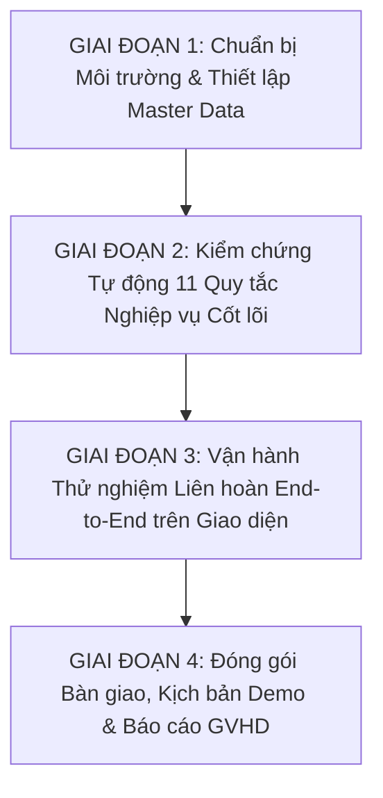
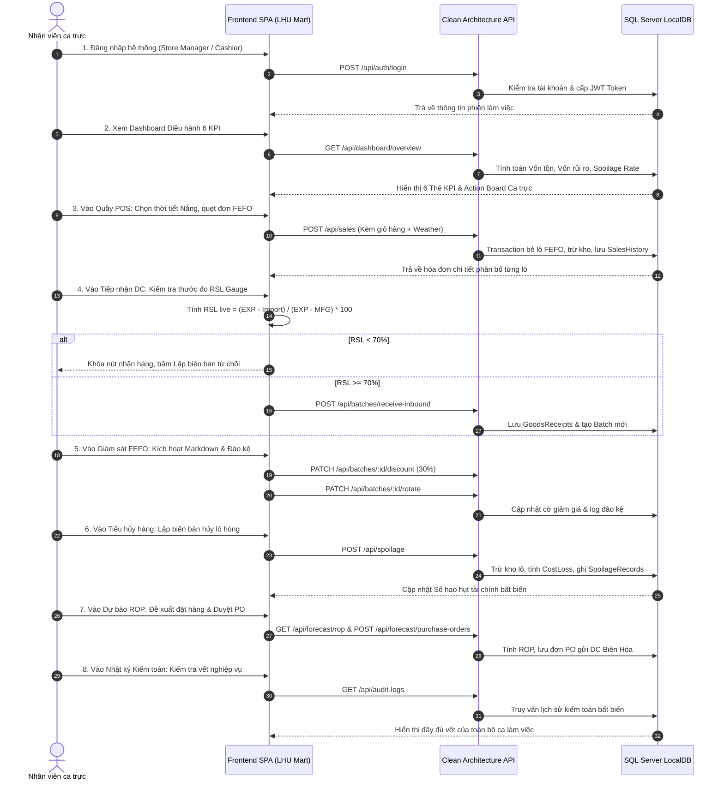

# KẾ HOẠCH NGHIỆM THU TOÀN DIỆN & VẬN HÀNH HỆ THỐNG
## NỀN TẢNG QUẢN TRỊ CHUỖI CUNG ỨNG BÁN LẺ CHỐNG LÃNG PHÍ
### (SUPPLY CHAIN SPOILAGE PREDICTOR - CLEAN ARCHITECTURE & SQL SERVER)

> **Căn cứ tài liệu gốc:** [Dac Ta He Thong Quan Ly Chuoi Cung Ung Chong Lang Phi - Supply Chain Spoilage Predictor.md](file:///c:/thuyet%20minh/Docs/Dac%20Ta%20He%20Thong%20Quan%20Ly%20Chuoi%20Cung%20Ung%20Chong%20Lang%20Phi%20-%20Supply%20Chain%20Spoilage%20Predictor.md)  
> **Đơn vị thực hiện:** Nhóm sinh viên Đỗ Tấn Du & Đoàn Minh Quân — Khoa CNTT, Đại học Lạc Hồng (LHU)  
> **GVHD:** ThS. Lê Minh Nhật  

---

## I. MỤC TIÊU VÀ NGUYÊN TẮC NGHIỆM THU

### 1. Mục tiêu
1. Kiểm chứng và nghiệm thu toàn diện hệ thống từ Tầng Cơ sở dữ liệu SQL Server LocalDB, Tầng Domain Clean Architecture Backend, đến Giao diện Người dùng Frontend SPA.
2. Đảm bảo toàn bộ 11 Quy tắc Nghiệp vụ cốt lõi (11 Core Business Rules) và Ma trận Phân quyền 4 Roles (Admin, Store Manager, Cashier, Warehouse Staff) vận hành chính xác 100% theo đúng tài liệu Đặc tả SSOT.
3. Không để xảy ra bất kỳ lỗi logic hồi quy (regression), không còn dữ liệu giả lập (mock data), tất cả giao dịch đều ghi nhận thời gian thực vào CSDL thật `retail_spoilage_db`.

### 2. Nguyên tắc thực hiện
- **Lập kế hoạch trước, duyệt xong mới thực thi:** Mỗi giai đoạn có tiêu chí chấp thuận (Acceptance Criteria) và kịch bản rõ ràng.
- **Tính toán toàn vẹn dữ liệu:** Không xóa hay làm xáo trộn dữ liệu mẫu đã có trong CSDL; mọi thao tác kiểm thử đều phải để lại dấu vết trong bảng kiểm toán `AuditLogs`.
- **Khả năng tái lập:** Mọi kịch bản kiểm thử đều có thể chạy lại tự động hoặc thủ công để phục vụ buổi báo cáo nghiệm thu với GVHD.

---

## II. LỘ TRÌNH 4 GIAI ĐOẠN NGHIỆM THU CHI TIẾT

---

### GIAI ĐOẠN 1: CHUẨN BỊ MÔI TRƯỜNG & THIẾT LẬP MASTER DATA

#### 1.1 Kiểm tra Cơ sở hạ tầng & Cơ chế Sao lưu An toàn
- **Database Server:** Microsoft SQL Server LocalDB `(localdb)\mssqllocaldb`.
  - Database: `retail_spoilage_db`.
  - Kiểm tra 13 bảng chuẩn 3NF: `Users`, `Roles`, `StoreProfile`, `Categories`, `Products`, `Batches`, `SalesHistory`, `SpoilageRecords`, `PurchaseOrders`, `PurchaseOrderItems`, `GoodsReceipts`, `AuditLogs`, `StoreShifts`.
  - Kiểm tra View 3 màu cảnh báo: `vw_Batches_ShelfLife_Alerts`.
  - Kiểm tra Trigger chống âm kho: `TR_Batches_PreventNegativeStock`.
  - Kiểm tra Index tối ưu: `IX_Batches_FEFO`, `IX_Batches_ExpiryWatchdog`, `IX_Products_Sku`, v.v.
- **Cơ chế Sao lưu & Khôi phục CSDL Mẫu (Database Backup/Restore):**
  - Tích hợp script `Backend/backup_database.js` tạo snapshot `.bak` trước khi thực hiện test suite tự động.
  - Tích hợp script `Backend/restore_database.js` khôi phục nguyên trạng CSDL mẫu sau khi test xong nhằm bảo toàn dữ liệu phục vụ buổi Demo với GVHD.
- **Backend Service:** Node.js Express Clean Architecture tại cổng `5000`.
- **Frontend SPA:** React + Vite SPA tại cổng `5173`.

#### 1.2 Rà soát Danh mục Dữ liệu chuẩn (Master Seed Data)
- **Cửa hàng bán lẻ duy nhất:** `RETAIL-STORE-01` (LHU Mart - Co.op Smile Liên kết ĐH Lạc Hồng).
- **Kho tổng DC liên kết:** `DC-BIENHOA` (Trung tâm Phân phối DC Biên Hòa).
- **Tài khoản kiểm thử chuẩn (4 Roles):**
  1. `admin` (Role: `ADMIN`) - Quản trị hệ thống, StoreProfile, Audit Log.
  2. `manager` (Role: `STORE_MANAGER`) - Cửa hàng trưởng, duyệt Markdown, duyệt Spoilage, duyệt PO.
  3. `cashier` (Role: `CASHIER`) - Thu ngân quầy POS.
  4. `warehouse` (Role: `CASHIER`) - Nhân viên kho nhận hàng DC, đảo kệ mặt tiền.
- **Tập Lô hàng đa dạng vòng đời chuẩn hóa theo Ngưỡng WarningDays ngành hàng:**
  - Nhóm lô Date xa (Vùng Xanh - `SAFE`, $DaysLeft > WarningDays$ của ngành hàng / sản phẩm).
  - Nhóm lô Cảnh báo (Vùng Vàng - `WARNING`, $3 < DaysLeft \le WarningDays$ với $WarningDays = COALESCE(p.custom\_warning\_days, c.default\_warning\_days, 7)$).
  - Nhóm lô Cận date nguy kịch (Vùng Đỏ - `CRITICAL`, $0 < DaysLeft \le 3$).
  - Nhóm lô Hết hạn (Vùng Tím - `EXPIRED`, $DaysLeft \le 0$).

---

### GIAI ĐOẠN 2: KIỂM CHỨNG TỰ ĐỘNG 11 QUY TẮC NGHIỆP VỤ CỐT LÕI (SSOT AUDIT)

Xây dựng và chạy bộ script kiểm chứng tự động lần lượt 11 Quy tắc Nghiệp vụ:

| STT | Quy tắc Nghiệp vụ (Business Rule) | Kịch bản Kiểm tra Cụ thể | Kết quả kỳ vọng (Expected Output) |
| :---: | :--- | :--- | :--- |
| **Rule 1** | **Cửa hàng bán lẻ duy nhất** | Gọi `GET /api/store-profile` và cập nhật thông tin cửa hàng. | Chỉ có duy nhất 1 record `RETAIL-STORE-01`. Mọi giao dịch xuất nhập đều tự động gắn mã cửa hàng này. |
| **Rule 2** | **Xuất bán FEFO tuyệt đối** | Đặt mua sản phẩm có nhiều lô với hạn sử dụng khác nhau. | Đơn hàng tự động bóc tách trừ số lượng vào lô có `expiry_date` gần nhất trước; nếu mua vượt số lượng 1 lô thì tự động bẻ dòng đơn qua lô tiếp theo. |
| **Rule 3** | **Chống tồn kho âm** | Cố tình tạo đơn bán hàng hoặc lệnh tiêu hủy có số lượng vượt tồn kho khả dụng hiện tại. | SQL Transaction và Trigger chặn đứng giao dịch, rollback 100%, trả về lỗi `HTTP 400: Không đủ tồn kho khả dụng`. Tồn kho `current_quantity >= 0` tuyệt đối. |
| **Rule 4** | **Cảnh báo 3 cấp màu Shelf-Life** | Truy vấn View `vw_Batches_ShelfLife_Alerts` qua endpoint `GET /api/batches`. | Phân loại chính xác 3 cấp màu: Xanh ($DaysLeft > WarningDays$), Vàng ($3 < DaysLeft \le WarningDays$), Đỏ ($0 < DaysLeft \le 3$), và Tím hết hạn ($DaysLeft \le 0$). |
| **Rule 5** | **Khóa cứng lô hết hạn** | Đưa lô hàng quá date ($DaysLeft \le 0$) vào giỏ hàng POS hoặc gọi API bán. | Hệ thống từ chối thanh toán sản phẩm, gắn nhãn `Khóa Bán POS` và chỉ cho phép xuất sang chức năng Tiêu hủy. |
| **Rule 6** | **Sổ hao hụt tài chính bất biến** | Thực hiện tiêu hủy một lô hàng hư hỏng/hết hạn qua `POST /api/spoilage`. | Tự động tính toán giá trị thiệt hại tài chính $CostLoss = QuantityDisposed \times ImportPrice$. Lưu vào bảng `spoilage_records`, trừ kho của lô, ghi nhận vào Sổ hao hụt bất biến. |
| **Rule 7** | **Tiêu chuẩn nhận hàng DC ($RSL \ge 70\%$)** | 1. Nhập lô có $RSL = 65\%$ ($< 70\%$). 2. Nhập lô có $RSL = 85\%$ ($\ge 70\%$). | 1. Trường hợp 1: Backend chặn lưu với thông báo vi phạm Rule 7, Frontend khóa nút lưu và hiện nút lập biên bản từ chối nhận hàng. 2. Trường hợp 2: Nhận hàng thành công, tạo lô mới vào CSDL. |
| **Rule 8** | **Dự báo ROP tích hợp ngoại cảnh** | Gọi `GET /api/forecast/rop` với các điều kiện: Nắng nóng (`SUNNY`), Mưa (`RAINY`), Ngày lễ (`isHoliday=true`). | Tự động áp dụng hệ số $W$-factor và $H$-factor; tính $DOS$ (Days of Supply); cảnh báo rủi ro ứ đọng khi $DOS > DUE$. Sinh đơn đề xuất đặt hàng PO gửi DC Biên Hòa. |
| **Rule 9** | **Chống trùng lặp sản phẩm** | Cố tình thêm sản phẩm mới có tên tương đồng $\ge 85\%$ hoặc trùng SKU. | Thuật toán chuẩn hóa chuỗi và Levenshtein chặn tạo mới, thông báo sản phẩm đã tồn tại trong danh mục. |
| **Rule 10** | **Xả hàng Markdown & Đảo kệ mặt tiền** | 1. Kích hoạt giảm giá Quick Markdown 30%. 2. Thực hiện thao tác xác nhận đảo kệ. | 1. Giá bán mới lập tức có hiệu lực tức thì ở quầy POS cho đúng lô đó. 2. Lưu vết nhân viên và thời gian đảo lô cận date ra mặt trước quầy kệ vào CSDL. |
| **Rule 11** | **Nhật ký kiểm toán bất biến** | Kiểm tra bảng `audit_logs` sau khi thực hiện chuỗi giao dịch. | Mọi thao tác xuất kho, nhập kho, đổi giá, đảo kệ, hủy hàng đều được ghi đầy đủ: `Timestamp`, `UserId`, `Action`, `EntityName`, `EntityId`, `Details`. |

---

### GIAI ĐOẠN 3: VẬN HÀNH THỬ NGHIỆM LIÊN HOÀN END-TO-END TRÊN GIAO DIỆN (UI SIMULATION)

Thực hiện phiên làm việc thực nghiệm qua giao diện Frontend kết nối Backend thật theo quy trình một ca làm việc hoàn chỉnh:

---

### GIAI ĐOẠN 4: ĐÓNG GÓI BÀN GIAO & KỊCH BẢN DEMO CHO GVHD

1. **Biên bản Nghiệm thu Kỹ thuật (Technical Acceptance Report):**
   - Bảng tổng hợp kết quả Pass/Fail của 11 Quy tắc Nghiệp vụ.
   - Thống kê hiệu năng: Thời gian phản hồi API ($< 150ms$), thời gian build Vite production ($< 600ms$).
2. **Kịch bản Demo Trực tiếp 15 phút (Live Demonstration Script):**
   - Phân bổ thời lượng chi tiết cho từng phân hệ để sinh viên thuyết trình trước GVHD ThS. Lê Minh Nhật và Hội đồng bảo vệ.
   - Tập trung làm nổi bật giá trị cốt lõi: **Chống lãng phí thực phẩm FMCG bằng công nghệ bẻ lô FEFO, cảnh báo RSL 3 màu và dự báo ROP đa biến**.
3. **Cập nhật Tài liệu Hướng dẫn Vận hành (`README.md`):**
   - Hướng dẫn 1 lệnh khởi chạy toàn bộ hệ thống (Backend + Frontend).
   - Danh sách tài khoản mẫu và hướng dẫn xử lý sự cố.

---

## III. TIÊU CHÍ CHẤP THUẬN NGHIỆM THU (ACCEPTANCE CRITERIA)

| Tiêu chí | Ngưỡng đạt chuẩn (Threshold) | Phương pháp kiểm chứng |
| :--- | :--- | :--- |
| **Clean Architecture** | 100% tuân thủ cấu trúc 4 tầng, không phụ thuộc chéo | Kiểm tra code review và DI Container |
| **SQL Server 3NF** | 13 bảng chuẩn hóa, ràng buộc CHECK chống âm kho hoạt động | Thực thi lệnh SQL trực tiếp và migration script |
| **Test Coverage** | 100% Unit Tests & Integration Tests PASS | Chạy các file `test_step3_*.js` và `test_step4_*.js` |
| **Frontend Production** | Build exit code 0, không tham chiếu mockData | Chạy `npm run build` trong thư mục `Frontend` |
| **Audit Trail** | 100% các hành động ghi/sửa dữ liệu đều có vết trong AuditLog | So sánh số lượng thao tác với bản ghi `audit_logs` |

---

## IV. BƯỚC HÀNH ĐỘNG TIẾP THEO

Sau khi bản kế hoạch này được người dùng xem xét và đồng ý, chúng ta sẽ lần lượt thực hiện:
1. **Bước 1:** Chạy script chuẩn hóa Master Seed Data trên SQL Server LocalDB để đảm bảo đủ dữ liệu mẫu cho mọi kịch bản.
2. **Bước 2:** Thực thi Kịch bản Kiểm chứng Tự động 11 Quy tắc Nghiệp vụ (Giai đoạn 2).
3. **Bước 3:** Khởi động Backend & Frontend để thực hiện phiên vận hành thử nghiệm trực quan End-to-End (Giai đoạn 3).
4. **Bước 4:** Xuất Kịch bản Demo chi tiết và Biên bản Báo cáo nghiệm thu hoàn tất đề tài (Giai đoạn 4).
