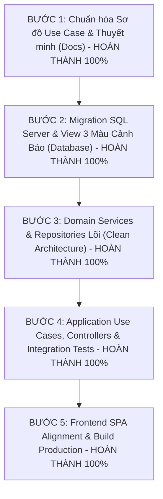

# KẾ HOẠCH RÀ SOÁT VÀ ĐIỀU CHỈNH HỆ THỐNG THEO ĐẶC TẢ CHUẨN MỰC

**Tài liệu tham chiếu chuẩn (SSOT):** [Dac Ta He Thong Quan Ly Chuoi Cung Ung Chong Lang Phi - Supply Chain Spoilage Predictor.md](<file:///c:/thuyet%20minh/Docs/Dac%20Ta%20He%20Thong%20Quan%20Ly%20Chuoi%20Cung%20Ung%20Chong%20Lang%20Phi%20-%20Supply%20Chain%20Spoilage%20Predictor.md>)
**Nguyên tắc vận hành:** Triển khai tuần tự theo từng module nhỏ, kiểm thử chắc chắn từng phần, tuyệt đối không sửa ồ ạt làm gãy vỡ hệ thống đang chạy.

---

## MỤC LỤC

1. [Tổng hợp hiện trạng &amp; Mức độ sai lệch](#1-tổng-hợp-hiện-trạng--mức-độ-sai-lệch)
2. [Hạng mục 1: Sơ đồ Use Case &amp; Tài liệu thuyết minh (Ưu tiên cao nhất)](#2-hạng-mục-1-sơ-đồ-use-case--tài-liệu-thuyết-minh)
3. [Hạng mục 2: Cơ sở dữ liệu SQL Server LocalDB](#3-hạng-mục-2-cơ-sở-dữ-liệu-sql-server-localdb)
4. [Hạng mục 3: Backend Clean Architecture 4 tầng](#4-hạng-mục-3-backend-clean-architecture-4-tầng)
5. [Hạng mục 4: Giao diện Frontend SPA &amp; Phân quyền](#5-hạng-mục-4-giao-diện-frontend-spa--phân-quyền)
6. [Lộ trình 5 bước triển khai sửa đổi an toàn](#6-lộ-trình-5-bước-triển-khai-sửa-đổi-an-toàn)

---

## 1. TỔNG HỢP HIỆN TRẠNG & MỨC ĐỘ SAI LỆCH

| Thành phần                | Hiện trạng đang có                                                                                                       | Chuẩn mực trong Đặc tả SSOT                                                                                           | Mức độ sai lệch / Cần làm                                                |
| :-------------------------- | :--------------------------------------------------------------------------------------------------------------------------- | :------------------------------------------------------------------------------------------------------------------------- | :----------------------------------------------------------------------------- |
| **Sơ đồ Use Case** | 2 nhóm Actor gộp chung; thiếu nhiều UC cốt lõi (RSL 70%, bẻ lô FEFO, 4 mức markdown, ca trực, audit).              | 4 Actor riêng biệt (`ADMIN`, `STORE_MANAGER`, `CASHIER`, `WAREHOUSE_STAFF`); 6 phân hệ nghiệp vụ đầy đủ. | **Cao (90%)** - Cần vẽ lại và viết lại thuyết minh ngay.          |
| **Database**          | Đã có các bảng nền tảng (`users`, `roles`, `store_profile`, `products`), khóa chính dạng `INT IDENTITY`. | 13 bảng 3NF, đầy đủ index và ràng buộc CHECK chống âm kho, khóa ngoại toàn vẹn.                              | **Trung bình (40%)** - Bổ sung các bảng PO, Hủy hàng, và Index.   |
| **Backend**           | Đã làm 3 Foundation Modules: Auth, StoreProfile, Catalog (Chống trùng sản phẩm).                                      | Đầy đủ 4 tầng Clean Architecture, các Domain Service (FEFO, ROP, Markdown) và Use Cases lõi.                       | **Trung bình (60%)** - Viết tiếp các Use Case nghiệp vụ chưa có. |
| **Frontend**          | Đã có khung giao diện SPA với 11 components, nhưng đang dùng dữ liệu mẫu`mockData.js`.                          | Kết nối API thật, chia menu theo 4 Roles, có máy tính RSL$\ge 70\%$ và cờ thời tiết/lễ POS.                   | **Trung bình (50%)** - Ghép API thật và phân quyền màn hình.     |

---

## 2. HẠNG MỤC 1: SƠ ĐỒ USE CASE & TÀI LIỆU THUYẾT MINH

*Tệp liên quan:*

* Script vẽ sơ đồ: [draw_use_case_diagram.py](<file:///c:/thuyet%20minh/Docs/draw_use_case_diagram.py>)
* Tài liệu thuyết minh: [THUYET_MINH_CHI_TIET_SO_DO_USE_CASE.docx](<file:///c:/thuyet%20minh/Docs/THUYET_MINH_CHI_TIET_SO_DO_USE_CASE.docx>)

### 2.1 Sai lệch về Actor (Cần tách thành 4 Actor)

* **Hiện tại:** Gộp chung `Store Staff / Cashier` và `Store Manager / Admin`. Điều này vi phạm nguyên tắc kiểm soát nội bộ và phân chia trách nhiệm.
* **Cần sửa:** Vẽ rõ ràng 4 Actor người dùng + 1 Actor hệ thống bên ngoài:
  1. `Admin` (Quản trị viên): Cấu hình cửa hàng, tài khoản, kiểm toán.
  2. `Store Manager` (Cửa hàng trưởng): Duyệt giá xả hàng, duyệt hủy hàng, duyệt đặt hàng DC, xem Dashboard KPI.
  3. `Cashier` (Thu ngân): Quét Barcode, bán hàng POS xuất kho FEFO, chọn cờ thời tiết/lễ, chốt ca tiền mặt.
  4. `Warehouse Staff` (Nhân viên kho & quầy kệ): Nhận hàng DC (kiểm tra RSL $\ge 70\%$), đảo kệ mặt tiền 5 bước, dán tem giảm giá, lập đề xuất hủy hàng, bàn giao ca.
  5. `Kho tổng DC Biên Hòa` (Secondary Actor): Tiếp nhận đơn đặt hàng PO và giao xe tải đến cửa hàng.

### 2.2 Chi tiết các Use Case cần sửa và bổ sung theo 6 Phân hệ

#### Phân hệ 1: Quản trị hệ thống & Cấu hình (Admin & Manager)

- [X] Đăng nhập & Xác thực JWT (`UC-01`)
- [ ] Quản lý tài khoản nhân viên & Phân quyền 4 vai trò (`UC-02`)
- [ ] Cấu hình thông tin Cửa hàng bán lẻ duy nhất `StoreProfile` (`UC-03`)
- [ ] Quản lý danh mục FMCG & Sản phẩm (Tích hợp thuật toán chặn trùng $\ge 85\%$) (`UC-04`)
- [ ] Xem Nhật ký kiểm toán bất biến `AuditLogs` (`UC-05`)

#### Phân hệ 2: Tiếp nhận hàng từ Kho tổng DC (Warehouse Staff)

- [ ] Tiếp nhận hàng từ xe tải DC Biên Hòa (`UC-06`)
- [ ] *«include»* Tính toán và kiểm định tỷ lệ $RSL_{inbound} \ge 70\%$ (`UC-06.1` - Rule 7)
- [ ] *«extend»* Khóa lưu và lập biên bản từ chối nhận hàng nếu $RSL < 70\%$ (`UC-06.2`)
- [ ] *«include»* Tự động sinh mã lô chuẩn `LOT-DC-[Mã SP]-[Ngày]` và kích hoạt theo dõi hạn dùng (`UC-06.3`)
- [ ] *«extend»* In tem mã vạch lô hàng lưu kho (`UC-06.4`)

#### Phân hệ 3: Bán lẻ tại quầy POS theo FEFO (Cashier)

- [ ] Bán lẻ tại quầy POS (`UC-07`)
- [ ] *«include»* Tự động quét chọn lô có hạn dùng gần nhất `ExpiryDate ASC` (`UC-07.1` - Rule 2)
- [ ] *«include»* Tự động bẻ nhỏ đơn hàng qua nhiều lô (Split Order) khi số lượng lớn (`UC-07.2`)
- [ ] *«include»* Tự động áp dụng giá sau chiết khấu nếu lô đang gắn Quick Markdown (`UC-07.3`)
- [ ] *«include»* Khấu trừ trực tiếp `CurrentQuantity` với Transaction khóa an toàn (`UC-07.4` - Rule 3)
- [ ] *«include»* Ghi nhận ngữ cảnh bán hàng (Thời tiết + Cờ ngày lễ) vào `SalesHistory` (`UC-07.5`)
- [ ] In hóa đơn bán lẻ chi tiết mã lô cho khách hàng (`UC-07.6`)

#### Phân hệ 4: Giám sát HSD, Quick Markdown & Đảo kệ mặt tiền (Manager & Warehouse Staff)

- [ ] Giám sát hạn dùng toàn bộ lô hàng theo 3 vùng màu Xanh/Vàng/Đỏ (`UC-08`)
- [ ] Tự động chuyển trạng thái `EXPIRED` và khóa cứng bán POS khi $DaysLeft \le 0$ (`UC-09` - Rule 5)
- [ ] Kích hoạt giảm giá xả hàng Quick Markdown (15%, 30%, 40%, 50%) — *Store Manager* (`UC-10` - Rule 10)
- [ ] Thực hiện quy trình 5 bước đảo kệ mặt tiền & Xác nhận điện tử — *Warehouse Staff* (`UC-11` - Rule 10)

#### Phân hệ 5: Tiêu hủy hàng hỏng & Sổ hao hụt tài chính (Warehouse Staff & Manager)

- [ ] Lập biên bản đề xuất tiêu hủy hàng hỏng / quá hạn — *Warehouse Staff* (`UC-12`)
- [ ] Phê duyệt tiêu hủy và chốt Sổ hao hụt tài chính — *Store Manager* (`UC-13` - Rule 6)
- [ ] *«include»* Tính toán giá trị vốn tổn thất $CostLoss = Quantity \times ImportPrice$ (`UC-13.1`)
- [ ] *«include»* Trừ kho lô hàng về 0 và chuyển trạng thái sang `DISPOSED` (`UC-13.2`)

#### Phân hệ 6: Dự báo ROP, Đơn đặt hàng DC & Điều hành ca trực (Manager & Staff)

- [ ] Phân tích tốc độ bán 14 ngày & Hệ số ngoại cảnh (Thời tiết, Ngày lễ) (`UC-14` - Rule 8)
- [ ] Đánh giá rủi ro ứ đọng $DOS > DUE$ (`UC-15` - Rule 8)
- [ ] Tự động đề xuất Điểm đặt hàng ROP (`UC-16`)
- [ ] Phê duyệt và gửi đơn đặt hàng bổ sung `PurchaseOrder` về Kho tổng DC — *Store Manager* (`UC-17`)
- [ ] Xem Dashboard điều hành 6 chỉ số KPI tài chính & Action Board ca trực (`UC-18`)
- [ ] Bàn giao ca trực điện tử 4 bước (POS, Lô cận date, Thùng hủy, Ký xác nhận) (`UC-19`)

---

## 3. HẠNG MỤC 2: CƠ SỞ DỮ LIỆU SQL SERVER LOCALDB

*Tệp liên quan:*

* [retail_spoilage_database.sql](<file:///c:/thuyet%20minh/Database/retail_spoilage_database.sql>)
* [clean_arch_migration.sql](<file:///c:/thuyet%20minh/Database/clean_arch_migration.sql>)

### 3.1 Bảng dữ liệu cần rà soát & Bổ sung

1. **`Batches`:**
   * Bắt buộc có các ràng buộc:
     * `CONSTRAINT CK_Batches_Quantity CHECK (CurrentQuantity >= 0 AND CurrentQuantity <= InitialQuantity)`
     * `CONSTRAINT CK_Batches_Dates CHECK (ExpiryDate > ManufactureDate)`
     * `CONSTRAINT CK_Batches_Discount CHECK (DiscountPercent BETWEEN 0 AND 100)`
   * Cột `DiscountPercent INT NOT NULL DEFAULT 0` (hỗ trợ các giá trị 0, 15, 30, 40, 50).
2. **`SalesHistory`:**
   * Đảm bảo có các cột: `TransactionCode`, `DayOfWeek`, `Weather` (SUNNY, RAINY, NORMAL), `IsHoliday` (BIT), `CashierId`.
3. **`SpoilageRecords`:**
   * Đảm bảo có: `RecordCode`, `CostLoss` (`DECIMAL(12,2)`), `Reason` (EXPIRED, DAMAGED, SPOILED), `PerformedBy`, `ApprovedBy`.
4. **`PurchaseOrders` & `PurchaseOrderItems`:**
   * Bổ sung bảng lưu đơn đặt hàng ROP gửi DC, có `OrderCode`, `Status` (DRAFT, APPROVED, SENT_TO_DC, COMPLETED), `SuggestedQuantity`, `ApprovedQuantity`.
5. **`GoodsReceipts`:**
   * Bổ sung bảng phiếu nhập kho từ xe tải DC liên kết với bảng `batches`.
6. **`AuditLogs`:**
   * Bảng nhật ký kiểm toán lưu vết bất biến: `UserId`, `Action`, `EntityName`, `EntityId`, `Description`, `CreatedAt`.

### 3.2 Bổ sung các Index tăng tốc (Mục 18 của Đặc tả)

* `IX_Batches_FEFO` trên `Batches(ProductId, Status, ExpiryDate ASC)` INCLUDE `(CurrentQuantity, DiscountPercent, ImportPrice)`
* `IX_Batches_ExpiryWatchdog` trên `Batches(ExpiryDate ASC, Status)`
* `IX_SalesHistory_Product_Date` trên `SalesHistory(ProductId, SaleDate DESC)`
* `IX_SpoilageRecords_Batch` trên `SpoilageRecords(BatchId, DisposedDate DESC)`
* `IX_PurchaseOrders_Status` trên `PurchaseOrders(Status, CreatedAt DESC)`
* `IX_AuditLogs_CreatedAt` trên `AuditLogs(CreatedAt DESC, UserId)`

---

## 4. HẠNG MỤC 3: BACKEND CLEAN ARCHITECTURE 4 TẦNG

*Tệp liên quan:* Thư mục [Backend/src/](<file:///c:/thuyet%20minh/Backend/src/>)

### 4.1 Domain Layer (`src/domain/`)

* **Entities:**
  * Tạo thực thể `Batch.js` (quản lý số lượng tồn, kiểm tra hết hạn, áp dụng chiết khấu).
  * Tạo thực thể `SaleOrder.js` (danh sách món hàng, cơ chế bẻ lô, tính tổng tiền).
  * Tạo thực thể `SpoilageRecord.js` (tính giá trị thiệt hại $CostLoss$).
  * Tạo thực thể `PurchaseOrder.js`.
* **Value Objects:**
  * `ShelfLife.js`: Tính $DaysLeft$, tỷ lệ $RSL\%$.
  * `AlertLevel.js`: Xác định vùng màu (SAFE, WARNING, CRITICAL, EXPIRED).
  * `WeatherCondition.js`: Validate giá trị thời tiết (SUNNY, RAINY, NORMAL).
* **Domain Services:**
  * `FefoAllocationPolicy.js`: Thuật toán bóc tách lô `ExpiryDate ASC`, bẻ dòng đơn qua nhiều lô.
  * `RopCalculationService.js`: Tính $d_{base}$, nhân hệ số $W$ và $H$, tính ROP và cảnh báo $DOS > DUE$.
  * `MarkdownPricingPolicy.js`: Tính giá bán sau giảm (15%, 30%, 40%, 50%).

### 4.2 Application Layer (`src/application/use-cases/`)

Tạo các Use Case theo từng thư mục nghiệp vụ:

* `batch/`:
  * `ReceiveDCBatchUseCase.js` (Validate $RSL \ge 70\%$, tạo lô mới).
  * `ApplyQuickMarkdownUseCase.js` (Áp dụng mức giảm giá xả hàng).
  * `RotateShelfFefoUseCase.js` (Lưu vết đảo kệ mặt tiền).
  * `EvaluateAlertsUseCase.js` (Phân vùng 3 màu và khóa lô hết hạn).
* `sales/`:
  * `ProcessFefoSaleUseCase.js` (Thực thi xuất bán lẻ POS FEFO an toàn trong SQL Transaction).
* `spoilage/`:
  * `DisposeSpoiledGoodsUseCase.js` (Hạch toán Sổ hao hụt tài chính).
  * `GetSpoilageLedgerUseCase.js` (Truy vấn sổ hao hụt).
* `forecast/`:
  * `CalculateROPForecastUseCase.js` (Dự báo nhu cầu đặt hàng).
  * `CreatePurchaseOrderUseCase.js` (Tạo đơn PO gửi DC).
* `dashboard/`:
  * `GetDashboardOverviewUseCase.js` (Tính 6 chỉ số KPI tài chính).

### 4.3 Infrastructure & Presentation Layer

* Triển khai các Repositories: `SqlBatchRepository.js`, `SqlSaleRepository.js`, `SqlSpoilageRepository.js`, `SqlPurchaseOrderRepository.js`, `SqlAuditLogRepository.js`.
* Controllers & Routes tương ứng: `BatchController.js`, `SalesController.js`, `SpoilageController.js`, `ForecastController.js`, `DashboardController.js`.
* Chuẩn hóa Middleware: `roleMiddleware.js` bảo vệ đúng ma trận phân quyền 4 Roles.

---

## 5. HẠNG MỤC 4: GIAO DIỆN FRONTEND SPA & PHÂN QUYỀN

*Tệp liên quan:* Thư mục [Frontend/src/](<file:///c:/thuyet%20minh/Frontend/src/>)

### 5.1 Phân quyền hiển thị Menu & Màn hình (RBAC)

* `CASHIER`: Chỉ hiển thị Quầy thu ngân POS, Lịch sử bán hàng của ca, Bàn giao ca thu ngân.
* `WAREHOUSE_STAFF`: Chỉ hiển thị Tiếp nhận hàng DC, Giám sát lô & Đảo kệ, Đề xuất tiêu hủy hàng, Bàn giao ca kho.
* `STORE_MANAGER`: Toàn quyền xem Dashboard KPI, Phê duyệt Quick Markdown, Phê duyệt tiêu hủy Sổ hao hụt, Dự báo ROP & Duyệt đơn PO gửi DC.
* `ADMIN`: Quản lý tài khoản, Cấu hình `StoreProfile`, Xem Audit Log hệ thống.

### 5.2 Nâng cấp các Màn hình chi tiết

* **Quầy thu ngân (`PosCheckoutView.jsx`):**
  * Thêm ô chọn nhanh: *Thời tiết* (Nắng / Mưa / Bình thường) và *Cờ ngày lễ*.
  * Hiển thị trực quan việc đơn hàng tự bẻ qua nhiều lô khi xuất bán.
* **Tiếp nhận hàng DC (`DcIntakeView.jsx`):**
  * Tích hợp máy tính RSL tự động hiển thị thanh % vòng đời:
    * $\ge 70\%$: Thanh màu xanh lá cây, nút "Lưu phiếu nhập" sáng.
    * $< 70\%$: Thanh màu đỏ, nút "Lưu phiếu nhập" bị khóa cứng, hiện nút "Lập biên bản từ chối nhận hàng".
* **Giám sát lô & Quầy kệ (`FefoMonitorView.jsx`):**
  * Tách rõ 2 nút bấm nghiệp vụ:
    * Nút "Kích hoạt giảm giá xả hàng" (Chỉ Store Manager thấy).
    * Nút "Xác nhận đã đảo kệ ra mặt tiền" (Dành cho Warehouse Staff thao tác xong bấm lưu vết).

---

## 6. LỘ TRÌNH 5 BƯỚC TRIỂN KHAI SỬA ĐỔI AN TOÀN

Tuân thủ nghiêm ngặt nguyên tắc: **Làm chắc từng bước, rà soát kiểm thử xong mới chuyển bước tiếp theo.**

### BẢNG THEO DÕI TIẾN ĐỘ THỰC HIỆN

| Bước             | Hạng mục công việc                              |        Trạng thái        | Chi tiết kết quả nghiệm thu                                                                                                                                                                                                                                                                                                                                                                                                         |
| :----------------- | :-------------------------------------------------- | :-------------------------: | :-------------------------------------------------------------------------------------------------------------------------------------------------------------------------------------------------------------------------------------------------------------------------------------------------------------------------------------------------------------------------------------------------------------------------------------- |
| **Bước 1** | **Sơ đồ Use Case & Thuyết minh**          | **100% HOÀN THÀNH** | Vẽ lại 4 Roles + 1 Actor ngoài (DC Biên Hòa) + 6 phân hệ nghiệp vụ. Xuất ảnh`use_case.png` và sinh tài liệu Word `THUYET_MINH_CHI_TIET_SO_DO_USE_CASE.docx` chuẩn chỉ. Dọn dẹp 39 file rác vào `_Archive_Old_Files`.                                                                                                                                                                                          |
| **Bước 2** | **Cơ sở dữ liệu SQL Server**              | **100% HOÀN THÀNH** | Thực thi`step2_migration_ssot_alignment.sql`: bổ sung `cashier_id`, `approved_by`, `entity_name`, `entity_id`; covered indexes `IX_Batches_FEFO`; Trigger `TR_Batches_PreventNegativeStock` chống âm kho (Rule 3); View `vw_Batches_ShelfLife_Alerts` 3 cấp màu cảnh báo (Rule 4, 5).                                                                                                                           |
| **Bước 3** | **Domain Services & Repositories**            | **100% HOÀN THÀNH** | Xây dựng Entities (`Batch`, `SaleOrder`, `SpoilageRecord`, `PurchaseOrder`), Value Objects (`Money`, `ShelfLife`, `WeatherCondition`), Domain Services (`FefoAllocationPolicy`, `RopCalculationService`, `MarkdownPricingPolicy`) và 10 Repositories kết nối SQL Server LocalDB. Audit pass 100%.                                                                                                              |
| **Bước 4** | **Application Use Cases & Controllers**       | **100% HOÀN THÀNH** | Hoàn thành 12 Use Cases, 5 Controllers, 5 Routes modules và DI Container (`container.js`). Bộ test tích hợp toàn diện `test_step4_full_integration.js` chạy pass 11/11 tests (100%), bao gồm chặn RSL < 70%, chặn âm kho, bẻ lô FEFO, Quick Markdown, Tiêu hủy Sổ hao hụt, ROP, PO, Dashboard.                                                                                                                   |
| **Bước 5** | **Frontend SPA Alignment & Production Build** | **100% HOÀN THÀNH** | Bổ sung API client functions Clean Architecture vào`api.js`. Loại bỏ toàn bộ ngày hardcode `2026-09-24` chuyển sang thời gian thực. Bổ sung thước đo RSL Inbound Freshness Gauge (Rule 7 >= 70%) trên `DcIntakeView`. Đồng bộ `daysLeft`, `alertColor`, `currentQuantity` của `FefoMonitorView`, `PosCheckoutView`, `DashboardView`. Build Vite production bundle thành công 100% (exit code 0). |
