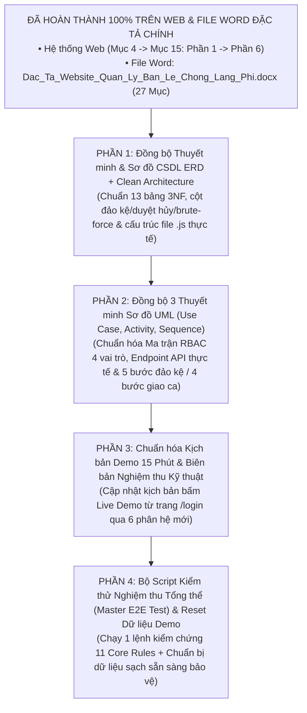

# KẾ HOẠCH ĐỒNG BỘ HỒ SƠ THUYẾT MINH, SƠ ĐỒ KỸ THUẬT & KỊCH BẢN BẢO VỆ ĐỒ ÁN

> **Tài liệu gốc đối chiếu (SSOT):**
> 1. [Dac Ta He Thong Quan Ly Chuoi Cung Ung Chong Lang Phi - Supply Chain Spoilage Predictor.md](file:///c:/thuyet%20minh/Docs/Dac%20Ta%20He%20Thong%20Quan%20Ly%20Chuoi%20Cung%20Ung%20Chong%20Lang%20Phi%20-%20Supply%20Chain%20Spoilage%20Predictor.md) *(27 Mục Đặc tả & 11 Core Business Rules)*
> 2. [Dac_Ta_Website_Quan_Ly_Ban_Le_Chong_Lang_Phi.docx](file:///c:/thuyet%20minh/Docs/Dac_Ta_Website_Quan_Ly_Ban_Le_Chong_Lang_Phi.docx) *(Đã cập nhật & xuất lại đồng bộ 100% với 27 mục)*
> 3. [Ke_Hoach_Trien_Khai_Tiep_Theo_Tu_Muc_5_Den_Muc_15.md](file:///c:/thuyet%20minh/Docs/Ke_Hoach_Trien_Khai_Tiep_Theo_Tu_Muc_5_Den_Muc_15.md) *(Phần 1 → Phần 6 trên Web đã hoàn thành 100%)*
>
> **Nguyên tắc thực hiện:** Triển khai cuốn chiếu **từng phần một (4 Phần độc lập)**. Hoàn thành, kiểm tra kết quả xuất file / chạy test xong phần nào mới chuyển sang phần tiếp theo.

---

## Tổng quan Lộ trình 4 Phần Hoàn thiện Cuối cùng

| Thứ tự | Tên phần công việc | File tài liệu / Mã nguồn mục tiêu | Trạng thái |
| :-: | :--- | :--- | :-: |
| **Bước 0** | Cập nhật & xuất lại file Word Đặc tả 27 mục | [Dac_Ta_Website_Quan_Ly_Ban_Le_Chong_Lang_Phi.docx](file:///c:/thuyet%20minh/Docs/Dac_Ta_Website_Quan_Ly_Ban_Le_Chong_Lang_Phi.docx), [build_docx_27muc.py](file:///c:/thuyet%20minh/Docs/Scripts/build_docx_27muc.py) | ✅ Hoàn thành |
| **Phần 1** | Đồng bộ Thuyết minh & File Word Sơ đồ **ERD (13 bảng)** và **Clean Architecture (4 tầng)** | [THUYET_MINH_CHI_TIET_SO_DO_ERD.md](file:///c:/thuyet%20minh/Docs/THUYET_MINH_CHI_TIET_SO_DO_ERD.md), [THUYET_MINH_CHI_TIET_SO_DO_CLEAN_ARCHITECTURE.md](file:///c:/thuyet%20minh/Docs/THUYET_MINH_CHI_TIET_SO_DO_CLEAN_ARCHITECTURE.md) + 2 file `.docx` trong `Docs/Word_Documents/` | ✅ Hoàn thành |
| **Phần 2** | Đồng bộ Thuyết minh & File Word 3 Sơ đồ UML: **Use Case**, **Activity (SOP)**, **Sequence** | [THUYET_MINH_CHI_TIET_SO_DO_USE_CASE.md](file:///c:/thuyet%20minh/Docs/THUYET_MINH_CHI_TIET_SO_DO_USE_CASE.md), [THUYET_MINH_CHI_TIET_SO_DO_HOAT_DONG.md](file:///c:/thuyet%20minh/Docs/THUYET_MINH_CHI_TIET_SO_DO_HOAT_DONG.md), [THUYET_MINH_CHI_TIET_SO_DO_TUAN_TU.md](file:///c:/thuyet%20minh/Docs/THUYET_MINH_CHI_TIET_SO_DO_TUAN_TU.md) + 3 file `.docx` | ✅ Hoàn thành |
| **Phần 3** | Cập nhật **Kịch bản Demo Thuyết trình 15 phút** & **Biên bản Nghiệm thu Kỹ thuật** | [KICH_BAN_DEMO_THUYET_TRINH_15_PHUT.md](file:///c:/thuyet%20minh/Docs/KICH_BAN_DEMO_THUYET_TRINH_15_PHUT.md), [BIEN_BAN_NGHIEM_THU_KY_THUAT_TOAN_DIEN.md](file:///c:/thuyet%20minh/Docs/BIEN_BAN_NGHIEM_THU_KY_THUAT_TOAN_DIEN.md) | ⏳ Chờ thực hiện |
| **Phần 4** | Xây dựng **Master E2E Test Suite (11 Rules + Phần 1→6)** & Kiểm tra tổng duyệt trước bảo vệ | `Backend/test_master_e2e_11_rules.js` & Kiểm tra toàn diện Database + Backend + Frontend | ⏳ Chờ thực hiện |

---

## Chi tiết từng phần triển khai

---

### BƯỚC 0 (ĐÃ XONG): Cập nhật file Word Đặc tả chính (`Dac_Ta_Website_Quan_Ly_Ban_Le_Chong_Lang_Phi.docx`)
- Đã cập nhật toàn bộ script [build_docx_27muc.py](file:///c:/thuyet%20minh/Docs/Scripts/build_docx_27muc.py) và chạy sinh lại thành công:
  - [Dac_Ta_Website_Quan_Ly_Ban_Le_Chong_Lang_Phi.docx](file:///c:/thuyet%20minh/Docs/Dac_Ta_Website_Quan_Ly_Ban_Le_Chong_Lang_Phi.docx) (`66,201 bytes`, đủ 27 mục từ Mục 1 đến Mục 27, 12 bảng biểu).
  - Bản sao đồng bộ tại [Dac Ta He Thong Quan Ly Chuoi Cung Ung Chong Lang Phi - Supply Chain Spoilage Predictor.docx](file:///c:/thuyet%20minh/Docs/Word_Documents/Dac%20Ta%20He%20Thong%20Quan%20Ly%20Chuoi%20Cung%20Ung%20Chong%20Lang%20Phi%20-%20Supply%20Chain%20Spoilage%20Predictor.docx).

---

### PHẦN 1: Đồng bộ Thuyết minh & File Word Sơ đồ ERD (13 bảng 3NF) và Clean Architecture (4 tầng)

#### 1.1 Điểm lệch hiện tại cần cập nhật
1. **Trong [THUYET_MINH_CHI_TIET_SO_DO_ERD.md](file:///c:/thuyet%20minh/Docs/THUYET_MINH_CHI_TIET_SO_DO_ERD.md) và script [build_erd_doc.py](file:///c:/thuyet%20minh/Docs/Scripts/build_erd_doc.py):**
   - Bảng `batches` chưa liệt kê 3 cột phục vụ quy trình SOP 5 bước đảo kệ (`is_shelf_rotated`, `shelf_rotated_at`, `shelf_rotated_by`).
   - Bảng `users` chưa liệt kê các cột bảo mật chống dò mật khẩu Brute-force (`failed_login_attempts`, `locked_until`, `last_login`).
   - Bảng `purchase_orders` đang ghi vòng đời trạng thái cũ (`DRAFT`, `SENT`, `DELIVERED`, `CANCELLED`) thay vì 5 trạng thái chuẩn trên Web (`DRAFT`, `APPROVED`, `SUBMITTED`, `DELIVERED`, `CANCELLED`) và thiếu cột `approved_by`.
   - Bảng `store_profile` cần bổ sung rõ các cột `default_warning_days`, `critical_days`, `opening_time`, `closing_time`.
2. **Trong [THUYET_MINH_CHI_TIET_SO_DO_CLEAN_ARCHITECTURE.md](file:///c:/thuyet%20minh/Docs/THUYET_MINH_CHI_TIET_SO_DO_CLEAN_ARCHITECTURE.md) và script [build_clean_arch_doc.py](file:///c:/thuyet%20minh/Docs/Scripts/build_clean_arch_doc.py):**
   - Đang ghi phần mở rộng file là `.ts` thay vì `.js` thực tế trong `Backend/src/`.
   - Chưa liệt kê các Domain Service và Use Case mới đã triển khai trong Phần 1 → Phần 6: `ProductDeduplicationService.js`, `RejectDCBatchUseCase.js`, `ApproveSpoilageRecordUseCase.js`, `UpdatePurchaseOrderStatusUseCase.js`, và các màn hình Frontend `LoginView.jsx`, `PurchaseOrdersSubView.jsx`, `ShiftHandoverView.jsx`.

#### 1.2 Công việc thực hiện ở Phần 1
- Cập nhật [THUYET_MINH_CHI_TIET_SO_DO_ERD.md](file:///c:/thuyet%20minh/Docs/THUYET_MINH_CHI_TIET_SO_DO_ERD.md) và [THUYET_MINH_CHI_TIET_SO_DO_CLEAN_ARCHITECTURE.md](file:///c:/thuyet%20minh/Docs/THUYET_MINH_CHI_TIET_SO_DO_CLEAN_ARCHITECTURE.md).
- Cập nhật và chạy 2 script [build_erd_doc.py](file:///c:/thuyet%20minh/Docs/Scripts/build_erd_doc.py) & [build_clean_arch_doc.py](file:///c:/thuyet%20minh/Docs/Scripts/build_clean_arch_doc.py) để xuất lại 2 file Word trong `Docs/Word_Documents/`.

---

### PHẦN 2: Đồng bộ Thuyết minh & File Word 3 Sơ đồ UML (Use Case, Activity, Sequence)

#### 2.1 Điểm lệch hiện tại cần cập nhật
1. **Trong [THUYET_MINH_CHI_TIET_SO_DO_USE_CASE.md](file:///c:/thuyet%20minh/Docs/THUYET_MINH_CHI_TIET_SO_DO_USE_CASE.md) & [build_use_case_doc.py](file:///c:/thuyet%20minh/Docs/Scripts/build_use_case_doc.py):**
   - Ma trận phân quyền RBAC cần cập nhật: Thu ngân & Nhân viên kho có quyền **Chỉ xem (Tra cứu Read-only)** Danh mục sản phẩm; Nhân viên kho có quyền **Tùy quyền (Chỉ xem)** Dự báo ROP; bổ sung Use Case `UC-06.2: Lập biên bản từ chối nhận hàng DC (REJECT_DC_INBOUND)`.
2. **Trong [THUYET_MINH_CHI_TIET_SO_DO_HOAT_DONG.md](file:///c:/thuyet%20minh/Docs/THUYET_MINH_CHI_TIET_SO_DO_HOAT_DONG.md) & [build_activity_doc.py](file:///c:/thuyet%20minh/Docs/Scripts/build_activity_doc.py):**
   - Chuẩn hóa tên cột `is_shelf_rotated = 1` ở Bước 5 quy trình đảo kệ và bổ sung **Mục 15.2 – 3 chế tài kỷ luật ca trực** ở Bước 4 quy trình bàn giao ca.
3. **Trong [THUYET_MINH_CHI_TIET_SO_DO_TUAN_TU.md](file:///c:/thuyet%20minh/Docs/THUYET_MINH_CHI_TIET_SO_DO_TUAN_TU.md) & [build_sequence_doc.py](file:///c:/thuyet%20minh/Docs/Scripts/build_sequence_doc.py):**
   - Đồng bộ tên endpoint thực tế: `POST /api/sales` (thay cho `/api/sales/checkout`), `POST /api/batches/receive-inbound` và `POST /api/batches/reject-inbound` (thay cho `/api/batches/inbound`).

#### 2.2 Công việc thực hiện ở Phần 2 (Đã hoàn thành)
- Cập nhật 3 file `.md` thuyết minh sơ đồ UML:
  - [THUYET_MINH_CHI_TIET_SO_DO_USE_CASE.md](file:///c:/thuyet%20minh/Docs/THUYET_MINH_CHI_TIET_SO_DO_USE_CASE.md): Ma trận RBAC chuẩn hóa, bổ sung UC-06.2 Lập biên bản từ chối nhận hàng DC.
  - [THUYET_MINH_CHI_TIET_SO_DO_HOAT_DONG.md](file:///c:/thuyet%20minh/Docs/THUYET_MINH_CHI_TIET_SO_DO_HOAT_DONG.md): Chuẩn hóa cờ `is_shelf_rotated = 1` và 3 chế tài kỷ luật Mục 15.2 trong SOP bàn giao ca trực.
  - [THUYET_MINH_CHI_TIET_SO_DO_TUAN_TU.md](file:///c:/thuyet%20minh/Docs/THUYET_MINH_CHI_TIET_SO_DO_TUAN_TU.md): Đồng bộ `POST /api/sales`, `POST /api/batches/receive-inbound`, `POST /api/batches/reject-inbound`, UseCase `RejectDCBatchUseCase`.
- Cập nhật và chạy 3 script build tự động xuất 3 file Word chuyên nghiệp:
  - [THUYET_MINH_CHI_TIET_SO_DO_USE_CASE.docx](file:///c:/thuyet%20minh/Docs/Word_Documents/THUYET_MINH_CHI_TIET_SO_DO_USE_CASE.docx) (`1,288,529 bytes`).
  - [THUYET_MINH_CHI_TIET_SO_DO_HOAT_DONG.docx](file:///c:/thuyet%20minh/Docs/Word_Documents/THUYET_MINH_CHI_TIET_SO_DO_HOAT_DONG.docx) (`1,291,556 bytes`).
  - [THUYET_MINH_CHI_TIET_SO_DO_TUAN_TU.docx](file:///c:/thuyet%20minh/Docs/Word_Documents/THUYET_MINH_CHI_TIET_SO_DO_TUAN_TU.docx) (`1,107,306 bytes`).

---

### PHẦN 3: Chuẩn hóa Kịch bản Demo Thuyết trình 15 Phút & Biên bản Nghiệm thu Kỹ thuật

#### 3.1 Điểm lệch hiện tại cần cập nhật
1. **Trong [KICH_BAN_DEMO_THUYET_TRINH_15_PHUT.md](file:///c:/thuyet%20minh/Docs/KICH_BAN_DEMO_THUYET_TRINH_15_PHUT.md):**
   - Bổ sung thao tác mở đầu tại **Trang Đăng nhập riêng (`/login`)** với 4 nút chọn nhanh vai trò (`ADMIN`, `STORE_MANAGER`, `CASHIER`, `WAREHOUSE_STAFF`).
   - Cập nhật lời thoại và thao tác khớp 100% với các tính năng mới:
     - **Phần 1 & 2:** Đổi trạng thái cửa hàng `OPEN` ↔ `INVENTORY` khóa POS tức thì; thử tạo sản phẩm trùng tên $\ge 85\%$ bị chặn bởi Rule 9.
     - **Phần 3:** Chọn đơn PO đã duyệt để nhập hàng DC; thử nhập lô có `RSL < 70%` bị khóa nút Lưu và bấm **Lập Biên Bản Từ Chối Nhận Hàng DC**.
     - **Phần 4:** Quét POS hiển thị **FEFO Allocation Preview** bẻ đơn qua 2 lô ngay trong giỏ hàng.
     - **Phần 5:** Kích hoạt Quick Markdown (15%/30%/40%/50%), mở Modal **SOP 5 bước đảo kệ**, và duyệt phiếu tiêu hủy tách biệt Người lập – Người duyệt (`SoD`).
     - **Phần 6:** Bấm nút Thời tiết (`SUNNY`/`RAINY`) & Lễ Tết (`+30%`) trên màn hình Dự báo ROP xem giải thích `🤖 AI: ...`, xem **Top 5 Bán chạy / Hao hụt** và **Action Board 4 Tab** trên Dashboard, ký **Bàn giao ca 4 bước kèm 3 chế tài Mục 15.2**.
2. **Trong [BIEN_BAN_NGHIEM_THU_KY_THUAT_TOAN_DIEN.md](file:///c:/thuyet%20minh/Docs/BIEN_BAN_NGHIEM_THU_KY_THUAT_TOAN_DIEN.md):**
   - Chuẩn hóa số lượng bảng thành **13 bảng chuẩn 3NF**, cập nhật đường dẫn API thực tế và bổ sung kết quả kiểm thử tự động của cả 6 Phần.

#### 3.2 Công việc thực hiện ở Phần 3
- Cập nhật [KICH_BAN_DEMO_THUYET_TRINH_15_PHUT.md](file:///c:/thuyet%20minh/Docs/KICH_BAN_DEMO_THUYET_TRINH_15_PHUT.md) và [BIEN_BAN_NGHIEM_THU_KY_THUAT_TOAN_DIEN.md](file:///c:/thuyet%20minh/Docs/BIEN_BAN_NGHIEM_THU_KY_THUAT_TOAN_DIEN.md).

---

### PHẦN 4: Bộ Script Kiểm thử Nghiệm thu Tổng thể (Master E2E Test) & Chuẩn bị Dữ liệu Demo

#### 4.1 Mục tiêu
- Tạo file script kiểm thử tổng hợp `Backend/test_master_e2e_11_rules.js` kiểm tra tự động từ đầu đến cuối toàn bộ **11 Core Business Rules** và **6 Phần chức năng (Mục 4 → Mục 15)**.
- Đảm bảo sau khi chạy kiểm thử xong, dữ liệu trong CSDL `retail_spoilage_db` ở trạng thái chuẩn đẹp (cửa hàng `OPEN`, đầy đủ lô Xanh/Vàng/Đỏ, có số liệu Top 5 bán chạy/hao hụt) để bạn mở trình duyệt lên là test hoặc trình chiếu bảo vệ được ngay.

---

## Quy trình thực hiện
Giống như lần trước, chúng ta sẽ làm tuần tự từng phần:
- Khi bạn nhắn **"làm phần 1"**, tôi sẽ thực hiện Phần 1, tự chạy script xuất file Word và kiểm tra kỹ trước khi báo cáo để bạn duyệt.

