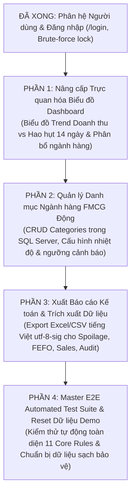

# KẾ HOẠCH PHÁT TRIỂN & HOÀN THIỆN HỆ THỐNG WEB (GIAI ĐOẠN TIẾP THEO)
### Dự án: Nền tảng Quản trị Chuỗi cung ứng Chống lãng phí (Supply Chain Spoilage Predictor)
### Đơn vị: Khoa Công nghệ Thông tin - Trường Đại học Lạc Hồng (LHU)
### Sinh viên thực hiện: Đỗ Tấn Du (123001364) & Đoàn Minh Quân (123000946)

---

## I. MỤC TIÊU TỔNG THỂ
Sau khi hoàn thành 6 phân hệ cốt lõi (Bàn giao ca trực, Quản lý đơn hàng PO 5 trạng thái, Thẩm định DC RSL ≥ 70% & Biên bản từ chối nhận hàng, Quy trình phê duyệt tiêu hủy Spoilage, Chống trùng sản phẩm Rule 9, và Bảo mật đăng nhập chống Brute-force), kế hoạch này tập trung vào **hoàn thiện 100% các tính năng nghiệp vụ còn lại trên Web** nhằm đáp ứng trọn vẹn Đặc tả Hệ thống SSOT và tạo ấn tượng trực quan cao nhất khi demo bảo vệ đồ án:

---

## II. LỘ TRÌNH 4 PHẦN TRIỂN KHAI CHI TIẾT

| Phần | Tên phân hệ | Trọng tâm kỹ thuật & Nghiệp vụ | Mục tiêu nghiệm thu |
| :-: | :--- | :--- | :--- |
| **Phần 1** | **Nâng cấp Dashboard Trực quan hóa Biểu đồ (Visual Analytics)** | Bổ sung biểu đồ vùng Trend Area Chart (Doanh thu POS vs Tổn thất Spoilage 14 ngày) và biểu đồ cột phân bổ hao hụt theo ngành hàng FMCG | ✅ Hoàn thành |
| **Phần 2** | **Quản lý Danh mục Ngành hàng Động (Category Management)** | Xây dựng CRUD API Backend và giao diện Tab Quản lý Ngành hàng trong `ProductCatalogView`, kết nối bảng `categories` SQL Server | ✅ Hoàn thành |
| **Phần 3** | **Xuất Báo cáo Kế toán & Dữ liệu (Export Excel/CSV Engine)** | Xây dựng module xuất CSV chuẩn tiếng Việt `utf-8-sig` (kèm BOM `\uFEFF`), tích hợp nút Export tại 4 màn hình: Sổ hao hụt Spoilage, Tồn kho FEFO, Hóa đơn POS, Audit Log | ✅ Hoàn thành |
| **Phần 4** | **Master E2E Automated Test Suite & Chuẩn hóa Dữ liệu** | Viết kịch bản kiểm thử tích hợp liên hoàn 11 Core Rules, xác thực tính đồng nhất từ DB -> API -> Frontend và reset dữ liệu chuẩn bị bảo vệ | ✅ Hoàn thành (40/40 tests PASSED, 100% Success) |

---

## III. NỘI DUNG KỸ THUẬT TỪNG PHẦN

### PHẦN 1: Nâng cấp Trực quan hóa Biểu đồ Dashboard (Visual Analytics)

#### 1. Bối cảnh & Yêu cầu Kỹ thuật
* **File can thiệp:** `Frontend/src/components/DashboardView.jsx` và Backend API `/api/dashboard/live-stats`.
* **Hiện trạng:** Dashboard mới có 6 thẻ KPI số liệu, 1 biểu đồ Donut phân bổ 3 cấp màu và thanh tiến độ ca trực. Chưa có biểu đồ đường/vùng thể hiện xu hướng biến thiên qua các ngày.
* **Nâng cấp cụ thể:**
  1. **Biểu đồ Vùng / Đường (Trend Area/Line Chart - 14 ngày):**
     * Trục hoành ($X$): 14 ngày gần nhất (D-13 đến Hôm nay).
     * Trục tung ($Y$): Giá trị tài chính (VNĐ).
     * Hai đường so sánh: **Doanh thu bán hàng FEFO** (đường màu xanh neon `var(--primary)`) và **Chi phí Hủy hàng Spoilage** (đường màu đỏ `var(--danger-red)`).
     * Tooltip tương tác hiển thị chi tiết khi rê chuột vào từng ngày.
  2. **Biểu đồ Cột Ngang (Horizontal Bar Chart) - Phân tích Thất thoát theo Ngành hàng FMCG:**
     * Thống kê tỷ lệ thất thoát hao hụt (Spoilage Loss) trên từng ngành: Sữa (DAIRY), Bánh mì (BAKERY), Thực phẩm đông lạnh (PROCESSED_MEAT), Rau củ quả (FRESH_PRODUCE), v.v.
     * Cảnh báo nhóm ngành có nguy cơ hư hỏng cao nhất để quản lý điều chỉnh chiến lược nhập hàng.
* **Công nghệ:** Render bằng SVG Vector thuần React (zero external dependency, không gây xung đột React 19, responsive 100%, phong cách Dark Mode Neon đồng bộ với hệ thống).

---

### PHẦN 2: Quản lý Danh mục Ngành hàng Động (FMCG Category Management)

#### 1. Bối cảnh & Yêu cầu Kỹ thuật
* **File can thiệp:**
  - `Backend/src/infrastructure/database/repositories/SqlCategoryRepository.js`
  - `Backend/src/presentation/controllers/CatalogController.js`
  - `Backend/src/presentation/routes/catalogRoutes.js`
  - `Frontend/src/components/ProductCatalogView.jsx`
  - `Frontend/src/api.js`
* **Hiện trạng:**
  - Bảng `categories` trong SQL Server LocalDB đã được định nghĩa chuẩn 3NF với các cột: `id`, `code`, `name`, `storage_temperature`, `default_warning_days`, `description`, `created_at`.
  - Repository mới chỉ có hàm `findAll()`, `findById()`, `create()`, còn thiếu `update()` và `delete()`.
  - Frontend `ProductCatalogView.jsx` đang dùng mảng tĩnh `DEFAULT_FMCG_CATEGORIES`.
* **Nâng cấp cụ thể:**
  1. **Backend:**
     - Bổ sung phương thức `update(id, data)` và `delete(id)` trong `SqlCategoryRepository.js`. Ràng buộc: Không cho phép xóa ngành hàng nếu đang có sản phẩm thuộc ngành đó (`productCount > 0`).
     - Bổ sung controller methods: `createCategory`, `updateCategory`, `deleteCategory` với xác thực quyền Admin / Store Manager và ghi nhận `AuditLogs`.
  2. **Frontend:**
     - Thêm thanh chuyển đổi Tab trong trang Danh mục: **[Danh Sách Sản Phẩm]** và **[Quản Lý Ngành Hàng FMCG]**.
     - Bảng danh sách ngành hàng hiển thị: Mã ngành, Tên ngành, Nhiệt độ bảo quản yêu cầu (Mát 2-4°C, Đông lạnh -18°C, Nhiệt độ phòng...), Ngưỡng cảnh báo ngày mặc định, Số lượng sản phẩm hiện có, và nút Thao tác (Sửa / Xóa / Thêm mới).
     - Modal Thêm / Chỉnh sửa Ngành hàng với xác thực dữ liệu đầu vào.

---

### PHẦN 3: Xuất Báo cáo Kế toán & Dữ liệu (Export Excel/CSV Engine)

#### 1. Bối cảnh & Yêu cầu Kỹ thuật
* **File can thiệp:**
  - `Frontend/src/utils/exportReportHelper.js` (tạo mới)
  - `Frontend/src/components/SpoilageDisposalView.jsx`
  - `Frontend/src/components/PosCheckoutView.jsx`
  - `Frontend/src/components/FefoMonitorView.jsx`
  - `Frontend/src/components/AuditLogView.jsx`
* **Nâng cấp cụ thể:**
  1. **Bộ tiện ích xuất file chuẩn hóa (`exportReportHelper.js`):**
     - Chuẩn hóa ký tự xuống dòng `\r\n` và bao dấu ngoặc kép `"..."` cho các trường có dấu phẩy hoặc ký tự đặc biệt (tuân thủ RFC 4180).
     - Chèn ký tự BOM Unicode `\uFEFF` ở đầu file để bảo đảm khi mở bằng Microsoft Excel trên Windows sẽ tự động nhận diện UTF-8, không bao giờ bị lỗi font tiếng Việt có dấu.
     - Tự động sinh tên file chuẩn mực: `[LoaiBaoCao]_LHUMart_[YYYYMMDD_HHMMSS].csv`.
  2. **Tích hợp nút Export tại 4 phân hệ kế toán:**
     - **Sổ Hao Hụt & Tiêu Hủy (Spoilage):** Mã phiếu, Tên sản phẩm, Lô hàng, Số lượng hủy, Giá vốn, Tổng thiệt hại tài chính, Lý do tiêu hủy, Người đề xuất, Người phê duyệt, Ngày giờ.
     - **Danh Sách Lô Hàng FEFO (Batches):** Mã lô, Tên sản phẩm, Ngành hàng, Số lượng ban đầu, Tồn khả dụng, Ngày sản xuất, Hạn sử dụng, Số ngày còn lại, Cấp màu cảnh báo, Tỷ lệ giảm giá.
     - **Lịch Sử Giao Dịch POS (Sales):** Mã hóa đơn, Tên sản phẩm, Lô bóc tách, Số lượng xuất, Đơn giá gốc, Đơn giá sau giảm, Thành tiền, Thu ngân thực hiện, Thời điểm giao dịch.
     - **Sổ Nhật Ký Kiểm Toán (Audit Logs):** Thời gian, Tài khoản thực hiện, Hành động, Bảng dữ liệu, Mã đối tượng, Địa chỉ IP, Chi tiết nghiệp vụ.

---

### PHẦN 4: Master E2E Automated Test Suite & Chuẩn bị Dữ liệu Demo

#### 1. Bối cảnh & Yêu cầu Kỹ thuật
* **File can thiệp:** `Backend/test_master_e2e_full_web.js` (tạo mới).
* **Nội dung kiểm thử tự động liên hoàn:**
  1. Kiểm tra xác thực & Bảo mật: Đăng nhập thành công, Khóa tài khoản sau 5 lần sai mật khẩu (Rule bảo mật).
  2. Kiểm tra Ngành hàng & Sản phẩm: Thêm ngành hàng mới, Thêm sản phẩm, Chặn trùng tên/SKU theo Rule 9 (Jaro-Winkler ≥ 85%).
  3. Kiểm tra Tiếp nhận DC: Nhập hàng RSL ≥ 70% chấp nhận; Nhập hàng RSL < 70% từ chối & lập biên bản `REJECT_DC_INBOUND` (Rule 7).
  4. Kiểm tra Giám sát FEFO & Đảo kệ: Tính toán 3 cấp màu (Rule 4), Đảo kệ mặt tiền cập nhật `is_shelf_rotated = 1` (Rule 10).
  5. Kiểm tra Xuất kho POS: Bán lẻ tự động bẻ lô theo FEFO (Rule 2), Chống tồn kho âm với `UPDLOCK, ROWLOCK` (Rule 3).
  6. Kiểm tra Tiêu hủy Spoilage: Khóa hàng hết hạn (Rule 5), Quản lý phê duyệt tiêu hủy, tính toán chi phí thiệt hại vào Sổ hao hụt (Rule 6).
  7. Kiểm tra Bàn giao ca trực & Đặt hàng PO 5 trạng thái (Rule 8 & 10).
  8. Kiểm tra ghi nhận toàn diện Nhật ký kiểm toán `AuditLogs` (Rule 11).
* **Kết quả:** Đưa ra báo cáo Passed 100% kèm thời gian thực thi của từng test case.

---

## IV. QUY TRÌNH THỰC HIỆN ĐỀ XUẤT

Thực hiện tuần tự từng phần theo đúng cam kết:
1. Bạn duyệt kế hoạch này.
2. Thực hiện **Phần 1 (Dashboard Biểu đồ Trực quan)** -> Tự test kiểm tra hiển thị và dữ liệu -> Báo cáo để bạn kiểm tra.
3. Khi bạn đồng ý, chuyển tiếp sang **Phần 2 (Quản lý Ngành hàng Động)** -> Tự test -> Báo cáo.
4. Chuyển sang **Phần 3 (Xuất Báo cáo Kế toán)** -> Tự test -> Báo cáo.
5. Chuyển sang **Phần 4 (Master E2E Test)** -> Chạy test tự động xác thực toàn diện -> Hoàn tất.

