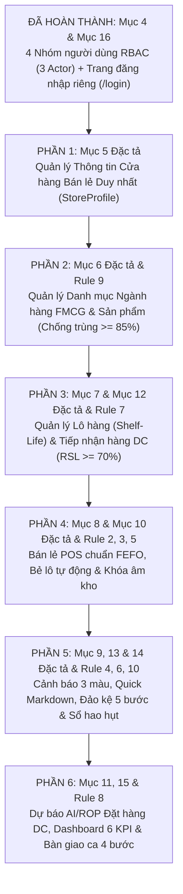

# KẾ HOẠCH TRIỂN KHAI CHI TIẾT TỪNG PHẦN (TỪ MỤC 5 ĐẾN MỤC 15 ĐẶC TẢ SSOT)

> **Tài liệu gốc đối chiếu (SSOT):**
> 1. [Dac Ta He Thong Quan Ly Chuoi Cung Ung Chong Lang Phi - Supply Chain Spoilage Predictor.md](file:///c:/thuyet%20minh/Docs/Dac%20Ta%20He%20Thong%20Quan%20Ly%20Chuoi%20Cung%20Ung%20Chong%20Lang%20Phi%20-%20Supply%20Chain%20Spoilage%20Predictor.md) *(Mục 5 → Mục 27)*
> 2. [SmartSupply_AI_Phan_tich_nghiep_vu_3_Actor.md](file:///c:/thuyet%20minh/Docs/SmartSupply_AI_Phan_tich_nghiep_vu_3_Actor.md) *(3 Actor: OWNER, MANAGER, STAFF – 26 Nhóm nghiệp vụ – Quy trình 5 bước)*
> 3. [SmartSupply_AI_Dinh_huong_va_Dac_ta_Trien_khai.md](file:///c:/thuyet%20minh/Docs/SmartSupply_AI_Dinh_huong_va_Dac_ta_Trien_khai.md) *(Định hướng AI, Kiểm soát hạn dùng, Tối ưu đặt hàng & Phụ lục A)*
>
> **Nguyên tắc thực hiện:** Triển khai cuốn chiếu **từng phần một (6 Phần độc lập)**. Hoàn thành, kiểm thử trên trình duyệt và nghiệm thu xong phần nào mới chuyển sang phần tiếp theo.

---

## Tổng quan Lộ trình 6 Phần Tiếp theo (Sau khi đã hoàn tất Mục 4 & Trang `/login`)

| Thứ tự | Tên phần triển khai | Mục Đặc tả tương ứng | Quy tắc cốt lõi (11 Rules) | Actor tham gia | Trạng thái |
| :-: | :--- | :--- | :--- | :--- | :-: |
| **Phần 1** | Quản lý thông tin cửa hàng bán lẻ duy nhất (`StoreProfile`) | Mục 5, Mục 17.3, Mục 22.3 | **Rule 1**, **Rule 11** | `ADMIN` (Cấu hình lõi), `STORE_MANAGER` (Đóng/Mở ca) | ✅ Hoàn thành |
| **Phần 2** | Quản lý danh mục ngành hàng FMCG & Sản phẩm | Mục 6, Mục 17.5, Mục 17.6, Mục 22.4 | **Rule 9**, **Rule 11** | `ADMIN`, `STORE_MANAGER` (CRUD), `STAFF` (Tra cứu) | ✅ Hoàn thành |
| **Phần 3** | Quản lý lô hàng & Tiếp nhận xe tải DC Biên Hòa | Mục 7, Mục 12, Mục 17.7, Mục 17.12 | **Rule 7**, **Rule 11** | `WAREHOUSE_STAFF`, `STORE_MANAGER`, `ADMIN` | ✅ Hoàn thành |
| **Phần 4** | Bán lẻ POS theo nguyên tắc FEFO & Bẻ lô tự động | Mục 8, Mục 10, Mục 17.8, Mục 21.1 | **Rule 2**, **Rule 3**, **Rule 5** | `CASHIER`, `STORE_MANAGER`, `ADMIN` | ✅ Hoàn thành |
| **Phần 5** | Cảnh báo 3 cấp màu, Quick Markdown, Đảo kệ & Sổ hao hụt | Mục 9, Mục 13, Mục 14, Mục 17.9 | **Rule 4**, **Rule 6**, **Rule 10** | `STORE_MANAGER`, `WAREHOUSE_STAFF`, `CASHIER` | ✅ Hoàn thành |
| **Phần 6** | Dự báo nhu cầu ROP, Đơn đặt hàng DC, Dashboard & Bàn giao ca | Mục 11, Mục 15, Mục 17.10, Mục 21.6 | **Rule 8**, **Rule 11** | Toàn bộ 4 vai trò theo phân quyền | ✅ Hoàn thành |

---

## Chi tiết từng phần triển khai

---

### PHẦN 1: Mục 5 — Quản lý thông tin cửa hàng bán lẻ duy nhất (`StoreProfile`)

#### 1.1 Đối chiếu yêu cầu Đặc tả (Mục 5, dòng 160–190)
- Hệ thống chỉ có **1 bản ghi cửa hàng duy nhất** (`StoreCode = 'RETAIL-STORE-01'`, tên: `Cửa hàng Bán lẻ Tiện lợi LHU Mart`).
- Thông tin bắt buộc quản lý:
  1. Mã cửa hàng (`RETAIL-STORE-01` – cố định, không cho sửa).
  2. Tên cửa hàng, Địa chỉ (`Số 10 Huỳnh Văn Nghệ, P. Bửu Long, TP. Biên Hòa, Đồng Nai`), Số điện thoại.
  3. **Cửa hàng trưởng phụ trách (`ManagerId` / `ManagerName`)** liên kết bảng `Users`.
  4. Kho tổng DC mặc định (`Kho Phân Phối DC Biên Hòa`), Thời gian giao hàng tiêu chuẩn (`LeadTime = 1 ngày`).
  5. Tỷ lệ hạn sử dụng tối thiểu khi nhận hàng từ DC (`Min RSL = 70%`).
  6. Ngưỡng cảnh báo cận date Vùng Vàng (`7 ngày`) & Vùng Đỏ (`3 ngày`).
  7. **Giờ mở cửa / Giờ đóng cửa (`06:00 - 22:00`)**.
  8. **Trạng thái hoạt động cửa hàng:** `OPEN` (Mở cửa), `CLOSED` (Đóng cửa ca đêm), `INVENTORY` (Kiểm kê kho), `SUSPENDED` (Tạm ngừng).
- **Điều kiện nghiệp vụ & Phân quyền (SoD):**
  - Khi cửa hàng ở trạng thái khác `OPEN` (`CLOSED`, `INVENTORY`, `SUSPENDED`), quầy POS khóa cứng chức năng thanh toán.
  - `ADMIN` có toàn quyền cấu hình mọi thông số kỹ thuật (`Min RSL`, `Lead Time`, `Warning Days`, `Critical Days`, `Cửa hàng trưởng`, `Giờ mở/đóng cửa`).
  - `STORE_MANAGER` chỉ được phép chuyển đổi **Trạng thái vận hành (`Status`)** và cập nhật thông tin liên hệ ca trực; **không được phép** tự ý hạ ngưỡng kiểm định `Min RSL` hoặc sửa tham số hệ thống của `ADMIN`.

#### 1.2 Hiện trạng mã nguồn & Điểm còn thiếu
- **Đã có:** Bảng `store_profile`, API `GET / PUT /api/store-profile`, giao diện [StoreSettingsView.jsx](file:///c:/thuyet%20minh/Frontend/src/components/StoreSettingsView.jsx) và nút đổi trạng thái nhanh trên [Header.jsx](file:///c:/thuyet%20minh/Frontend/src/components/Header.jsx).
- **Còn thiếu / Chưa khớp:**
  1. Giao diện [StoreSettingsView.jsx](file:///c:/thuyet%20minh/Frontend/src/components/StoreSettingsView.jsx) chưa hiển thị và chưa cho phép chọn **Cửa hàng trưởng phụ trách (`managerId`)** từ danh sách người dùng cũng như **Giờ mở cửa / Giờ đóng cửa (`06:00 - 22:00`)**.
  2. Chưa tách quyền SoD giữa `ADMIN` và `STORE_MANAGER` trong [StoreSettingsView.jsx](file:///c:/thuyet%20minh/Frontend/src/components/StoreSettingsView.jsx) và [UpdateStoreProfileUseCase.js](file:///c:/thuyet%20minh/Backend/src/application/use-cases/store/UpdateStoreProfileUseCase.js): hiện tại `STORE_MANAGER` vẫn sửa được cả ngưỡng `Min RSL` xuống 50%.

#### 1.3 Công việc thực hiện ở Phần 1
1. **Backend:**
   - Cập nhật [SqlStoreProfileRepository.js](file:///c:/thuyet%20minh/Backend/src/infrastructure/database/repositories/SqlStoreProfileRepository.js), [StoreProfile.js](file:///c:/thuyet%20minh/Backend/src/domain/entities/StoreProfile.js) và [StoreProfileDTO.js](file:///c:/thuyet%20minh/Backend/src/application/dtos/StoreProfileDTO.js) trả về đầy đủ `managerId`, `managerName`, `openTime` (`06:00`), `closeTime` (`22:00`).
   - Cập nhật [UpdateStoreProfileUseCase.js](file:///c:/thuyet%20minh/Backend/src/application/use-cases/store/UpdateStoreProfileUseCase.js): kiểm tra nếu người gọi là `STORE_MANAGER` thì chỉ cho phép đổi `status` (đóng/mở cửa, kiểm kê) và ghi `AuditLogs`; chỉ `ADMIN` mới được thay đổi các ngưỡng `minInboundRslPercent`, `defaultWarningDays`, `criticalWarningDays`, `defaultLeadTimeDays`, `managerId`.
2. **Frontend:**
   - Cập nhật [StoreSettingsView.jsx](file:///c:/thuyet%20minh/Frontend/src/components/StoreSettingsView.jsx): bổ sung ô chọn/hiển thị **Cửa hàng trưởng phụ trách**, **Giờ mở cửa / Giờ đóng cửa (Ca sáng 06:00–14:00, Ca chiều 14:00–22:00)**, khóa các ô tham số lõi nếu tài khoản đang đăng nhập là `STORE_MANAGER` (chỉ mở khu vực chuyển trạng thái cửa hàng).

#### 1.4 Tiêu chí nghiệm thu Phần 1
- Đăng nhập `admin`: Sửa được toàn bộ thông tin cửa hàng, chọn Cửa hàng trưởng phụ trách, lưu thành công và ghi nhận vào `AuditLogs`.
- Đăng nhập `manager`: Đổi được trạng thái cửa hàng (`OPEN` ↔ `INVENTORY`), nhưng các ô ngưỡng `Min RSL 70%`, `Warning Days`, `Critical Days` ở chế độ chỉ đọc (Read-only).
- Khi cửa hàng ở trạng thái `INVENTORY`, sang màn hình POS bấm Thanh toán sẽ bị chặn ngay lập tức.

---

### PHẦN 2: Mục 6 — Quản lý danh mục ngành hàng FMCG & Sản phẩm (Rule 9)

#### 2.1 Đối chiếu yêu cầu Đặc tả (Mục 6, dòng 191–224 & Tài liệu 3 Actor)
- **5 Danh mục ngành hàng FMCG chuẩn:**
  1. Sữa & Chế phẩm từ sữa (HSD: 30–180 ngày, Cảnh báo: 7 ngày, Bảo quản: Vùng mát 2–4°C)
  2. Bánh tươi & Thực phẩm chế biến sẵn (HSD: 3–7 ngày, Cảnh báo: 2 ngày, Bảo quản: Nhiệt độ phòng)
  3. Nước giải khát & Nước ép (HSD: 180–365 ngày, Cảnh báo: 15 ngày, Bảo quản: Nhiệt độ phòng)
  4. Thực phẩm đông lạnh & Thịt mát (HSD: 15–45 ngày, Cảnh báo: 5 ngày, Bảo quản: Đông lạnh -18°C)
  5. Đồ khô & Gia vị đóng gói (HSD: 180–720 ngày, Cảnh báo: 30 ngày, Bảo quản: Nhiệt độ phòng)
- **Thuật toán chống trùng lặp sản phẩm (Rule 9 - Product Deduplication):**
  - Chuẩn hóa chuỗi tiếng Việt, chặn tạo mới hoặc cập nhật nếu trùng mã `SKU` hoặc độ tương đồng tên sản phẩm `>= 85%`.
- **Phân quyền 3 Actor / 4 Role:**
  - `ADMIN` & `STORE_MANAGER`: Thêm mới, cập nhật thông tin/giá/ngưỡng tồn kho, ngừng kinh doanh (`DISCONTINUED`).
  - `CASHIER` & `WAREHOUSE_STAFF` (Actor `STAFF` - Nghiệp vụ 1 "Xem sản phẩm"): Được mở màn hình Danh mục sản phẩm ở chế độ **Tra cứu (Read-only)** để xem mã SKU, giá bán, đơn vị tính, điều kiện bảo quản và tồn kho.

#### 2.2 Hiện trạng mã nguồn & Điểm còn thiếu
- **Đã có:** [ProductDeduplicationService.js](file:///c:/thuyet%20minh/Backend/src/domain/services/ProductDeduplicationService.js), [CreateProductUseCase.js](file:///c:/thuyet%20minh/Backend/src/application/use-cases/catalog/CreateProductUseCase.js), [ProductCatalogView.jsx](file:///c:/thuyet%20minh/Frontend/src/components/ProductCatalogView.jsx).
- **Còn thiếu / Chưa khớp:**
  1. Giao diện [ProductCatalogView.jsx](file:///c:/thuyet%20minh/Frontend/src/components/ProductCatalogView.jsx) hiện chỉ nhận prop `isAdmin` (`roleCode === 'ADMIN'`), dẫn đến **Cửa hàng trưởng (`STORE_MANAGER`) bị ẩn mất nút Thêm/Sửa sản phẩm** dù Backend `catalogRoutes.js` và Đặc tả Mục 16 cho phép `STORE_MANAGER` quản lý sản phẩm.
  2. Nhân viên `CASHIER` và `WAREHOUSE_STAFF` chưa có mục "Tra cứu Sản phẩm FMCG" trên [Sidebar.jsx](file:///c:/thuyet%20minh/Frontend/src/components/Sidebar.jsx) (theo Nghiệp vụ 1 của `STAFF` trong tài liệu 3 Actor).
  3. Hàm `CatalogController.updateProduct` khi sửa tên/SKU sản phẩm chưa gọi `ProductDeduplicationService` để chặn đổi tên trùng `>= 85%` với sản phẩm khác.

#### 2.3 Công việc thực hiện ở Phần 2
1. **Backend:**
   - Cập nhật [CatalogController.js](file:///c:/thuyet%20minh/Backend/src/presentation/controllers/CatalogController.js): tích hợp kiểm tra `ProductDeduplicationService.checkDuplicate` (loại trừ chính `id` đang sửa) khi cập nhật sản phẩm (`PUT /api/products/:id`).
2. **Frontend:**
   - Cập nhật [ProductCatalogView.jsx](file:///c:/thuyet%20minh/Frontend/src/components/ProductCatalogView.jsx) và [App.jsx](file:///c:/thuyet%20minh/Frontend/src/App.jsx): mở quyền Thêm/Sửa/Ngừng kinh doanh cho cả `ADMIN` và `STORE_MANAGER`; hiển thị thẻ thông tin 5 ngành hàng FMCG kèm nhiệt độ bảo quản và ngưỡng cảnh báo mặc định.
   - Cập nhật [Sidebar.jsx](file:///c:/thuyet%20minh/Frontend/src/components/Sidebar.jsx): cho phép `CASHIER` và `WAREHOUSE_STAFF` truy cập tab `Danh mục Sản phẩm` ở chế độ Chỉ đọc (Tra cứu).

---

### PHẦN 3: Mục 7 & Mục 12 — Quản lý Lô hàng & Tiếp nhận hàng từ Kho tổng DC (`RSL >= 70%`)

#### 3.1 Đối chiếu yêu cầu Đặc tả (Mục 7, Mục 12 & Rule 7)
- Công thức kiểm định độ tươi mới khi xe tải DC giao đến cửa hàng:
  $$\text{RSL}_{\text{inbound}} = \frac{\text{ExpiryDate} - \text{ImportDate}}{\text{ExpiryDate} - \text{ManufactureDate}} \times 100\% \ge 70\%$$
- Nếu $\text{RSL}_{\text{inbound}} < 70\%$: Khóa nút lưu phiếu nhập, đồng thời cho phép nhân viên kho bấm **"Lập biên bản từ chối nhận hàng DC"** để lưu vết vào `AuditLogs` (`REJECT_DC_INBOUND`).
- Tự động sinh mã lô chuẩn `LOT-DC-[SKU]-[YYYYMMDD]`, lưu vào `GoodsReceipts` & `Batches`, cập nhật `CostPrice` chuẩn vào `Products`, và hỗ trợ **In tem mã lô hàng** dán lên thùng lưu kho.

#### 3.2 Hiện trạng mã nguồn & Điểm còn thiếu
- **Đã có:** [ReceiveDCBatchUseCase.js](file:///c:/thuyet%20minh/Backend/src/application/use-cases/batch/ReceiveDCBatchUseCase.js) và [DcIntakeView.jsx](file:///c:/thuyet%20minh/Frontend/src/components/DcIntakeView.jsx) đã tính `RSL_inbound` và chặn lưu khi `< 70%`.
- **Còn thiếu / Chưa khớp:**
  1. Khi `RSL < 70%`, chưa có nút **"Ghi nhận Biên bản Từ chối Lô hàng DC"** gửi về Backend để lưu vào `AuditLogs` làm bằng chứng làm việc với Kho tổng DC Biên Hòa (Mục 12.1 dòng 370).
  2. Chưa có chức năng chọn **Nhận hàng từ Đơn đặt hàng PO đã duyệt (`PurchaseOrders`)** để khép kín quy trình 5 bước (Đề xuất ROP → Duyệt PO → Xe DC giao hàng → Nhập kho kiểm tra RSL → Hoàn tất PO `RECEIVED`).

#### 3.3 Công việc thực hiện ở Phần 3
1. **Backend:**
   - Bổ sung endpoint `POST /api/batches/reject-inbound` trong [batchRoutes.js](file:///c:/thuyet%20minh/Backend/src/presentation/routes/batchRoutes.js) và [BatchController.js](file:///c:/thuyet%20minh/Backend/src/presentation/controllers/BatchController.js) để ghi nhận biên bản từ chối lô hàng DC không đạt `RSL >= 70%` vào `AuditLogs`.
2. **Frontend:**
   - Cập nhật [DcIntakeView.jsx](file:///c:/thuyet%20minh/Frontend/src/components/DcIntakeView.jsx):
     - Thêm nút **"Lập Biên Bản Từ Chối Nhận Hàng DC"** khi phát hiện `RSL < 70%`.
     - Thêm danh sách **Đơn PO đang giao từ DC** để nhân viên kho bấm 1 chạm nạp thông tin sản phẩm & số lượng vào form kiểm định RSL, sau khi nhập kho thành công tự động chuyển trạng thái PO sang `RECEIVED`.
     - Hoàn thiện mẫu cửa sổ **In Tem Lô Hàng (`LOT-DC-...`)**.

---

### PHẦN 4: Mục 8 & Mục 10 — Bán lẻ POS theo nguyên tắc FEFO & Bẻ lô tự động (`Split Order`)

#### 4.1 Đối chiếu yêu cầu Đặc tả (Mục 8, Mục 10 & Rule 2, 3, 5)
- Thu ngân quét mã SKU → Hệ thống tự động lấy các lô `DaysLeft > 0` sắp xếp theo `expiry_date ASC, id ASC`.
- **Bẻ nhỏ đơn hàng qua nhiều lô (Split Order Scenario - Mục 8.2):** Nếu khách mua số lượng lớn hơn tồn của lô cận date thứ nhất, hệ thống tự động lấy hết lô thứ nhất (với giá khuyến mãi nếu có) và phần còn thiếu lấy tiếp từ lô thứ hai (với giá của lô thứ hai).
- Ghi nhận `SalesHistory` kèm cờ Thời tiết (`SUNNY` / `RAINY` / `NORMAL`) và Ngày lễ (`isHoliday`).

#### 4.2 Hiện trạng mã nguồn & Điểm còn thiếu
- **Đã có:** Backend [ProcessFefoSaleUseCase.js](file:///c:/thuyet%20minh/Backend/src/application/use-cases/sales/ProcessFefoSaleUseCase.js) và [FefoAllocationPolicy.js](file:///c:/thuyet%20minh/Backend/src/domain/services/FefoAllocationPolicy.js) đã xử lý bẻ lô chuẩn xác trong SQL Transaction.
- **Còn thiếu / Chưa khớp:**
  1. Trên giao diện [PosCheckoutView.jsx](file:///c:/thuyet%20minh/Frontend/src/components/PosCheckoutView.jsx), khi thu ngân tăng số lượng vượt quá lô đầu tiên (kịch bản bẻ lô Mục 8.2), giỏ hàng cần hiển thị rõ **Chi tiết phân bổ FEFO dự kiến theo từng lô** (ví dụ: *Lô 1: 3 hộp giá giảm 30% + Lô 2: 2 hộp nguyên giá*) và tính đúng tổng tiền gộp của các lô được bẻ ngay trước khi bấm Thanh toán.
  2. Bổ sung ngăn xem nhanh **Lịch sử hóa đơn vừa xuất trong ca (`SalesHistory`)** để thu ngân đối chiếu và in lại hóa đơn khi khách yêu cầu (Mục 22.6).

#### 4.3 Công việc thực hiện ở Phần 4
1. **Frontend & Backend:**
   - Cập nhật thuật toán tính giỏ hàng trong [PosCheckoutView.jsx](file:///c:/thuyet%20minh/Frontend/src/components/PosCheckoutView.jsx) đồng bộ 100% với `FefoAllocationPolicy` của Backend: tự động hiển thị các dòng bẻ lô (`Split Batch Lines`) ngay trong giỏ hàng và trên hóa đơn in ra.
   - Bổ sung danh sách **Hóa đơn POS gần nhất trong ca** kèm nút xem chi tiết các lô đã trừ và in lại phiếu.

---

### PHẦN 5: Mục 9, 13 & 14 — Cảnh báo 3 cấp màu, Quick Markdown, SOP Đảo kệ 5 bước & Sổ hao hụt tài chính

#### 5.1 Đối chiếu yêu cầu Đặc tả (Mục 9, 13, 14 & Rule 4, 6, 10)
- **3 vùng màu cảnh báo + 1 trạng thái khóa:**
  - Vùng Xanh (`DaysLeft > WarningDays`): Nguyên giá 0%.
  - Vùng Vàng (`3 < DaysLeft <= WarningDays`): Giảm 15%–30%, đảo kệ mặt tiền.
  - Vùng Đỏ (`0 < DaysLeft <= 3`): Giảm kịch sàn 40%–50%, gom xả trong ngày.
  - Quá hạn (`DaysLeft <= 0`): `EXPIRED`, khóa bán POS tuyệt đối, chuyển sang tiêu hủy.
- **SOP 5 bước đảo kệ mặt tiền (Mục 13.2)** & **Sổ hao hụt tài chính bất biến (Mục 14):**
  - Biên bản tiêu hủy phải thể rõ `RecordCode`, `BatchCode`, `QuantityDisposed`, `ImportPrice`, `CostLoss = QuantityDisposed * ImportPrice`, `Reason` (`EXPIRED`, `DAMAGED`, `SPOILED`), **Người lập đề xuất (`PerformedBy`)** và **Cửa hàng trưởng ký duyệt (`ApprovedBy`)**.

#### 5.2 Hiện trạng mã nguồn & Điểm còn thiếu
- **Đã có:** [FefoMonitorView.jsx](file:///c:/thuyet%20minh/Frontend/src/components/FefoMonitorView.jsx) và [SpoilageDisposalView.jsx](file:///c:/thuyet%20minh/Frontend/src/components/SpoilageDisposalView.jsx).
- **Còn thiếu / Chưa khớp:**
  1. Trong [SpoilageDisposalView.jsx](file:///c:/thuyet%20minh/Frontend/src/components/SpoilageDisposalView.jsx), bảng Sổ hao hụt cần hiển thị rõ cột **Người lập đề xuất** và **Người phê duyệt**, bộ lọc theo trạng thái `Chờ duyệt (PENDING)` / `Đã chốt sổ (APPROVED)`, và nút **Duyệt chốt sổ** dành riêng cho `STORE_MANAGER` & `ADMIN`.
  2. Cập nhật [SqlSpoilageRepository.js](file:///c:/thuyet%20minh/Backend/src/infrastructure/database/repositories/SqlSpoilageRepository.js) JOIN với bảng `users` để trả về tên thật của `performedByName` và `approvedByName`.

---

### PHẦN 6: Mục 11, 15 & Rule 8 — Dự báo AI/ROP Đặt hàng DC, Dashboard 6 KPI & Bàn giao ca 4 bước

#### 6.1 Đối chiếu yêu cầu Đặc tả (Mục 11, 15, Rule 8 & Định hướng SmartSupply AI)
- **Dự báo ROP đa biến (Rule 8 & Mục 21.6):**
  - $d_{\text{adjusted}} = d_{\text{base (14 ngày)}} \times W_{\text{factor}} \times H_{\text{factor}}$
  - $\text{ROP} = (d_{\text{adjusted}} \times \text{LeadTime}) + \text{SafetyStock}$
  - Cảnh báo nguy cơ ứ đọng khi $\text{DOS} > \text{DUE}$ (Số ngày bán hết tồn kho lớn hơn hạn dùng ngắn nhất còn lại).
  - Giải thích rõ ràng lý do đề xuất nhập hàng (theo nguyên tắc minh bạch AI trong tài liệu Định hướng SmartSupply AI).
- **Dashboard tổng quan (Mục 11):**
  - Hiển thị đầy đủ 6 KPI tài chính + **Tỷ lệ tuân thủ FEFO** + **Top sản phẩm bán nhanh nhất vs Top sản phẩm phát sinh hao hụt nhiều nhất** + **Action Board ca trực khẩn cấp**.

#### 6.2 Công việc thực hiện ở Phần 6
1. Cập nhật [ReorderPredictorView.jsx](file:///c:/thuyet%20minh/Frontend/src/components/ReorderPredictorView.jsx): hiển thị cột giải thích chi tiết công thức AI/ROP ($d_{base}$, $W_{factor}$, $H_{factor}$, $DOS$ vs $DUE$) và luồng trạng thái đơn hàng `PurchaseOrders` gửi DC.
2. Cập nhật [DashboardView.jsx](file:///c:/thuyet%20minh/Frontend/src/components/DashboardView.jsx) và [GetDashboardOverviewUseCase.js](file:///c:/thuyet%20minh/Backend/src/application/use-cases/dashboard/GetDashboardOverviewUseCase.js): bổ sung bảng xếp hạng **Top 5 sản phẩm bán chạy nhất** và **Top 5 sản phẩm hao hụt cao nhất** theo đúng Mục 11.2 (dòng 350–351).

---

## Quy trình làm việc cho từng phần

Mỗi khi bắt đầu một phần (bắt đầu từ **Phần 1**):
1. Thực hiện sửa đổi đúng phạm vi các file thuộc phần đó.
2. Chạy kiểm tra biên dịch (`npm run build` & `node --check`) đảm bảo 0 lỗi.
3. Hướng dẫn kịch bản kiểm thử trực tiếp trên trình duyệt `http://localhost:5173`.
4. Chờ bạn xác nhận đạt yêu cầu rồi mới chuyển sang phần tiếp theo.

