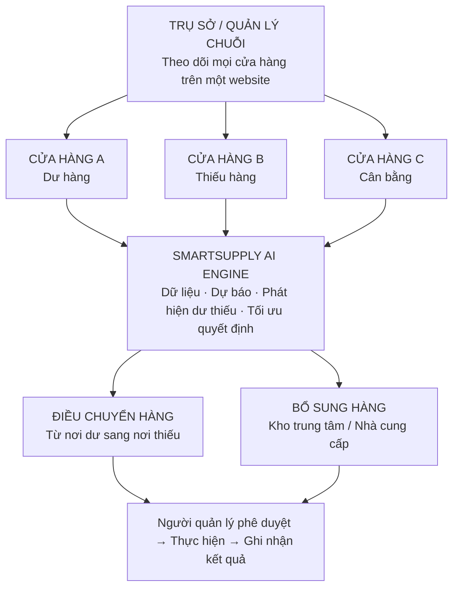
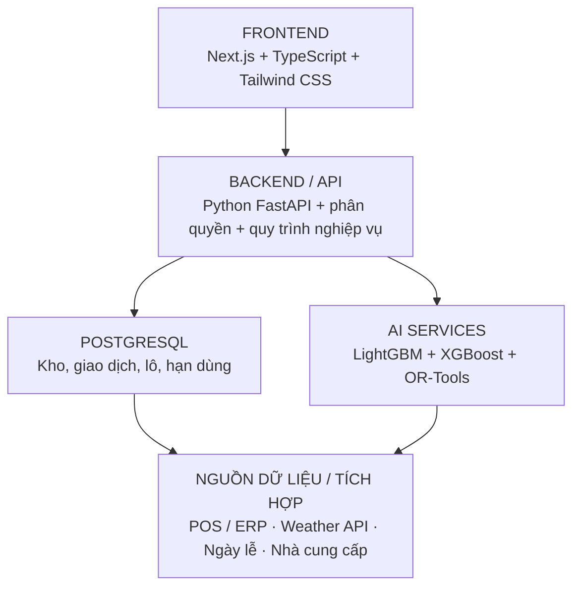

# SMARTSUPPLY AI — ĐỊNH HƯỚNG DỰ ÁN & TRIỂN KHAI HỆ THỐNG

> **Dự báo nhu cầu · Tối ưu nhập hàng · Điều phối thực phẩm thông minh bằng trí tuệ nhân tạo**
>
> - **01** DỰ BÁO SỨC MUA
> - **02** ĐỀ XUẤT NHẬP HÀNG
> - **03** ĐIỀU PHỐI DƯ - THIẾU
> - **04** GIẢM LÃNG PHÍ
>
> **TÀI LIỆU ĐỊNH HƯỚNG SẢN PHẨM CHO NHÓM PHÁT TRIỂN**
> - **Mô hình:** SaaS B2B | **Đối tượng:** chuỗi 3–30 cửa hàng
> - **Phạm vi MVP:** 3 cửa hàng · 30 sản phẩm · dự báo 7 ngày
> - **Bản định hướng triển khai:** 28.10.2026

---

## Tổng quan và quyết định định hướng

> **SmartSupply AI nên được phát triển thành nền tảng quản trị chuỗi cửa hàng thực phẩm bằng AI** (AI-Powered Food Inventory & Supply Chain Optimization), chứ không chỉ là website dự báo số lượng sản phẩm bán ra.

### 4 CÂU HỎI HỆ THỐNG PHẢI TRẢ LỜI

| STT | Câu hỏi trọng tâm | Vai trò của hệ thống |
| :-: | :--- | :--- |
| **01** | **Ngày mai, tuần tới bán được bao nhiêu?** | AI dự báo nhu cầu. |
| **02** | **Nên nhập thêm bao nhiêu hàng?** | AI đề xuất số lượng đặt hàng. |
| **03** | **Cửa hàng nào dư hàng, cửa hàng nào thiếu?** | Hệ thống đề xuất điều phối. |
| **04** | **Sản phẩm nào có nguy cơ hết hạn?** | AI đánh giá rủi ro lãng phí. |

### QUYẾT ĐỊNH ĐÃ CHỐT

| Hạng mục | Định hướng triển khai |
| :--- | :--- |
| **Đối tượng chính** | Chuỗi cửa hàng thực phẩm, tiện lợi, tiệm bánh quy mô 3–30 chi nhánh |
| **Phương thức triển khai** | SaaS B2B; hỗ trợ cả doanh nghiệp chỉ có 1 cửa hàng |
| **Khác biệt sản phẩm** | Không chỉ dự báo, mà còn đề xuất nhập từ đâu, chuyển đi đâu, số lượng và thời điểm |
| **MVP đầu tiên** | 3 cửa hàng, 30 sản phẩm, dự báo 7 ngày, lô/hạn dùng và duyệt điều chuyển |

*Ví dụ tham khảo trong ý tưởng: FamilyMart triển khai hệ thống đề xuất đặt hàng bằng AI tại 500 cửa hàng từ cuối tháng 6/2025, dựa trên doanh số, thời tiết và lịch ngày lễ. Đây là thông tin tham khảo được nêu trong nội dung định hướng ban đầu.*

---

## MỤC LỤC

1. [Đối tượng khách hàng của dự án](#01-đối-tượng-khách-hàng-của-dự-án)
2. [Hệ thống sẽ giải quyết nhu cầu nào?](#02-hệ-thống-sẽ-giải-quyết-nhu-cầu-nào)
3. [Mô hình hoạt động của toàn hệ thống](#03-mô-hình-hoạt-động-của-toàn-hệ-thống)
4. [Hệ thống điều phối hàng giữa các cửa hàng](#04-hệ-thống-điều-phối-hàng-giữa-các-cửa-hàng)
5. [Công nghệ AI nào sẽ được sử dụng?](#05-công-nghệ-ai-nào-sẽ-được-sử-dụng)
6. [Thiết kế website gồm những trang nào?](#06-thiết-kế-website-gồm-những-trang-nào)
7. [Kiến trúc công nghệ đề xuất](#07-kiến-trúc-công-nghệ-đề-xuất)
8. [Lộ trình phát triển dự án](#08-lộ-trình-phát-triển-dự-án)
9. [Định hướng sản phẩm chốt cho dự án](#09-định-hướng-sản-phẩm-chốt-cho-dự-án)
10. [Phụ lục A: Checklist bàn giao cho nhóm phát triển](#phụ-lục-a--hướng-dẫn-bám-sát-triển-khai-checklist-bàn-giao-cho-nhóm-phát-triển)

*Tài liệu giữ nguyên nội dung định hướng đã thống nhất, đồng thời bổ sung một phụ lục checklist để nhóm triển khai bám sát phạm vi. Những số liệu tại ví dụ điều phối và dự báo là giả định minh họa, không phải kết quả chạy mô hình.*

---

## 01 Đối tượng khách hàng của dự án

Tôi đề xuất lựa chọn chuỗi cửa hàng tiện lợi, chuỗi cửa hàng thực phẩm tươi và chuỗi F&B quy mô nhỏ đến vừa làm khách hàng mục tiêu ban đầu.

### Ba nhóm khách hàng

| Nhóm khách hàng | Định hướng |
| :--- | :--- |
| **Khách hàng chính: Chuỗi cửa hàng** | Doanh nghiệp sở hữu từ 3–30 cửa hàng tiện lợi, cửa hàng thực phẩm hoặc tiệm bánh, có nhiều sản phẩm ngắn hạn sử dụng. Vừa cần dự báo nhu cầu từng điểm bán, vừa có thể điều phối hàng giữa các chi nhánh. |
| **Khách hàng phụ: Cửa hàng độc lập** | Một cửa hàng vẫn sử dụng để quản lý kho, dự báo lượng bán, cảnh báo hàng gần hết hạn, đề xuất nhập; không cần điều chuyển giữa chi nhánh. |
| **Khách hàng mở rộng: Chuỗi F&B** | Tiệm bánh, cà phê, cơm hộp và thực phẩm chế biến sẵn; dự báo thành phẩm nên chuẩn bị và nguyên liệu cần mua. |

### Vậy chọn chuỗi hay cá nhân một cửa hàng?

| Tiêu chí | Một cửa hàng | Chuỗi cửa hàng |
| :--- | :--- | :--- |
| Dự báo số lượng bán | Có | Có |
| Quản lý hàng tồn, hạn dùng | Có | Có |
| Đề xuất nhập hàng | Có | Có |
| Điều phối giữa chi nhánh | Không | Có |
| Phân tích hiệu quả toàn chuỗi | Không cần | Có |
| Độ phức tạp triển khai | Thấp | Cao hơn |

> **Quyết định:** Thiết kế cho chuỗi cửa hàng ngay từ đầu, nhưng vẫn cho phép doanh nghiệp đăng ký với duy nhất một cửa hàng. Như vậy cùng một hệ thống có thể phục vụ cả hai quy mô mà không cần phát triển hai sản phẩm riêng.

Giai đoạn đầu, điều phối chỉ diễn ra giữa các cửa hàng thuộc cùng một doanh nghiệp hoặc có thỏa thuận chia sẻ hàng hóa. Không nên xây dựng ngay một sàn trao đổi thực phẩm giữa các cửa hàng độc lập, vì phát sinh bài toán sở hữu hàng hóa, thanh toán, truy xuất nguồn gốc và trách nhiệm an toàn thực phẩm.

---

## 02 Hệ thống sẽ giải quyết nhu cầu nào?

| Vấn đề doanh nghiệp gặp phải | SmartSupply AI giải quyết |
| :--- | :--- |
| Nhập hàng theo kinh nghiệm, không biết ngày mai bán bao nhiêu | Dự báo sức mua từng sản phẩm theo từng cửa hàng |
| Nhập quá nhiều gây tồn kho, hết hạn | Tính lượng nhập khuyến nghị dựa trên nhu cầu và hạn sử dụng |
| Một cửa hàng thừa, cửa hàng khác thiếu | Phát hiện chênh lệch và đề xuất điều chuyển |
| Không biết hàng nào sắp hết hạn | Theo dõi tồn kho theo lô và tạo cảnh báo |
| Thiếu hàng vào cuối tuần hoặc ngày lễ | Tính đến thời tiết, lịch nghỉ và khuyến mãi |
| Ban quản lý không kiểm soát được lãng phí toàn chuỗi | Tổng hợp số lượng, giá trị hàng hủy và hiệu quả từng chi nhánh |

> **Nguyên tắc sản phẩm:** Website này **không thay thế hệ thống POS** đang bán hàng. Nó nằm phía trên POS và dữ liệu kho, giữ vai trò phân tích, dự báo và hỗ trợ ra quyết định.

---

## 03 Mô hình hoạt động của toàn hệ thống

Tôi hình dung doanh nghiệp có một kho trung tâm và ba cửa hàng A, B, C. Kho trung tâm là tùy chọn; nếu doanh nghiệp không có kho tổng thì các cửa hàng có thể đặt trực tiếp từ nhà cung cấp.

> Website này đóng vai trò **bộ não điều hành hàng hóa**, không tự vận chuyển thực phẩm. AI đề xuất phương án, người quản lý xác nhận, hệ thống tạo phiếu điều chuyển hoặc đơn nhập và nhân viên thực hiện ngoài đời thực.

---

## 04 Hệ thống điều phối hàng giữa các cửa hàng

Đây là chức năng tôi đánh giá có thể trở thành điểm khác biệt lớn nhất của dự án so với những website chỉ sử dụng AI để dự báo doanh số.

### Ví dụ thực tế giả định: điều phối bánh sandwich

Một doanh nghiệp có hai cửa hàng cùng kinh doanh bánh sandwich đóng gói.

| Chỉ tiêu | Cửa hàng A | Cửa hàng B |
| :--- | :--- | :--- |
| Tồn kho có thể bán (cùng kỳ/hạn phù hợp) | 80 cái | 20 cái |
| Dự báo bán trước hạn/cùng kỳ | 35 cái | 60 cái |
| Hàng sắp giao | — | 10 cái |
| Dự trữ an toàn | 5 cái | 5 cái |
| **Đánh giá** | **Dư 40 cái** | **Thiếu 35 cái** |

> **AI đề xuất: chuyển 35 bánh sandwich từ cửa hàng A sang cửa hàng B.**
> Sau điều chuyển, A còn 45 cái (đủ bán 35 và dự trữ 5); B có 65 cái sau khi nhận hàng và đơn đang giao (đủ bán 60 và dự trữ 5).

**Điều kiện:** hàng phải còn đủ hạn để bán tại B, đáp ứng điều kiện bảo quản, vận chuyển kịp thời và chi phí hợp lý.

### Quy trình điều phối thật

1. **01.** AI dự báo mức tiêu thụ của từng sản phẩm tại từng cửa hàng.
2. **02.** Hệ thống so sánh tồn kho theo lô, hạn dùng và hàng đang trên đường giao.
3. **03.** Phát hiện nơi dư hàng và nơi thiếu hàng.
4. **04.** Tính phương án điều chuyển hoặc nhập từ nhà cung cấp với chi phí phù hợp.
5. **05.** Gửi đề xuất đến người quản lý có quyền phê duyệt.
6. **06.** Sau khi duyệt, tạo phiếu xuất kho, phiếu vận chuyển và phiếu nhận hàng.
7. **07.** Khi cửa hàng nhận hàng, cập nhật tồn kho hai bên và lưu lịch sử.

> **Không phải hàng dư là tự động chuyển.** Hệ thống phải kiểm tra hạn sử dụng còn lại, an toàn thực phẩm, thời gian di chuyển, chi phí, nhu cầu nhận hàng và quyền sở hữu. Nếu chi phí chuyển hàng cao hơn lợi ích dự kiến, có thể đề xuất giảm giá tại cửa hàng A thay vì vận chuyển.

Khi doanh nghiệp có nhiều phương tiện và điểm giao nhận, có thể dùng Google OR-Tools để tối ưu lịch vận chuyển với các ràng buộc thời gian nhận và giao hàng.

---

## 05 Công nghệ AI nào sẽ được sử dụng?

Tôi đề xuất chia thành bốn bộ máy xử lý thông minh, thay vì xây dựng một AI duy nhất làm tất cả nhiệm vụ.

| Bộ máy | Công nghệ | Chức năng |
| :--- | :--- | :--- |
| **AI 1 – Demand Forecasting** | LightGBM, XGBoost | Dự báo nhu cầu theo ngày, sản phẩm, cửa hàng |
| **AI 2 – Spoilage Risk** | Quy tắc + dự báo; về sau CatBoost/LightGBM | Ước tính nguy cơ hàng tồn không bán hết trước hạn |
| **AI 3 – Inventory Optimization** | Google OR-Tools và tối ưu tồn kho | Đề xuất nhập hàng, điều chuyển, phân bổ hàng |
| **AI 4 – AI Assistant** | LLM qua API | Giải thích báo cáo, trả lời câu hỏi quản lý |

*LightGBM là lựa chọn đáng ưu tiên để dự báo, và từng đóng vai trò trung tâm trong các giải pháp dẫn đầu cuộc thi dự báo bán lẻ M5. Các mô hình cần được kiểm thử với dữ liệu thực tế trước khi cam kết độ chính xác.*

### AI 1 – Dự báo nhu cầu bán hàng

Đầu vào gồm lịch sử bán, thời tiết, ngày lễ, khuyến mãi, giá bán và tình trạng hết hàng trước đó. Đầu ra là nhu cầu theo từng sản phẩm và từng cửa hàng.

| Sản phẩm | Hôm nay | Ngày mai | 7 ngày tới |
| :--- | :--- | :--- | :--- |
| Bánh sandwich | 45 | 51 | 342 |
| Cơm hộp | 82 | 76 | 570 |
| Sữa tươi | 120 | 135 | 910 |

*Số liệu minh họa, không phải kết quả chạy mô hình. Bên cạnh một con số, nên bổ sung khoảng dự báo (ví dụ 70–95 hộp) để cân đối nguy cơ thiếu hàng và nguy cơ hủy hàng.*

### AI 2 – Dự báo nguy cơ lãng phí

Ví dụ: kho còn 100 hộp sữa thuộc một lô; lô hết hạn trong 3 ngày; AI dự báo chỉ bán được khoảng 60 hộp trước thời điểm đó. Hệ thống ước tính khoảng 40 hộp có nguy cơ tồn đọng.

Hệ thống có thể đề xuất giảm hoặc dừng nhập thêm, giảm giá phù hợp hoặc điều chuyển đến nơi có nhu cầu cao hơn. Trong MVP, phép tính dựa trên dự báo nhu cầu + hạn sử dụng + tồn kho theo lô. Khi đã có đủ lịch sử hàng hủy và các lần can thiệp, mới huấn luyện mô hình phân loại xác suất lãng phí.

*Dự báo tồn đọng là ước lượng, không khẳng định chắc chắn 40 hộp sẽ bị hủy.*

### AI 3 – Tối ưu nhập và điều phối hàng

Thành phần này giải quyết bài toán ra quyết định, không chỉ dự báo. Khi cửa hàng B có nguy cơ thiếu hàng, hệ thống phải so sánh các phương án sau:

| Phương án | Điều kiện kiểm tra |
| :--- | :--- |
| **A. Nhập mới từ nhà cung cấp** | Giá nhập, quy cách đóng gói, thời gian giao |
| **B. Điều chuyển từ cửa hàng A** | Lượng dư, hạn dùng, điều kiện bảo quản, vận chuyển và chi phí |
| **C. Cấp hàng từ kho trung tâm** | Chỉ áp dụng nếu doanh nghiệp có kho tổng và lịch giao phù hợp |

Bộ máy tối ưu so sánh chi phí nhập, vận chuyển, nguy cơ hủy, nguy cơ thiếu hàng và các ràng buộc an toàn để đề xuất phương án khả thi nhất. Không cần dùng Deep Learning cho bài toán tối ưu ngay từ đầu; OR-Tools và mô hình tối ưu toán học dễ kiểm soát điều kiện nghiệp vụ hơn.

### AI 4 – Trợ lý thông minh

Đây là tính năng mở rộng. Quản lý có thể hỏi: *"Tại sao hôm nay hệ thống đề xuất cửa hàng A nhập ít cơm hộp hơn hôm qua?"* hoặc *"Những cửa hàng nào có nguy cơ hủy thực phẩm cao nhất trong 3 ngày tới?"*.

Trợ lý truy vấn dữ liệu đã được phân quyền và giải thích từ kết quả tính toán: nhu cầu dự báo giảm, tồn kho còn đủ bán hoặc có hàng sắp giao.

> **Nguyên tắc AI:** Không dùng ChatGPT hoặc Gemini làm mô hình dự báo chính. LLM phù hợp để diễn giải, truy vấn, hỗ trợ thao tác; các con số dự báo đến từ mô hình chuyên dụng và được lưu lại để kiểm chứng.

---

## 06 Thiết kế website gồm những trang nào?

Tôi đề xuất cấu trúc giao diện theo hai cấp: quản lý toàn chuỗi và quản lý từng cửa hàng.

| Trang chức năng | Nhiệm vụ chính |
| :--- | :--- |
| **01. Dashboard** | Tổng quan toàn chuỗi, doanh số, nguy cơ lãng phí |
| **02. Store Management** | Quản lý chi nhánh và so sánh hiệu quả |
| **03. Inventory Management** | Tồn kho, lô hàng, hạn sử dụng |
| **04. AI Forecast** | Dự báo nhu cầu trong 7 ngày |
| **05. Smart Ordering** | Gợi ý nhập hàng, duyệt đơn |
| **06. Stock Transfer** | Đề xuất và theo dõi điều chuyển |
| **07. Spoilage Alerts** | Cảnh báo và xử lý hàng có nguy cơ hủy |
| **08. Reports & Analytics** | Báo cáo lãng phí, độ chính xác AI và hiệu quả vận hành |
| **09. Settings & Integration** | Tài khoản, phân quyền, kết nối POS, nhà cung cấp |

> Đối với **quản lý chuỗi**, Dashboard hiển thị dữ liệu tất cả chi nhánh. Đối với **quản lý một cửa hàng**, người dùng chỉ xem thông tin thuộc cửa hàng mình được phân quyền.

### Quy tắc triển khai giao diện

- Người dùng phải nhìn được số liệu thực tế, số liệu AI dự báo và trạng thái phê duyệt một cách tách bạch.
- Mỗi đề xuất điều chuyển hoặc nhập hàng cần có giải thích, nguồn dữ liệu đầu vào và người phê duyệt.
- Quy trình ở trang **Stock Transfer** phải có trạng thái: `đề xuất` → `chờ duyệt` → `đã duyệt` → `đang chuyển` → `đã nhận / hủy`.

---

## 07 Kiến trúc công nghệ đề xuất

| Thành phần | Công nghệ đề xuất | Vai trò |
| :--- | :--- | :--- |
| **Frontend** | Next.js + TypeScript + Tailwind CSS | Website quản trị, bảng và biểu đồ, duyệt quyết định |
| **Backend** | Python FastAPI | API, phân quyền, quy trình nghiệp vụ |
| **Database** | PostgreSQL | Lưu giao dịch, cửa hàng, sản phẩm, lô hàng, hạn dùng |
| **AI/Optimization** | LightGBM, XGBoost, Google OR-Tools | Dự báo nhu cầu và tối ưu phương án nhập/điều phối |
| **Jobs / Deploy** | Redis + Celery, Docker | Đồng bộ, tác vụ chạy lịch, triển khai |
| **Tích hợp** | POS/ERP, Weather API, lịch ngày lễ, nhà cung cấp | Bổ sung nguồn dữ liệu vận hành và bối cảnh |

Ở giai đoạn đầu, dữ liệu có thể tải lên từ Excel/CSV, chưa nhất thiết tích hợp trực tiếp mọi hệ thống POS. Muốn vận hành thật, cần đồng bộ thường xuyên và ghi nhận tồn kho theo lô. Mã GS1 tương thích có thể chứa số lô và hạn sử dụng; nếu sản phẩm không có mã phù hợp, phải có quy trình nhập thủ công.

> **Yêu cầu bắt buộc:** Dữ liệu mỗi doanh nghiệp phải được phân tách an toàn, có phân quyền người dùng, ghi nhật ký thao tác và lưu lịch sử phê duyệt.

---

## 08 Lộ trình phát triển dự án

| Giai đoạn | Phạm vi thực hiện |
| :--- | :--- |
| **01 – MVP** | Thử nghiệm 1–3 cửa hàng, khoảng 20–50 sản phẩm hạn dùng ngắn; xây dựng kho, dữ liệu bán hàng, AI dự báo, đề xuất nhập, cảnh báo quá hạn. Có thể mô phỏng điều chuyển để trình diễn. |
| **02 – Pilot** | Hợp tác với một chuỗi nhỏ, đồng bộ dữ liệu thực, triển khai duyệt đơn và điều phối có kiểm soát. Theo dõi kết quả trong khoảng 2–3 tháng nếu điều kiện cho phép. |
| **03 – Scale** | Mở rộng nhiều doanh nghiệp, kho trung tâm, tối ưu giao hàng, tích hợp POS/ERP, báo cáo SDG và thuê bao theo số cửa hàng. |

### Chỉ số để chứng minh hệ thống thành công

Cần theo dõi đồng thời sai số dự báo, giá trị hàng bị hủy, tỷ lệ thiếu hàng, thời gian lập đơn nhập và chi phí điều phối. Không nên chỉ đặt mục tiêu *"AI chính xác 95%"*.

| Nhóm chỉ số | Ý nghĩa |
| :--- | :--- |
| **Sai số dự báo** | Theo dõi chất lượng mô hình theo sản phẩm, cửa hàng và kỳ dự báo |
| **Giá trị và khối lượng hàng bị hủy** | Mức độ giảm lãng phí thực phẩm |
| **Tỷ lệ thiếu hàng** | Tránh việc giảm hủy bằng cách nhập thiếu quá mức |
| **Thời gian lập đơn nhập** | Hiệu quả thời gian làm việc của quản lý |
| **Chi phí điều phối** | Đánh giá lợi ích ròng của điều chuyển |

> Một hệ thống dự báo chưa thật hoàn hảo vẫn tạo ra lợi ích nếu giúp đặt hàng hợp lý hơn. Ngược lại, dự báo có sai số thấp nhưng khiến nhập quá nhiều thực phẩm vẫn không đạt mục tiêu chống lãng phí.

---

## 09 Định hướng sản phẩm chốt cho dự án

> **SMARTSUPPLY AI – INTELLIGENT FOOD SUPPLY CHAIN**
> Nền tảng SaaS B2B dành cho chuỗi cửa hàng bán lẻ thực phẩm.

| Hạng mục | Nội dung đã chốt |
| :--- | :--- |
| **Đối tượng chính** | Doanh nghiệp có từ 3–30 cửa hàng tiện lợi, tiệm bánh hoặc cửa hàng thực phẩm với hàng hóa dễ hư hỏng và hạn dùng ngắn. |
| **Giá trị cốt lõi** | Dự báo sức mua · Tối ưu nhập hàng · Điều phối dư thiếu · Cảnh báo nguy cơ hủy · Đo lường kết quả. |
| **Công nghệ AI chính** | LightGBM để dự báo; phân tích rủi ro hết hạn; Google OR-Tools tối ưu nhập và điều phối. |
| **Điểm khác biệt (USP)** | Không chỉ biết cửa hàng sẽ bán bao nhiêu, mà còn đề xuất hàng cần nhập hoặc chuyển từ đâu, đến đâu, bao nhiêu và vào lúc nào. |
| **Phạm vi MVP** | 3 cửa hàng mô phỏng hoặc thử nghiệm, 30 sản phẩm, dự báo 7 ngày, quản lý lô/hạn dùng và phê duyệt điều chuyển. |

### Tên đề tài đề xuất

> **“SmartSupply AI – Hệ thống dự báo nhu cầu tiêu thụ và tối ưu điều phối hàng hóa nhằm giảm lãng phí thực phẩm trong chuỗi bán lẻ.”**

Định hướng này có một lợi thế lớn: có thể bắt đầu bằng website quản lý và dự báo cho một vài cửa hàng, sau đó phát triển dần thành hệ thống quản trị chuỗi cung ứng hoàn chỉnh mà không phải thay đổi mục tiêu cốt lõi của sản phẩm.

---

## PHỤ LỤC A / HƯỚNG DẪN BÁM SÁT TRIỂN KHAI: Checklist bàn giao cho nhóm phát triển

*Phần phụ lục là checklist triển khai được bổ sung để biến định hướng trên thành yêu cầu có thể kiểm tra; không thay đổi những quyết định sản phẩm đã chốt.*

### A1. Những việc bắt buộc trong bản MVP

- [ ] Quản lý doanh nghiệp, cửa hàng, nhân viên và quyền truy cập theo đúng phạm vi.
- [ ] Quản lý sản phẩm, tồn kho theo lô và hạn sử dụng; ghi nhận nhập/xuất/kiểm kê.
- [ ] Nhập và kiểm tra dữ liệu POS bằng Excel/CSV theo mẫu thống nhất.
- [ ] Dự báo nhu cầu 7 ngày cho từng sản phẩm ở từng cửa hàng; hiển thị sai số đánh giá.
- [ ] Tính số lượng nên nhập dựa trên dự báo, tồn kho có thể bán, hàng đang giao và dự trữ an toàn.
- [ ] Phát hiện nơi dư/thiếu và tạo đề xuất điều chuyển giữa cửa hàng cùng doanh nghiệp.
- [ ] Phê duyệt đề xuất và quản lý trạng thái vận chuyển / nhận hàng; lưu dấu vết thao tác.
- [ ] Cảnh báo hàng sắp hết hạn và báo cáo lượng, giá trị hàng bị hủy.

### A2. Những việc chưa ưu tiên ở MVP

- Không xây sàn giao dịch hàng giữa các doanh nghiệp độc lập.
- Chưa tự động điều chuyển hàng khi chưa có người duyệt.
- Chưa bắt buộc tối ưu tuyến xe phức tạp hay tích hợp trực tiếp mọi POS/ERP.
- Chưa xây LLM thành mô hình dự báo số lượng bán; AI Assistant là tính năng mở rộng.

### A3. Tình huống kiểm thử nghiệm thu

| Kịch bản | Kết quả mong đợi |
| :--- | :--- |
| **Cửa hàng độc lập** | Không hiển thị tính năng điều chuyển giữa chi nhánh không tồn tại |
| **Cửa hàng A dư, B thiếu** | Đưa ra đề xuất điều chuyển nếu các điều kiện hợp lệ; không tự cập nhật tồn kho trước khi xác nhận giao nhận |
| **Sản phẩm gần hết hạn** | Cảnh báo có nêu số lô, hạn dùng, lượng tồn và phương án xử lý |
| **Không đủ dữ liệu dự báo** | Hiển thị cảnh báo chất lượng dữ liệu, không gắn nhãn chính xác giả tạo |
| **Người dùng chi nhánh B xem dữ liệu A** | Phải chặn truy cập khi không có phân quyền tương ứng |
| **Đơn điều chuyển bị hủy** | Trạng thái được ghi nhận, tồn kho không bị trừ/nhập sai |

> **Định nghĩa hoàn thành MVP:** Nhóm có thể trình diễn toàn bộ luồng: `nhập dữ liệu` → `dự báo` → `nhận diện dư/thiếu` → `đề xuất nhập hoặc điều chuyển` → `phê duyệt` → `xác nhận giao nhận` → `báo cáo kết quả`.

