# ĐẶC TẢ USE CASE HỆ THỐNG — SMARTSUPPLY AI

**Đề tài:** SmartSupply AI – Hệ thống dự báo nhu cầu tiêu thụ và tối ưu điều phối hàng hóa nhằm giảm lãng phí thực phẩm trong chuỗi bán lẻ  
**Đơn vị:** Khoa Công nghệ Thông tin – Trường Đại học Lạc Hồng (LHU)  
**GVHD:** ThS. Lê Minh Nhật  
**Nhóm sinh viên thực hiện:** Đỗ Tấn Du (123001364) & Đoàn Minh Quân (123000946)  
**Tài liệu chuẩn đối chiếu:**
1. [SmartSupply_AI_Phan_tich_nghiep_vu_3_Actor.md](file:///c:/thuyet%20minh/Docs/SmartSupply_AI_Phan_tich_nghiep_vu_3_Actor.md) (**3 Actor – 26 nhóm nghiệp vụ – Quy trình 5 bước**)
2. [SmartSupply_AI_Dinh_huong_va_Dac_ta_Trien_khai.md](file:///c:/thuyet%20minh/Docs/SmartSupply_AI_Dinh_huong_va_Dac_ta_Trien_khai.md) (**9 trang chuẩn 01–09 – 4 Bộ máy AI – Chuỗi 3–30 chi nhánh & Chế độ 1 cửa hàng**)

---

## I. NGUYÊN TẮC THIẾT KẾ 3 ACTOR, QUY TRÌNH 5 BƯỚC & 4 BỘ MÁY AI

1. **Chuẩn hóa đúng 03 Actor nghiệp vụ (Separation of Duties):**
   * **`OWNER` (`ADMIN` – Chủ chuỗi / Quản trị viên):** 10 nhóm nghiệp vụ (`US-OWN-01` → `10`), toàn quyền 9 trang (`01`–`09`), xem toàn bộ các chi nhánh (`ALL STORES`).
   * **`MANAGER` (`STORE_MANAGER` – Quản lý cửa hàng):** 9 nhóm nghiệp vụ (`US-MGR-01` → `09`), mở mặc định 8 trang (`01`–`08`), cô lập dữ liệu nghiêm ngặt theo chi nhánh được giao (`store_id`).
   * **`STAFF` (`CASHIER` – Nhân viên cửa hàng):** 7 nhóm nghiệp vụ (`US-STF-01` → `07`), mở mặc định 3 trang tác nghiệp (`03. Inventory Management`, `06. Stock Transfer`, `07. Spoilage Alerts`), cô lập theo `store_id`.
   * *Tác nhân ngoài:* **Nhà cung cấp / Kho tổng (`DC`)**, **Dịch vụ Thời tiết & Ngày lễ (`Open-Meteo` + `Nager.Date VN`)**, và **Google Gemini API (`AI Assistant`)**.
   * Kiểm tra phân quyền tại Backend bằng `roleMiddleware` + `storeScope`, hỗ trợ OWNER cấp/thu hồi quyền linh hoạt theo trang (`pagePermissions: { grant, revoke }`).
2. **Quy trình vận hành trọng tâm 5 bước khép kín:**
   * **Bước 01 (Dữ liệu đầu vào):** `STAFF` ghi nhận bán lẻ POS FEFO, nhập kho DC (`RSL >= 70%`), kiểm kê/xuất kho, đồng bộ POS CSV.
   * **Bước 02 (AI phân tích & dự báo):** **AI 1 (`LightGBM .pkl`)** dự báo sức mua 7 ngày kết hợp lịch sử 14 ngày + thời tiết + lễ + khuyến mãi; **AI 2 (`Spoilage Risk`)** ước tính lượng hàng có nguy cơ ứ đọng quá hạn (`DOS > DUE`).
   * **Bước 03 (AI đề xuất giải pháp):** **AI 3 (`Google OR-Tools MILP SCIP/CBC`)** tính điểm đặt hàng `ROP` (có trừ hàng đang giao) và giải bài toán điều phối dư–thiếu liên chi nhánh giữa 3 phương án (PO NCC / Điều chuyển nội bộ / Kho trung tâm).
   * **Bước 04 (`OWNER / MANAGER` ra quyết định):** Phê duyệt/từ chối đơn đặt hàng PO (có hạn mức tài chính Manager), duyệt phiếu điều chuyển `PROPOSED → PENDING → APPROVED`, bật Quick Markdown hoặc duyệt tiêu hủy.
   * **Bước 05 (`STAFF` thực hiện):** Xuất kho chuyển đi (`IN_TRANSIT`), xác nhận nhận hàng (`RECEIVED` / `DELIVERED`), đảo kệ 5 bước, lập biên bản hủy chốt Sổ hao hụt.
3. **Chế độ Cửa hàng Độc lập (`isSingleStore`):** Khi doanh nghiệp chỉ vận hành 1 cửa hàng, hệ thống tự động ẩn phân hệ điều chuyển `06. Stock Transfer` nhưng vẫn giữ nguyên dự báo LightGBM, ROP, cảnh báo hết hạn và kiểm soát FEFO.

---

## II. SƠ ĐỒ TỔNG QUAN USE CASE (3 ACTOR & 6 CỤM PHÂN HỆ)

```mermaid
flowchart LR
    OWN(["OWNER · Chủ chuỗi (ADMIN)"])
    MGR(["MANAGER · Quản lý CN"])
    STF(["STAFF · Nhân viên CN"])

    subgraph T1["Tầng 1 — Chủ chuỗi Độc quyền (Trang 02, 09)"]
        direction TB
        U1["UC-04 Quản lý Chuỗi Chi nhánh"]
        U2["UC-13 Import POS CSV Trừ FEFO"]
        U3["UC-27 Nhân sự & Phân quyền RBAC"]
        U4["UC-28 NCC, Cấu hình & AuditLogs"]
    end

    subgraph T2["Tầng 2 — Quản lý & Quyết định AI (Trang 01, 02, 04, 05, 06, 07, 08)"]
        direction TB
        M1["UC-05 Đóng/Mở CN & Khóa POS"]
        M2["UC-14/15 Dự báo LightGBM & Sai số"]
        M3["UC-16/17 ROP & Duyệt PO theo Hạn mức"]
        M4["UC-18/19 OR-Tools MILP & Duyệt Điều chuyển"]
        M5["UC-23 Quick Markdown (0–50%) & Tem GS1"]
        M6["UC-26 Dashboard KPI & Báo cáo 5 Trụ cột"]
        M7["UC-21 Trợ lý AI Giải thích (Gemini)"]
    end

    subgraph T3["Tầng 3 — Tác nghiệp Cửa hàng (Trang 03, 06, 07 — 7 Nhóm NV)"]
        direction TB
        S1["UC-01..03 Đăng nhập, Thời tiết & Scope"]
        S2["UC-06 Kiểm tra Tồn lô & 4 Vùng màu"]
        S3["UC-07 Nhập hàng DC (RSL >= 70%, GS1)"]
        S4["UC-08/09 Kiểm kê, Xuất kho & Danh mục"]
        S5["UC-10..12 Bán POS FEFO, Tem GS1 & Hóa đơn"]
        S6["UC-20 Giao/Nhận Điều chuyển"]
        S7["UC-22/24/25 Cận date, Đảo kệ & Hủy SoD"]
    end

    subgraph EXT["Tác nhân Ngoài & Tích hợp API"]
        direction TB
        E1["Kho tổng DC / Nhà cung cấp"]
        E2["Google Gemini 2.5 Flash"]
        E3["Open-Meteo & Nager.Date VN"]
    end

    OWN --> T1
    MGR --> T2
    STF --> T3
    T2 -.->|"Kế thừa quyền"| T1
    T3 -.->|"Kế thừa quyền (trừ tự duyệt SoD)"| T2
    T2 -.-> EXT
    T3 -.-> EXT

    classDef owner fill:#EEF2FF,stroke:#4F46E5,color:#1E1B4B,stroke-width:1.5px;
    classDef mgr fill:#F0FDFA,stroke:#0D9488,color:#134E4A,stroke-width:1.5px;
    classDef stf fill:#F0FDF4,stroke:#16A34A,color:#14532D,stroke-width:1.5px;
    classDef ext fill:#FFFBEB,stroke:#D97706,color:#78350F,stroke-width:1.5px;
    class OWN,U1,U2,U3,U4 owner;
    class MGR,M1,M2,M3,M4,M5,M6,M7 mgr;
    class STF,S1,S2,S3,S4,S5,S6,S7 stf;
    class E1,E2,E3 ext;
```

*(Hình sơ đồ Use Case tổng thể độ phân giải cao lưu tại [use_case.png](file:///c:/thuyet%20minh/Docs/Diagram_Images/use_case.png).)*

---

## III. MA TRẬN PHÂN QUYỀN 3 ACTOR TRÊN 9 TRANG CHUẨN (`01`–`09`)

Khớp 100% cấu hình `defaultRoles` tại [Backend pagePermissions.js](file:///c:/thuyet%20minh/Backend/src/domain/constants/pagePermissions.js) và [Frontend pagePermissions.js](file:///c:/thuyet%20minh/Frontend/src/utils/pagePermissions.js):

| STT | Trang giao diện (Sidebar) | Page ID | OWNER (`ADMIN`) | MANAGER (`STORE_MANAGER`) | STAFF (`CASHIER`) | Phủ nhóm nghiệp vụ (26 nhóm) |
| :-: | :--- | :--- | :---: | :---: | :---: | :--- |
| **01** | `01. Dashboard` | `dashboard` | Toàn chuỗi / Chọn CN | Chỉ CN mình | ❌ *(hoặc `grant`)* | `US-OWN-04/09`, `US-MGR-01` |
| **02** | `02. Store Management` | `store-management` | Tạo / Sửa mọi CN | Sửa CN mình | ❌ | `US-OWN-02`, `US-MGR-01` |
| **03** | `03. Inventory Management` | `inventory-management` | Toàn quyền | Toàn quyền CN mình | Xem SP, Bán POS, Nhập DC, Kiểm kê, Tồn lô | `US-OWN-03/04`, `US-MGR-02/03/04`, `US-STF-01..05` |
| **04** | `04. AI Forecast` | `ai-forecast` | Xem & Lưu Snapshot | Xem & Lưu Snapshot CN | ❌ *(hoặc `grant`)* | `US-OWN-05`, `US-MGR-05` |
| **05** | `05. Smart Ordering` | `smart-ordering` | Lập, Duyệt mọi hạn mức, Gửi DC | Lập & Duyệt `<= Limit` | ❌ *(Chỉ xác nhận `DELIVERED` khi nhập hàng)* | `US-OWN-07`, `US-MGR-07`, `US-STF-03` |
| **06** | `06. Stock Transfer` *(ẩn khi `isSingleStore`)* | `stock-transfer` | Duyệt/Hủy mọi phiếu | Đề xuất & Duyệt phạm vi CN | Đóng gói `IN_TRANSIT`, Nhận hàng `RECEIVED` | `US-OWN-08`, `US-MGR-08`, `US-STF-07` |
| **07** | `07. Spoilage Alerts` | `spoilage-alerts` | Duyệt hủy, Quick Markdown, Sổ hao hụt | Duyệt hủy, Quick Markdown, Đảo kệ | Xem cảnh báo, Đảo kệ 5 bước, Lập đề xuất hủy `PENDING` | `US-OWN-06`, `US-MGR-06`, `US-STF-06` |
| **08** | `08. Reports & Analytics` | `reports-analytics` | Báo cáo 5 trụ cột toàn chuỗi | Báo cáo 5 trụ cột CN mình | ❌ | `US-OWN-09`, `US-MGR-09` |
| **09** | `09. Settings & Integration` | `settings-integration` | User RBAC, Import POS, NCC, Cấu hình & AuditLog | ❌ *(hoặc `grant`)* | ❌ | `US-OWN-01/03/04/10` |

---

## IV. DANH MỤC TỔNG HỢP 28 USE CASES (`UC-01` → `UC-28`) & ÁNH XẠ TEST CASE

| Mã UC | Tên Use Case | Tác nhân | Trang UI | Nhóm US / Rule | Quan hệ `«include»` / `«extend»` | Danh sách Test Case (130 TC) |
| :---: | :--- | :--- | :--- | :--- | :--- | :--- |
| **UC-01** | Đăng nhập JWT, Đổi/Reset mật khẩu & Chống Brute-Force | OWNER, MANAGER, STAFF, GUEST | `/login`, Header | `US-OWN-01` | `«include»` Hash bcrypt, Rate-limit/Lockout 5 lần | `TC01-001` → `TC01-009` *(9)* |
| **UC-02** | Đồng bộ Thời tiết Open-Meteo & Lịch ngày lễ VN trên Header | OWNER, MANAGER, STAFF | Header | `US-OWN-05`, `US-MGR-05` | `«extend»` Đổi tọa độ GPS chi nhánh | `TC01-010` → `TC01-011` *(2)* |
| **UC-03** | Chuyển đổi Phạm vi Chi nhánh & Chế độ Single-Store (`isSingleStore`) | OWNER, MANAGER, STAFF | Header, Sidebar | `US-OWN-02`, `Rule 1` | `«include»` Cô lập `storeScope`; ẩn Trang 06 nếu 1 CH | `TC01-012` → `TC01-015` *(4)* |
| **UC-04** | Quản lý Danh sách Chi nhánh & Tham số Vận hành Chuỗi | OWNER, MANAGER | `02. Store Management` | `US-OWN-02`, `US-MGR-01` | `«include»` Kiểm tra trùng `storeCode`, SoD liên CN | `TC01-016` → `TC01-019` *(4)* |
| **UC-05** | Đóng / Mở Trạng thái Chi nhánh & Khóa xuất bán POS | OWNER, MANAGER | `02. Store Management` | `US-OWN-02`, `Rule 1` | `«include»` Chặn `POST /api/sales` khi `CLOSED` | `TC01-020` *(1)* |
| **UC-06** | Kiểm tra Tồn kho Theo lô, Ngày còn lại & 4 Vùng màu HSD | OWNER, MANAGER, STAFF | `03. Inventory` Tab 1 | `US-MGR-02`, `US-STF-05`, `Rule 4/5` | `«include»` SQL View `vw_Batches_ShelfLife_Alerts` | `TC02-001` → `TC02-004` *(4)* |
| **UC-07** | Tiếp nhận Hàng từ DC/NCC, Giải mã GS1-128 & Từ chối `RSL < 70%` | OWNER, MANAGER, STAFF | `03. Inventory` Tab 2 | `US-STF-03`, `Rule 7` | `«include»` Tính `RSL_inbound`; `«extend»` BB Từ chối DC | `TC02-005` → `TC02-015` *(11)* |
| **UC-08** | Kiểm kê Tồn kho (`STOCKTAKE`) & Xuất kho Nghiệp vụ (`STOCK_OUT`) | OWNER, MANAGER, STAFF | `03. Inventory` Tab 3 | `US-STF-04`, `Rule 3/11` | `«include»` Khóa `UPDLOCK, ROWLOCK`, ghi AuditLog | `TC02-016` → `TC02-019` *(4)* |
| **UC-09** | Quản lý Danh mục Sản phẩm, Nhóm hàng & Chống trùng SKU/Tên | OWNER, MANAGER, STAFF *(Read)* | `03. Inventory` Tab 4 | `US-OWN-03`, `US-MGR-04`, `US-STF-01`, `Rule 9` | `«include»` Similarity `>= 85%`, kiểm tra FK | `TC02-020` → `TC02-024` *(5)* |
| **UC-10** | Bán lẻ tại quầy POS Tự động FEFO, Bẻ đa lô & Khóa Hết hạn | OWNER, MANAGER, STAFF | `03. Inventory` POS | `US-STF-02`, `Rule 2/3/5` | `«include»` Sort `expiry_date ASC`, Quick Markdown, rollback | `TC03-001` → `TC03-007`, `TC03-009` → `TC03-014` *(13)* |
| **UC-11** | Quét Mã vạch Tem Giảm giá GS1-128 Chỉ định Lô Xuất Bán | OWNER, MANAGER, STAFF | `03. Inventory` POS | `US-STF-02`, `Rule 2/3` | `«extend»` của `UC-10`; kiểm tra lô hợp lệ (`404` nếu sai) | `TC03-008` *(1)* |
| **UC-12** | Tra cứu Lịch sử Xuất bán Theo Chi nhánh & Chi tiết Hóa đơn Bẻ lô | OWNER, MANAGER, STAFF | `03. Inventory` Tab 2 | `US-MGR-03`, `US-STF-02` | `«include»` Cô lập dữ liệu theo `storeScope` | `TC03-015` → `TC03-016` *(2)* |
| **UC-13** | Đồng bộ Hàng loạt Dữ liệu POS CSV/Excel Trừ tồn kho FEFO thật | OWNER | `09. Settings` Tab 1 | `US-OWN-04`, `Rule 2/3` | `«include»` Phân bổ `FefoAllocationPolicy`, tách dòng lỗi | `TC03-017` → `TC03-020` *(4)* |
| **UC-14** | Dự báo Sức mua 7 ngày bằng `LightGBM (.pkl)` + Ngoại cảnh Thời tiết/Lễ | OWNER, MANAGER | `04. AI Forecast` | `US-OWN-05`, `US-MGR-05`, `Rule 8` | `«include»` `predict_cli.py`; xuất `0` khi chưa có lịch sử bán | `TC04-001` → `TC04-004` *(4)* |
| **UC-15** | Lưu Snapshot Dự báo & Tính Sai số Mô hình (`MAE / MAPE / RMSE`) | OWNER, MANAGER | `04. AI Forecast`, `08. Reports` | `US-OWN-05/09`, `Rule 8` | `«include»` `dbo.ai_forecasts` & đánh giá thực tế vs dự báo | `TC04-005` → `TC04-007` *(3)* |
| **UC-16** | Tính Điểm Đặt hàng `ROP`, Trừ Hàng Đang Giao & So sánh 3 Phương án | OWNER, MANAGER | `05. Smart Ordering` | `US-OWN-07`, `US-MGR-07`, `Rule 8` | `«include»` Trừ `incomingOrderQty + incomingTransferQty`, `packSize` | `TC04-008` *(1)* |
| **UC-17** | Lập Đơn PO, Phê duyệt theo Hạn mức Tài chính, Gửi DC & Xác nhận Nhận hàng | OWNER, MANAGER, STAFF *(DELIVERED)* | `05. Smart Ordering` | `US-OWN-07`, `US-MGR-07`, `US-STF-03` | `«extend»` Chuyển `OWNER` nếu `> managerPoApprovalLimit` | `TC04-009` → `TC04-015` *(7)* |
| **UC-18** | Phân tích Ma trận Cung-Cầu & Tối ưu Điều phối bằng `Google OR-Tools MILP` | OWNER, MANAGER | `06. Stock Transfer` | `US-OWN-08`, `US-MGR-08` | `«include»` `optimize_transfer_cli.py` (`SCIP`/`CBC`) | `TC04-016` *(1)* |
| **UC-19** | Lập Phiếu Điều chuyển Nội bộ (`PROPOSED`) & Duyệt Chuyển (`PENDING → APPROVED`) | OWNER, MANAGER | `06. Stock Transfer` | `US-OWN-08`, `US-MGR-08` | `«include»` Kiểm tra `fromStoreId != toStoreId` & tồn lô | `TC04-017` → `TC04-021`, `TC04-024` *(6)* |
| **UC-20** | Thực hiện Đóng gói Xuất kho (`IN_TRANSIT`), Nhận hàng (`RECEIVED`) & Hủy Phiếu | OWNER, MANAGER, STAFF | `06. Stock Transfer` | `US-STF-07`, `Rule 3` | `«include»` Hoàn tồn nguyên trạng nếu `CANCELLED` | `TC04-022`, `TC04-023`, `TC04-025` *(3)* |
| **UC-21** | Truy vấn & Giải thích Số liệu Hệ thống qua Trợ lý AI (`Gemini 2.5 Flash`) | OWNER, MANAGER | Floating AI Assistant | `US-OWN-05`, `US-MGR-05` | `«include»` Giới hạn ngữ cảnh theo `storeScope` | `TC04-026` *(1)* |
| **UC-22** | Giám sát Cảnh báo Cận hạn & Ước tính Sản lượng Nguy cơ Ứ đọng (`DOS > DUE`) | OWNER, MANAGER, STAFF | `07. Spoilage Alerts` | `US-OWN-06`, `US-MGR-06`, `US-STF-06`, `Rule 4/8` | `«include»` Chỉ gọi AI Risk khi có quyền `ai-forecast` | `TC05-001` → `TC05-002` *(2)* |
| **UC-23** | Kích hoạt Quick Markdown (`0%`, `15%`, `30%`, `40%`, `50%`) & In Tem GS1-128 | OWNER, MANAGER | `07. Spoilage Alerts` | `US-MGR-06`, `Rule 10` | `«include»` Chặn lô `EXPIRED`/`DISPOSED`; hiệu lực tức thì POS | `TC05-003` → `TC05-007` *(5)* |
| **UC-24** | Thực hiện Quy trình SOP Đảo kệ Mặt tiền 5 bước & Xác nhận Điện tử | OWNER, MANAGER, STAFF | `07. Spoilage Alerts` | `US-STF-06`, `Rule 10` | `«include»` Cập nhật `is_shelf_rotated = 1` & `AuditLogs` | `TC05-008` → `TC05-010` *(3)* |
| **UC-25** | Lập Đề xuất Tiêu hủy (`PENDING`), Duyệt SoD & Ghi Sổ hao hụt Bất biến | OWNER, MANAGER, STAFF *(Lập)* | `07. Spoilage Alerts` | `US-OWN-06`, `US-MGR-06`, `US-STF-06`, `Rule 6` | `«include»` `CostLoss = Qty * ImportPrice`; chặn tự duyệt SoD | `TC05-011` → `TC05-020` *(10)* |
| **UC-26** | Xem Dashboard Điều hành KPI & Báo cáo Phân tích 5 Trụ cột | OWNER, MANAGER | `01. Dashboard`, `08. Reports` | `US-OWN-09`, `US-MGR-01/09` | `«include»` Tổng hợp chuỗi (`OWNER`) hoặc theo CN (`MANAGER`) | `TC06-001` → `TC06-008` *(8)* |
| **UC-27** | Quản trị Tài khoản Nhân sự & Cấp/Thu hồi Quyền Trang Động (`grant`/`revoke`) | OWNER | `09. Settings` Tab 2 | `US-OWN-01` | `«include»` Self-Protection OWNER, vô hiệu hóa token khi khóa | `TC06-009` → `TC06-015` *(7)* |
| **UC-28** | Quản lý Nhà cung cấp, Cấu hình Chuỗi Doanh nghiệp & Tra cứu `AuditLogs` Bất biến | OWNER | `09. Settings` Tab 3 & 4 | `US-OWN-03/10`, `Rule 11` | `«include»` Chặn mọi `PUT`/`DELETE` trên `system_audit_logs` | `TC06-016` → `TC06-020` *(5)* |

---

## V. ĐẶC TẢ CHI TIẾT 28 USE CASES

### Cụm 1: Xác thực, Thời tiết & Quản trị Chi nhánh (`UC-01` → `UC-05`)

#### `UC-01`: Đăng nhập JWT, Đổi/Reset mật khẩu & Chống Brute-Force
* **Tác nhân:** `OWNER`, `MANAGER`, `STAFF`, `GUEST`.
* **Tiền điều kiện:** Người dùng truy cập `/login`; tài khoản tồn tại trong `dbo.users` với mật khẩu băm `bcrypt`.
* **Luồng chính:**
  1. Người dùng nhập `username` và `password` gửi `POST /api/auth/login`.
  2. Hệ thống kiểm tra trạng thái `is_active`, đếm `failed_login_attempts`, đối chiếu mật khẩu.
  3. Cấp JWT Token kèm thông tin vai trò, `storeId`, `pagePermissions` và điều hướng về trang mặc định (`dashboard` với `OWNER`/`MANAGER`, `inventory-management` với `STAFF`).
* **Luồng thay thế / Ngoại lệ:** Sai mật khẩu 5 lần liên tiếp tự động khóa (`423`/`400`) và ghi `AuditLogs`; tài khoản bị khóa từ chối ngay cả với JWT cũ; API không có token bị chặn `401`.
* **Hậu điều kiện / CSDL:** Cập nhật `failed_login_attempts`, `last_login_at`; ghi log đăng nhập; API `POST /api/auth/change-password`, `GET /api/auth/me`.

#### `UC-02`: Đồng bộ Thời tiết Open-Meteo & Lịch ngày lễ VN trên Header
* **Tác nhân:** `OWNER`, `MANAGER`, `STAFF`.
* **Tiền điều kiện:** Đã đăng nhập; chi nhánh có tọa độ GPS hoặc người dùng chọn GPS thiết bị.
* **Luồng chính:** Giao diện gọi `GET /api/forecast/environment`, nhận trạng thái thời tiết 7 ngày (`NORMAL`/`SUNNY`/`RAINY`, nhiệt độ) từ Open-Meteo và danh sách ngày lễ từ Nager.Date VN hiển thị trên `Header`.
* **Ngoại lệ:** Khi API ngoài lỗi/mất mạng, hệ thống fallback về cấu hình môi trường gần nhất hoặc chế độ giả lập thủ công cho bộ máy AI.

#### `UC-03`: Chuyển đổi Phạm vi Chi nhánh & Chế độ Single-Store (`isSingleStore`)
* **Tác nhân:** `OWNER`, `MANAGER`, `STAFF`.
* **Tiền điều kiện:** Đã đăng nhập thành công.
* **Luồng chính:** `OWNER` chuyển `selectedStoreId` (`ALL`, `1`, `2`, `3`) trên `Header`; hệ thống làm mới Dashboard, tồn kho, dự báo. Khi `isSingleStore = true` (chuỗi chỉ còn 1 cửa hàng hoạt động hoặc bật cờ cấu hình), Sidebar tự động ẩn `06. Stock Transfer` và điều chuyển giữa chi nhánh.
* **Ngoại lệ:** `MANAGER`/`STAFF` truyền `storeId` khác chi nhánh của mình bị `storeScope` trả `403`.

#### `UC-04`: Quản lý Danh sách Chi nhánh & Tham số Vận hành Chuỗi
* **Tác nhân:** `OWNER`, `MANAGER`.
* **Tiền điều kiện:** Đăng nhập với quyền `02. Store Management`.
* **Luồng chính:** `OWNER` tạo mới (`POST /api/store-profile`) hoặc chỉnh sửa (`PUT /api/store-profile/:id`) tên chi nhánh, địa chỉ, tọa độ GPS, `minInboundRslPercent`, `defaultLeadTimeDays`, `standardWarningDays`. `MANAGER` chỉ được sửa chi nhánh của mình.
* **Ngoại lệ:** Trùng `store_code` trả `400/409`; `STAFF` tạo/sửa hoặc `MANAGER` CN1 sửa CN2 bị chặn `403`.

#### `UC-05`: Đóng / Mở Trạng thái Chi nhánh & Khóa xuất bán POS
* **Tác nhân:** `OWNER`, `MANAGER`.
* **Tiền điều kiện:** Chi nhánh đang tồn tại trong `dbo.store_profile`.
* **Luồng chính:** Chuyển `status` sang `CLOSED` hoặc `INVENTORY` khi đóng cửa/kiểm kê, sau đó chuyển lại `OPEN` khi mở bán.
* **Hậu điều kiện:** Trong lúc trạng thái khác `OPEN`, mọi giao dịch `POST /api/sales` đều bị khóa cứng (`400 ERR_STORE_CLOSED`), bảo toàn tồn kho.

---

### Cụm 2: Tồn kho Lô, Nhập DC, Kiểm kê & Danh mục (`UC-06` → `UC-09`)

#### `UC-06`: Kiểm tra Tồn kho Theo lô, Ngày còn lại & 4 Vùng màu HSD
* **Tác nhân:** `OWNER`, `MANAGER`, `STAFF`.
* **Tiền điều kiện:** Người dùng có quyền trang `03. Inventory Management`.
* **Luồng chính:** Gọi `GET /api/batches` (đọc từ SQL View `dbo.vw_Batches_ShelfLife_Alerts`), hiển thị số lô, `current_quantity`, `days_left`, `rsl_percent`, 4 vùng màu `GREEN` (`> WarningDays`), `YELLOW` (`4..WarningDays`), `RED` (`1..3`), `EXPIRED` (`<= 0`).
* **Hậu điều kiện:** `STAFF` và `MANAGER` chỉ thấy các lô thuộc `store_id` của chi nhánh mình; có thể in nhãn mã vạch lô (`PrintBatchLabelModal`).

#### `UC-07`: Tiếp nhận Hàng từ DC/NCC, Giải mã GS1-128 & Từ chối `RSL < 70%`
* **Tác nhân:** `OWNER`, `MANAGER`, `STAFF`.
* **Tiền điều kiện:** Có phiếu giao hàng từ DC/NCC hoặc đơn PO đang chờ nhận.
* **Luồng chính:**
  1. Nhân sự quét mã vạch GS1-128 `(01)GTIN(17)YYMMDD(10)BATCH` (tự tách SKU, HSD, mã lô qua `gs1Parser.js`) hoặc nhập thủ công NSX, HSD, số lượng, giá vốn.
  2. Hệ thống tính $RSL_{inbound} = \frac{HSD - NgàyNhập}{HSD - NSX} \times 100\%$.
  3. Nếu $RSL \ge 70\%$ (hoặc ngưỡng của chi nhánh), tạo bản ghi `dbo.goods_receipts` + `dbo.batches`, đồng thời trừ cache dự báo và cập nhật trạng thái PO nếu gắn với đơn PO.
* **Ngoại lệ (`«extend»`):** Nếu `RSL < minInboundRslPercent` (`69%`), nút lưu khóa cứng và yêu cầu lập **Biên bản Từ chối Nhận hàng DC** (`POST /api/batches/reject-inbound`) ghi `REJECT_DC_INBOUND` vào `system_audit_logs`. Chặn `HSD <= NSX`, `NSX > Ngày nhập`, `HSD <= Ngày nhập`, số lượng `<= 0`.

#### `UC-08`: Kiểm kê Tồn kho (`STOCKTAKE`) & Xuất kho Nghiệp vụ (`STOCK_OUT`)
* **Tác nhân:** `OWNER`, `MANAGER`, `STAFF`.
* **Tiền điều kiện:** Lô hàng tồn tại và thuộc phạm vi chi nhánh người thao tác.
* **Luồng chính:** Người dùng mở Tab `Kiểm kê & Xuất kho`, nhập số lượng kiểm đếm thực tế (`POST /api/batches/:id/stocktake`) hoặc số lượng xuất kho khác (`POST /api/batches/:id/stock-out`) kèm lý do.
* **Hậu điều kiện / Ngoại lệ:** Cập nhật tồn trong Transaction có `UPDLOCK, ROWLOCK`, ghi `dbo.batch_adjustments` (trước → sau) và `AuditLogs`; chặn xuất vượt quá `current_quantity` hoặc số âm (`400`).

#### `UC-09`: Quản lý Danh mục Sản phẩm, Nhóm hàng & Chống trùng SKU/Tên
* **Tác nhân:** `OWNER`, `MANAGER` (CRUD), `STAFF` (Chỉ xem).
* **Tiền điều kiện:** Truy cập Tab `Sản phẩm & Nhóm hàng`.
* **Luồng chính:** `OWNER`/`MANAGER` thêm/sửa sản phẩm (`packSize`, giá vốn, giá bán, `standardShelfLifeDays`, `min/maxStockLevel`) và nhóm hàng.
* **Ngoại lệ:** Thuật toán `ProductDeduplicationService` chuẩn hóa chuỗi tiếng Việt và chặn trùng `SKU` không phân biệt hoa/thường hoặc tên tương đồng $\ge 85\%$ (**Rule 9**); chặn xóa nhóm hàng đang có SKU liên kết; `STAFF` gọi `POST`/`PUT`/`DELETE` bị chặn `403`.

---

### Cụm 3: Bán lẻ POS FEFO, Tem GS1-128 & Đồng bộ CSV (`UC-10` → `UC-13`)

#### `UC-10`: Bán lẻ tại quầy POS Tự động FEFO, Bẻ đa lô & Khóa Hết hạn
* **Tác nhân:** `OWNER`, `MANAGER`, `STAFF`.
* **Tiền điều kiện:** Chi nhánh ở trạng thái `OPEN`, sản phẩm đang kinh doanh (`is_active = 1`).
* **Luồng chính:**
  1. Thu ngân chọn sản phẩm, số lượng, ngữ cảnh `weather` & `isHoliday`, gửi `POST /api/sales`.
  2. `FefoAllocationPolicy.allocate` sắp xếp lô khả dụng theo `expiry_date ASC, id ASC`, tự động bẻ đơn qua nhiều lô nếu lô đầu không đủ.
  3. Áp dụng tự động mức giảm giá `discount_percent` của từng lô và trừ tồn bằng `UPDATE batches WITH (UPDLOCK, ROWLOCK)` trong 1 Transaction SQL.
* **Ngoại lệ:** Tự động bỏ qua lô `EXPIRED`/`DISPOSED`; nếu toàn bộ tồn đều hết hạn trả `400 ERR_BATCH_EXPIRED`; nếu vượt tổng tồn hoặc 1 dòng trong giỏ thiếu hàng thì rollback toàn bộ hóa đơn (**Rule 3**).

#### `UC-11`: Quét Mã vạch Tem Giảm giá GS1-128 Chỉ định Lô Xuất Bán
* **Tác nhân:** `OWNER`, `MANAGER`, `STAFF`.
* **Tiền điều kiện:** Sản phẩm cận date đã dán tem giảm giá chứa chuỗi `(01)GTIN14(17)YYMMDD(10)BATCHCODE`.
* **Luồng chính:**
  1. Thu ngân quét chuỗi tem GS1-128 vào ô quét trên modal Bán POS (hoặc chọn trực tiếp mã lô), giao diện hiển thị xem trước lô được trừ.
  2. Gửi `POST /api/sales` kèm `batchCode` / `batchId` và `strictBatch: true`; Backend trừ đúng lô đã quét thay vì mặc định lấy lô khác.
* **Ngoại lệ:** Nếu mã lô không tồn tại tại chi nhánh trả `404 ERR_BATCH_NOT_FOUND`; nếu lô đã hết hạn hoặc đã hủy bị chặn cứng (**Rule 5**).

#### `UC-12`: Tra cứu Lịch sử Xuất bán Theo Chi nhánh & Chi tiết Hóa đơn Bẻ lô
* **Tác nhân:** `OWNER`, `MANAGER`, `STAFF`.
* **Tiền điều kiện:** Có giao dịch trong `dbo.sales_history`.
* **Luồng chính:** Gọi `GET /api/sales/history` xem danh sách hóa đơn đúng chi nhánh (chặn truy vấn chéo `storeId` khác với `403`) và gọi `GET /api/sales/receipt/:txnCode` xem chi tiết từng dòng lô đã xuất, chiết khấu từng dòng để in hóa đơn (`404` nếu sai mã).

#### `UC-13`: Đồng bộ Hàng loạt Dữ liệu POS CSV/Excel Trừ tồn kho FEFO thật
* **Tác nhân:** `OWNER`.
* **Tiền điều kiện:** Truy cập `09. Settings & Integration` Tab 1, có file CSV/Excel mẫu bán hàng theo chi nhánh.
* **Luồng chính:** Giao diện đọc file và đối chiếu lũy kế `Tồn FEFO` hiện có để xem trước; khi xác nhận gửi `POST /api/sales/import`, Backend phân bổ trừ `batches.current_quantity` theo `FefoAllocationPolicy` + `UPDLOCK, ROWLOCK` trong 1 Transaction và lưu `sales_history`.
* **Ngoại lệ:** Các dòng sai chi nhánh, SKU không tồn tại, số lượng `<= 0` hoặc vượt tồn kho FEFO khả dụng bị tách riêng vào danh sách `errors[]`, vẫn nạp trọn vẹn các dòng hợp lệ (`importedCount`, `rejectedCount`, `totalUnitsDeducted`) và ghi `IMPORT_POS_SALES` vào `AuditLogs`.

---

### Cụm 4: 4 Bộ máy AI, Đặt hàng PO & Điều phối Chuỗi (`UC-14` → `UC-21`)

#### `UC-14`: Dự báo Sức mua 7 ngày bằng `LightGBM (.pkl)` + Ngoại cảnh Thời tiết/Lễ
* **Tác nhân:** `OWNER`, `MANAGER` (và `STAFF` nếu được cấp `grant`).
* **Tiền điều kiện:** Truy cập `04. AI Forecast`; có dữ liệu bán 14 ngày trong `sales_history`.
* **Luồng chính:**
  1. Gọi `GET /api/forecast/rop` kèm tham số thời tiết, cờ ngày lễ, cờ khuyến mãi (`isPromo`).
  2. `CalculateROPForecastUseCase` trích xuất đặc trưng 14/30 ngày, thời tiết, ngày trong tuần, chiết khấu và gọi `LightGbmForecastEngine` chạy mô hình `pretrained_lgbm_model.pkl` (`modelName = "LightGBM (.pkl) + Live Weather"`).
  3. Xuất `predictedSales7d`, khoảng tin cậy `[lowerBound, upperBound]` và chi tiết 7 ngày (`dailyBreakdown`).
* **Ngoại lệ:** SKU có `0` giao dịch trong 14 ngày gần nhất trả `0` trung thực, gắn cảnh báo `NO_SALES_14D` không tự bịa số; nếu tiến trình Python quá tải/lỗi thì fallback sang công thức điều chỉnh thống kê `ROP-Live-Sales-Weather`.

#### `UC-15`: Lưu Snapshot Dự báo & Tính Sai số Mô hình (`MAE / MAPE / RMSE`)
* **Tác nhân:** `OWNER`, `MANAGER`.
* **Tiền điều kiện:** Đã có kết quả dự báo trên `04. AI Forecast`.
* **Luồng chính:** Bấm lưu dự báo (`POST /api/forecast/snapshot`) ghi vào bảng `dbo.ai_forecasts`; định kỳ hệ thống đối chiếu lượng dự báo đã lưu với doanh số thực tế để tính `MAE`, `RMSE`, `MAPE %` hiển thị tại `08. Reports & Analytics`.

#### `UC-16`: Tính Điểm Đặt hàng `ROP`, Trừ Hàng Đang Giao & So sánh 3 Phương án
* **Tác nhân:** `OWNER`, `MANAGER`.
* **Tiền điều kiện:** Có tồn kho lô khả dụng, dữ liệu `PO` và `StockTransfer` đang trên đường về.
* **Luồng chính:** Hệ thống tính $ROP = (d_{adjusted} \times LeadTime) + SafetyStock$, cộng dồn hàng đang chờ về (`incomingOrderQty + incomingTransferQty`) để ra lượng cần đặt thuần (`netSuggestedOrderQuantity`) làm tròn theo quy cách kiện (`packSize`), đồng thời so sánh 3 phương án: **A (Đặt PO NCC)**, **B (Điều chuyển nội bộ)**, **C (Kho trung tâm)**.

#### `UC-17`: Lập Đơn PO, Phê duyệt theo Hạn mức Tài chính, Gửi DC & Xác nhận Nhận hàng
* **Tác nhân:** `OWNER`, `MANAGER` (Lập, Duyệt, Gửi DC), `STAFF` (Chỉ xác nhận `DELIVERED` khi nhận hàng).
* **Tiền điều kiện:** Có đề xuất đặt hàng từ `05. Smart Ordering`.
* **Luồng chính:**
  1. `MANAGER`/`OWNER` lập đơn `POST /api/forecast/purchase-orders` (`DRAFT`).
  2. Duyệt `PATCH .../status` (`APPROVED`) và gửi Kho tổng (`POST .../send-to-dc` → `SUBMITTED`).
  3. Khi xe tải DC giao hàng tới, `STAFF` hoặc `MANAGER` xác nhận `DELIVERED` (hoặc tạo phiếu nhập DC gắn `poId`).
* **Ngoại lệ:** Nếu tổng tiền đơn PO vượt `managerPoApprovalLimit`, `MANAGER` bị chặn `403 ERR_PO_EXCEEDS_MANAGER_LIMIT` buộc `OWNER` duyệt; chặn `STAFF` duyệt/gửi/hủy PO (`403`); chặn nhảy ngược trạng thái từ `DELIVERED` về `DRAFT` (`400 ERR_INVALID_PO_TRANSITION`).

#### `UC-18`: Phân tích Ma trận Cung-Cầu & Tối ưu Điều phối bằng `Google OR-Tools MILP`
* **Tác nhân:** `OWNER`, `MANAGER`.
* **Tiền điều kiện:** Hệ thống ở chế độ chuỗi (`isSingleStore = false`).
* **Luồng chính:** Gọi `GET /api/stock-transfers/ai-matrix`, tính mức dư/thiếu theo từng SKU trên toàn bộ các chi nhánh rồi gọi `optimize_transfer_cli.py` (`Google OR-Tools SCIP/CBC`) tối đa hóa giá trị cứu hàng + ưu tiên FEFO lô cận date trừ chi phí vận chuyển, xuất ra danh sách đề xuất ghép cặp `CN nguồn → CN đích`.

#### `UC-19`: Lập Phiếu Điều chuyển Nội bộ (`PROPOSED`) & Duyệt Chuyển (`PENDING → APPROVED`)
* **Tác nhân:** `OWNER`, `MANAGER`.
* **Tiền điều kiện:** Có đề xuất từ OR-Tools hoặc nhu cầu điều chuyển thủ công.
* **Luồng chính:** Tạo phiếu (`POST /api/stock-transfers`) luôn ở `PROPOSED` (tồn kho chưa đổi), gửi duyệt (`PENDING`), `OWNER`/`MANAGER` phê duyệt (`APPROVED`).
* **Ngoại lệ:** Chặn `fromStoreId == toStoreId`; chặn chuyển vượt tồn lô nguồn; chặn `STAFF` phê duyệt `APPROVED` (`403`); chặn nhảy cóc trạng thái từ `PROPOSED` sang `RECEIVED` (`409`).

#### `UC-20`: Thực hiện Đóng gói Xuất kho (`IN_TRANSIT`), Nhận hàng (`RECEIVED`) & Hủy Phiếu
* **Tác nhân:** `OWNER`, `MANAGER`, `STAFF`.
* **Tiền điều kiện:** Phiếu điều chuyển ở trạng thái `APPROVED` hoặc `IN_TRANSIT`.
* **Luồng chính:**
  1. Nhân sự chi nhánh xuất chuyển sang `IN_TRANSIT` (`PATCH /api/stock-transfers/:id/status`) → trừ tồn kho lô tại chi nhánh nguồn trong Transaction (`UPDLOCK, ROWLOCK`).
  2. Nhân sự chi nhánh nhận xác nhận `RECEIVED` → tạo lô mới `TRF-...` tại chi nhánh đích giữ nguyên hạn sử dụng gốc của lô nguồn.
  3. Nếu hủy phiếu (`CANCELLED`) khi đang `IN_TRANSIT` → hệ thống hoàn nguyên số lượng về đúng lô nguồn.

#### `UC-21`: Truy vấn & Giải thích Số liệu Hệ thống qua Trợ lý AI (`Gemini 2.5 Flash`)
* **Tác nhân:** `OWNER`, `MANAGER`.
* **Tiền điều kiện:** Cấu hình API Key Gemini hoạt động hoặc chế độ phân tích ngữ cảnh sẵn sàng.
* **Luồng chính:** Người dùng mở nút **Trợ lý AI**, đặt câu hỏi tự nhiên (`POST /api/ai/assistant/chat`); hệ thống chỉ nạp số liệu tổng hợp theo `storeScope` hợp lệ của người dùng (không cho LLM tự bịa con số dự báo) để giải thích lý do biến động tồn, cảnh báo đỏ và gợi ý hành động.

---

### Cụm 5: Cảnh báo Cận hạn, Xả hàng & Tiêu hủy SoD (`UC-22` → `UC-25`)

#### `UC-22`: Giám sát Cảnh báo Cận hạn & Ước tính Sản lượng Nguy cơ Ứ đọng (`DOS > DUE`)
* **Tác nhân:** `OWNER`, `MANAGER`, `STAFF`.
* **Tiền điều kiện:** Truy cập `07. Spoilage Alerts`.
* **Luồng chính:** Lọc lô `EXPIRED`, `RED`, `YELLOW`, lô chưa đảo kệ; nếu người dùng có quyền đọc AI (`canReadAiForecast`), nạp thêm `spoilageRiskQty` (`DOS > DUE`) để gợi ý xử lý. (`STAFF` không gọi ngầm `/api/forecast/rop`.)

#### `UC-23`: Kích hoạt Quick Markdown (`0%`, `15%`, `30%`, `40%`, `50%`) & In Tem GS1-128
* **Tác nhân:** `OWNER`, `MANAGER`.
* **Tiền điều kiện:** Lô hàng còn hạn và có tồn `> 0`.
* **Luồng chính:** `MANAGER`/`OWNER` chọn mức giảm giá thuộc tập `{0, 15, 30, 40, 50}` (`PATCH /api/batches/:id/discount`), hiệu lực ngay trên POS và có thể in tem nhãn giảm giá kèm mã GS1-128 (`PrintDiscountStickerModal`).
* **Ngoại lệ:** Chặn mức giảm giá ngoài quy định (`25%`, `-10%`); chặn giảm giá lô `EXPIRED`/`DISPOSED`; chặn `STAFF` thực hiện (`403`).

#### `UC-24`: Thực hiện Quy trình SOP Đảo kệ Mặt tiền 5 bước & Xác nhận Điện tử
* **Tác nhân:** `OWNER`, `MANAGER`, `STAFF`.
* **Tiền điều kiện:** Lô hàng nằm trong Vùng Vàng hoặc Vùng Đỏ cần đưa ra mặt tiền kệ.
* **Luồng chính:** Nhân sự hoàn thành đủ 5 bước kiểm tra vật lý trên giao diện và gửi `PATCH /api/batches/:id/rotate`; hệ thống đặt `is_shelf_rotated = 1`, lưu thời điểm, người thực hiện và ghi `AuditLogs` (`404` nếu mã lô không tồn tại).

#### `UC-25`: Lập Đề xuất Tiêu hủy (`PENDING`), Duyệt SoD & Ghi Sổ hao hụt Bất biến
* **Tác nhân:** `OWNER`, `MANAGER` (Lập & Duyệt), `STAFF` (Lập đề xuất `PENDING`).
* **Tiền điều kiện:** Lô hàng quá hạn hoặc hư hỏng cần tiêu hủy/quyên góp.
* **Luồng chính:**
  1. `STAFF` lập đề xuất tiêu hủy đơn lẻ hoặc hàng loạt (`POST /api/spoilage`) ở trạng thái `PENDING` (chưa trừ tồn kho, áp dụng **Segregation of Duties**).
  2. `MANAGER`/`OWNER` kiểm tra thực tế và phê duyệt (`PATCH /api/spoilage/:id/approve` → `APPROVED`), hoặc từ chối (`REJECTED`).
  3. Hệ thống tính bất biến $CostLoss = QuantityDisposed \times ImportPrice$, lưu bảng `dbo.spoilage_records` (Sổ hao hụt tài chính) và trừ tồn kho lô tương ứng.
* **Ngoại lệ:** Chặn `STAFF` tự phê duyệt hoặc từ chối phiếu (`403`); chặn số lượng hủy `<= 0` hoặc vượt tồn kho hiện tại; cho phép in phiếu tiêu hủy K80/A4 (`PrintSpoilageReceiptModal`).

---

### Cụm 6: Dashboard, Báo cáo, Nhân sự & Kiểm toán (`UC-26` → `UC-28`)

#### `UC-26`: Xem Dashboard Điều hành KPI & Báo cáo Phân tích 5 Trụ cột
* **Tác nhân:** `OWNER`, `MANAGER`.
* **Tiền điều kiện:** Truy cập `01. Dashboard` hoặc `08. Reports & Analytics`.
* **Luồng chính:** `GET /api/dashboard/overview` hiển thị 6 chỉ số KPI điều hành và `GET /api/dashboard/reports` hiển thị báo cáo 5 trụ cột (Sai số AI, Thiệt hại hủy, Thiếu & Cứu hàng, Hiệu quả PO, Lợi ích điều chuyển) kèm so sánh chi nhánh và xuất `.CSV`.
* **Ngoại lệ:** Chặn `STAFF` khi chưa được `grant` (`403`); `MANAGER` chỉ xem số liệu thuộc chi nhánh của mình.

#### `UC-27`: Quản trị Tài khoản Nhân sự & Cấp/Thu hồi Quyền Trang Động (`grant`/`revoke`)
* **Tác nhân:** `OWNER`.
* **Tiền điều kiện:** Truy cập `09. Settings & Integration` Tab 2.
* **Luồng chính:** `OWNER` tạo mới user (`POST /api/auth/users`), cấp/thu hồi quyền theo trang `pagePermissions: { grant, revoke }`, đặt lại mật khẩu (`reset-password`), khóa/mở tài khoản (`status`).
* **Hậu điều kiện / Ngoại lệ:** Chặn `OWNER` tự khóa/xóa chính mình (Self-Protection); tài khoản bị khóa lập tức mất hiệu lực token; chặn `MANAGER`/`STAFF` truy cập (`403`).

#### `UC-28`: Quản lý Nhà cung cấp, Cấu hình Chuỗi Doanh nghiệp & Tra cứu `AuditLogs` Bất biến
* **Tác nhân:** `OWNER`.
* **Tiền điều kiện:** Truy cập `09. Settings & Integration` Tab 3 & Tab 4.
* **Luồng chính:** Thêm/sửa/xóa Nhà cung cấp & Lead Time (`/api/suppliers`); cập nhật cấu hình chuỗi (`PUT /api/store-profile/enterprise`: kho trung tâm, hạn mức PO của Manager, chế độ 1 cửa hàng); tra cứu nhật ký hệ thống (`/api/audit-logs`).
* **Ngoại lệ:** Hệ thống khóa mọi thao tác `PUT` / `DELETE` lên `system_audit_logs` (**Rule 11** bất biến); chặn `MANAGER`/`STAFF` chỉnh cấu hình chuỗi (`403`).
